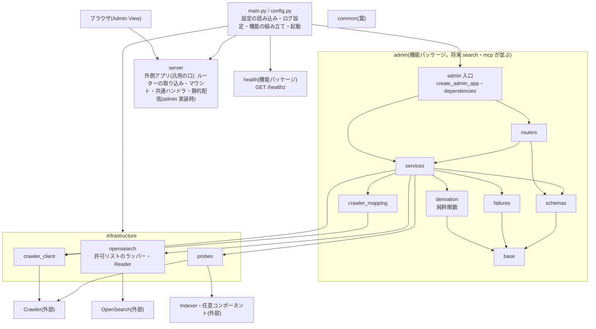
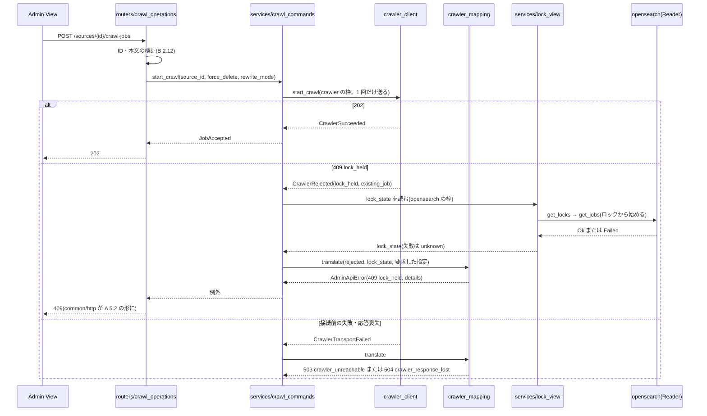
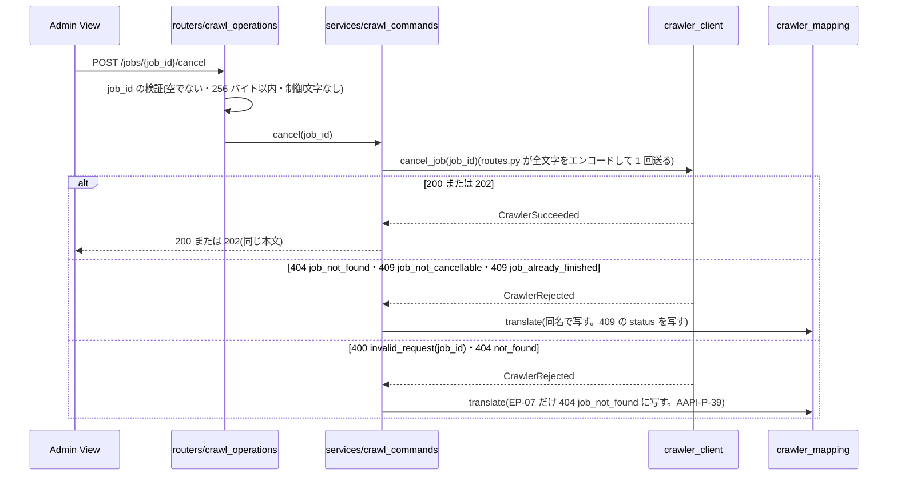
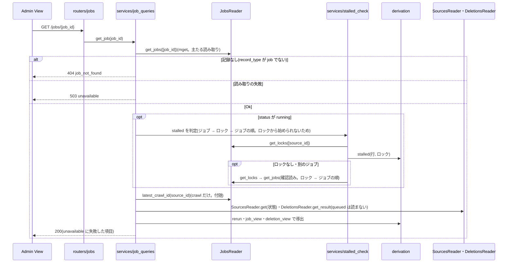
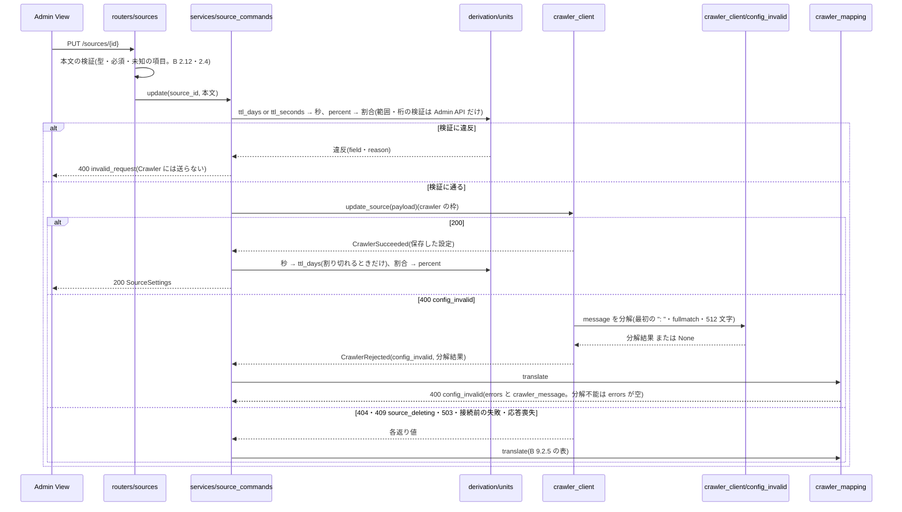
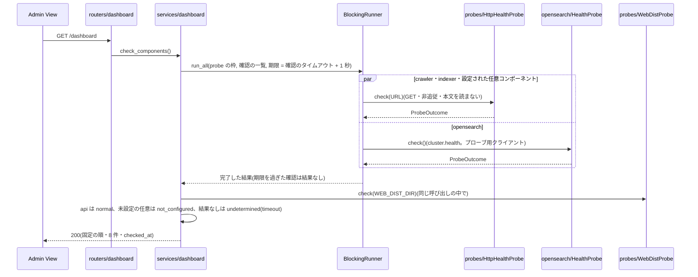
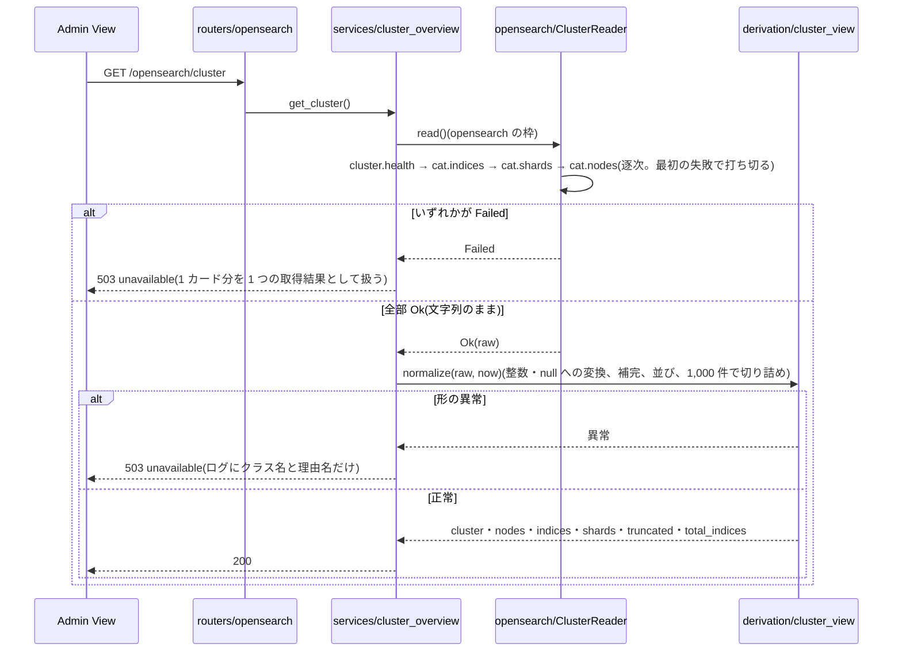
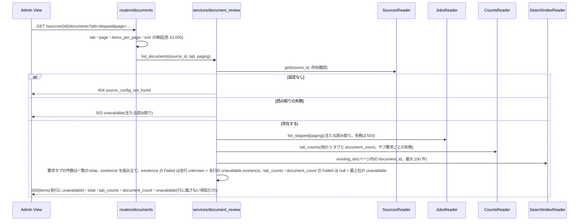
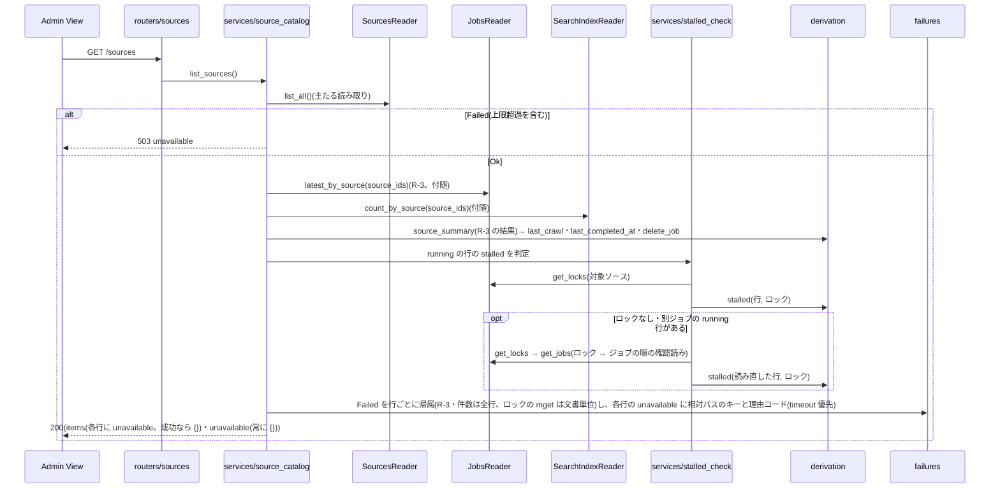
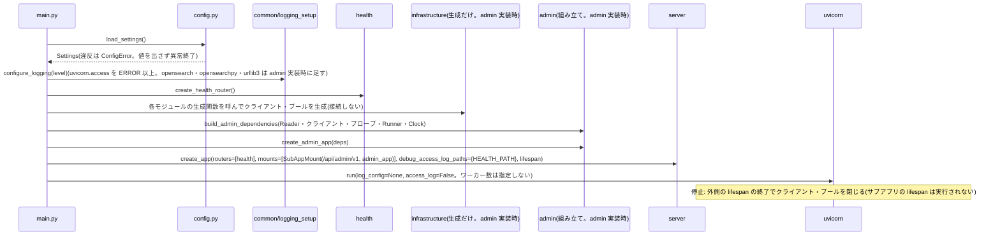

# Admin API モジュール構成設計書 v0.1

- 版: v0.1(ドラフト。ゲート3(2026-11-23)の承認を反映済み。API 基盤(`apps/api`。`health`・`server`・`common/http`・`main`・`config`)は実装済みで、本書をその実装に追従させた(2026-11-23。HO-51)。admin・`infrastructure` は未実装で、実装時確認事項(AAM-U)が残る)
- 更新日: 2026-11-23
- 前版: なし(初版)
- 位置づけ: Admin API(`api` コンテナの admin パッケージ)の**コード上のモジュール分割と、モジュール間の依存・呼び出しの流れ**。「何を、どのモジュールが担うか」を一目で分かるようにする。エンドポイント・DTO・Admin 固有 code・Crawler 写像は `admin-api-v0.1.md`(以下 B)が、導出ロジック・データアクセスのクエリ形・環境変数・仮値・並行性の方針は `admin-api-architecture-v0.1.md`(以下 C)が、エラー形式・共通 code・共通設定の規則は `../api-base-design-v0.1.md`(以下 A)が正本で、本書は**参照のみ**で複製しない。Search API・MCP の設計は含まない(同居できる配置の境界だけを書く)。
- 本書は Admin 画面の詳細設計タスク(`20261122_create_admin_system_design`)の成果物で、SD・PD・crawler / indexer 設計・機能設計・画面仕様を変更しない。追従改訂は A 9章(申し送り一覧。HO-1〜HO-51。本書に関わるものは HO-39・HO-48・HO-49・HO-51)に集約する。
- **実装との関係**: 本書は **admin 実装後のあるべき構成**を示す。基盤で実装済みの部分は実装の名前・署名・配置に合わせてあり、未実装の部分は「admin 実装時」と明記した。実装済みの範囲・admin 実装時に追加するもの・実装上の注意は 4.12 にまとめた。
- 改訂履歴: v0.1 は初版(フェーズ2-3)。C 本文中の「(D)」の注(層、導出の純粋関数、写像表のデータ化、`Ok / Failed` と `unavailable` の組み立て、パッケージ構成、`tests/fakes`・`tests/architecture`)をすべて割り当てた(8.5)。R2(作業記録 0027)の指摘を反映した: 依存ルール(`urllib3.exceptions` の import 範囲、`infrastructure` が `common.http` を import しない、`名前空間.メソッド` の許可リスト、`Depends` も `async def`)、uvicorn の起動引数、部分的な失敗の扱い、EP-13 の期限と放棄、`no-store` の範囲、図の修正、ほか。フェーズ5の統合(2026-11-23): 申し送りへの参照を A 9章の実番号に置き換え、関連文書の表に E・F を足し、8.6 の依頼 8・9 の状態を A の現状(反映済み)に更新し、更新日を統一した。R4 指摘の反映(2026-11-23): 2.1 の図の省略の注記、6章の分類の整理、4.1 の uvicorn 引数の記述を Crawler・Indexer の実物に合わせた限定表現に直し、AAM-P-28(`timeout_graceful_shutdown` と停止の流儀。案)を足し、8.5 の `WEB_DIST_DIR` の行を `/app/web` に直した。 ゲート3の承認(2026-11-23)の反映: 案の区分を承認済みの案(ゲート3。2026-11-23)に更新した(設計の内容は変更なし)。 PR #10 のレビュー指摘への対応(2026-11-23): 一覧の EP の `unavailable` を行単位にした(B 2.2・C 5.8。AAPI-P-42・AAA-P-45)。DTO(4.4)、`unavailable` の組み立て(4.5・4.7)、シナリオ(5.7・5.8)、テスト(7.3)、AAM-P-29 を更新した。 API 基盤の実装(`20261123_implement_api_base`。PR #16)への追従改訂(2026-11-23。タスク `20261123_update_api_design_after_base_impl`。A 9.2.10 の HO-51。v0.2 は作らず本版を直接改訂した): ヘルスチェックを `server/health.py` から独立した機能パッケージ `health/` に移し、`server` を機能パッケージを import しない汎用の口(`create_app(*, routers, mounts, debug_access_log_paths, lifespan)`・`SubAppMount`)に改め、組み立てを `main` に移した(1・2.1・3・4.1・4.2・5.9・6章・7章・AAM-P-2・P-3・P-14・P-17)。**AAM-P-23(承認済みの案。アクセスログは外側がサブアプリ担当のパスを除き、サブアプリ側が出す)の分担を、ユーザー回答(2026-11-23)で逆にして確定した**: 外側の middleware だけが 1 回出し、サブアプリには `log_access=False` で設置する(AAM-K-5 を新設し、AAM-U-2 を確定に移し、AAM-P-23 を改めた)。4.11 に `ApiError`・`error_response` の署名と 422 の項目名整形の置き場を反映し、4.12(基盤の実装状況・admin 実装時に追加するもの・実装上の注意)を新設した。8.1 に確認した事実を追加した。節番号は変えていない。

区分の凡例は A 0章・C 0章と同じ(確定 / 案 / 承認済みの案 / 未決 / 推測 / 導出)。**`-K-` にしたのは、ユーザーの明示回答と、確定として書かれた既承認文書の引用だけ**。B・A・C のゲート1・2で承認済みの案は「承認済みの案」として出典の ID を書いて引用し、本書で新たに決めた判断は、ゲート3(2026-11-23)で承認され、「承認済みの案(ゲート3。2026-11-23)」とした(確定にはしていない。本文中で「案」と書いた判断は、ID の区分欄が正で、承認済みの案(ゲート3)に読み替える)。

ID 体系: `AAM-K-n` / `AAM-P-n` / `AAM-U-n`。既存設計との不整合は `I-n`(本書の予約範囲は I-110〜119。A は I-60〜69、B は I-70〜79、C は I-90〜99、E は I-80〜89 と I-120〜129、F は I-100〜109 と I-130〜139)。A の ID は `BAPI-*`、B は `AAPI-*`、C は `AAA-*`。EP は B の通し番号(`EP-01`〜`EP-14`)、読み取り単位は C の `R-1`〜`R-12`。

関連文書(いずれも `docs/v0.x/` 配下):

| 略称 | 文書 | 本書との関係 |
| --- | --- | --- |
| A | `system-design/api/api-base-design-v0.1.md`(v0.1。作成済み) | 層の共通方針(7章)、技術スタック(3章)、compose への要求(8章) |
| B | `system-design/api/admin/admin-api-v0.1.md`(v0.1。作成済み) | EP・DTO・code・Crawler 写像。`schemas`・`routers`・`crawler_mapping` の正本 |
| C | `system-design/api/admin/admin-api-architecture-v0.1.md`(v0.1。作成済み) | 導出・読み取り単位・Crawler クライアント・死活・設定・並行性・テスト観点。各モジュールの中身の正本 |
| E・F | `system-design/ui-admin/frontend/ui-admin-frontend-architecture-v0.1.md`、`ui-admin-frontend-module-structure-v0.1.md`(いずれも v0.1。作成済み) | Admin API の呼び手(Web UI)。型生成の入力(`openapi_export.py`。AAM-P-16)と配信の置き場(`WEB_DIST_DIR`)で E と合わせる |
| crawler-module-structure | `system-design/crawler/crawler-module-structure-v0.5.md` | 形式・層の考え方・依存ルールの流儀を踏襲(参考) |
| indexer-module-structure | `system-design/indexer/indexer-module-structure-v0.4.md` | 同上 |
| `apps/crawler/`・`apps/indexer/` | 実装 | `pyproject.toml`・`config.py`・`tests/architecture/`・`tests/fakes/` の作り方の参考。コードは変更しない |
| `apps/api/` | 実装(API 基盤のみ。PR #16) | 基盤の名前・署名・配置は実装が正(4.12(a))。admin・`infrastructure` は未実装 |

---

## 1. 概要

前提(確定): Admin API は `api` コンテナ内の admin パッケージで、Web UI は同一オリジンで静的配信する(AAM-K-1)。Store 層・検索インデックスには書かず(AAM-K-2)、Crawler に送る経路は固定の 6 つだけ(AAM-K-3)。技術スタックは Indexer・Crawler に揃える(AAM-K-4)。

`api` コンテナは、将来 Search API・MCP Server・Admin API を同じプロセスで動かす(A 1章)。本タスクの範囲は Admin API と Web UI の静的配信だけで、本書はそのコード構成を定める(基盤の `health`・`server` などは実装済み。4.12)。

実装は Python 3.12・FastAPI・uvicorn(単一プロセス)。ブロッキングの I/O(OpenSearch・Crawler・プローブ)は、ハンドラ(`async def`)から**区分ごとの上限つきでスレッドに渡す**(C 8.1。AAA-P-33)。コードは Crawler・Indexer に倣って、層(エントリ → `server` → 機能パッケージ → `infrastructure`)と、層の外の `common` に分ける(A 7章。承認済みの案ではなく本書の案で、ゲート3で承認。BAPI-P-18)。

| モジュール | ディレクトリ(`src/loreley_api/` から) | 役割 | 主な入力 | 主な出力 |
| --- | --- | --- | --- | --- |
| エントリ | `main.py`・`config.py` | 環境変数の読み込みと起動時検証、ログ設定、機能(`health`・`admin`)の組み立て(`create_app` の口に渡す)、起動(uvicorn)。クライアントの生成と停止順は admin 実装時 | 環境変数 | 起動した `api` プロセス |
| `server` | `server/` | **外側の FastAPI アプリ(汎用の口。機能パッケージを import しない)**: `main` が渡すルーターの取り込み、サブアプリ(Admin API)のマウント、共通のミドルウェア・例外ハンドラの設置、Web UI の静的配信(SPA フォールバック。admin 実装時) | HTTP リクエスト | HTTP 応答 |
| `health` | `health/` | 最初の機能パッケージ。`api` 自身のヘルスチェック `GET /healthz`(何も呼ばない) | HTTP リクエスト | `{"status": "ok"}` |
| `admin` | `admin/` | Admin API の本体。FastAPI のサブアプリ(`/api/admin/v1`)。下の 6 つの内部モジュールを持つ | HTTP リクエスト(B の EP-01〜14) | HTTP 応答(B の DTO・エラー) |
| `admin.routers` | `admin/routers/` | EP の受け口。パス・クエリ・本文の検証(B 2.12)と、サービスの呼び出し | HTTP リクエスト | DTO、エラー |
| `admin.schemas` | `admin/schemas/` | B の DTO(リクエスト・応答・エラー応答)の型 | — | pydantic モデル |
| `admin.services` | `admin/services/` | EP ごとのユースケース。読み取り・Crawler 呼び出し・導出を順に組み合わせ、部分失敗を集約する(C 8.6) | 検証済みの入力 | DTO、`AdminApiError` |
| `admin.derivation` | `admin/derivation/` | **純粋関数**による導出(`lock_state`・`stalled`・変換・`cat.*` の正規化など。C 5章・3.4) | 読み取りの結果(素の値)、`now` | 素の値(DTO の元) |
| `admin.crawler_mapping` | `admin/crawler_mapping/` | Crawler の応答・失敗を Admin API のエラーに写す(B 2.6・9.2 の表のデータ化。C 4.4) | Crawler クライアントの返り値 | 成功の本文、`AdminApiError` |
| `admin.failures` | `admin/failures/` | 部分失敗の理由コードと `unavailable` の組み立て(C 5.8・8.6) | `Failed` の結果 | `unavailable` の項目 |
| `admin.base` | `admin/base/` | admin 内の共通の葉: code・理由コードの定数、`AdminApiError`、固定の上限(C 9章) | — | 定数・型 |
| `infrastructure.opensearch` | `infrastructure/opensearch/` | OpenSearch の**読み取り専用**アクセス。許可リストのクライアントのラッパーと、読み取り単位ごとの Reader。`cluster.health` のプローブも持つ | 読み取りの指示 | `Result`(`Ok` または `Failed`) |
| `infrastructure.crawler_client` | `infrastructure/crawler_client/` | Crawler の 6 API を固定の経路で呼ぶ urllib3 のクライアント(例外分類・`config_invalid` の分解) | 操作の指示 | 型付きの返り値 |
| `infrastructure.probes` | `infrastructure/probes/` | `GET /healthz` のプローブ(urllib3)と、`web` のファイル確認 | 確認先、確認のタイムアウト | `ProbeOutcome` |
| `common` | `common/` | 全層から参照できる共通部品(時計、日時、`Ok / Failed`、`BlockingRunner`、HTTP のエラー形式・ミドルウェア、ログ、URL の検証)。他のモジュールに依存しない葉 | — | 型・関数 |

読み方: 行は層の順(エントリ、`server`、機能パッケージ `health`・`admin`、`infrastructure`、`common`)。**実装済みなのはエントリ・`server`・`health`・`common` のうち HTTP の共通規約とログ設定だけ**で、`admin`・`infrastructure` と `common` の他の部品は admin 実装時に追加する(4.12)。`admin.*` は `admin` の内部で、依存の向きは 6章。ファイル名は目安で、追加・改名に改版は要らない(モジュール境界・入口・依存の変更は要る。Crawler の流儀)。

---

## 2. 構成図

### 2.1 モジュールと依存

責務と依存の向きだけを示す(矢印は「import する」)。処理の順序は 5章。



- `server` は機能パッケージを import しない汎用の口で、`health` も `admin` も知らない(R3)。`main` が `create_health_router()` と `create_admin_app(...)`(admin 実装時)を作り、`create_app(routers=[create_health_router(), …], mounts=[SubAppMount("/api/admin/v1", admin_app)], debug_access_log_paths={HEALTH_PATH}, lifespan=…)` に渡して組み立てる。`main` は機能パッケージの入口と `infrastructure` の生成関数を呼ぶ(図の `main --> server`・`main --> health`・`main --> adminEntry`・`main --> infra`)。実装済みなのは `main`・`server`・`health` までで、`admin` と `infrastructure` は admin 実装時(4.12)。
- 図の矢印のうち `admin` から `infrastructure` への線は、**インターフェース(Protocol)と結果の型だけ**を import する(クライアントの生成は、`main` が各 `infrastructure` モジュールの生成関数を呼んで行う。6章 R6)。`common` への依存は全モジュールにあり、図では省略した。同様に、admin 内の葉 `base`・`config` への辺と、`adminEntry` から `schemas`・`base` への辺も省略した(依存の正は 6章の R4 と 7章の許可表)。
- `iopen` は `cluster.health` のプローブも持つ(`opensearchpy` を import してよい場所が OpenSearch アクセスの層に限られるため。A 3章。AAM-P-12)。例外の分類のために `urllib3.exceptions` の型も import する(`failure.py`・`health_probe.py` だけ。R5)。

### 2.2 実行の単位

状態をプロセス内に持たない(最終取得成功日時はクライアントが持つ。AAPI-P-8)ので、バックグラウンドのスレッドやタスクはない。実行の単位は次の 4 つ(C 8.1。承認済みの案ではなく本書の案で、ゲート3で承認。AAA-P-33)。

| 単位 | 内容 | 上限(仮値) |
| --- | --- | --- |
| イベントループ | すべてのハンドラ(`async def`)。`GET /healthz` はここだけで完結し、スレッドを使わない | — |
| `opensearch` の枠 | OpenSearch の読み取り(`BlockingRunner` の区分)。待つ要求はイベントループの上で待つ | 16 |
| `crawler` の枠 | Crawler への操作 6 API | 4 |
| `probe` の枠 | EP-13 の確認(`crawler`・`indexer`・`opensearch`・任意 3 つ) | 8 |

- 共有する状態は、起動時に作るクライアント(OpenSearch の読み取り用・プローブ用、urllib3 のプール)と、`BlockingRunner` の区分ごとの上限だけ(どちらも不変または内部でスレッド安全)。
- 1 つの要求の中では、読み取りを**逐次**に実行する(EP-13 の確認だけが並行。C 6.1)。
- EP-13 の期限を過ぎて放棄された確認のスレッドは、`probe` の枠の上限の外に残りうる(トークンは放棄時に返る。最大約 6 秒。C 6.1。AAM-P-27)。

---

## 3. ディレクトリ構成

```text
apps/api/
├── Dockerfile
├── README.md                   # 起動・設定(環境変数と既定値)・テストの要点(作成済み。admin 実装時に環境変数を足す。C 7章に従う)
├── pyproject.toml, uv.lock
├── tests/                      # src の構成に合わせる。architecture/ は実装済み、fakes/・contract/ は admin 実装時(7章)
└── src/
    └── loreley_api/            # Python パッケージ層
        ├── main.py             # エントリポイント(Composition Root。機能パッケージの組み立てはここだけ)
        ├── config.py           # 環境変数の読み込みと起動時検証
        ├── common/             # 全層から参照できる共通部品。葉
        │   └── http/           # A 5章の共通 HTTP 規約(エラー形式・ミドルウェア・例外ハンドラ。本文の上限は admin 実装時)
        ├── server/             # 外側のアプリ(汎用の口。機能パッケージを import しない)
        ├── health/             # ヘルスチェック(最初の機能パッケージ。GET /healthz)
        ├── admin/              # Admin API(機能パッケージ。admin 実装時)。将来 search/・mcp/ が並ぶ
        │   ├── base/           # code・理由コード・AdminApiError・固定の上限
        │   ├── schemas/        # B の DTO
        │   ├── routers/        # EP の受け口
        │   ├── services/       # ユースケース
        │   ├── derivation/     # 純粋関数
        │   ├── crawler_mapping/# Crawler の応答 → Admin API のエラー
        │   └── failures/       # 理由コード・unavailable の組み立て
        └── infrastructure/     # admin 実装時
            ├── opensearch/     # 許可リストのクライアント・Reader・cluster.health のプローブ
            ├── crawler_client/ # Crawler の 6 API
            └── probes/         # /healthz のプローブ・web のファイル確認
```

実際のファイル(目安。責務は 4章。AAM-P-25):

| モジュール | ファイル |
| --- | --- |
| 直下 | `main.py`(`build_app()`: 外部に接続せず `create_app` を組み立てる。`main()`: 設定の読み込み・ログ設定・`uvicorn.run`。クライアントの生成と停止順は admin 実装時)、`config.py`(`Settings`・`load_settings()`・`ConfigError`・`describe_settings_errors`。実装済みの設定は `HOST`・`PORT`・`LOG_LEVEL` だけ。起動時検証と各モジュールの設定への詰め替えは admin 実装時) |
| `common/` | **実装済み**: `logging_setup.py`(`configure_logging`・制限対象のロガー。現在は `uvicorn.access` だけ)、`http/`: `__init__.py`(`install_common_http`)、`errors.py`(A 5.2 のエラー本文・`ApiError` 基底・`error_response`・想定外の例外のログ用の診断)、`handlers.py`(例外ハンドラの設置。422・`HTTPException`・未定義のパス・405・`ApiError`。422 の項目名整形を含む)、`middleware.py`(アクセスログ・`Cache-Control: no-store`・想定外の例外の吸収。`no-store` は `/api/` の応答にだけ付ける。AAM-P-26)。**admin 実装時に追加**: `clock.py`(`Clock`・`SystemClock`)、`timestamps.py`(日時の読み取りと UTC ミリ秒の整形。C 5.0)、`results.py`(`Ok`・`Failed`)、`concurrency.py`(`BlockingRunner`)、`urls.py`(URL の検証。C 7.3)、`probe_outcome.py`(`ProbeOutcome`)、`http/body.py`(本文の読み取りと 1 MiB の上限) |
| `server/` | `app.py`(`create_app`・`SubAppMount`。実装済み)、`static_web.py`(静的配信と SPA フォールバック。admin 実装時) |
| `health/` | `__init__.py`(`create_health_router`・`HEALTH_PATH`)、`router.py`(`GET /healthz`)。実装済み |
| `admin/` 直下 | `app.py`(`create_admin_app`)、`dependencies.py`(`AdminDependencies` と組み立て関数)、`settings.py`(Admin API 固有の設定型)、`openapi_export.py`(OpenAPI JSON の書き出し) |
| `admin/base/` | `constants.py`(固定の上限と既定。C 9章)、`codes.py`(B 2.3 の code・`reason` 値・`unavailable` の理由コード・`lock_state`・`state` の値)、`errors.py`(`AdminApiError` と code ごとの生成関数) |
| `admin/schemas/` | `common.py`(`SourceSettings`・`JobBrief`・`JobAccepted`・`ExistingJob`・ページ付き応答・`Unavailable`(最上位と行の `unavailable` の型。キーは項目のパス、値は理由コード))、`sources.py`(`SourceListItem` を含む)・`jobs.py`(`JobListItem` を含む)・`documents.py`(各タブの行)・`opensearch.py`・`dashboard.py`・`meta.py`(EP ごとのリクエスト・応答)、`errors.py`(OpenAPI 用のエラー応答) |
| `admin/routers/` | `sources.py`(EP-01〜05)、`crawl_operations.py`(EP-06〜08)、`jobs.py`(EP-09・10)、`documents.py`(EP-11)、`opensearch.py`(EP-12)、`dashboard.py`(EP-13)、`meta.py`(EP-14)、`request_input.py`(パスの ID・クエリ・本文の検証。B 2.12。依存関係はすべて `async def`) |
| `admin/services/` | `source_catalog.py`(EP-01・02)、`source_commands.py`(EP-03〜05)、`crawl_commands.py`(EP-06〜08)、`job_queries.py`(EP-09・10)、`document_review.py`(EP-11)、`cluster_overview.py`(EP-12)、`dashboard.py`(EP-13)、`meta.py`(EP-14)、`lock_view.py`(ロック文書 → ジョブ記録 → `lock_state` の読み取りの共通手順。EP-02 と 409 の付随情報で共有)、`stalled_check.py`(`stalled` の確認読みの共通手順。C 5.2) |
| `admin/derivation/` | `values.py`(読めない値の扱い。C 5.0)、`lock_state.py`(C 5.1)、`stalled.py`(`stalled`・`cancellable`。C 5.2)、`rerun.py`(`latest_for_source`・`rerunnable`・`rerun_blocked_reason`・`cancel_after_finish_notice`。C 5.3)、`job_view.py`(`JobBrief` の元・`registration`・`warnings`。C 5.4)、`deletion_view.py`(`deletion.*`。C 5.4)、`source_summary.py`(R-3 の結果から `last_crawl`・`last_completed_at`・`delete_job`。C 5.5)、`settings_view.py`(`SourceSettings` の元と `malformed`。C 5.8)、`units.py`(TTL・しきい値の十進数変換。C 5.7)、`cluster_view.py`(`cat.*` の正規化・補完・並び・切り詰め。C 3.4) |
| `admin/crawler_mapping/` | `table.py`(B 9.2 の写像表のデータ)、`translate.py`(表の適用・400 の項目の分岐・`existing_job` の取り込み・EP-07 の 404。C 4.4) |
| `admin/failures/` | `reasons.py`(`Failed` → 理由コード。`timeout` 優先。C 5.8)、`unavailable.py`(`unavailable` の組み立て 1 か所。単一応答の最上位(正式なパスのキー)と、一覧の行(相対パスのキー)の 2 つの関数を区別する。C 5.8・8.6。AAM-P-29) |
| `infrastructure/opensearch/` | `ports.py`(Reader・プローブの Protocol と結果の型)、`readonly_client.py`(**許可リストのクライアントのラッパー**)、`connection.py`(読み取り用・プローブ用クライアントの生成。C 3.7)、`config.py`(接続設定)、`queries.py`(R-1〜R-12 のクエリ本文の組み立て。純粋)、`failure.py`(例外・部分的な失敗の応答 → 失敗の種別。`ConnectionError.info` を `urllib3.exceptions` の型で判定する。C 3.2・5.8・6.2)、`sources_reader.py`、`jobs_reader.py`、`deletions_reader.py`、`search_index_reader.py`、`counts_reader.py`(`msearch` による件数)、`cluster_reader.py`、`health_probe.py`(`cluster.health`) |
| `infrastructure/crawler_client/` | `client.py`(インターフェースと返り値の型)、`http_client.py`(urllib3 の実装)、`routes.py`(固定 6 経路とエンコード。C 4.8)、`classification.py`(例外の分類。C 4.3)、`payloads.py`(リクエスト本文の組み立て)、`parsing.py`(応答の解釈・上限・期待のステータス)、`config_invalid.py`(`message` の分解。C 4.5)、`config.py` |
| `infrastructure/probes/` | `http_probe.py`(`GET /healthz`・リダイレクト非追従・本文を読まない)、`classification.py`(urllib3 の例外 → `state`・`reason`。C 6.2)、`web_dist.py`(`index.html` の確認。C 6.3)、`config.py` |

- パッケージ層・`main.py`・`config.py` は Crawler・Indexer と同じ作り(A 7章)。`apps/api/`(AAM-P-1)は基盤が実装済み(PR #16)で、admin・`infrastructure` は未実装。本書はコードを作らない。依存パッケージは AAM-P-22(`fastapi>=0.143.2`・`uvicorn`・`pydantic`・`pydantic-settings`・`opensearch-py`・`urllib3`・`anyio`。dev は `httpx2`・`pytest`・`ruff`)。基盤の `pyproject.toml` にあるのは `fastapi>=0.143.2,<1`・`pydantic`・`pydantic-settings`・`uvicorn` と dev の `httpx2`・`pytest`・`ruff` で、`opensearch-py`・`urllib3`・`anyio` は admin 実装時に足す。
- `search`・`mcp` を足すときは、`main` が作って `create_app` の `routers`・`mounts` に渡すだけでよい(`server` は機能パッケージを import しない。AAM-P-17・6章 R3)。
- `README.md`(`apps/api/README.md`。作成済み)は、起動・環境変数・テストの要点を持つ(Crawler の `README.md` の位置づけ)。基盤の環境変数は `HOST`・`PORT`・`LOG_LEVEL` だけで、C 7.2 の一覧と既定値は admin 実装時に足す。

---

## 4. モジュール詳細

各節に、責務・入口(公開する型・関数)・依存先・C と B の対応を書く。依存の許可は 6章の表が正本。

### 4.1 エントリ(`main.py`・`config.py`。AAM-P-14・P-15)

- **`config.py`**: `pydantic-settings` の `Settings`(`env_prefix="LORELEY_API_"`。C 7.1)。入口は `load_settings()`・`Settings`・`ConfigError`。違反は値を出さない `ConfigError`(環境変数名(フィールド名)と検証の種別だけ。`describe_settings_errors`。C 7.3)で、`main.py` は捕捉せず異常終了させる。**実装済みの設定は `HOST`(既定 `127.0.0.1`)・`PORT`(既定 8080。1〜65535)・`LOG_LEVEL`(既定 `INFO`。小文字も可)だけ**で、`main.py` が `Settings` から直接取り出す。**admin 実装時に追加**: C 7.1 の環境変数と起動時検証(C 7.3。URL(`CRAWLER_URL`・`INDEXER_URL` は `http` だけ)・IANA 名・範囲・索引名の重複)。検証済みの値を、各モジュールが定義する**自前の設定 dataclass**(`infrastructure/opensearch/config.py`・`crawler_client/config.py`・`probes/config.py`・`admin/settings.py`)に詰めて `ApiConfig` にする(AAM-P-14。入口は `load_config()`。現案のまま admin 実装時に作る)。**各モジュールは `config.py` に依存せず**、値は `main.py` が渡す(Crawler・Indexer の流儀)。`config.py` が import するのは設定型を持つモジュールの入口だけ(内部には触れない)。`server` は設定の dataclass を持たない(`create_app` は引数で受ける)。URL の検証関数は `common/urls.py`(純粋。admin 実装時)。
- **`main.py`**(Composition Root): 機能パッケージを知っているのは `main.py` だけ(`server` は知らない。R3)。起動順は次のとおり(C 7.3・8.4)。実装済みの手順は 1・2・5 の `create_app`・6 で、3・4・`create_admin_app` は admin 実装時。
  1. `load_settings()`(失敗なら終了。admin 実装時に `load_config()` → `ApiConfig` になる)
  2. ログの設定: `configure_logging(level=…)`(ルートロガーのハンドラを置き換え、`uvicorn.access` を ERROR 以上に。admin 実装時に `opensearch`・`opensearchpy`・`opensearchpy.trace`・`opensearchpy.helpers`・`urllib3` を足す。C 8.5)
  3. (admin 実装時)各 `infrastructure` モジュールの生成関数を呼んで、クライアントを生成(**接続はしない**): OpenSearch の読み取り用・プローブ用、urllib3 のプール(Crawler 用・プローブ用)
  4. (admin 実装時)Reader・Crawler クライアント・プローブ・`BlockingRunner`・`Clock` の組み立てと、`AdminDependencies`(`admin/dependencies.py` の組み立て関数)
  5. `build_app()`: `create_app(routers=[create_health_router(), …], mounts=[SubAppMount("/api/admin/v1", create_admin_app(deps))], debug_access_log_paths={HEALTH_PATH}, lifespan=…)`(外側のアプリ。`create_admin_app` のマウントと `lifespan` は admin 実装時。基盤は `routers=[create_health_router()]` と `debug_access_log_paths={HEALTH_PATH}` だけを渡す。`/healthz` は数秒おきに呼ばれるので、アクセスログを DEBUG にする)。静的配信は admin 実装時(`server/static_web.py`)
  6. `uvicorn.run(app, host=…, port=…, log_config=None, access_log=False)`(ワーカー数は指定しない=単一プロセス。ホスト・ポートは設定)。ログの設定は 2 に任せ(`log_config=None`)、uvicorn のアクセスログは ID を含むパスを出すので無効にする(自前のアクセスログは `common/http/middleware.py`)。この 2 引数は Crawler・Indexer と同じ(A 5.5・C 8.5。AAM-P-15)。Crawler は加えて `lifespan="off"` と `timeout_graceful_shutdown` を指定するが、Indexer は指定しない(実物の `main.py` で確認)。本書は Indexer と同じ lifespan 方式とし、`timeout_graceful_shutdown` を指定するかは案(AAM-P-28)
- 停止: 外側のアプリの lifespan(`main.py` が `create_app(lifespan=…)` に渡す)の終了で、クライアントとプールを閉じる(1 つの `close()` の失敗が他を止めない。この閉じ方の流儀は Crawler の `close_clients` に倣うが、閉じる契機は Indexer と同じ lifespan の終了。AAM-P-28)。**マウントしたサブアプリ(`admin`)自身の lifespan は実行されない**(4.12(c))ので、閉じる処理は外側の lifespan に置く。基盤は閉じる資源がないので `lifespan` を渡していない。
- OpenSearch・Crawler・Indexer が落ちていても起動する(C 8.4。admin 実装時)。起動時の回復・整合性検査にあたる処理はない(Admin API は状態を持たない)。
- 生のクライアント(`OpenSearch`・`PoolManager`)は、各 `infrastructure` モジュールの生成関数(`connection.py`・`http_client.py`・`http_probe.py`)が作る(admin 実装時)。`main.py` はそれらを呼んで Reader・クライアントに注入し、**`opensearchpy`・`urllib3` を自分では import しない**(6章 R5・R6)。`admin` は生成しない。

### 4.2 `server`・`health`(AAM-P-3・P-23。AAM-K-5)

- **`server` の責務**: 外側の `FastAPI`(`openapi_url`・`docs_url`・`redoc_url` を `None`、`redirect_slashes=False`。A 2.2・5.1・5.4)を作る**汎用の口**。機能パッケージ(`health`・`admin`)を import せず、`main` が渡したものを載せる。(1) `routers`: 外側に直接載せるルーター(`/healthz` など。`app.include_router`)、(2) `mounts`: サブアプリのマウント(Admin API は `/api/admin/v1`。BAPI-P-9)、(3) `common/http` の例外ハンドラ・middleware の設置(未定義のパスは JSON の 404。A 5.2)、(4) Web UI を `/admin/` で静的配信し、**`/admin/` 配下の未知のパスだけ `index.html` を返す**(admin 実装時。`app.frontend()` を第一候補。BAPI-P-2。細部は BAPI-U-1)。`Cache-Control: no-store` は `/api/` の応答にだけ付け、`/admin/` の静的アセットと `/healthz` には付けない(A 5.1。AAM-P-26。判定は `root_path` を除いた、アプリから見たパスで、サブアプリの処理の前に行う)。想定外の例外は 500 に変換して再送出しない(uvicorn のトレースバックのログを避ける。C 8.5)。
- **入口**: `create_app(*, routers=(), mounts=(), debug_access_log_paths=(), lifespan=None) -> FastAPI`、`SubAppMount(prefix, app)`(frozen dataclass。`prefix` は `/api/admin/v1` のように先頭が `/`・末尾は `/` なし)。`lifespan` は機能が持つ資源の開始・終了のために `main` が渡す。`debug_access_log_paths` はアクセスログを DEBUG にするルートのテンプレート(`HEALTH_PATH`)。`create_app` は各マウントについて、`mount.app.router.redirect_slashes` を `False` にし(副作用。サブアプリが既定でも末尾スラッシュをリダイレクトしない。A 5.1)、`install_common_http(mount.app, log_access=False)` を設置してからマウントし、最後に外側へ `install_common_http(app, debug_access_log_paths=…)` を設置する。
- **依存**: `common` だけ(`fastapi`・`starlette` は使ってよい)。機能パッケージを import しない(R3)。
- **`health` の責務**: 最初の機能パッケージ。`GET /healthz`(`async def`。何も呼ばず、`{"status": "ok"}`。A 6章。BAPI-P-13)。入口は `create_health_router() -> APIRouter` と `HEALTH_PATH`(`"/healthz"`)で、`main` が `create_app(routers=…)` に渡す。依存の許可は `common` だけ(現状の import は `fastapi` だけ)で、`server` を import しない。
- **CORS のミドルウェアを入れない**(同一オリジン。BAPI-K-2。6章 R10)。
- **ログと例外ハンドラ**(AAM-K-5。AAM-P-23): サブアプリは自分の例外ハンドラと最外殻の Starlette を持つので、外側の設置は届かない。そのため `create_app` がサブアプリにも `install_common_http(app, log_access=False)` を設置し、例外の吸収・統一エラー形式・`no-store` を担当させる。**アクセスログは外側の middleware だけが、サブアプリの処理が終わった後に 1 回出す**(メソッド・テンプレート・ステータス・所要時間)。サブアプリ側(admin の factory)では `install_common_http` を呼ばない(二重になる)。
  - テンプレートは、`scope["root_path"]` から `scope["app_root_path"]` を除いた部分(マウントの接頭辞)と `scope["route"].path` で組み立てる(`app_root_path` が `scope` にないときは `route.path`)。ルートに当たらなかったとき、または `route` が `methods` を持たない(Starlette の `Mount` など。接頭辞だけが当たり、終点のテンプレートを作れず、接頭辞が二重になる)ときは `-`(パスを出さない)。
  - **Starlette の実装挙動に依存する**: 外側の middleware がサブアプリの処理後に、同じ `scope` に入った `route`・`root_path` を読める。FastAPI 0.165.0・Starlette 1.10.0 で確認し、`tests/server/test_mounts.py` が固定している(更新時はこのテストで検知する)。サブアプリ内の `Mount` 配下と、外側アプリの `root_path`(プロキシ配下)はテストで固定済み。**サブアプリの中にサブアプリをマウントする入れ子は未検証**。`FastAPI(root_path=…)` をサブアプリに設定すると壊れうる(推測。実装タスクのレビューの指摘で、実験もテストもしていない。未検証。BAPI-U-2)。外側の 404 とサブアプリの 404 は同じ形(テストで固定)。
- **C との対応**: A 2.2・5.5・6章(C には規定なし。`api` 自身の `/healthz` は C 8.1 で「スレッドを使わない」)。

### 4.3 `admin/routers`(AAM-P-4・P-7)

- **責務**: EP の受け口。パスの ID・クエリ・本文の検証(B 2.12。未知のクエリ・未知の項目は 400。本文が空なら `Content-Type` を問わず `{}` として扱う。`page × items_per_page ≤ 10,000`)と、サービスの呼び出し、DTO の返却。**業務判断をしない**(導出・読み取り・写像は `services` 以降)。すべてのルート関数と依存関係(`Depends`)は `async def`(6章 R9)。
- **入口**: `create_admin_router(deps) -> APIRouter`(ファイルごとのルーターを束ねる)。ルート関数は `deps.<service>.<method>(...)` を `await` して返すだけにする。`operationId` は関数名で安定させ、エラー応答の共通スキーマを各操作に宣言する(A 5.4)。タグは B の領域に合わせる(`sources`・`jobs`・`documents`・`opensearch`・`dashboard`・`meta`。EP-06・08 は `sources`、EP-07 は `jobs`。B の「クロール操作」は領域の見出しで、タグにしない。AAM-P-4。A 5.4 の 6 タグに従う)。
- **EP との対応**:

  | ファイル | EP | サービス |
  | --- | --- | --- |
  | `sources.py` | EP-01〜05 | `source_catalog`(EP-01・02)、`source_commands`(EP-03〜05) |
  | `crawl_operations.py` | EP-06〜08 | `crawl_commands` |
  | `jobs.py` | EP-09・10 | `job_queries` |
  | `documents.py` | EP-11 | `document_review` |
  | `opensearch.py` | EP-12 | `cluster_overview` |
  | `dashboard.py` | EP-13 | `dashboard` |
  | `meta.py` | EP-14 | `meta` |

- **依存**: `services`・`schemas`・`base`・`common`。`infrastructure`・`derivation` を import しない。
- **`request_input.py`**: `source_id`(`^[A-Za-z0-9][A-Za-z0-9._-]{0,255}$`)・`job_id`(空でなく 256 バイト以内・制御文字なし)・ページング(`page`・`items_per_page`・`sort`・窓)・本文の規約を、FastAPI の依存関係(`Depends`)として持つ。**依存関係はすべて `async def`** で書く(同期関数の依存関係は共通のスレッドプールで動き、C 8.1 の区分別の上限を迂回して枯渇の原因になるため。R9)。違反は `common/http` の形(A 5.2。`details.errors` の `field`・`reason`)の 400。FastAPI の標準の検証エラー(422)の変換(`pydantic` の `type` → `reason` の対応表)は `common/http/handlers.py`(AAM-U-3)。

### 4.4 `admin/schemas`(AAM-P-7)

- **責務**: B の DTO を型にする。正本は B で、本書は項目を複製しない。リクエストの本文は **strict**(型の変換をしない。未知の項目は 400。A 5.1・B 2.12)。応答は、項目を省略せず値がないときは `null`(A 5.1)。`unavailable` は常に存在するオブジェクトで、**単一の応答は最上位、一覧の EP(EP-01・09・11)は各行(`SourceListItem`・`JobListItem`・EP-11 の各タブの行)が持ち、最上位は行に属さない項目だけ**(B 2.2。AAPI-P-42。AAM-P-29)。`JobBrief` 自体は `unavailable` を持たない(`JobListItem` = `JobBrief` + `unavailable`。EP-01 の入れ子の `last_crawl`・`delete_job` では外側の行が持つ)。
- **ファイル**: 3 章の表のとおり。共通の部品(`SourceSettings`・`JobBrief`・`JobAccepted`・`ExistingJob`)は `common.py`(B 2.11)。
- **依存**: `base`(固定の上限・値の列挙)・`common`。`derivation` は `schemas` に依存しない(導出は素の値を返し、`services` が DTO に詰める。6章 R7)。
- **DTO の `null` を許す範囲**: Crawler・Indexer が書いた値が読めないときは項目を `null` にする(C 5.0。AAA-P-25)。B 2.11・EP-10 が `null` を許す型を定めた: `JobBrief` の `status`・`job_type`・`trigger`・`queued_at`(`status=null` なら `stalled=false`・`cancellable=false`)、EP-10 の `registration` の件数・`partial`・`phase`。`job_id`・`source_id` は `null` 不可。`schemas` はこれに従う。

### 4.5 `admin/services`(AAM-P-4・P-5)

- **責務**: EP ごとのユースケース。次を順に行う(C 8.6): (1) 主たる読み取りを先に実行(失敗なら `AdminApiError.unavailable`)、(2) 付随する読み取りを独立に実行(結果は `Ok`・`Failed`)、(3) `derivation` の純粋関数で導出、(4) DTO を組み立て、`Failed` の項目を `null` にして `unavailable`(`failures`)を載せる。単一の応答は最上位、一覧は**行ごとに失敗を帰属**させて各行の `unavailable` に載せる(読み取りの結果を行の ID で持ち、失敗した行だけにキーを付ける。1 回の読み取りの失敗は全行。C 5.8・8.6。AAM-P-29)。
- **実行モデル**: サービスのメソッドは `async def`。ブロッキングの呼び出し(Reader・Crawler クライアント・プローブ)は、**1 呼び出しごとに** `await runner.run("<区分>", fn, *args)` で渡す(区分は `opensearch`・`crawler`・`probe`。C 8.1)。1 つのユースケースが複数の区分をまたいでよい(例: EP-06 の `crawler` の呼び出しの後、409 の付随情報の読み取りを `opensearch` で行う)。サービスは `anyio` を直接使わず、並行が要る箇所(EP-13)は `runner.run_all(...)`(`common/concurrency.py`)を使う。
- **現在時刻**: 1 回のリクエストの先頭で `now = clock.now()` を取り、導出すべてに渡す(C 5.0)。
- **入口と対応**:

  | サービス | メソッド(目安) | EP | 主な読み取り単位・呼び出し | 主な導出 |
  | --- | --- | --- | --- | --- |
  | `source_catalog` | `list_sources`、`get_source` | EP-01・02 | R-1、R-2、R-3、R-4・R-5(`lock_view`・`stalled_check`)、R-9(件数) | `source_summary`・`stalled`・`lock_state`・`settings_view`・`units` |
  | `source_commands` | `register`、`update`、`start_delete`(EP-05) | EP-03・04・05 | Crawler 3 経路。EP-05 の 409 で `lock_view` | `units`、`crawler_mapping` |
  | `crawl_commands` | `start_crawl`、`cancel`、`release_lock` | EP-06・07・08 | Crawler 3 経路。409 で `lock_view` | `crawler_mapping`(EP-07 の 404 写像) |
  | `job_queries` | `list_jobs`、`get_job` | EP-09・10 | R-6、R-4・R-5、R-5(EP-10)、R-7、R-2(状態)、R-8 | `stalled`・`rerun`・`job_view`・`deletion_view` |
  | `document_review` | `list_documents` | EP-11 | R-2(存在確認)、R-10、R-9、R-11 | `existence`(`job_view` の一部) |
  | `cluster_overview` | `get_cluster` | EP-12 | R-12 | `cluster_view` |
  | `dashboard` | `check_components` | EP-13 | プローブ(`probe` の枠)、`web_dist` | `ProbeOutcome` の組み立て(固定の順・8 件) |
  | `meta` | `get_meta` | EP-14 | なし(設定だけ) | — |

- **共通の手順**: `lock_view`(ロック文書 → `lock.job_id` のジョブ記録 → `lock_state`。C 5.1。ロックから始める)と `stalled_check`(`running` 行のロック不一致の確認読み。C 5.2)は、複数のサービスで共有する手順なので独立のファイルにする(AAM-P-24)。**409 の付随情報**(C 4.6)は、`lock_view` を呼び、失敗しても `lock_state=unknown` にするだけでステータス・`existing_job` を変えない。
- **依存**: `derivation`・`crawler_mapping`・`failures`・`schemas`・`base`・`infrastructure`(Protocol と結果の型だけ)・`common`。`routers` を import しない。

### 4.6 `admin/derivation`(純粋関数。AAM-P-6)

- **責務**: 読み取りの結果(素の値)と `now` から、B の応答項目の元になる値を導出する(C 5章・3.4)。**I/O・時計・pydantic・`infrastructure` に依存せず**、入力は `Mapping`・`datetime` などの素の値、出力は素の値(`dataclass`・`Enum` 文字列)。単体テストを表と固定時刻だけで書ける。
- **ファイルと C の対応**:

  | ファイル | 導出 | C | B の応答項目 |
  | --- | --- | --- | --- |
  | `values.py` | 日時・整数・文字列・真偽値の読み方(読めなければ `None`) | 5.0 | — |
  | `lock_state.py` | `lock_state` の 10 行の判定、`lock.job`・`lock.acquired_at` | 5.1 | `lock.*`(EP-02)、`details.lock_state` |
  | `stalled.py` | `stalled`・`cancellable`(ロックと一致の判定。確認読みが要るかの判定) | 5.2 | `stalled`・`cancellable`・`lease_expires_at` |
  | `rerun.py` | `latest_for_source`・`rerunnable`・`rerun_blocked_reason`(`source_missing` を含む。AAPI-P-41)・`cancel_after_finish_notice` | 5.3 | EP-10 |
  | `job_view.py` | `JobBrief` の元、`registration`(`phase`)、`warnings`、`failure_detail` | 5.4 | `JobBrief`・`registration`・`warnings` |
  | `deletion_view.py` | `deletion.summary`・`confirmation`・`current`・`current_state`・`fetched_at`・`settings` | 5.4・5.7 | `deletion.*` |
  | `source_summary.py` | R-3 の結果から `last_crawl`・`last_completed_at`・`delete_job` | 5.5 | EP-01・02 |
  | `settings_view.py` | `SourceSettings` の元と `malformed` の判定 | 5.8・5.7 | `SourceSettings`(EP-02) |
  | `units.py` | `percent_to_ratio`・`ratio_to_percent`・TTL の変換と範囲 | 5.7 | `ttl_*`・`ratio_threshold_percent` |
  | `cluster_view.py` | `cat.*` の文字列 → 整数・`null`、`prirep`・`state` の正規化、`relocating` の `node`、インデックスの補完・並び・切り詰め、形の異常の検出 | 3.4 | EP-12 |

  `existence`(C 5.6)は、ID の集合の照合だけなので `job_view.py` の関数にする(別ファイルにしない)。
- **依存**: `base`(定数・値の列挙)・`common`(日時の読み取り)だけ。

### 4.7 `admin/crawler_mapping`・`admin/failures`・`admin/base`(AAM-P-11)

- **`crawler_mapping`**: Crawler クライアントの返り値(`CrawlerSucceeded`・`CrawlerRejected`・`CrawlerTransportFailed`・`CrawlerContractViolation`。4.9)を、Admin API の成功の本文・`AdminApiError` に写す。
  - `table.py`: B 9.2 の API ごとの写像表を**データ**として持つ(`(API, ステータス, code, 項目) → Admin のエラー`)。API ごとの分岐を `if` で書かない(C 4.4)。B の表と 1 対 1 にして、表を B と並べて保守する。
  - `translate.py`: 表の適用。未知の組み合わせは 502 `crawler_error`。400 `invalid_request` の項目の分岐(写せる項目だけを Admin の名前で 400、それ以外だけなら 502)、`existing_job` の取り込み(`job_id`・`job_type`・`status`・`trigger`・`lease_expires_at` を型を確かめて)、`config_invalid`(分解結果の受け渡し)、**EP-07 の `job_id` 起因の 400・404 `not_found` を 404 `job_not_found` に写す**(AAPI-P-39)、`CrawlerTransportFailed` の 503 `crawler_unreachable`・504 `crawler_response_lost`(`outcome_unknown=true`)。
  - 依存: `base`・`infrastructure.crawler_client`(返り値の型)・`common`。
- **`failures`**: `reasons.py` は `Failed`(失敗の種別 `timeout` または `unavailable`、対象 `store` または `search_index`)から B の理由コード(`timeout`・`store_unavailable`・`search_index_unavailable`)を返す(**`timeout` 優先**。C 5.8)。`unavailable.py` は、理由コードから `unavailable` を組み立てる 1 か所で、**2 つの関数を区別する**(AAM-P-29): (a) 単一の応答の最上位用(キーは応答の項目の正式なパス。例 `index.document_count`、`deletion.current`)、(b) 一覧の行用(キーは行の中の相対パス。例 `last_crawl.stalled`・`document_count`・`existence`。失敗した行の ID ごとに組み立て、失敗がなければ `{}`)。一覧の最上位用には、行に属さない項目(EP-11 の `tab_counts.<タブ>`・`document_count`)だけを渡す。`items[].…` 形式のキーは作らない(C 5.8)。
- **`base`**: `codes.py`(B 2.3 の code・`reason` の値・理由コード・`lock_state`・`state` の値の定数)、`errors.py`(`AdminApiError(code, status, retryable, details)`。`common.http.errors.ApiError` の子。code ごとの生成関数)、`constants.py`(窓 10,000・`items_per_page` の選択肢・X1 の 100・O1 の 1,000・`loreley-sources` の 10,000・応答本文 1 MiB。C 9章。**環境変数にしない**固定の上限)。`base` は `common` にだけ依存する admin 内の葉。

### 4.8 `infrastructure/opensearch`(AAM-P-8・P-9)

- **責務**: OpenSearch の**読み取りだけ**。構成は次の 3 層。
  1. **`readonly_client.py`(許可リストのラッパー)**: 生の `opensearchpy.OpenSearch` を包み、公開メソッドを `search`・`msearch`・`mget`・`cluster_health`・`cat_indices`・`cat_shards`・`cat_nodes` の 7 つに固定する(C 2.3。AAA-P-1)。生のクライアントの呼び先は、最後の属性名だけでなく**名前空間つき**の `search`・`msearch`・`mget`・`cluster.health`・`cat.indices`・`cat.shards`・`cat.nodes` で数える。引数は明示のものだけを受け、`**kwargs`・`**params` を素通ししない(AAM-P-8)。書き込み・索引管理・`refresh`・`scroll`・PIT・スクリプトに当たるメソッドを**持たない**。生のクライアントを返すメソッドもない。
  2. **Reader**(読み取り単位ごと): クエリ本文は `queries.py`(純粋。C 3.3 の R-n の形)で組み立て、`readonly_client` を呼び、応答を素の値に戻す。**各メソッドは `Ok(値)` または `Failed(種別, 対象)` を返し、例外を呼び出し側へ漏らさない**(例外の分類は `failure.py`。C 5.8・6.2。AAM-P-9)。Reader は応答を使う前に、**部分的な失敗**(`mget` の `docs[i].error`・`found` が真偽値でない文書、`search`・`msearch` の `timed_out=true`・`_shards.failed>0`・形の異常)も `Failed` にする(C 3.2。AAA-P-39)。`mget` を使う Reader(`get_locks`・`get_jobs`・`get`・`get_result`)は、文書ごとに `Ok`(文書または「なし」)か `Failed` を返す(他の文書の結果は使える)。
  3. **`connection.py`**: 読み取り用・プローブ用クライアントの生成(C 3.7。`max_retries`・`retry_on_timeout=False`・`retry_on_status`・`pool_maxsize`・認証・TLS)。`main.py` だけが呼ぶ。
- **Reader の入口(`ports.py` の Protocol)と読み取り単位**:

  | Reader | メソッド(目安) | 読み取り単位 | 備考 |
  | --- | --- | --- | --- |
  | `SourcesReader` | `list_all()`、`get(source_id, fields)` | R-1、R-2 | R-1 は上限 10,000 を超えたら `Failed`。`connector_config` を除く |
  | `JobsReader` | `latest_by_source(source_ids)`、`get_locks(source_ids)`、`get_jobs(job_ids, fields)`、`list_jobs(query)`、`latest_crawl_id(source_id)`、`list_skipped(...)`・`list_oversize(...)` | R-3、R-4、R-5、R-6、R-7、R-10(`loreley-jobs` 側のタブ) | `mget` は文書ごとに `Ok`・`Failed` を返し(ID をキーにした対応で返す。行への帰属に使う。AAM-P-29)、`record_type` を確かめる(`Failed` は「なし」と読まない)。`list_*` は窓を超えない |
  | `DeletionsReader` | `get_result(job_id)` | R-8 | `record_type=deletion_result` を確かめる |
  | `SearchIndexReader` | `count_by_source(source_ids)`、`list_extract_failed(...)`・`list_summary_pending(...)`、`existing_ids(ids)` | R-9(EP-01 の集計)、R-10(検索インデックス側のタブ)、R-11 | エイリアスだけ。`content`・`summary` を読まない(C 3.6) |
  | `CountsReader` | `tab_counts(source_id, tabs)` | R-9(`msearch`) | サブ要求ごとに `Ok`・`Failed` |
  | `ClusterReader` | `read()` | R-12 | 逐次で最初の失敗で打ち切る。値は文字列のまま返す(正規化は `derivation.cluster_view`) |
  | `OpenSearchHealthProbe` | `check()` | `cluster.health`(プローブ用クライアント) | `ProbeOutcome` を返す(C 6.2 の表) |

- **依存**: `common`(`Ok`・`Failed`・`ProbeOutcome`・日時)と `opensearchpy` だけ。加えて `failure.py`・`health_probe.py` は、OpenSearch の例外の分類のために `urllib3.exceptions` の型を import する(`ConnectionError.info` の型の判定。`PoolManager` などは import しない。R5・AAM-P-12)。**`fastapi`・`starlette` を import せず、`common.http` も import しない**(R5・R12)。他の `infrastructure` に依存しない。`opensearchpy` を import してよい唯一の層(6章 R5)。
- **`ProbeOutcome` の置き場**: `infrastructure.opensearch` と `infrastructure.probes` は互いに依存しないため、共有する結果の型は `common/probe_outcome.py` に置く(AAM-P-12)。

### 4.9 `infrastructure/crawler_client`(AAM-P-10)

- **責務**: Crawler の 6 API を**固定の経路**で呼ぶ urllib3 のクライアント(C 4章)。
- **入口(`client.py`)**: 6 つの操作のメソッドだけ(`register_source`・`update_source`・`start_delete_job`・`start_crawl`・`cancel_job`・`release_lock`。EP-03〜08 に 1 対 1)。**任意のパス・メソッドを受け取る汎用の入口を持たない**(C 2.3)。
- **返り値**(型の概形): `CrawlerSucceeded(status, body)`、`CrawlerRejected(status, code, details, config_invalid)`(`config_invalid` は `code=config_invalid` のときだけ、分解結果または `None`)、`CrawlerTransportFailed(phase, reason)`(`phase` は送る前 / 送った後)、`CrawlerContractViolation`(期待以外の 2xx・JSON でない本文・3xx・1 MiB 超。502 の元)。例外を呼び出し側へ漏らさない。
- **実装の内訳**:
  - `routes.py`: 6 経路のパスのテンプレートと、`quote(value, safe="")` の結果の `.` を `%2E` に置換する全文字エンコード(urllib3 がドットセグメントを除去するため。C 4.8)。**パスのリテラルを持つ唯一のファイル**(6章 R8)。
  - `http_client.py`: `PoolManager`、`Timeout(connect, read)`、`retries=False`、`redirect=False`、接続を使い回さない(`Connection: close`)、1 回だけ送る(C 4.1・4.2)。
  - `classification.py`: urllib3 の例外の分類(狭いほうから `NameResolutionError` → `NewConnectionError` → `ConnectTimeoutError` → `SSLError` → `ReadTimeoutError` → `ProtocolError` ほか。C 4.3)。
  - `parsing.py`: 成功のステータスの検査(API ごとの期待)、`error.code`・`details` の取り出し、本文 1 MiB の上限。
  - `config_invalid.py`: `message` の分解(`partition` + `fullmatch`・512 文字。C 4.5)。Crawler の `message` の形式への依存を、この層に閉じる(C 1章の原則 7)。
- **依存**: `common` と `urllib3`(`urllib3` を import してよい 2 層のうちの 1 つ。ほかに `urllib3.exceptions` の型だけ `infrastructure.opensearch` の 2 ファイルが import する。6章 R5)。`fastapi` を import しない。
- **テスト用の偽物**: `tests/fakes/` のローカル HTTP スタブ(7章)。

### 4.10 `infrastructure/probes`(AAM-P-12)

- **責務**: `crawler`・`indexer`・任意コンポーネントの `GET /healthz`(C 6.1・6.2)と、`web` のファイル確認(C 6.3)。
- **入口**: `HttpHealthProbe.check(url, timeout) -> ProbeOutcome`(`preload_content=False`・リダイレクト非追従・2xx だけで判定・本文を読まない・`Timeout(total=timeout)`。例外の分類は `classification.py`。AAM-P-27)、`WebDistProbe.check(directory) -> ProbeOutcome`(`index.html` が通常のファイルで先頭 1 バイトを読めるか。キャッシュしない。**スレッドに渡さず `services.dashboard` が直接呼ぶ**(R9 の明示の例外。C 6.3))。
- **確認先の URL**: 呼び出し側(`services.dashboard`)が、設定(環境変数)から得た値だけを渡す(リクエストから受け取らない。C 6.4)。プローブは**メソッド `GET` だけ**で、パスは `/healthz`(`crawler`・`indexer`)または設定された完全な URL(任意コンポーネント)。
- **`opensearch` のプローブはここに置かない**(`opensearchpy` を import できないため。`infrastructure/opensearch/health_probe.py`。4.8)。`api` の確認は `services.dashboard` が常に `normal` として組み立てる。
- **依存**: `common` と `urllib3`。

### 4.11 `common`(AAM-P-13)

- **責務**: 全層から参照できる共通部品。**他のモジュールに依存しない葉**。複数のモジュールが共有する部品に限る。**実装済み(基盤)**は `logging_setup.py` と `http/`(`__init__.py`・`errors.py`・`handlers.py`・`middleware.py`)。**それ以外(`clock.py`・`timestamps.py`・`results.py`・`concurrency.py`・`urls.py`・`probe_outcome.py`・`http/body.py`)は admin 実装時に追加する**(4.12(b))。
  - `clock.py`: `Clock`(`now()`)・`SystemClock`。テストは固定時計を使う。
  - `timestamps.py`: 日時の読み取り(オフセット必須・UTC にして範囲外は読めない。C 5.0)と、UTC ミリ秒の整形。
  - `results.py`: `Ok[T]`・`Failed`(種別 `timeout` / `unavailable`・対象 `store` / `search_index`・ログ用の例外クラス名)。C 8.6 の結果型。
  - `concurrency.py`: `BlockingRunner`(区分ごとの `anyio.CapacityLimiter`。`run(category, fn, *args)` で `to_thread.run_sync(..., limiter=...)`、`run_all(category, calls, deadline)` で並行実行と全体の期限。期限を超えた呼び出しは結果なし(呼び出し側が `timeout` にする)。**期限を過ぎた呼び出しは `abandon_on_cancel=True` で放棄して戻る**(anyio 4.16.0 の既定 `False` では、キャンセルがスレッドの終了まで効かず、期限で応答できないため。放棄時にトークンは返るので、スレッドは枠の上限の外に残りうる。スレッドは中断できず、自身のタイムアウトまで走る。EP-13 は 30 秒間隔なので無害。C 6.1。AAM-P-27)。`run`(通常の呼び出し)は既定の `False`。API の細部は AAM-U-8)。**`anyio` を直接 import してよい唯一の場所**。
  - `urls.py`: URL の検証(scheme・ホスト・ユーザー情報なし・フラグメントなし。許可する scheme(`CRAWLER_URL`・`INDEXER_URL` は `http` だけ)とパスの規則は呼び出し側。C 7.3)。
  - `logging_setup.py`: `configure_logging(*, level, stream=None)`。ルートロガーのハンドラを置き換え(二重に出力しない)、水準を設定し、制限対象のロガー(`RESTRICTED_LOGGER_NAMES`)を ERROR 以上にする。基盤の対象は `uvicorn.access` だけで、`opensearch`・`opensearchpy`・`urllib3` などは導入時に足す(C 8.5)。ログに出してよい項目(例外のクラス名・送出元の位置だけ)の整形は `http/errors.py`。
  - `probe_outcome.py`: `ProbeOutcome(state, reason)`。
  - `http/`: A 5章の共通 HTTP 規約。入口は `install_common_http(app, *, debug_access_log_paths=(), log_access=True)`(例外ハンドラと middleware の設置。外側とサブアプリの両方に設置し、アクセスログは外側だけ。4.2)。`fastapi`・`starlette` に依存してよい(`infrastructure` は不可)。
    - `errors.py`: A 5.2 のエラー本文。`ApiError(status_code, code, message, *, retryable=False, details=None)`(`retryable`・`details` はキーワード専用。機能パッケージが統一エラー形式にしたい失敗を表す基底)、`error_response(status_code, code, message, *, retryable=False, details=None, headers=None)`(`headers` は 405 の `Allow` を残すため)、想定外の例外のログ用の診断(クラス名と最内フレームの送出元の位置だけ)。
    - `handlers.py`: `ApiError`・422(`RequestValidationError`)・`HTTPException`(未定義のパスは 404 `not_found`、405 は `method_not_allowed` で `Allow` を残す)を A 5.2 の形に変換する。422 は 400 `invalid_request` にし(本文が JSON として読めないときは `details` なし)、`pydantic` の `type` → `reason`(`required`・`unknown_field`・`type`・`range`・`unsupported`・`format`)を対応づける(AAM-U-3)。**422 の項目名の整形(孤立サロゲートの置換・制御文字のエスケープ・100 文字への切り詰め。Crawler の `display_text.py` 相当)は `handlers.py` 内に小さく実装した**(`common/` に独立の部品は作っていない)。`body.py` は admin 実装時。
    - `middleware.py`: アクセスログ(メソッド・ルートのテンプレート・ステータス・所要時間(ミリ秒)だけ。A 5.5)・`Cache-Control: no-store`(`/api/` の応答にだけ。AAM-P-26)。**想定外の例外もここで捕捉**して 500 `internal_error` にし(クラス名・位置だけをログ)、**再送出しない**: Starlette の `Exception` ハンドラは応答の後に例外を再送出し、uvicorn が例外のメッセージを含むトレースバックを出すため。Crawler の `api/middleware.py` と同じ。保証の範囲は 4.12(c)。
    - `body.py`(admin 実装時): 本文の読み取りと 1 MiB の上限(A 5.1)。
- **依存**: なし(標準ライブラリ・`anyio`・`fastapi`・`starlette`・`pydantic` のみ)。

### 4.12 基盤の実装状況と admin 実装時に追加するもの(HO-51)

API 基盤は `apps/api` に実装済み(`20261123_implement_api_base`。PR #16)。本書は admin 実装後のあるべき構成を示すので、ここに (a) 実装済みの範囲、(b) admin 実装時に追加するもの、(c) 実装上の注意を分けて書く。(a) の名前・署名・配置は 2026-11-23 に実装・テストを読んで確認した(FastAPI 0.165.0・Starlette 1.10.0。`uv run pytest` は 310 passed)。

**(a) 実装済み(基盤)**

| 範囲 | 内容 |
| --- | --- |
| `main` | `build_app()`(外部に接続せず `create_app(routers=[create_health_router()], debug_access_log_paths={HEALTH_PATH})` を組み立てる)、`main()`(`load_settings()` → `configure_logging` → `build_app()` → `uvicorn.run(log_config=None, access_log=False)`。4.1) |
| `config` | `Settings`(`HOST`・`PORT`・`LOG_LEVEL`)・`load_settings()`・`ConfigError`・`describe_settings_errors` |
| `server` | `create_app(*, routers, mounts, debug_access_log_paths, lifespan)`・`SubAppMount(prefix, app)`(4.2) |
| `health` | `create_health_router()`・`HEALTH_PATH`(4.2) |
| `common` | `logging_setup.py`(`configure_logging`)、`http/`(`install_common_http`・`ApiError`・`error_response`・例外ハンドラ・middleware。4.11) |
| `tests/` | `architecture/`(`dependency_rules.py`・`test_dependency_rules.py`・`test_http_rules.py`)、`common/`(`http/`・`test_logging_setup.py`・`test_logging_calls.py`)、`health/`、`server/`(`test_app.py`・`test_mounts.py`・機能の代役 `dummy_features.py`)、`test_config.py`、`test_main.py`、`conftest.py`・`log_records.py`(共有の補助) |
| 自動の検査 | R1〜R3・R12 の import(許可表は `FEATURE_PACKAGES` から作る)、R5 の外部ライブラリの所有者(基盤は所有者なし)、R9 のルート関数の `async def`、R10(`FastAPI(...)` の既定値の明示)、R11 のログ呼び出しの AST(`tests/common/test_logging_calls.py`。`extra`・`stack_info`・`exc_info` の指定と `.exception(...)` を禁止。対象メソッドは `debug`・`info`・`warning`・`warn`・`error`・`critical`・`fatal`・`exception`・`log`) |
| そのほか | `Dockerfile`・`README.md`(起動・環境変数・テスト)・`pyproject.toml`・`uv.lock` |

**(b) admin 実装時に追加するもの**(基盤は未実装。D はこれらを含む構成を示している)

| 項目 | 内容 | 参照 |
| --- | --- | --- |
| `admin/` と組み立て | `admin` の本体(3章)と `create_admin_app(deps)`。`main` が `SubAppMount("/api/admin/v1", admin_app)` を `mounts` に渡し、`FEATURE_PACKAGES` に `admin` を足す(許可表に行ができる) | 4.1・5.9・6章 |
| `infrastructure` | `opensearch`・`crawler_client`・`probes`。R5 の外部ライブラリの所有者の割り当て(基盤の `EXTERNAL_LIBRARY_OWNERS` は `opensearchpy`・`urllib3`・`requests`・`httpx`・`httpx2`・`aiohttp`・`anyio` のすべてを空にしてある。`urllib3` のファイル単位の例外つき。I-110・A 9.2 の HO-39) | 4.8〜4.10・R5 |
| `common` の残り | `clock`・`timestamps`・`results`・`concurrency`(`BlockingRunner`。`anyio` の唯一の import 元)・`urls`・`probe_outcome`・`http/body.py`(本文の上限 1 MiB。超過は 400 `invalid_request`・`details` なし) | 4.11 |
| 入力・エラーの規約 | 厳密 JSON(型変換なし・未知の項目は 400。A 5.1)、422 の `reason` の `exclusive` と Admin 固有の値(`config_invalid` など)。基盤の対応は `required`・`unknown_field`・`type`・`range`・`unsupported`・`format` | 4.4・AAM-U-3 |
| 設定 | C 7章の環境変数(OpenSearch・Crawler・Indexer への接続、`ADMITTING_LOCK_GRACE_SECONDS`、`WEB_DIST_DIR`、`OPENAPI_ENABLED` ほか。A 4章の表のうち実装済みは `HOST`・`PORT`・`LOG_LEVEL` だけ)、起動時検証、`ApiConfig` への詰め替え(AAM-P-14)、`README.md` の環境変数の一覧 | 4.1 |
| 静的配信 | `/admin/` の配信と SPA フォールバック(`server/static_web.py`)、`WEB_DIST_DIR` | 4.2・4.10 |
| OpenAPI | 書き出し(`admin/openapi_export.py`)と、実行時公開の有効化(`OPENAPI_ENABLED`) | 5.9・AAM-P-16 |
| ロガーの制限 | `RESTRICTED_LOGGER_NAMES` に `opensearch`・`opensearchpy`・`opensearchpy.trace`・`opensearchpy.helpers`・`urllib3` を足す | 4.1 |
| 検査 | 許可表の `admin`・`infrastructure` の行と R4・R6、`test_read_only_rules.py`(R8)、R9 の `Depends` の関数が `async def` の検査(基盤に `Depends` がない)、R7 の import | 6章・7.1・AAM-U-9 |
| テスト | `fakes/`・`contract/`・`infrastructure/`・`admin/` のテスト、`test_config.py` の拡張、共有フィクスチャ | 7章 |
| 依存パッケージ | `opensearch-py`・`urllib3`・`anyio`(`pyproject.toml`) | 3章・AAM-P-22 |

**(c) 実装上の注意**(admin 実装時の前提。出典は A 9.2.10 の HO-51 の内訳と、基盤の実装・テスト)

- **サブアプリの lifespan は実行されない**: マウントしたサブアプリ自身の `lifespan` は Starlette では実行されない(`tests/server/test_mounts.py` で固定)。クライアントを閉じる処理は `create_app(lifespan=…)` に渡す(4.1)。
- **OpenAPI の生成元**: 外側の `app.openapi()` にサブアプリのスキーマは集約されない。Admin API の OpenAPI は `create_admin_app(...).openapi()` で生成する(型生成の入力。BAPI-P-9・BAPI-P-10)。外側のアプリは `openapi_url=None` のため、実行時に公開する場合はサブアプリ(`create_admin_app`)側の設定で行う。
- **サブアプリを素の `FastAPI(...)` で作ると `/openapi.json` が既定で公開される**: `docs_url`・`redoc_url`・`openapi_url` を明示する(A 5.4)。`tests/architecture/test_http_rules.py` が、すべての `FastAPI(...)` に `docs_url=None`・`redoc_url=None`・`redirect_slashes=False` と `openapi_url`(値は問わない)の明示を強制する(R10)。なお `create_app` は、サブアプリの作り方に関わらず `redirect_slashes` を `False` にする(4.2)。
- **OpenAPI の 422**: FastAPI は検証のある操作の OpenAPI に 422 の応答を既定で足す。基盤は `RequestValidationError` を 400 `invalid_request` に変えるので、Admin API の OpenAPI を生成するときは、400 の共通エラースキーマを宣言し、422 の宣言を除く(A 5.4。実際の応答と仕様を一致させる)。
- **想定外の例外を 500 にして再送出しない保証(A 5.5)の範囲**: レスポンスの開始前(ハンドラの中)に起きた例外だけ。`StreamingResponse` の本文の生成中や `BackgroundTask` の中の例外は、middleware(`BaseHTTPMiddleware`)が `call_next` の後で起きるため捕捉できず、送信を始めた応答は 500 に差し替えられない(uvicorn がメッセージを含むトレースバックを出しうる)。Admin API・基盤は JSON の応答だけを返す前提で、これらを使い始めるときは、純粋な ASGI middleware への置き換えなどを再検討する。
- **`ClientDisconnect`**(本文を読む POST・PUT で、クライアントが切断したとき): 想定外の例外として ERROR ログ・500 のアクセスログになると推測している(未確認。基盤にコードもテストもない)。admin 実装時に挙動を確認し、別扱い(ログ水準を下げるなど)を検討する。
- **孤立サロゲートを含む JSON のキー**: pydantic が `loc=("body",)` の `format` にする(項目名の置換までの端から端の確認は `body` の `format` まで。置換自体は `handlers.py` の単体テストで確認)。
- **ロガー制限の対象と外部ライブラリの所有者**: opensearch・urllib3 などのロガーの制限と、R5 の外部ライブラリの所有者は、ライブラリの導入時に足す((b) の「ロガーの制限」「`infrastructure`」)。

---

## 5. 主要シナリオ別の呼び出しの流れ

読み方: 矢印は呼び出し。`->>` は応答を待つ呼び出し。ブロッキングの呼び出しは `runner`(`BlockingRunner`。区分は括弧)を経由するが、図が長くなるため省略する箇所がある。`router` は `admin/routers`、`service` は該当の `admin/services`。手順の中身(順序・条件・失敗の扱い)は C・B が正本で、図は「どのモジュールが呼ぶか」だけを示す。

EP とシナリオの対応:

| EP | シナリオ | EP | シナリオ |
| --- | --- | --- | --- |
| EP-01 | 5.8 | EP-08 | 5.1(差分) |
| EP-02 | 5.8(差分) | EP-09 | 5.8(差分) |
| EP-03 | 5.4(差分) | EP-10 | 5.3 |
| EP-04 | 5.4 | EP-11 | 5.7 |
| EP-05 | 5.1(差分) | EP-12 | 5.6 |
| EP-06 | 5.1 | EP-13 | 5.5 |
| EP-07 | 5.2 | EP-14 | 5.5(設定だけ) |

### 5.1 クロールの起動と 409(EP-06。EP-05・08 は差分)



- **EP-05**(削除ジョブの起動)と **EP-08**(ロック解放)は、呼ぶクライアントのメソッドと 409 の `code`(`lock_held`・`lock_in_use`)が違うだけで、同じ流れ。EP-05 の `lock_held` は `options_applied`・`requested` を付けない(B 2.7)。EP-08 は 404 を返さない(B 4.3)。
- 付随情報の読み取り(`lock_view`)の失敗は 409 のステータスを変えない(C 4.6)。再送しない(C 4.1)。

### 5.2 ジョブの取消(EP-07。`job_id` 起因の 404 写像)



- `source_id` を使う EP では、同じ 400・404 `not_found` は 502 `crawler_error`(B 2.6)。表の差は `crawler_mapping/table.py` の EP 別の行で表す。
- 409 `job_already_finished` は成功に変換せず返す(AAPI-P-21)。

### 5.3 ジョブ詳細と `stalled` の確認読み(EP-10)



- 導出の定義は C 5.2〜5.4。付随する読み取りの失敗は該当項目を `null` にして(単一の応答なので最上位の)`unavailable` に載せる(`stalled`・`lease_expires_at`・`latest_for_source`・`rerunnable`・`deletion.current`。C 5.8)。
- `rerun_blocked_reason` は C 5.3 の評価順(データソース設定がないときは `source_missing`。AAPI-P-41)。

### 5.4 設定の更新と `config_invalid`(EP-04。EP-03 は差分)



- **EP-03**(登録)は、呼ぶメソッドが `register_source` で、409 `source_already_exists`(`details.status`)があり、404・409 `source_deleting` がない点だけが違う(B 3.3)。成功は 201 または 200。
- `config_invalid` の分解は Crawler の `message` の形式に依存する。壊れても分解不能(`errors=[]`)に落ちるだけで、操作は止まらない(C 4.5)。

### 5.5 ダッシュボード(EP-13。EP-14 は設定だけ)



- 確認先の URL は、設定から得た値だけを渡す(リクエストから受け取らない。C 6.4)。確認ごとのタイムアウトは `HEALTH_PROBE_TIMEOUT_SECONDS`。通常の読み取りの枠(`opensearch`)は使わない(C 6.1)。
- **EP-14** は `services/meta` が設定(`cron_timezone`・`dashboards_url`)を返すだけで、`runner` も Reader も使わない(B 8.2)。

### 5.6 OpenSearch の状態(EP-12)



### 5.7 文書の確認(EP-11。`skipped` タブ)



- `extract_failed`・`summary_pending` タブは、一覧を `SearchIndexReader`(`list_extract_failed`・`list_summary_pending`)から取る。`oversize` は `JobsReader.list_oversize`。`existence` はスキップのタブだけ。
- 1 つのリクエスト内の読み取りは逐次(C 8.1)。

### 5.8 データソース一覧の部分失敗と `stalled` の確認読み(EP-01。EP-02・09・10 は差分)



- **EP-02** は、`SourcesReader.get`(主たる読み取り。設定がなければ 404)、`lock_view`(ロック → ジョブ → `lock_state`。失敗は `lock=null`)、R-3(1 ソース分)、R-9 の件数。保存値は `derivation.settings_view` が `malformed` を判定し、`unavailable.<項目名>=malformed`(C 5.8)。
- **EP-09** は `JobsReader.list_jobs`(主たる読み取り)の後、そのページの `running` 行の `stalled` を `stalled_check` で判定する。ロック文書の `mget` の失敗は、失敗した文書のソースの行の `unavailable.stalled` だけに付け(`mget` 全体の失敗は `running` の全行)、最上位の `unavailable` は常に `{}`。
- **EP-01 の行の `unavailable`** は、5.8 の図の `failures` が組み立てる。未実行の行(`last_crawl=null`・キーなし)と、失敗した行(`last_crawl=null`+キーあり)を区別できる(B 2.2 の例)。
- **EP-10** は 5.3 の流れ(ジョブ → ロック → 確認読みのジョブ。ロックから始められないため。C 5.2)。
- 失敗の理由コードの付け方と、キーと理由の対応は C 5.8。

### 5.9 起動・停止(`main.py`。AAM-P-15)

実装済みなのは `load_settings`・`configure_logging`・`create_health_router`・`create_app`・`uvicorn.run` で、`infrastructure`・`admin` の手順は admin 実装時(4.12)。



- 起動時に外部へ接続しない(C 8.4)。起動順の中で失敗しうるのは設定の検証だけ。基盤の `build_app()` は外部に接続しないことをテストで確認している(`tests/test_main.py`)。
- **OpenAPI の書き出し**(型生成の入力。BAPI-P-10。admin 実装時)は `admin/openapi_export.py`: 接続を持たない依存(未接続のスタブ)で `create_admin_app` を呼び、`create_admin_app(...).openapi()` の結果をファイルに書く(サーバー起動不要。外側の `app.openapi()` にはサブアプリのスキーマが集約されないので使わない。4.12(c)。E の型生成との整合は AAM-U-7)。**公開の既定は無効**でも、書き出しは常に可能(AAM-P-16)。

---

## 6. 依存ルール

層と依存のルール(R1〜R4)、外部ライブラリと読み取り専用のルール(R5・R6・R8)、導出のルール(R7)、HTTP・並行のルール(R9・R10)、ログ(R11)、共通部品(R12)に分ける。すべて導出で、区分は案(AAM-P-18)。読み取り専用の検査は許可リスト方式(AAM-P-19)。**自動の検査**(`tests/architecture`。Crawler の `dependency_rules.py` に倣う許可表と検査器。7章)は、R1〜R5・R12(import)、R6 の import の部分、R7 の import の部分、R8(AST)、R9 のうち「ルート関数と `Depends` の関数が `async def`」(AST)、R10(AST)。**各機能のテスト**で確認するのは、R7 の「時刻を引数で受ける」、R9 の「`runner` 経由」、R11(`caplog` と、ログ呼び出しの AST 検査 `tests/common/test_logging_calls.py`)。**基盤で実装済みの検査**は、R1〜R3・R12 の import、R5 の外部ライブラリの所有者(所有者は空)、R9 のうちルート関数の `async def`、R10、R11 のログ呼び出しの AST。R4・R6・R7・R8、R9 の `Depends`、R5 の所有者の割り当ては admin 実装時(4.12(b))。**機械検査できない**のは、R6 の「型だけ import」(慣習。AAM-U-4)。

| # | ルール | 根拠 | 検査 |
| --- | --- | --- | --- |
| R1 | **呼び出しは上の層から下の層へだけ**。順序は エントリ(`main`・`config`)→ `server` → 機能パッケージ(`health`・`admin`)→ `infrastructure` → `common`。**組み立ては `main` だけが行い、`server` は `common` だけに依存する**(R3)。循環させない。`common` は層の外で R12 による | A 7章 | import(許可表) |
| R2 | **機能パッケージどうしは依存しない**: `health`・`admin` と将来の `search`・`mcp` は互いに import しない(許可表に行がなければ違反)。共通のものは `common` か `infrastructure` に置く | A 7章 | import(許可表) |
| R3 | **`server` は機能パッケージ(`health`・`admin` ほか)を import しない**(`common` だけ。機能は `main` が `create_app` の `routers`・`mounts` に渡す)。機能パッケージを足すときは、`main` の組み立てと `tests/architecture/dependency_rules.py` の `FEATURE_PACKAGES` を足す(許可表に行ができ、`main` だけがその入口を import できる。許可表・読み取りの置き場の再検討は AAM-U-6) | AAM-P-3・P-17 | import |
| R4 | `admin` の内部は一方向: `routers` → `services`・`schemas`・`base`。`services` → `derivation`・`crawler_mapping`・`failures`・`schemas`・`base`。`crawler_mapping` → `base`。`failures` → `base`。`derivation` → `base`。`schemas` → `base`。`base` → `common` だけ。**`routers` は `infrastructure`・`derivation` を import しない**。`derivation` は `schemas`・`services`・`infrastructure` を import しない(純粋) | AAM-P-4・P-6 | import |
| R5 | **外部システム用ライブラリの所有者**: `opensearchpy` は `infrastructure.opensearch` だけ、`urllib3` は `infrastructure.crawler_client` と `infrastructure.probes` だけ、`anyio` は `common`(`concurrency.py`)だけ。**例外: `urllib3.exceptions` の型は、これらに加えて `infrastructure.opensearch` の `failure.py`・`health_probe.py` だけが import してよい**(OpenSearch の例外の分類で `ConnectionError.info` の型を見る。`PoolManager` などは import しない。C 5.8。AAM-P-12)。`requests`・`httpx`・`aiohttp` はどこも import しない。`httpx2` はテストだけ(検査の対象は `src` だけ)。**`fastapi`・`starlette` は `infrastructure` が import しない**(`common.http` 経由の間接 import も禁じる。R12)。`server`・`health`・`common` は `fastapi`・`starlette` を使ってよい(基盤は制限しない。この規則は `infrastructure` についてだけ)。基盤の `EXTERNAL_LIBRARY_OWNERS` は、上記の外部システム用ライブラリの所有者をすべて空にしてあり、admin 実装時に割り当てる(4.12(b)) | A 3章、C 2.3 | import(`urllib3` の所有者をファイル単位の例外つきで判定できるよう、検査器を拡張する。I-110) |
| R6 | **`infrastructure` の 3 モジュールは互いに依存しない**(共有する型は `common`)。`admin` が `infrastructure` から import するのは Protocol・結果の型・返り値の型だけ。**生のクライアント(`OpenSearch`・`PoolManager`)を作るのは `infrastructure` の `connection.py`・`http_client.py`・`http_probe.py` の生成関数だけで、それを呼ぶのは `main` だけ**(`main` が Reader・クライアントに注入する。`admin` は作らない。`main` は `opensearchpy`・`urllib3` を import しない) | C 2.3 | import は自動。「型だけ」は慣習(限界) |
| R7 | **`derivation` は純粋**: 時計・I/O・乱数・環境変数・pydantic を使わない。時刻は引数 `now` | C 5章冒頭 | import(R4)と単体テスト |
| R8 | **読み取り専用**(C 2.3): (a) 生の OpenSearch クライアントを呼ぶ場所は `readonly_client.py` だけで、呼んでよい属性チェーンは**名前空間つきで** `search`・`msearch`・`mget`・`cluster.health`・`cat.indices`・`cat.shards`・`cat.nodes` の 7 つ(最後の属性名だけで判定しない。`indices.get` が `get` で通らないように)。(b) ラッパーの公開メソッドの集合が固定(7 つ)で、引数は明示のものだけ(`**kwargs`・`**params` の素通しを書かない)。(c) Reader の Protocol に書き込みを表すメソッド名がない。(d) Crawler クライアントの公開操作は 6 つだけで、パスのリテラル(`/sources`・`/jobs`)は `routes.py` だけ。(e) プローブの HTTP メソッドは `GET` だけ | C 2.3・11章 8 | AST |
| R9 | **すべてのルート関数(`routers` と `health/`)と、`Depends` に渡す依存関係は `async def`**(同期の依存関係は共通のスレッドプールで動き、区分別の上限を迂回するため)。ブロッキングの呼び出しは `BlockingRunner` 経由(Reader・クライアント・プローブを `services` が直接ではなく `runner.run` で呼ぶ)。`GET /healthz` は何も呼ばない。**例外: `WebDistProbe.check`**(ローカルのファイルの `stat` と 1 バイトの読み取りだけ。C 6.3)は `services.dashboard` が直接呼ぶ | C 8.1・6.3 | AST(ルート関数は実装済み。`Depends` の関数は admin 実装時。AAM-U-9)。runner 経由はテスト |
| R10 | **CORS を許可しない**: `fastapi.middleware.cors`・`starlette.middleware.cors` を import しない。すべての `FastAPI(...)` に `redirect_slashes=False`・`docs_url=None`・`redoc_url=None` を明示し、`openapi_url` も書く(値は問わない。外側は `None`。サブアプリを素の `FastAPI(...)` で作ると `/openapi.json` が既定で公開されるため。4.12(c)) | BAPI-K-2、C 11章 11 | AST |
| R11 | **ログ**: 要求の本文・`connector_config`・Crawler の `message`・`crawler_message`・ID を含むパス・OpenSearch の例外の文字列・`OPENSEARCH_PASSWORD` を出さない。出すのは、ルートのテンプレート・ステータス・所要時間・結果の区分・例外のクラス名・送出元の位置。想定外の例外を変換するときは元の例外を連鎖に残さない(`from None`)。500 に変換して再送出しない | A 5.5、C 8.5 | `caplog` のテスト(import の検査の対象外)。ログ呼び出しの AST 検査(`extra`・`stack_info`・`exc_info` と `.exception(...)` を禁止。4.12(a)) |
| R12 | **`common` は他のモジュールに依存しない**(葉)。置くのは複数のモジュールが共有する部品に限る。`config` は設定型を持つモジュールの入口だけを import し、どのモジュールも `config` に依存しない。**`infrastructure` は `common.http` を import しない**(`fastapi`・`starlette` を間接的に引くため。R5。`common` の他の部品(`results`・`clock` など)は import してよい) | A 7章 | import |

**許可表(R1〜R4・R6・R12 の具体)**。モジュールが import してよい他のモジュール(自分自身と `common` は常に許可)。表にない import・分類できないファイル・循環は違反。

| モジュール | import してよい |
| --- | --- |
| `main` | `config`、`server`、`health`、`admin`(入口。admin 実装時)、`infrastructure.*`(生成の入口。admin 実装時)、`common` |
| `config` | `admin`(設定型。admin 実装時)、`infrastructure.*`(設定型。admin 実装時)、`common`(基盤の `config` は他のモジュールを import しない) |
| `server` | `common` だけ(機能パッケージは不可。R3) |
| `health` | `common` だけ |
| `admin`(直下: `app.py`・`dependencies.py`・`settings.py`・`openapi_export.py`。admin 実装時) | `admin.routers`、`admin.services`、`admin.schemas`、`admin.base`、`infrastructure.*`(Protocol と型だけ)、`common` |
| `admin.routers` | `admin.services`、`admin.schemas`、`admin.base`、`common` |
| `admin.services` | `admin.derivation`、`admin.crawler_mapping`、`admin.failures`、`admin.schemas`、`admin.base`、`infrastructure.*`(Protocol と型だけ)、`common` |
| `admin.crawler_mapping` | `admin.base`、`infrastructure.crawler_client`(返り値の型)、`common` |
| `admin.failures`・`admin.derivation`・`admin.schemas` | `admin.base`、`common` |
| `admin.base` | `common` |
| `infrastructure.opensearch`・`.crawler_client`・`.probes` | `common` だけ(互いに依存しない。`common.http` は不可。外部ライブラリは R5) |
| `common` | なし |

- `tests/` は許可表の対象外(`src` の構成に合わせて任意に import する)。
- **限界**(AAM-U-4): AST の検査は、動的な import(`importlib`・`__import__`・文字列から組み立てた名前)、動的な呼び出し(`getattr(client, name)(...)`)、`client` を含まない名前へ代入し直したクライアント、`transport.perform_request` のような低水準の呼び出しを検出できない(Indexer の `test_write_rules.py` と同じ限界)。R6 の「型だけ」は機械検査できない。

---

## 7. テスト構成

方針は C 11章に従い、実 OpenSearch・実 Crawler なしで確かめる(AAM-P-20)。実機での確認は結合テストで行う(C 12.4 の AAA-U)。**実装済みなのは基盤のテスト**(`architecture/`・`common/`・`health/`・`server/`・`test_config.py`・`test_main.py`)で、それ以外は admin 実装時に追加する(4.12)。

### 7.1 ディレクトリ

```text
apps/api/tests/
├── architecture/
│   ├── dependency_rules.py        # 許可表(`FEATURE_PACKAGES` から作る)と AST の検査器(実装済み: R1〜R3・R12・R5 の外部ライブラリの所有者(基盤は空)。admin 実装時に R4・R6 と、`urllib3` のファイル単位の例外を足す)
│   ├── test_dependency_rules.py   # 実ソースの検査と、合成ソースでの検査器の自己テスト。許可表の全辺の固定。分類できないファイル・循環・許可外の import(実装済み)
│   ├── test_read_only_rules.py    # (admin 実装時)R8: 名前空間つきの許可リスト・ラッパーの公開メソッドと `**kwargs` の素通しがないこと・Crawler クライアントの 6 操作・パスのリテラル・プローブは GET
│   └── test_http_rules.py         # R9・R10: ルート関数が async def、CORS の import 禁止、`FastAPI(...)` の `docs_url`・`redoc_url`・`redirect_slashes` の既定値と `openapi_url` の明示(実装済み。`Depends` の関数の検査は admin 実装時)
├── fakes/                         # (admin 実装時。基盤のテストは `server/dummy_features.py` の機能の代役を使う)
│   ├── fake_opensearch_client.py  # 生のクライアントの偽物(台本どおりの応答・例外。受けたメソッド名と本文を記録)
│   ├── in_memory_readers.py       # Reader の偽物(Protocol を実装。障害注入・検索の古いスナップショット)
│   ├── fake_crawler_client.py     # services 向けの Crawler クライアントの偽物(台本の返り値。呼び出しを記録)
│   ├── local_http_server.py       # ローカルの HTTP スタブ(状態・本文・遅延・切断・リダイレクト。受けたパス・ヘッダ・回数を記録)
│   ├── fake_probes.py             # プローブの偽物
│   ├── inline_runner.py           # BlockingRunner の偽物(同じスレッドで実行。区分を記録)
│   ├── clock.py                   # 固定時計・進める時計
│   └── behavior.py                # 障害注入(失敗する・タイムアウトする・特定の呼び出しだけ失敗する)
├── contract/                      # (admin 実装時)
│   └── test_schema_contract.py    # infra/opensearch/schema/*.json との契約(C 3.5)
├── common/                        # 実装済み: http(errors・handlers・middleware)・logging_setup・ログ呼び出しの AST 検査(`test_logging_calls.py`)。admin 実装時: timestamps・results・concurrency・urls・http/body
├── infrastructure/                # (admin 実装時)
│   ├── opensearch/                # queries(本文の形)・各 Reader(偽の生クライアント。部分的な失敗の応答を含む)・failure(例外の分類)・health_probe
│   ├── crawler_client/            # ローカル HTTP スタブ: 例外分類・再送しない・非追従・エンコード・config_invalid・応答の上限
│   └── probes/                    # ローカル HTTP スタブ: state・reason・非追従・本文を読まない・web_dist
├── admin/                         # (admin 実装時)
│   ├── derivation/                # 表駆動(固定時刻)
│   ├── crawler_mapping/           # B 9.2 の表に対する表駆動
│   ├── failures/                  # 理由コード・unavailable のキー
│   ├── services/                  # Reader・クライアントの偽物 + inline runner
│   └── routers/                   # TestClient(httpx2)でアプリ全体: 入力の検証・A 5.2 の形・秘密を出さない
├── health/                        # `GET /healthz`(実装済み。`create_health_router()` を素の FastAPI に載せても動く・`async def`・GET だけ・`no-store` なし・末尾スラッシュは 404・アクセスログは DEBUG)
├── server/                        # `create_app` の口(実装済み: ルーター・マウント・lifespan・共通ハンドラ・アクセスログ・`no-store`・OpenAPI と docs が既定で 404・CORS ヘッダなし。`test_app.py`・`test_mounts.py`・機能の代役 `dummy_features.py`)。静的配信・`OPENAPI_ENABLED`・枠の分離は admin 実装時
├── test_config.py                 # 設定の検証(値を出さない。実装済みは `HOST`・`PORT`・`LOG_LEVEL`)
└── test_main.py                   # 組み立て・起動(外部に接続しない。`uvicorn.run` の引数)
```

### 7.2 偽物の方針(AAM-P-21)

偽物はすべて admin 実装時に作る(基盤のテストは、`server/dummy_features.py` の機能の代役を `create_app` の `routers`・`mounts` に載せて確かめる)。

| 偽物 | 水準 | 用途 | 限界 |
| --- | --- | --- | --- |
| `FakeOpenSearchClient` | 生のクライアント(`readonly_client` の下) | Reader の単体テスト: **発行したクエリ本文・メソッド名の確認**(許可リスト外なら失敗)と、台本の応答・例外(`mget` の `docs[i].error`・`_shards.failed`・`timed_out` を含む)から素の値・`Failed` への変換の確認 | クエリの**意味**(フィルタ・集計・並べ替え)は実行しない。実 OpenSearch での確認は結合テスト(AAA-U-1〜3。AAM-U-5) |
| `InMemoryReaders` | Reader(Protocol) | `services`・`routers` のテスト: 障害注入(索引単位・サブ要求単位・タイムアウト)、**検索は古いスナップショット・`mget` はリアルタイムを再現**(C 11章 16。`stalled` の偽陽性が出ないこと) | Reader 自体の中身(クエリ)は別のテスト |
| `FakeCrawlerClient` | Crawler クライアント(Protocol) | `services` のテスト: 台本の返り値(`CrawlerSucceeded`・`CrawlerRejected`・`CrawlerTransportFailed`・`CrawlerContractViolation`)と呼び出しの記録 | HTTP の層は別のテスト |
| ローカル HTTP スタブ | 実 HTTP | `crawler_client`・`probes` のテスト: 受けた**生のリクエスト行のパス(`%2E` を含むエンコード。ドットセグメントが除去されないこと)・回数(再送しない)・ヘッダ**、リダイレクト、遅延(読み取りのタイムアウト)、切断、本文の大きさ。接続拒否は閉じたポート、名前解決の失敗は `.invalid` のホスト | 実 Crawler の `job_id` の特殊文字の扱い(AAA-U-4。実機) |
| `InlineRunner` | `BlockingRunner` | `services` のテスト(スレッドなし。呼ばれた区分を記録) | 実際の上限・並行は `common/concurrency` のテストで実物を使う |
| 時計 | `Clock` | 導出・猶予の境界 | — |

- `fakes/` の自己テストは不要(挙動は上のテストに出る)。ただし `InMemoryReaders` が Protocol の全メソッドを実装していることは型検査(実装時)で確かめる。

### 7.3 C 11章の観点と配置の対応(AAM-P-20)

C 11章の 16 観点が、次のテストのどこで確かめられるかを示す。`tests/architecture` の検査項目は、C 11章の 8・11 と R8〜R10 が一致する(9 は `contract/`)。

| C 11章 | 観点 | 配置 |
| --- | --- | --- |
| 1 | Crawler 写像表(B 9.2・2.6) | `admin/crawler_mapping/`(表駆動)、`admin/services/`(偽のクライアントで EP ごと) |
| 2 | Crawler の障害別挙動・再送しない・非追従 | `infrastructure/crawler_client/`(ローカル HTTP スタブ)、`admin/services/` |
| 3 | パスのエンコードと EP-07 の 404 写像 | `infrastructure/crawler_client/`(スタブが受けたパス)、`admin/crawler_mapping/`(EP-07 の行)、`admin/routers/` |
| 4 | `config_invalid` の分解 | `infrastructure/crawler_client/test_config_invalid`(ベクタ表)、`admin/crawler_mapping/` |
| 5 | 導出(`lock_state`・`stalled`・`rerunnable` ほか・変換) | `admin/derivation/`(表駆動・固定時刻)、`admin/services/`(確認読みの流れ) |
| 6 | 部分失敗・障害別・`malformed` | `admin/services/`(障害注入)、`admin/failures/`、`admin/routers/`(応答の形)、`infrastructure/opensearch/`(`mget` の `docs[i].error`・`_shards.failed`・`timed_out` の台本)。**行ごとの成否の区別**(未実行の行と失敗した行、文書単位の失敗は該当の行だけ、一括の失敗は全行、最上位は行に属さない項目だけ)は `admin/services/` と `admin/failures/` |
| 7 | ページングの窓・`total`・同順位 | `admin/routers/`(窓 10,000 の境界)、`infrastructure/opensearch/`(クエリ本文の `from`・`size`・`track_total_hits`・並べ替え + ID) |
| 8 | 読み取り専用(AST・許可リスト・6 経路) | **`architecture/test_read_only_rules.py`**(R8)。偽の生クライアントが許可リスト外で失敗(`infrastructure/opensearch/`) |
| 9 | 契約テスト(スキーマ) | **`contract/test_schema_contract.py`**(`queries.py` のフィルタ・並べ替え・集計の項目と、スキーマ JSON の型) |
| 10 | 死活 | `infrastructure/probes/`・`infrastructure/opensearch/test_health_probe`(例外ごとの `state`・`reason`)、`admin/services/`(`web`・`not_configured`・遅い確認が他を待たせない・期限) |
| 11 | CORS を許可しない | **`architecture/test_http_rules.py`**(R10。AST。実装済み)、`server/test_app.py`(`Origin` 付きと preflight の応答に `Access-Control-*` がない。実装済み)。本文なし POST の現状の記録は admin 実装時 |
| 12 | 入力値・秘密を出さない | `admin/routers/`(応答本文)、`common/`(`caplog`。ログ) |
| 13 | 設定 | `test_config.py` |
| 14 | 並行性 | `common/concurrency`(実物の上限・枠の分離。admin 実装時)、`server/`(Crawler を遅延させても他が応答する。admin 実装時)、`health/`(`/healthz` は何も呼ばない `async def`。実装済み) |
| 15 | OpenAPI の既定 | `server/test_app.py`(外側は `/docs`・`/redoc`・`/openapi.json` が JSON の 404。実装済み)、`server/`(サブアプリ側は `OPENAPI_ENABLED=true` で JSON だけ。admin 実装時) |
| 16 | `mget` と検索の使い分け | `admin/services/`(`InMemoryReaders` の古いスナップショット) |

### 7.4 配置の規則

- テストは `src` の構成に合わせて置く。モジュールごとにディレクトリを持ち、`conftest.py` に共有のフィクスチャを置く(基盤: ログ設定を戻す `restore_logging`。固定時計・`InlineRunner`・`tmp_path` の `web` ディレクトリは admin 実装時)。
- アプリ全体のテストは `server/`・`health/` と `admin/routers/`(admin 実装時)が担い、`TestClient`(`httpx2`。dev 依存)を使う。
- 結合テスト(実 OpenSearch・実 Crawler)は本タスクの範囲外。C 12.4 の未決(AAA-U-1〜4)が対象になる(置き場は結合テストの設計時)。

---

## 8. 確認状況

### 8.1 確認した事実(2026-11-22。R2 の根拠の確認と R4 の指摘への確認を含む。基盤の実装への追従で 2026-11-23 に追加)

- A・B・C を通読した。作業記録 0010〜0019 で R1 の修正を、C 本文の「(D)」の注を確認した。R2(0027)の指摘の根拠は、`apps/crawler/.venv` の urllib3 2.8.0・opensearch-py 3.2.0・anyio 4.16.0 と、`infra/opensearch/init-indices.sh`・`apps/indexer`・`apps/crawler` の `main.py`・`tests/architecture/dependency_rules.py` で確認した(詳細は C 12.1)。
- 書式・構成の手本: `crawler-module-structure-v0.5.md`(1〜7章の形式、依存ルールの表、確認状況)、`indexer-module-structure-v0.4.md`(章立て)。
- 実装の作り方: `apps/crawler/` の `pyproject.toml`(依存・ruff・pytest 設定)、`config.py`(`Settings`・設定 dataclass への詰め替え・`describe_settings_errors`)、`tests/architecture/dependency_rules.py`(許可表・外部ライブラリの所有者・`main`・`config` の扱い)、`tests/fakes/`(ファイル名の構成)、`infrastructure/opensearch/connection.py`・`indexer_client/http_client.py`、`apps/indexer/tests/architecture/test_write_rules.py`(書き込み検査。拒否リスト方式)。
- 現状(2026-11-22 の設計時): `apps/api/`・`apps/web/` は存在しない(新規)。コード・設定ファイルは作っていない。
- **基盤の実装への追従で確認した事実(2026-11-23)**: `apps/api/src/loreley_api/`(`main.py`・`config.py`・`server/app.py`・`health/router.py`・`common/http/*`・`common/logging_setup.py`)、`apps/api/tests/`(`architecture/`・`server/`・`health/`・`common/`・`test_main.py`・`test_config.py`)、`apps/api/README.md`・`pyproject.toml`・`uv.lock` を読んだ。FastAPI 0.165.0・Starlette 1.10.0・anyio 4.16.0・uvicorn 0.54.0(`uv.lock`)。`uv run pytest` は 310 passed。`apps/web/` は存在しない。admin・`infrastructure` は未実装。実装時の判断は `agent_tasks/20261123_implement_api_base/`(0004・0009)。

**確認していないこと**: `app.frontend()` を `/admin` にマウントしたときの細部(BAPI-U-1)、`anyio` の `CapacityLimiter`・`abandon_on_cancel` の他の版での挙動(AAM-U-1。4.16.0 は確認済み)、FastAPI の 422 を A 5.2 の形に変換する実装の網羅(AAM-U-3。基盤の対応は 4.11)、サブアプリの中にサブアプリをマウントする入れ子、サブアプリへの `FastAPI(root_path=…)`・サブアプリのマウントでの OpenAPI の `servers`・`paths`(4.2。BAPI-U-2)、`ClientDisconnect` の挙動(4.12(c))、admin・`infrastructure` のテスト(未実装)。サブアプリのマウントでのログ・例外ハンドラの適用範囲(BAPI-U-2 の一部。旧 AAM-U-2)は、基盤の実装とテストで確認して確定した(AAM-K-5)。

### 8.2 確定(AAM-K)

確定にしたのは、ユーザーの明示回答と、確定として書かれた既承認文書の引用だけ。

| ID | 内容 | 出典 |
| --- | --- | --- |
| AAM-K-1 | Admin API は `api` コンテナ内の admin パッケージ。Search API・MCP は設計対象外。Web UI は同一オリジンで静的配信する(CORS 不要) | ユーザー回答(2026-11-22。0001 Q2)。BAPI-K-1・K-2・AAA-K-8 |
| AAM-K-2 | Admin API は Store 層・検索インデックスに書かない。書き込みは Crawler の HTTP だけ | CAPI-K-5・CA-K-2(確定)。AAA-K-1 |
| AAM-K-3 | Admin API が Crawler に中継する操作は、6 つの固定の経路だけ | CAPI-K-1・CA-K-19(確定)。AAA-K-7 |
| AAM-K-4 | API の技術スタックは Indexer・Crawler と揃える(個別の選定は導出) | 要件 0000(ユーザー記載)。BAPI-K-3 |
| AAM-K-5 | サブアプリのマウント下の共通ハンドラとアクセスログ: **アクセスログは外側のアプリの middleware だけが、サブアプリの処理後に 1 回出す**(テンプレートは `scope["root_path"]` から `scope["app_root_path"]` を除いた部分と `scope["route"].path`。`methods` を持たない route は `-`)。サブアプリには `install_common_http(app, log_access=False)` で例外の吸収と `no-store` だけを設置する(`create_app` が設置し、サブアプリ側では呼ばない)。ゲート3で承認した AAM-P-23(外側はサブアプリ担当のパスを除き、サブアプリ側がログを出す)の分担を逆にして確定した(詳細は 4.2) | ユーザー回答(2026-11-23)。`agent_tasks/20261123_update_api_design_after_base_impl/0001-work-plan.md` の 0 節(タスク完了後は `agent_tasks/_archive/` 配下。プランの承認は同タスクの 0002 に記録)。実装と固定するテスト: `apps/api/src/loreley_api/server/app.py`・`common/http/middleware.py`・`tests/server/test_mounts.py`(実装時の判断は `agent_tasks/20261123_implement_api_base/` の 0004) |

### 8.3 案・承認済みの案(AAM-P)

区分欄の「承認済みの案」は、B・A・C のゲート1・2で承認された事項の引用(出典の ID を書く)。「実装形はゲート3で承認(2026-11-23)」は、本書が足した実装の具体。確定にはしていない。

| ID | 内容 | 区分 | 章 |
| --- | --- | --- | --- |
| AAM-P-1 | 実装ディレクトリ `apps/api/`、パッケージ `loreley_api` | 承認済みの案(BAPI-P-11。ゲート2) | 3 |
| AAM-P-2 | 層と並び: エントリ(`main`・`config`)→ `server` → 機能パッケージ(`health`・`admin`。将来 `search`・`mcp`)→ `infrastructure` → `common`。組み立ては `main` だけが行い、`server` は機能パッケージを import しない | 承認済みの案を実装に合わせて変更(HO-51。2026-11-23)。元の区分: 承認済みの案(ゲート3。2026-11-23。A 7章の具体化。BAPI-P-18 に依存)。基盤の実装で `health` を足し、`server` が機能を import しない形にした(HO-51。2026-11-23) | 1・2.1 |
| AAM-P-3 | `server`: 外側のアプリ(汎用の口。ルーターの取り込み・サブアプリのマウント・静的配信(admin 実装時)・共通ハンドラ)。機能パッケージを import せず、`main` が `create_app` の `routers`・`mounts` に渡す。`/healthz` は機能パッケージ `health` | 承認済みの案を実装に合わせて変更(HO-51。2026-11-23)。元の区分: 承認済みの案(マウント: BAPI-P-9、フォールバック: BAPI-P-2。ゲート1・2)。実装形はゲート3で承認(2026-11-23)。基盤の実装で、`/healthz` を `health` に分け、`server` が `admin` を import する形から汎用の口に改めた(HO-51。2026-11-23。実装タスクの `agent_tasks/20261123_implement_api_base/0002-work-plan.md` に記録された、ヘルスチェックを独立した機能モジュールにするというユーザーの意図) | 4.2 |
| AAM-P-4 | `admin` の内部分け(`base`・`schemas`・`routers`・`services`・`derivation`・`crawler_mapping`・`failures`)と、タグを B の領域(6 種)に合わせること | 承認済みの案(ゲート3。2026-11-23) | 3・4.3〜4.7 |
| AAM-P-5 | 実行モデル: ルート・依存関係(`Depends`)・サービスは `async def`、`infrastructure` は同期、ブロッキングは `BlockingRunner`(区分別の上限)経由。`anyio` は `common` だけ。`WebDistProbe.check` だけはハンドラから直接呼ぶ(R9 の明示の例外。C 6.3) | 承認済みの案(ゲート3。2026-11-23。C の AAA-P-33 の実装形) | 2.2・4.5・4.11 |
| AAM-P-6 | `derivation` は純粋関数(時計・I/O・pydantic・`infrastructure` に依存しない。`now` は引数) | 承認済みの案(ゲート3。2026-11-23。C 5章に依存) | 4.6 |
| AAM-P-7 | `schemas` は B の DTO(strict)。`routers` は検証と受け渡しだけ。422 は A 5.2 の形に変換 | 承認済みの案(ゲート3。2026-11-23。DTO・入力規約は B。AAPI-P-24・P-25 に依存)。行の `unavailable` を持つ DTO への修正は AAM-P-29 | 4.3・4.4 |
| AAM-P-8 | OpenSearch: 許可リストのラッパー(公開メソッド 7 つ。許可リストは `名前空間.メソッド` で定義し、引数は明示のものだけ=`**kwargs` を素通ししない)と読み取り単位ごとの Reader。書き込みメソッドを持たない | 承認済みの案(ゲート3。2026-11-23。C の AAA-P-1・P-3 の実装形) | 4.8 |
| AAM-P-9 | Reader の戻り値は `Ok / Failed`(`mget` は文書ごと)。失敗の分類(例外 → 種別)と部分的な失敗(`docs[i].error`・`_shards.failed`・`timed_out`)の判定は `infrastructure` に閉じる | 承認済みの案(ゲート3。2026-11-23。C の AAA-P-25 の実装形) | 4.8・4.11 |
| AAM-P-10 | Crawler クライアント: 6 操作だけ、返り値 4 種、`config_invalid` の分解・例外分類をこの層に閉じる | 承認済みの案(ゲート3。2026-11-23。C の AAA-P-10〜14 の実装形) | 4.9 |
| AAM-P-11 | `crawler_mapping`: B 9.2 の表をデータとして持ち、`translate` で適用(EP-07 の 404 写像を含む) | 承認済みの案(ゲート3。2026-11-23。C の AAA-P-12・P-14。AAPI-P-39 に依存) | 4.7 |
| AAM-P-12 | プローブの置き場: urllib3 の `/healthz` と `web` は `infrastructure/probes`、opensearch の `cluster.health` は `infrastructure/opensearch`(`opensearchpy` の所有者を 1 つに保つ)。共有の `ProbeOutcome` は `common`。`urllib3.exceptions` の型だけは `infrastructure.opensearch` の `failure.py`・`health_probe.py` が import する(R5) | 承認済みの案(ゲート3。2026-11-23。C の AAA-P-26〜28・P-40 の実装形。A 3章の import 場所と BAPI-P-22 に従う) | 4.8・4.10 |
| AAM-P-13 | `common` の中身(時計・日時・`Ok / Failed`・`BlockingRunner`・URL 検証・ログ・`ProbeOutcome`・HTTP の共通規約) | 承認済みの案(ゲート3。2026-11-23) | 4.11 |
| AAM-P-14 | 設定の流儀: `config.py` が `Settings` を読み、各モジュール(`infrastructure.*`・`admin`)の設定 dataclass に詰めて `ApiConfig` にする(admin 実装時。基盤は `Settings` を `main` が直接使う)。モジュールは `config.py` に依存しない。`server` の設定 dataclass は作らない | 承認済みの案を実装に合わせて変更(HO-51。2026-11-23)。元の区分: 承認済みの案(ゲート3。2026-11-23。Crawler・Indexer の流儀。環境変数は C 7章)。`server` の設定を外した(HO-51。2026-11-23) | 4.1 |
| AAM-P-15 | `main.py` の起動順・停止順(外部へ接続しない。生のクライアントは `infrastructure` の生成関数が作り、`main` が呼ぶ)。uvicorn は `log_config=None`・`access_log=False`、ワーカー数は指定しない | 承認済みの案(ゲート3。2026-11-23。C 8.4 の実装形) | 4.1・5.9 |
| AAM-P-16 | OpenAPI JSON の書き出しの入口 `admin/openapi_export.py`(接続を持たない依存で `app.openapi()`。公開の既定は無効のままでも書き出せる) | 承認済みの案(ゲート3。2026-11-23。方針は承認済みの案: BAPI-P-10。ゲート2) | 5.9 |
| AAM-P-17 | Search API・MCP との同居の境界: `search/`・`mcp/` は `admin/` と並ぶ兄弟。`infrastructure`・`common` を共有。機能パッケージどうしは依存しない。足すのは `main` の組み立て(`create_app` の `routers`・`mounts`)と許可表の行(`FEATURE_PACKAGES`) | 承認済みの案を実装に合わせて変更(HO-51。2026-11-23)。元の区分: 承認済みの案(ゲート3。2026-11-23。A 7章。境界だけで設計はしない)。足す先を `server` のマウントから `main` の組み立てに改めた(HO-51。2026-11-23) | 3・6 |
| AAM-P-18 | 依存ルール R1〜R12 と許可表(`infrastructure` は `common.http` を import しない) | 承認済みの案(ゲート3。2026-11-23) | 6 |
| AAM-P-19 | 読み取り専用の検査は**許可リスト方式**(Indexer の `test_write_rules.py` は拒否リスト方式。名前が許可リストの外なら失敗) | 承認済みの案(ゲート3。2026-11-23。C 2.3(3)・11章 8 に従う) | 6・7 |
| AAM-P-20 | テスト構成(`architecture`・`fakes`・`contract`・モジュール別)と、C 11章の 16 観点の配置 | 承認済みの案(ゲート3。2026-11-23。C 11章に依存) | 7.1・7.3・7.4 |
| AAM-P-21 | 偽物の水準: 生のクライアント(台本)・Reader・Crawler クライアント・ローカル HTTP スタブ・`InlineRunner`・時計 | 承認済みの案(ゲート3。2026-11-23) | 7.2 |
| AAM-P-22 | 依存パッケージ(`pyproject.toml`): `fastapi>=0.143.2`・`uvicorn`・`pydantic`・`pydantic-settings`・`opensearch-py`・`urllib3`(直接 import するので明記)・`anyio`(同)。dev: `httpx2`・`pytest`・`ruff`。パッケージ管理は uv・hatchling | 承認済みの案(ゲート3。2026-11-23。`fastapi` の下限は BAPI-P-8。他は `apps/crawler` に揃える。BAPI-P-11・P-21 に依存) | 3 |
| AAM-P-23 | サブアプリのマウント下の共通ハンドラ・アクセスログの設置: `create_app` がサブアプリにも `install_common_http(app, log_access=False)` を設置し(例外の吸収・統一エラー形式・`no-store`)、**アクセスログは外側の middleware だけが、サブアプリの処理後に 1 回出す**(AAM-K-5) | **確定(AAM-K-5 に移した。ゲート3の承認済みの案からユーザー回答で変更。2026-11-23)**。確定した方式は AAM-K-5。**ゲート3で承認した分担(外側とサブアプリの両方に設置し、外側はサブアプリ担当のパスを除く。サブアプリ側がログを出す)を、ユーザー回答(2026-11-23)で逆にして確定した**(BAPI-P-9 の帰結。旧 AAM-U-2 を確定。出典は AAM-K-5 の欄) | 4.2 |
| AAM-P-24 | `services/lock_view`・`stalled_check` を共通手順として独立させる(EP-02・09・10 と 409 の付随情報で共有) | 承認済みの案(ゲート3。2026-11-23。C 4.6・5.1・5.2 の実装形) | 4.5 |
| AAM-P-25 | ファイル名は目安。追加・改名に改版は要らない(境界・入口・依存の変更は要る) | 承認済みの案(ゲート3。2026-11-23。Crawler の流儀) | 1・3 |
| AAM-P-26 | `Cache-Control: no-store` は `/api/` の応答にだけ付ける(静的アセット・`/healthz` は対象外) | 承認済みの案(ゲート3。2026-11-23。A 5.1 の BAPI-P-16 の実装形) | 4.2・4.11 |
| AAM-P-27 | `BlockingRunner.run_all` は、期限を過ぎた呼び出しを `abandon_on_cancel=True` で放棄して戻る(スレッドは枠の外に残りうる)。HTTP のプローブは `Timeout(total=…)` | 承認済みの案(ゲート3。2026-11-23。C の AAA-P-42 の実装形) | 4.10・4.11 |
| AAM-P-28 | uvicorn の停止の流儀: 閉じる契機は Indexer と同じ lifespan の終了(Crawler は `lifespan="off"` で `close_clients` を呼ぶ型)。`timeout_graceful_shutdown`(Crawler は指定、Indexer は未指定)は、指定する場合は compose の `stop_grace_period`(既定 10 秒)より短い値にする。既定は未指定(Indexer と同じ)で、指定するかと値は実装時に決める | 承認済みの案(ゲート3。2026-11-23。R4 S-3。実物: `apps/crawler/src/loreley_crawler/main.py` の `http_server_options`、`apps/indexer/src/loreley_indexer/main.py`) | 4.1・5.9 |
| AAM-P-29 | 一覧の EP の `unavailable` は行単位: `SourceListItem`・`JobListItem`・EP-11 の各行の DTO が行の `unavailable` を持ち、`failures/unavailable.py` は単一応答の最上位用と一覧の行用の 2 関数に区別する。`services` は読み取りの結果を行の ID で持ち、行ごとに失敗を帰属させる(1 回の読み取りの失敗は全行) | 承認済みの案(ゲート3。2026-11-23)の修正(PR #10 のレビュー指摘への対応。B の AAPI-P-42・C の AAA-P-45 の実装形。AAM-P-4・P-7 の修正) | 4.4・4.5・4.7・5.8 |

### 8.4 未決・実装時確認(AAM-U)

| ID | 内容 | 決める場所 |
| --- | --- | --- |
| AAM-U-1 | `anyio` の版と、`CapacityLimiter`・`to_thread.run_sync` の `abandon_on_cancel`(または旧 `cancellable`)の挙動(4.16.0 は既定 `False`、`True` で取消時にトークンが返ることを確認済み)。放棄後に残るスレッドの数と時間(C 6.1・AAA-U-10) | 実装時 |
| AAM-U-2 | **確定(AAM-K-5 に移した。2026-11-23)**。元の内容: サブアプリのマウント下で、アクセスログのルートのテンプレートを 1 回だけ出す方法、例外ハンドラの適用範囲、外側の 404 とサブアプリの 404 の形の一致(BAPI-U-2 の一部) | 基盤の実装・テストで確定(`tests/server/test_mounts.py`)。残る未検証(入れ子のマウント・サブアプリへの `FastAPI(root_path=…)`)は 4.2 に書き、BAPI-U-2(A 10.4)に引き継いだ。BAPI-U-2 の残り(OpenAPI の `servers`・`paths`)も、admin 実装時に A 10.4 で確認する |
| AAM-U-3 | FastAPI の 422(`RequestValidationError`)を A 5.2 の `details.errors`(`field`・`reason`)に変換する対応表(`pydantic` の `type` → `required`・`type`・`format`・`range`・`unknown_field`・`unsupported`・`exclusive`)の網羅 | 実装時 |
| AAM-U-4 | AST 検査の限界(動的な import・呼び出し・代入し直したクライアント・低水準の呼び出し)と、R6 の「型だけ import」の機械検査できなさ。許可リストの対象を `readonly_client.py` に限る妥当性 | 実装時。必要なら Reader 単位の追加検査 |
| AAM-U-5 | `FakeOpenSearchClient` はクエリの意味を実行しない。クエリの正しさは結合テストが頼り(C の AAA-U-1〜3) | 結合テストの設計 |
| AAM-U-6 | Search API・MCP を足すときの、`infrastructure/opensearch` の許可リスト・Reader の置き場所(共有か機能別か)・`main` の組み立て(`create_app` の `routers`・`mounts`)・ミドルウェアの共有の再検討(BAPI-U-3・U-4) | 別タスク |
| AAM-U-7 | `openapi_export.py` が外部へ接続せずに書き出せること、E の型生成手順(ビルド前に実行・生成物のコミット)との整合 | 実装時・E |
| AAM-U-8 | `BlockingRunner.run_all` の API(期限・結果の型)と、`services.dashboard` が `run` を並行に呼ぶ代案との比較 | 実装時 |
| AAM-U-9 | R9 の AST 検査で、`Depends` に渡す関数を追う方法と限界(`Depends(...)` の引数が名前でない書き方、別名での登録)。ルート関数の `async def` の検査は基盤で実装済み(`tests/architecture/test_http_rules.py`)で、ここで決めるのは `Depends` の検査 | 実装時(admin 実装時) |

### 8.5 C・B への対応

**C 本文中の「(D)」の注**(C に書かれた、D に委ねた事項)の割り当て:

| C 本文中の「(D)」の注(C の章) | 本書 |
| --- | --- |
| C 0・10: モジュール・ディレクトリ・依存規則・パッケージ構成は D が正本 | 3(ディレクトリ)、4(各モジュール)、6(依存ルール) |
| C 1 の原則 7: 外部の仕様への依存を読み取りの層・Crawler クライアントの層に閉じ、導出は純粋な関数にする | 4.6・4.8・4.9、R7(6章) |
| C 2.3(2): Reader は書き込みのメソッドを持たない(型で書けない構成) | 4.8(ラッパー・Reader の Protocol)、R8 |
| C 2.3(3): クライアント由来の呼び出しの名前の機械検査(AST。限界つき) | R8(6章)、7.1(`test_read_only_rules.py`)、AAM-U-4 |
| C 4.4: Crawler 写像は B 9.2 と 1 対 1 の表(データ)で保守する | 4.7(`crawler_mapping/table.py`) |
| C 5 冒頭・5.0: 導出は純粋な関数。`now` は引数。テストでは差し替える | 4.6、R7(6章)、4.11(`clock.py`)、7.2(時計) |
| C 8.6: `Ok(値)` / `Failed(理由コード)` で持ち、例外を呼び出し側に漏らさない | 4.8(Reader)、4.11(`results.py`)、4.7(`failures`) |
| C 11: 偽物(`tests/fakes/`)の置き方 | 7.1・7.2 |
| C 7.2: `WEB_DIST_DIR` の既定(`/app/web`。AAA-P-43。A 9.3 の G3-16 で確認) | C 7.2 で既定を `/app/web` と決めた(AAA-P-43)。本書は 4.10(`web_dist.py`)で使う |

**C の各章と本書(参考)**:

| C の章 | 本書 |
| --- | --- |
| 2.3 読み取り専用の保証 5 層 | R8(6章)、4.8(ラッパー)、4.9(6 操作)、7.3 |
| 3 データアクセス(R-1〜R-12、3.4、3.5、3.6、3.7) | 4.8(Reader・`queries.py`・`connection.py`)、4.6(`cluster_view`)、7.3(契約テスト) |
| 4 Crawler 連携(4.1〜4.8) | 4.9(クライアント)、4.7(写像)、5.1・5.2・5.4 |
| 5 導出(5.0〜5.10) | 4.6(ファイルと B の応答項目の対応)、4.5(`lock_view`・`stalled_check`) |
| 6 死活判定 | 4.10・4.8(`health_probe`)、4.5(`dashboard`)、5.5 |
| 7 設定 | 4.1(`config.py`)、3(各モジュールの `config.py`) |
| 8 エラー処理・並行性(8.1〜8.6) | 2.2、4.5、4.11(`concurrency`・`http`)、4.2(`/healthz`) |
| 9 仮値・固定の上限 | 4.7(`admin/base/constants.py`)。可変の値は 4.1 の設定 |
| 11 テスト観点 | 7.3(16 観点の配置) |

**B の EP とモジュール**: EP-01〜14 は 4.3 の表(ルーター・サービス)と 4.5 の表(読み取り単位・導出)に割り当て済みで、5章の冒頭の表でシナリオに対応する。

### 8.6 既存設計との不整合(I-n)と、A・B・C への修正依頼

| ID | 内容 | 本書での扱い |
| --- | --- | --- |
| I-110 | Crawler の `tests/architecture/dependency_rules.py`(`EXTERNAL_LIBRARY_OWNERS`)は、`urllib3` の所有者を `infrastructure.indexer_client` だけとし(モジュール単位・トップレベル名で判定)、`opensearch` に `urllib3` を使わせない前提(C の I-92) | 本書は `urllib3.exceptions` の型だけを `infrastructure.opensearch` の 2 ファイルに許す(R5)。検査器は、サブモジュール名とファイル単位の例外を扱えるよう拡張する(実装時。Crawler の検査器をそのまま写すだけでは足りない) |

D の作成で出た A・B・C への整合の修正依頼(「状態」は、R2 の対応時点の A・B・C を読んで確認したもの。依頼の内容は R2 の指摘(作業記録 0027 I-9)による):

| # | 依頼先 | 内容 | 理由 | 状態 |
| --- | --- | --- | --- | --- |
| 1 | A 3章・7章 | `urllib3` を import してよい場所を「Crawler クライアントと HTTP のヘルスプローブ」に限り、`cluster.health` のプローブは opensearchpy(`infrastructure.opensearch`)で行うと区別して書く。`urllib3.exceptions` の型だけ `infrastructure.opensearch` に許す | AAM-P-12・R5。R2 I-3・I-9 | A 3・7 に反映済み(BAPI-P-22) |
| 2 | A 5.4 | タグは 6 種で、EP-06・08 は `sources`、EP-07 は `jobs`。B の領域「クロール操作」は章立ての区分でタグではない | AAM-P-4。R2 I-9 | A 5.4 に反映済み(BAPI-P-23) |
| 3 | A 7章 | 「Repository」を Reader(許可リストのラッパー)に | 本書の語。R2 I-9 | A 7 に反映済み |
| 4 | A 4・8 | 索引名の渡し方(検索エイリアスは init の `SEARCH_INDEX_ALIAS` と Indexer の変数と同じ。init の `SEARCH_INDEX_NAME` は実体名で別物) | C の I-90・I-93。R2 I-7 | A 4・8 に反映済み |
| 5 | A 4 | `CRAWLER_URL`・`INDEXER_URL` は MVP では `http` 限定 | C の AAA-P-41。R2 S-1 | A 4 に反映済み(BAPI-P-24) |
| 6 | A 4 | `WEB_DIST_DIR` の既定は C 7.2(`/app/web`) | C の AAA-P-43。R2 S-8 | A 4 は「既定 `/app/web`(C 7.2。AAA-P-43)」に更新済み(R4 I-3) |
| 7 | A 5.1 | `Cache-Control: no-store` は `/api/` の応答だけで、静的アセットは対象外 | AAM-P-26。R2 S-12 | A 5.1 に反映済み |
| 8 | A 5.5 | uvicorn は `log_config=None`・`access_log=False` で起動すると 1 文足す(任意) | 4.1。R2 I-4 | A 5.5 に反映済み(uvicorn は `log_config=None`・`access_log=False` で起動し、自前でアクセスログを出す) |
| 9 | A 5.6 | `retry_on_status` は `(429, 500, 502, 503, 504)` の 5 値で、「429・5xx」より狭いと書く | C の AAA-P-8。R2 I-8 | A 5.6 に反映済み(再試行するステータスは 5 値で「5xx すべて」より狭いと明記) |
| 10 | B 2.12・9.1 | パス ID の符号化は `quote(safe="")` の後に `.` を `%2E` に置換 | 4.9(`routes.py`)。R2 I-1 | B に反映済み(AAPI-P-24) |
| 11 | C 2.3(2)・6.2 | 「Repository」を Reader に。`opensearch` のプローブの置き場は `infrastructure/opensearch`(`health_probe.py`) | 本書 4.8・4.10。R2 I-9 | C に反映済み(R2 の対応) |

C からの依頼(`null` を許す型、`source_missing` ほか)は、A・B に反映済み(作業記録 0020)。

### 8.7 ゲート3(2026-11-23)で承認した案

AAM-P のうち区分が「案」だったもの(実装形が案を含むものを含む)は、すべてゲート3(2026-11-23)で現案どおり承認され、「承認済みの案(ゲート3。2026-11-23)」になった(A 9.3 の G3-22 に重点案、G3-23 に残りの ID の列挙と回答がある)。特に確認した点:

| ID | 確認の要点 |
| --- | --- |
| AAM-P-2・P-17 | 層の並びと、`search`・`mcp` が兄弟として並ぶこと(足すのは許可表の行と、`main` の組み立て。ゲート3の時点では `server` のマウントだった。2026-11-23 の基盤の実装で `main` の組み立てに改めた。HO-51) |
| AAM-P-5 | `async def` + `BlockingRunner`(区分別の上限)。`anyio` を `common` に閉じること。`Depends` も `async def` にすること。`web` の確認だけ枠に渡さない例外(R9) |
| AAM-P-8・P-19 | 許可リスト方式のラッパーと検査(Indexer の拒否リスト方式からの変更) |
| AAM-P-12 | opensearch のプローブを `infrastructure/opensearch` に置くこと(`opensearchpy` の所有者を 1 つに保つ)。`urllib3.exceptions` の import を `infrastructure.opensearch` の 2 ファイルに限って許すこと(R5。I-110。C の AAA-P-40・A の BAPI-P-22 と同じ) |
| AAM-P-10・P-11 | `config_invalid` の分解・例外分類を Crawler クライアントに、Admin 固有の写像を `crawler_mapping` に分けること |
| AAM-P-15 | uvicorn の起動引数(`log_config=None`・`access_log=False`)と、想定外の例外を再送出しないこと(ID・例外メッセージをログに出さないため) |
| AAM-P-16 | OpenAPI JSON の書き出し(`openapi_export.py`。方針は承認済みの案 BAPI-P-10 で、実装形を確認) |
| AAM-P-4 | `admin.routers` のタグを 6 種にすること(EP-06・08 は `sources`、EP-07 は `jobs`。A の BAPI-P-23 と同じ) |
| AAM-P-22 | 依存パッケージ(`anyio`・`urllib3` を直接 import として明記すること) |
| AAM-P-23 | サブアプリのマウント下の共通ハンドラ・アクセスログの設置。ゲート3では「外側と `admin` の両方に設置し、外側は担当のパスを除く」を承認したが、**2026-11-23 のユーザー回答で、アクセスログは外側だけが出す方式に変更して確定した**(AAM-K-5。サブアプリには `log_access=False` で設置) |
| AAM-P-29 | 一覧の `unavailable` を行単位にする DTO と、組み立ての 2 関数の区別(PR #10 のレビュー指摘への対応。AAPI-P-42) |
| AAM-P-26・P-27 | `no-store` を `/api/` の応答にだけ付けること、EP-13 の期限後に確認のスレッドを放棄すること(枠の外に残る) |
| AAM-P-28 | uvicorn の停止(lifespan 方式)と、`timeout_graceful_shutdown` を指定するか(既定は未指定) |
| AAM-P-21 | 偽物を 2 水準(生のクライアントは台本、Reader は障害注入)にし、クエリの意味は結合テストに任せること |

### 8.8 この文書が決めないこと

- 各ファイルの関数・クラスの詳細な署名(実装で決める)。
- EP・DTO・code・Crawler 写像(B)、導出の定義・クエリ形・環境変数・仮値(C)、エラー形式・共通 code(A)。
- Search API・MCP のモジュール構成。
- 結合テスト(実 OpenSearch・実 Crawler)の構成。
