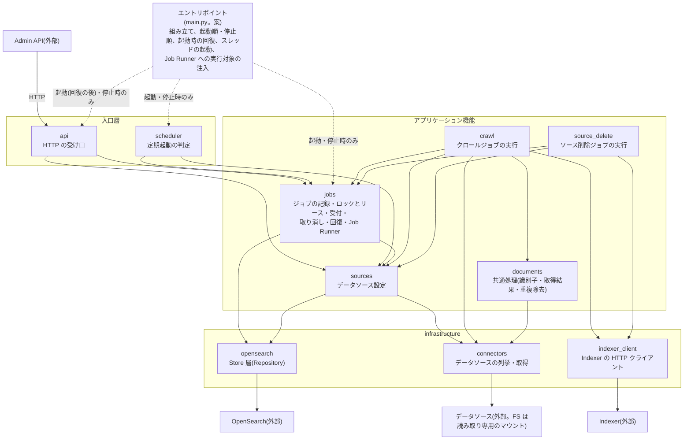
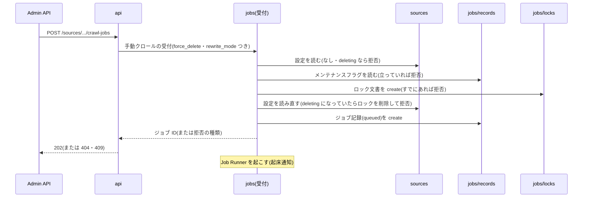
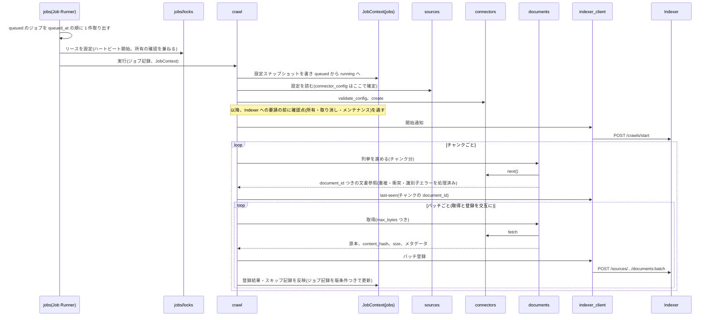
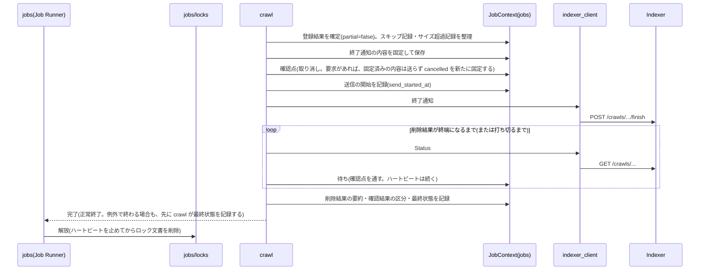
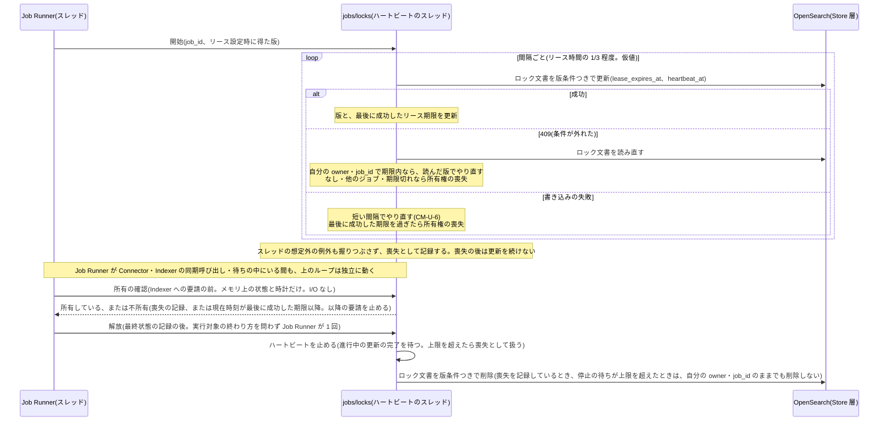
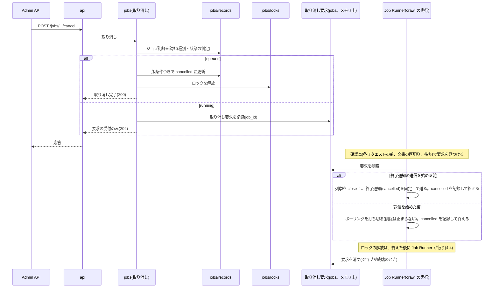
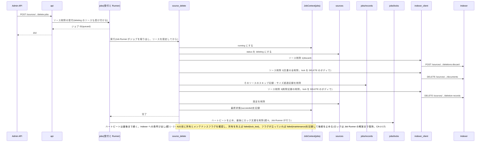
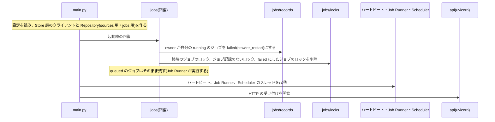
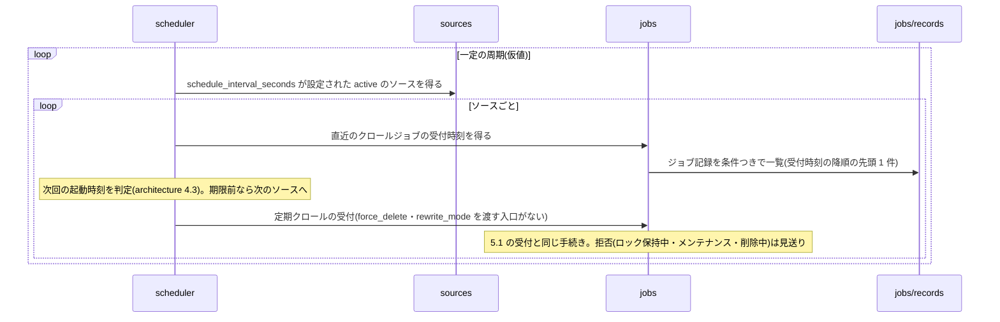

# Crawler モジュール構成設計書 v0.1

- 版: v0.1
- 更新日: 2026-11-13
- 前版: なし(初版)
- 位置づけ: Crawler のコード上のモジュール分割と、モジュール間の依存・呼び出しの流れ。「何を、どのモジュールが担うか」を一目で分かるようにする。ジョブ・ロック・リース・リトライ・スキップ・連携・API 契約・Connector 仕様の仕様は他の Crawler 設計書が正本で、本書は仕様を変えず、再掲もしない。
- 本書は「案」「推測」「未決」を確定扱いにしない。**モジュールの分割、ディレクトリ名、並行モデル(スレッドの割り当て)はすべて案**で、ユーザー承認済みではない。本書の確定は、他文書・CLAUDE.md で確定済みの事項の引用に限る(7.2)。数値は「仮値・設定可能・未決」とし、本書では決めない(値は architecture 11章と各 Connector 文書)。

区分の凡例(Indexer 設計書に合わせる):

| 区分 | 意味 |
| --- | --- |
| 確定 | ユーザーが確定した事項(出典を書く) |
| 案 | ユーザー未確定。確定扱いにしない |
| 未決 | 決めていない |
| 推測 | 根拠が弱い想定。推測と注記した事項(実機未確認を含む) |
| 導出 | 他の仕様から導いた事項(明示された記述がなく、本書で導いた事項) |

ID 体系: 本書の確定・案・未決は `CM-K-n` / `CM-P-n` / `CM-U-n`。既存設計との不整合は `I-n`(本書の予約範囲は I-50〜。本書で新たに立てる I-n はない。I-50(FS 9.2 の「ロック解放かコンテナの再起動で解消」の誤り)と I-51(architecture 7.5 の「共通処理が保持するメモリ上の集合」と interface 2章の定義のずれ)は、他文書の修正で解消したため欠番とし、I-52 以降も使わない。7.5)。`CA-*` は architecture、`CI-*` は interface、`CAPI-*` は crawler-api、`CFS-*` は FS、`CW-*` は Web の ID。

関連文書:

| 文書 | 内容 | 本書との関係 |
| --- | --- | --- |
| `crawler/crawler-architecture-v0.1.md`(以下 architecture) | ジョブ、ロック・リース、リトライ・スキップ、Indexer との連携、データモデル。13.7 に本書への申し送り | 仕様の正本。本書はどのモジュールが担うかを示す |
| `crawler/connector/connector-interface-v0.1.md`(以下 interface) | Connector の抽象、識別子規則、エラー分類。11.6 に本書への申し送り | 同上 |
| `crawler/crawler-api-v0.1.md`(以下 crawler-api) | Admin API -> Crawler の契約 | 同上 |
| `crawler/connector/connector-file-system-v0.1.md`(以下 FS)、`connector-web-v0.1.md`(以下 Web) | Connector 固有の設計。FS 9.2 にテスト用の注入点の申し送り | 同上 |
| `indexer/indexer-module-structure-v0.4.md` | Indexer の構成設計 | 形式・層構成・依存ルールの考え方を踏襲した(参考) |
| `apps/indexer/`(`pyproject.toml`、`main.py`、`tests/architecture/`、`tests/fakes/`) | Indexer の実装 | ディレクトリ・設定・テストの作り方の参考。コードは変更しない |
| `indexer/indexer-api-v0.10.md` | Crawler -> Indexer の契約 | `indexer_client` の呼び出し先。再掲しない |

---

## 1. 概要

Crawler は、データソースを列挙・取得して Indexer に登録させ、ジョブ・ロック・リースを管理し、削除結果を確認する(architecture 2章)。Admin API からの操作(起動・取り消し・ロック解放・設定の登録/更新・ソース削除)は HTTP で受ける(crawler-api)。実装言語は Python(CM-K-1)。実行は単一プロセスで、HTTP ハンドラ・Job Runner・ハートビート・Scheduler の 4 つの実行単位をスレッドで動かし、Connector と Indexer の呼び出しは同期で行う(2.2。案。CM-P-13)。

コードは Indexer に倣って 3 層(入口層 / アプリケーション機能 / infrastructure)に分け、層の外に全層から参照できる `common` を置く(案。CM-P-1)。

| モジュール | ディレクトリ | 役割 | 主な入力 | 主な出力 |
| --- | --- | --- | --- | --- |
| `api` | `api/` | Admin API からの HTTP を受け、形式を検証して担当機能へ渡す | HTTP リクエスト(crawler-api の 6 API) | HTTP 応答 |
| `scheduler` | `scheduler/` | 定期起動の時刻を判定し、`jobs` の受付を呼ぶ | 現在時刻、データソース設定、直近のクロールジョブ | 受付の呼び出し |
| `sources` | `sources/` | `loreley-sources` のデータソース設定の登録・更新・読み取り・削除と、その業務上の検証を行う | 設定の登録・更新・読み取り・削除の要請 | 設定、検証結果 |
| `jobs` | `jobs/` | ジョブの記録、ロック・リース(ハートビート)、受付、取り消し、ロック解放、起動時の回復、Job Runner を担う(ジョブ管理) | 起動・取り消し・解放の要請、`queued` のジョブ | ジョブ記録、ロック文書、実行に渡す `JobContext` |
| `crawl` | `crawl/` | クロールジョブを実行する(列挙・`last-seen`・取得・バッチ登録・終了通知・ポーリング、リトライ・スキップの判断、登録結果の集計) | `running` にするジョブと `JobContext` | ジョブ記録の更新(`jobs` 経由)、Indexer への要請 |
| `source_delete` | `source_delete/` | ソース削除ジョブを実行する(architecture 8.1 の手順) | 同上 | ジョブ記録の更新、Indexer への要請、設定・記録の削除 |
| `documents` | `documents/` | Connector の呼び出し結果を Crawler の規則に合わせる共通処理(識別子規則、`document_id`、`content_hash`、重複除去、衝突検出)。Indexer の `documents` とは別物 | Connector の列挙・取得の結果 | 規則適用後の文書参照・原本 |
| `opensearch` | `infrastructure/opensearch/` | Store 層(`loreley-sources`・`loreley-jobs`)の Repository を OpenSearch で実装する | 取得・作成・条件付き置き換え/削除・一覧・一括削除の指示 | 記録(版つき)、または結果の区分 |
| `indexer_client` | `infrastructure/indexer_client/` | Indexer の HTTP API を呼び、応答を呼び出し側が扱える形にする | 開始通知・`last-seen`・バッチ登録・終了通知・Status・ソース削除 1〜3 の要請 | 型付きの結果、または失敗の区分 |
| `connectors` | `infrastructure/connectors/` | データソースの列挙・取得(interface の Connector。MVP は FileSystem)と、`connector_type` から実装を引くレジストリ | `connector_config`、文書参照、取得の上限 | 文書参照、原本とメタデータ、`ConnectorError` |
| `common` | `common/` | 全層から参照できる共通部品(時計、日時形式、リトライの汎用機構、表示用の文字列整形、ログ、エラー型)。他のモジュールに依存しない葉(CM-P-20) | 各モジュールからの利用 | 型・関数 |

ディレクトリは `src/loreley_crawler/`(3章)からの相対。行は層の順(入口層、アプリケーション機能、infrastructure)で、層の外の `common` は最後。依存先は 4章、依存のルールは 6章にある。

読み方:

- **分割と呼び出し関係は 7.3 の `CM-P` の案が基本。確定は `CM-K`(他文書・CLAUDE.md で確定済みの事項の引用)だけで、モジュール分割そのものにユーザー承認はない。**
- 仕様の正本は architecture(ジョブ・ロック・リトライ・連携)、interface(識別子規則・エラー分類・Connector の抽象)、crawler-api(API 契約)、FS・Web(Connector 固有)。本書は仕様を変えない。
- 申し送り(architecture 13.7、interface 11.6、FS 9.2、Indexer クライアントの要件)への回答は 7.6 に対応表がある。

---

## 2. 構成図

### 2.1 モジュールと依存

責務と依存の向きだけを示す。処理の順序は 5章のシーケンス図にある。案の一覧は 7.3。



凡例:

| 記号 | 意味 |
| --- | --- |
| 矢印 `A --> B` | A が B を呼ぶ(呼ぶ側 → 呼ばれる側)。データの流れではない |
| 点線 | 用途が限られる呼び出し(ラベルのとおり) |
| 3 つの枠 | 層。層をまたぐ呼び出しは上から下へだけ。同じ層(アプリケーション機能)の中の呼び出しは図にある 6 本だけ(R3) |

`jobs` は `crawl`・`source_delete` を呼ばない。Job Runner が実行する対象は `main.py` が起動時に渡す(CM-P-4)。`crawl --> conn` は Connector の生成(レジストリ)と型の参照のためで、列挙・取得の呼び出しは `documents` が包む。`common`(全層から参照できる葉。R10)は、矢印が多くなるため図に描かない。OpenSearch 内の索引ごとのアクセス範囲は 6章の表にある。

### 2.2 実行の単位(スレッド)

単一プロセスで、次の 4 つの実行単位が動く(案。CM-P-13)。Indexer の実行モデル(同期クライアントと `threading` のワーカー、単一プロセス。`indexer-module-structure-v0.4.md` 1章)に揃えた。

| 実行の単位 | 数 | 担当モジュール | 行うこと | 行わないこと |
| --- | --- | --- | --- | --- |
| HTTP ハンドラ | uvicorn の 1 プロセス。同期ハンドラで、複数のスレッドで並行しうる | `api` → `jobs`・`sources` | 受付、取り消し、ロック解放、設定の登録・更新(Store 層の読み書き) | Connector の列挙・取得、Indexer の呼び出し |
| Job Runner | 1 スレッド | `jobs`(Runner)→ `crawl`・`source_delete` | `queued` のジョブを 1 件ずつ実行する。Connector の呼び出し、Indexer への同期呼び出し、`running` 以降のジョブ記録の書き込み、ポーリング、リトライの待ちのすべて | |
| ハートビート | 1 スレッド | `jobs/locks` | 実行中のジョブのロック文書のリース更新(architecture 5.3)。ジョブ記録は書かない | |
| Scheduler | 1 スレッド | `scheduler` | 定期起動の判定と、`jobs` の受付の呼び出し | |

- **ハートビートはジョブ実行と独立に動く**。Job Runner のスレッドが、Connector の取得・Indexer の同期 HTTP・リトライの待ち・ポーリングの中で止まっていても、ハートビートは別スレッドで Store 層を更新し続ける(architecture 5.3 の要件。CA-U-10、CI-U-9 への案)。所有の確認と解放の規則は、次の項に集約する(CM-P-14)。
- **所有の確認と解放の規則**(本書での正。他の節は参照する。architecture 5.3・5.5・5.7)
  - **所有の確認**: Job Runner が Indexer への要請の前に、ハートビートが持つメモリ上の状態と時計だけで確認する(I/O なし)。「所有していない」とするのは、(a) 喪失が記録されている、または (b) 現在時刻が最後に成功した更新のリース期限以降、のどちらかのとき(ハートビートが止まってもリース切れで以降の要請を止められ、architecture 5.7 を満たす)。喪失を記録するのは、ハートビート(更新の失敗・ロック文書の消失・他のジョブのロック・スレッドの想定外の例外。例外は握りつぶさない)と、`lock_not_owned` を受けた実行対象(`JobContext` 経由)。喪失の後は、ハートビートは更新を続けない。
  - **解放**: 実行したジョブのロックの解放は、Job Runner が、実行対象の終わり方(正常・例外)を問わず 1 回行う。最終状態の記録の後に、ハートビートを止め(進行中の更新の完了を待つ。待ちの上限は Store 層のタイムアウト以上の仮値。CM-U-6)、読んだ版を条件にロック文書を削除する(条件が外れたら読み直す)。
  - **喪失を記録しているときは、ロック文書が自分の `owner`・`job_id` のままでも削除しない**(保守側に倒す。回復や管理者の解放に委ねる)。停止の待ちの上限を超えたときも、喪失として扱い、ロック文書は削除せずに終了処理を続ける(以後の更新は無効にする)。
  - 受付の巻き戻し、`queued` の取り消し、管理者の解放、起動時の回復によるロック文書の削除は、それぞれ `jobs` の該当処理が行う(Job Runner の解放ではない)。
- **ブロッキングの扱い**: ブロッキングする `os.read` の待ち中も別のスレッドが進むことを、macOS・CPython 3.13.4 で確認した(7.1。Linux コンテナ・NFS/SMB は未確認で、推測)。このため、ハードマウントの共有の停止などで Job Runner が戻らない呼び出しの中にいても、ハートビートは続いてリースは切れない。このとき管理者のロック解放は `lock_in_use` で拒否されるので、脱出手段は Crawler の再起動による回復だけ(architecture 4.7・5.8、crawler-api 4.3。MVP は、呼び出しの停止を検知するウォッチドッグを設けない。案。FS 9.2 の「ロック解放でも解消できる」旨の記述は、この点に合わせて修正済み。7.6)。
- **asyncio・別プロセスのハートビートを採らない理由**(案): interface 3.2 の `fetch`・`next()` と FS の `os.*`、Indexer 呼び出しは同期の呼び出しで、非同期にすると、結局これらをスレッドに逃がすことになる。ハートビートだけを別プロセスにすると、Job Runner の I/O なしの所有確認に要る所有状態(最後に成功したリース期限・喪失の有無)をプロセス間で共有する必要が出る(取り消し要求の共有も複雑になる。CA-P-44)。スレッドの限界として、Job Runner が GIL を保持し続ける長い処理(GIL を解放しない拡張モジュールの呼び出しなど)の間は、ハートビートも進まなくなりうる(推測。MVP は、そのような処理を想定しない)。
- **スレッド間で共有する状態**は次の 6 つに限る(CM-P-13)。(1) 取り消し要求(`jobs`。CM-P-15)。(2) ハートビートの所有状態(`jobs/locks`。CM-P-14)。(1)(2) は 1 か所に置き、排他で守る。(3) Store 層のクライアント(Job Runner・HTTP ハンドラ・Scheduler の各スレッドが共有するクライアントを複数スレッドから使えるかは未確認。ハートビートは専用のクライアントを持つ。CM-P-14、CM-U-1)。(4) 時計。(5) Job Runner の起床通知。(6) 停止要求。(5)(6) は `main.py` が作って各スレッドに渡す同期の部品(イベント)。`JobContext`(CM-P-16)は Job Runner のスレッドだけが使う。
- Job Runner は、受付が `queued` を保存したときの起床通知(プロセス内の通知)と、一定間隔の走査(取りこぼし対策。間隔は仮値。CM-U-6)で動く。

---

## 3. ディレクトリ構成

```text
apps/crawler/
├── Dockerfile
├── pyproject.toml
├── tests/                      # src の構成に合わせる(案)。architecture/・fakes/ を持つ(CM-P-18)
└── src/
    └── loreley_crawler/        # Python パッケージ層(案)
        ├── main.py             # エントリポイント(案)
        ├── config.py           # 設定の読み込み(案)
        ├── common/             # 全層から参照できる共通部品。葉(CM-P-20)
        ├── api/
        ├── scheduler/
        ├── sources/
        ├── jobs/               # 直下に、受付・取り消し・ロック解放・回復・Job Runner・JobContext を置く(案)
        │   ├── records/        # loreley-jobs の記録(ジョブ・スキップ・サイズ超過・メンテナンスフラグ)
        │   └── locks/          # ロック文書とハートビート
        ├── crawl/
        ├── source_delete/
        ├── documents/          # 共通処理(Indexer の documents とは別物)
        └── infrastructure/
            ├── opensearch/
            ├── indexer_client/
            └── connectors/
                ├── interface/  # 型・エラー・ConnectorType(Python への落とし込みは 4.10)
                └── filesystem/ # FS(MVP)。直下にレジストリ(connector_type から実装を引く)を置く
```

- パッケージ層・`main.py`・`config.py` は Python 前提の案(CM-P-17)。分け方は Indexer の構成(`api`・アプリケーション機能・`infrastructure`・`common`)に倣う(CM-P-1)。技術スタックも Indexer に揃える(Python 3.12、FastAPI・uvicorn、pydantic・pydantic-settings、opensearch-py。HTTP クライアントのライブラリは実装時に選ぶ。CM-P-19、CM-U-2)。
- Web Connector 用のディレクトリは、MVP では作らない(追加時の構成は CM-U-8)。
- モジュール(ディレクトリ)の内部のファイル名は書かない。実装時に決める。`crawl` の内部も、ここでは分けない(実装時に、責務ごとのファイルに分ける)。
- `api/` は Admin API からの HTTP ハンドラの置き場(Indexer と同じ名前。`apps/api` とは別)。
- `main.py` は、モジュールの組み立て、起動順・停止順、起動時の回復の呼び出し、スレッドの起動、Job Runner への実行対象(`crawl`・`source_delete`)の注入を担う(CM-P-4、CM-P-17)。
- `config.py` は設定の読み込みを担う(案。Indexer の M-15 と同じ作り)。各モジュールが自前の設定 dataclass を持ち、`config.py` がそれらに値を詰める。モジュールは `config.py` に依存せず、値は `main.py` が渡す。環境変数の接頭辞は `LORELEY_CRAWLER_`(案。Indexer は `LORELEY_INDEXER_`)。設定する項目は、OpenSearch の接続先、Indexer の URL、`loreley-sources`・`loreley-jobs` の索引名(後者は Indexer の `JOBS_INDEX_NAME` と一致させる。CA-U-14)、`owner`(CA-P-3)、architecture 11章の仮値、FS 文書の仮値。数値は本書では決めない。
- `tests/` は `src` の構成に合わせ(案)、メモリ上の Repository・Indexer の偽物・固定時計・偽の Connector・偽の `FsOps`(CM-P-9)を `tests/fakes/` に置く。`document_id` のテストベクタ(CM-P-6)のデータファイルと、依存ルールの検査(CM-P-18)も置く。

---

## 4. モジュール詳細

各モジュールを同じ形式で示す。節番号は architecture・interface・crawler-api・FS の節。括弧のタグ(CM-P-n)は 7.3 の案。どのモジュールも `common`(4.11)を使える(R10)ため、依存先には書かない。

### 4.1 `api`(CM-P-1)

- **役割**: Admin API からの HTTP を受け、形式を検証して担当機能へ渡す
- **やること**
  - crawler-api 1章の 6 つの API を受け付ける(担当は下表)
  - リクエストの形式を検証し、違反の `reason`(`required`・`type`・`format`・`read_only`・`unknown_field`・`unsupported`。crawler-api 3.3)を決める: JSON の厳密な型(型変換をしない)、必須の項目、未知の項目、読み取り専用の項目、`job_id` の形式(crawler-api 3.2)。**値の規則そのもの**(`source_id` の形式、`ttl`・`min_delete_count` が整数、`ratio_threshold` が有限の数値、`schedule_interval_seconds` が 1 以上の整数または null、`connector_type` が登録済み)は `sources` が持ち、`api` はその検証関数を呼んで結果を `reason` に対応づける(crawler-api 4.4.1)
  - 業務上の結果(拒否の種類など)を、エラーコードと HTTP ステータスの応答にする(crawler-api 3.3)
  - HTTP の受け付けは、起動時の回復が終わった後に始める(起動順は `main.py`。architecture 10、CA-P-40)
- **やらないこと**: 受付の判断(ロック・メンテナンスフラグ・設定の状態)、ジョブ記録の書き込み、設定の保存、Connector の列挙・取得、Indexer の呼び出し。ヘルスチェックの要否は未決(CM-U-5)
- **依存先**: `jobs`、`sources`
- **公開する入口**: Admin API から HTTP リクエストを受け、下表の担当機能に渡し、その結果を応答として返す
- **元の節**: crawler-api 1・3・4章、architecture 4.3・4.7

API の担当(CM-P-1):

| API | 担当 |
| --- | --- |
| クロール起動(`POST /sources/{source_id}/crawl-jobs`) | `jobs`(手動の受付) |
| ソース削除ジョブ起動(`POST /sources/{source_id}/delete-jobs`) | `jobs`(受付。`status=deleting` のソースも受け付ける) |
| 取り消し(`POST /jobs/{job_id}/cancel`) | `jobs`(取り消し) |
| ロック解放(`DELETE /sources/{source_id}/lock`) | `jobs`(解放) |
| 設定の登録(`POST /sources`) | `sources` |
| 設定の更新(`PUT /sources/{source_id}`) | `sources` |

パスは crawler-api の案をそのまま使う。設定の登録・更新で呼ぶ `ConnectorType.validate_config` は I/O をしないので、HTTP ハンドラのスレッドから呼んでよい(`sources` が、`connectors` のレジストリが返す保護済みの `ConnectorType` を通して呼ぶ。4.10、R9)。

### 4.2 `scheduler`(CM-P-5)

- **役割**: 定期起動の時刻を判定し、`jobs` の受付を呼ぶ
- **やること**
  - 一定の周期(仮値。CM-U-6)で起きる
  - `schedule_interval_seconds` が設定されている `active` のデータソースを `sources` から得る
  - 各ソースについて、直近のクロールジョブの受付時刻を `jobs` から得て、architecture 4.3 の規則で次回の起動時刻を判定する(そのソースにクロールジョブがなければ、設定の登録・更新時刻を起点にする)
  - 期限を過ぎていれば `jobs` の定期の受付を呼ぶ。この入口は `force_delete`・`rewrite_mode` を受け取らない(常に `false`。CA-P-13)
  - 受付の拒否(ロック保持中・メンテナンス中・削除中)は、その回を見送るだけで、待ち行列を作らず取り返さない
- **やらないこと**: 受付の判断そのもの、ジョブ記録の書き込み、ジョブの実行
- **依存先**: `jobs`、`sources`
- **公開する入口**: Scheduler のスレッドの開始と停止
- **元の節**: architecture 4.3、CA-P-12・CA-P-13

### 4.3 `sources`(CM-P-3)

- **役割**: `loreley-sources` のデータソース設定を扱う。記録の形式(architecture 3.2)と書き込みの規則を持つ。`loreley-sources` に書く唯一のモジュール
- **やること**
  - 設定の登録: 存在しない場合だけ成功する作成。同じ内容の再送は成功、内容が異なる、または `status=deleting` なら競合の結果を返す(crawler-api 4.4.2)
  - 設定の更新: 変更できる項目の全置換。読んだ版を条件にし、`status` は現在の値を保つ。内容が同じなら書き込まない(crawler-api 4.4.3)
  - 設定の読み取りと一覧(`jobs` の受付、`scheduler`、`crawl` が使う)
  - ソース削除ジョブのための `status=deleting` への更新と、設定の削除(architecture 8.1 の順 0・5)
  - 値の規則の検証(検証関数として公開し、`api` が呼んで `reason` に対応づける): `source_id`(CA-K-13。文字種は案で CAPI-P-15)、`ttl`・`min_delete_count` が整数、`ratio_threshold` が有限の数値(範囲は見ない)、`schedule_interval_seconds` が 1 以上の整数または null、`connector_type` が `connectors` のレジストリに登録されていること(crawler-api 4.4.1)
  - `connector_config` を、レジストリが返す保護済みの `ConnectorType` の `validate_config` で確認する(I/O なし。想定外の例外は `connectors` 側で `connector_internal_error` に変換済み。4.10)
- **やらないこと**: しきい値の範囲の検証(Admin API。CA-K-16)、接続確認(`validate_config` は I/O をしない)、JSON の形式の検証と `reason` の決定(→ `api`)、ジョブ・ロックの扱い(→ `jobs`)、`loreley-sources` 以外の索引への書き込み
- **依存先**: `opensearch`、`connectors`(レジストリと `validate_config` だけ)
- **公開する入口**: 設定の登録・更新・読み取り・一覧・`deleting` への更新・削除。検証の結果は、呼び出し側が応答にできる区分で返す
- **元の節**: architecture 3.2・8.1・8.3、crawler-api 4.4

### 4.4 `jobs`(ジョブ管理。CM-P-2)

- **役割**: ジョブの記録、ロックとリース、受付、取り消し、ロック解放、起動時の回復、Job Runner を担う。`loreley-jobs` に書く唯一のモジュール。ジョブの実行の中身(列挙・登録・削除)は持たない

内部は、`loreley-jobs` の記録の種類ごとに 2 つのサブディレクトリに分け、受付などの手続きは直下に置く(CM-P-2)。

| 置き場 | 役割 |
| --- | --- |
| `records/` | ジョブ・スキップ・原本サイズ超過・メンテナンスフラグの記録の形式(architecture 3.3)と読み書き。ジョブ記録の更新はすべて読んだ版を条件にする(CA-P-43)。メンテナンスフラグは fail-closed で読む(CA-P-34)。ジョブ ID の生成(CA-P-1) |
| `locks/` | ロック文書(architecture 5.1)の作成・リースの設定・読み取り・版条件つきの削除と、ハートビート(専用スレッド。CM-P-14) |
| 直下 | 受付・取り消し・ロック解放・起動時の回復・Job Runner・`JobContext` |

- **やること**
  - 受付: 手動クロール・定期クロール・ソース削除の 3 つの入口が、同じ手続き(architecture 4.3 の手順 1〜5)を共有する。`api` と `scheduler` が同じ受付処理を呼ぶ(CM-P-5)。クロールとソース削除の違い(`deleting` のソースを受け付けるか)と、`force_delete`・`rewrite_mode` を受け取るのが手動クロールの入口だけであることは、入口の引数で表す。受付が `queued` を保存したら、Job Runner を起こす
  - 取り消し: `queued` は版条件つきで `cancelled` にしてロックを解放する。`running` は、取り消し要求をメモリ上のレジストリに記録する(CM-P-15)。判定の順序は crawler-api 4.2、状態別の扱いは architecture 4.7
  - ロック解放(管理者): architecture 5.4 の対象のロックだけを解放し、`running` のジョブがあれば `failed`(`lock_released`)にする。受付の途中のロックを解放しない判定(`acquired_at`)を含む
  - 起動時の回復: architecture 5.8 の手順 1〜4
  - Job Runner: `queued` のジョブを `queued_at` の順に 1 件ずつ取り出し、リースを設定してハートビートを始め、`job_type` に対応する実行対象を呼ぶ。実行対象は `main.py` から受け取り、`crawl`・`source_delete` を import しない(CM-P-4)。
  - **実行したジョブのロックの解放は Job Runner だけが行う**(CM-P-16): 実行対象は最終状態の記録までを担い、正常に終わっても例外で終わっても、ハートビートの停止とロック文書の削除は Job Runner が必ず 1 回行う。受付の巻き戻し・`queued` の取り消し・管理者の解放・起動時の回復によるロック操作は、それぞれ `jobs` の該当処理が行う(区別。2.2)。解放の手順、喪失を記録しているときはロック文書を削除しない規則、停止の待ちの上限は 2.2(architecture 5.5・5.7)。`source_delete` の順 6 のロック文書の削除(K29 の順序で最後)も、この解放に当たる(最終状態の記録の直後。喪失を記録していれば削除しない)
  - **最後の手段**: 実行対象が、最終状態を記録しないまま例外を送出したときだけ、Job Runner が `failed`(`internal_error`)を記録してから解放する。想定外の例外の捕捉と終了通知(`failed`)の試みは、まず実行対象が行う(`crawl`。4.5)
  - ハートビートの停止の待ち: 上限(仮値。CM-U-6)を超えたら喪失として扱い、ロック文書は削除せずに終了処理を続ける(2.2)
  - `JobContext`(CM-P-16): 実行対象(`crawl`・`source_delete`)に渡す、ジョブ単位の部品。次を提供する
    - 最後に書いた版を条件にしたジョブ記録の更新。条件が外れたら読み直し、`failed`(`lock_released`)などに変わっていれば所有権の喪失として知らせる(architecture 5.3)
    - 確認点: 所有の確認(規則は 2.2。I/O なし)、取り消し要求の確認、メンテナンスフラグの確認(`source_delete` では 8.1 の順 1・2・4 の送信の前にも確認する。案。architecture 4.6・4.7・5.7・7.9・8.1、CA-U-17)。取り消し・所有権の喪失・メンテナンスは、それぞれの例外で知らせる。どの呼び出しの前でどれを確認するかは、実行対象が決める
    - 待ち: 確認点を通しながら中断できる待ち(リトライのバックオフ、ポーリングの間隔)
    - リトライ: `common` の汎用機構(CM-P-12)を、設定のリトライ値と確認点で束ねたもの。判断(何をリトライするか)は呼び出し側が渡す。`JobContext` は Job Runner のスレッドでしか使えないため、HTTP ハンドラ側の Store 層の書き込み(受付・取り消し・ロック解放・設定の登録/更新)のリトライは、呼び出し側(`jobs` の受付など・`sources`)が `common` の汎用機構を直接使う
    - 最終状態の記録(終了処理の前半。ロックの解放は Job Runner)
- **やらないこと**: 列挙・取得・Indexer への登録・削除の手順(→ `crawl`・`source_delete`)、リトライ・スキップの判断、登録結果の集計(→ `crawl`)、Indexer の呼び出し、`loreley-sources` の書き込み(読み取りだけ)、しきい値の検証
- **依存先**: `sources`(読み取り)、`opensearch`。内部は、直下 → `records/`・`locks/` で、`records/` と `locks/` は互いに依存しない(R6)
- **公開する入口**
  - 受付(手動クロール・定期クロール・ソース削除)を受け、ジョブ ID または拒否の種類(`lock_held` のときは既存ジョブの情報)を返す
  - 取り消し、ロック解放を受け、結果を返す
  - 記録の読み書き(スキップ記録・サイズ超過記録の更新・整理・一括削除、直近のクロールジョブの取得、メンテナンスフラグの読み取り)。`scheduler`・`crawl`・`source_delete` が使う
  - 起動時の回復の実行、Job Runner とハートビートの開始・停止
  - 実行対象が実装するインターフェースと、`JobContext`
- **元の節**: architecture 3.3、4.2〜4.8、5章、crawler-api 4.1〜4.3・4.6

### 4.5 `crawl`

- **役割**: クロールジョブを実行する(architecture 4.5 の手順 6〜13)。Job Runner が呼ぶ実行対象
- **やること**
  - 実行開始: 設定スナップショットの組み立て(`sources` の値が欠けている・型が合わなければ `config_invalid`)と `queued` -> `running`(`JobContext` 経由)。`connector_config` の確定、`validate_config`・`create`(レジストリが返す保護済みの `ConnectorType` を使う。想定外の例外は `connectors` 側で `connector_internal_error` に変換済み。4.10)。失敗したら開始通知を送らずに `failed`(architecture 4.5 の手順 6〜8)
  - 開始通知。再送では保存済みの同一値を送る(architecture 7.4)
  - チャンク処理: `documents` が包んだ列挙からチャンクを作り、チャンクごとに `last-seen` → 取得 → バッチ登録を、取得と登録を交互に進めて行う。バッチの閉じ条件、失敗した文書だけの再送(architecture 4.6、7.3)
  - 失敗の扱いの適用: リトライ(`JobContext` 経由)、スキップ、原本サイズ超過、ジョブ `failed`、連続スキップの計数(取得段階・登録段階。architecture 6.2・6.3・7.8)。スキップ記録・原本サイズ超過記録の書き込みと整理(`jobs` の記録操作を呼ぶ。architecture 6.4)
  - 登録結果の集計(再送時は最初の結果を保持)と、`partial` の遷移・ジョブ記録への反映(architecture 7.7)
  - 識別子エラー(`invalid_external_id`)の文書の計上(`invalid_id_count`)と、`partially_succeeded` への反映(architecture 7.7、CA-P-25)
  - `warnings` の記録: 識別子エラーの例(件数・長さに上限。architecture 7.7)、終了通知の ID 一覧の件数が警告閾値を超えそうなとき(CA-P-41)、受理の根拠が得られない終端状態(CA-P-29)、ポーリングを打ち切ったとき(architecture 7.6)
  - `failure_detail` の組み立て(分類名と、Connector の説明文または衝突した `external_id` と `document_id`。保存前に `common` の整形を通す。architecture 3.3.1、CA-P-45・CA-P-48)
  - 件数照合のための ID 集合(`skipped_document_ids`・`oversize_document_ids`)を、このクロールの実行状態として持つ。`enumerated_count` と、スキップ記録の整理(architecture 6.4。今回列挙された文書か)に必要な、列挙済みの件数と「ID が列挙済みか」の照会は、`documents` の列挙の包みに問い合わせる(architecture 7.5。CM-P-21)
  - バッチ応答の `document_id` を、`documents` が算出した値と照合する(architecture 7.11。CA-P-27)
  - 終了通知の組み立て・固定・送信(`send_started_at` の記録を含む)、`failed`・`cancelled` の通知(architecture 7.5)
  - 削除結果のポーリング、確認結果の区分、削除結果の要約の記録(architecture 7.6)
  - 確認点で知らされた取り消し・所有権の喪失・メンテナンスへの対応(列挙の `close()`、`outcome=cancelled`・`failed` の通知、ポーリングの打ち切りなど。architecture 4.7・5.7・7.9)
  - 最終状態の決定と理由コードの記録(Store 層への書き込みがリトライを尽くしても失敗したときの `store_unavailable` を含む。architecture 4.8、CA-P-50)。記録までが `crawl` の担当で、ロックの解放は Job Runner(4.4)
  - 想定外の例外: `crawl` が自分で捕捉し、開始通知が成功した後で、`enumeration_completed` の初回送信を始める前(`send_started_at` の記録前)に限り、終了通知 `failed` を試みる(CA-P-28)。送信開始後は `failed` を送らない(受理の有無が不明で、別内容は Indexer が 409 `finish_content_mismatch` で拒否し、`failure_reason` を上書きしかねないため。architecture 4.7・4.8、CA-K-9)。そのうえで `failed`(`internal_error`)を記録して再送出する。Job Runner の最後の手段(4.4)は、それでも最終状態が記録されないまま例外が抜けた場合だけ
  - 終了時に、`EnumerationStream.close()` と `Connector.close()` を呼ぶ(正常・異常・取り消しのいずれでも)
- **やらないこと**: ジョブ・ロックの記録操作の実装(→ `jobs`)、Indexer との HTTP 通信そのもの(→ `indexer_client`)、`external_id`・`document_id` の規則(→ `documents`)、データソースの読み取り(→ `connectors`)、削除の判断(Indexer)
- **依存先**: `jobs`(`JobContext`・記録操作)、`sources`(読み取り)、`documents`、`indexer_client`、`connectors`(レジストリと型)
- **公開する入口**: 「ジョブ記録と `JobContext` を受けてクロールを実行する」(Job Runner が呼ぶ実行対象)
- **元の節**: architecture 4.5〜4.8、6章、7章

### 4.6 `source_delete`

- **役割**: ソース削除ジョブを実行する(architecture 8.1 の手順)。Job Runner が呼ぶ実行対象
- **やること**
  - 実行開始: `running` にし、`sources` を `status=deleting` にする(順 0)
  - 順 1・2・4: `indexer_client` のソース削除 1・2・3 を、`lock` つきで呼ぶ。各呼び出しの前に確認点(所有・メンテナンスフラグ)を通し、所有権を失ったら後続を止めて `failed`(`lock_lost`)に、フラグが立っていれば後続を止めて `failed`(`maintenance`)にする(ロックは終了処理まで保持し、再実行で復旧する。architecture 7.9・8.1・8.2、CA-U-17。案)
  - 順 3: そのソースのスキップ記録・原本サイズ超過記録を、`jobs` の記録操作で削除する(リトライを尽くしても失敗したら `failed`(`store_unavailable`。architecture 8.1・4.8))
  - 順 5: `sources` の設定を削除する(同上)
  - 順 6: 最終状態(`succeeded`)を記録する。続くロック文書の削除(最後。K29)は Job Runner が行う(4.4)。失敗・所有権の喪失のときの最終状態の記録も `source_delete` が行う
  - 再実行: 順 3・5 は、すでに削除済みなら成功として扱う(architecture 8.3)。ロックは最後まで保持し、ハートビートも続く(CM-K-7)
- **やらないこと**: ジョブ・ロックの記録操作の実装(→ `jobs`)、Indexer の HTTP 通信そのもの(→ `indexer_client`)、取り消し(`source_delete` は取り消せない。crawler-api 4.2)
- **依存先**: `jobs`、`sources`、`indexer_client`
- **公開する入口**: 「ジョブ記録と `JobContext` を受けてソース削除を実行する」(Job Runner が呼ぶ実行対象)
- **元の節**: architecture 8章、CA-K-11

### 4.7 `documents`(共通処理。CM-P-6)

- **役割**: Connector の呼び出し結果を Crawler 本体の規則に合わせる(interface 2章の「共通処理」の中心)。識別子、取得結果、列挙の重複除去と衝突検出。全 Connector で 1 つの実装を使う。論理上の共通処理は、`documents` と `connectors` のレジストリの保護ラッパの両方に実装される(`validate_config`・`create` の例外の変換は、R3 のため保護ラッパが同じ変換関数で行う。4.10)。Indexer の `documents`(文書の登録)とは無関係
- **やること**
  - `external_id` の規則適用(孤立サロゲートの ID 用エスケープ → NFC → `\` の置換 → 検証)と、規則に合わない文書の `invalid_external_id`(interface 5.1)
  - `document_id` の算出(interface 5.2)。単独の関数として置き、`crawl` が `last-seen`・終了通知の ID 一覧・バッチ応答の照合に使う
  - 列挙の包み: `next()` の結果に `document_id` を付け、重複を除き、衝突を検出する。列挙した ID の集合(`document_id` と、元の `external_id` の SHA-256)をこの包みが持ち、件数の上限(`max_enumerated_documents`)を超えたら専用の失敗を返す(architecture 7.7、CA-P-26。interface CI-U-10 への回答)。列挙済みの件数と、ID が列挙済みかの照会に答える(`crawl` が `enumerated_count` とスキップ記録の整理に使う)
  - 取得の包み: `fetch` に `max_bytes` を渡し、`size_hint` が上限を超えるときは読まずに `oversize` にする(architecture 6.5)。原本から `content_hash`・`size` を算出する(interface 5.4)。`title`・`path`・`url`・`mime_type` の孤立サロゲートを表示用に置換する(interface 4章)
  - 列挙(`next()`)・取得(`fetch`)で、Connector から `ConnectorError` 以外の例外が出たときの `connector_internal_error` への変換。変換の関数は `connectors/interface/` が持ち、`documents` はそれを呼ぶ(`validate_config`・`create` の変換は `connectors` のレジストリが同じ関数で行う。interface 3.2。4.10)
  - 保存・表示する文字列(`failure_detail`・`warnings`)の整形は `common` の部品を使う(CA-P-48)
- **`document_id` の二重実装対策**(CM-P-6): Indexer との共有ライブラリは作らない(別アプリ・別 `pyproject` で、小さな 2 つの関数のために共有パッケージを増やさないため)。ずれは、実行時の照合(architecture 7.11。CA-P-27)と、テストベクタで検出する。テストベクタは interface 5.2 の全行(共通処理を通さず算出関数へ直接入力する行を含む。interface 10章 #1)を、出典つきの 1 つのデータファイルとして `apps/crawler/tests/` に置く(CI-U-1、CA-U-9 への案。Indexer 側に置くかなどは CM-U-3)
- **やらないこと**: Connector の実装、リトライ・スキップの判断(→ `crawl`)、Indexer との通信、ジョブ・ロックの扱い。自身は I/O をしない(Connector の呼び出しを除く)
- **依存先**: `connectors`(`interface/` の型と、例外の変換関数だけ)
- **公開する入口**: 列挙の包み(列挙済みの件数・ID の照会を含む)、取得の包み、`document_id` の算出関数
- **元の節**: interface 2〜7章、architecture 4.6・6.5・7.7・7.11

### 4.8 `opensearch`(`infrastructure/opensearch`。CM-P-10)

- **役割**: Store 層の Repository(architecture 3.1)を OpenSearch で実装し、結果を呼び出し側が扱える区分に直す
- **やること**
  - Repository インターフェース(抽象クラス)と OpenSearch の実装を持つ。操作は architecture 3.1 の案のとおり: ID による取得(版つき)、存在しない場合だけ成功する作成(`create`)、読んだ版を条件にした置き換え、読んだ版を条件にした削除、単純な条件での一覧(並べ替え・件数上限)、ID の一括削除。Indexer の Store 層にない `create` と版条件つきの削除は、ここで用意する(7.1)
  - 結果を、成功・競合(409)・存在しない・すでに存在する・OpenSearch 全体の異常に区分して返す
  - 索引ごとに Repository のインスタンスを作る(`loreley-sources` 用と `loreley-jobs` 用の 2 つ。索引名は設定。R7)。加えて、ハートビート専用の `loreley-jobs` 用のクライアントとインスタンスを作る(別のタイムアウトを持てる。Indexer の `delete_by_query` 専用クライアントに倣う。CM-P-14)。クライアントの作成と終了、タイムアウトの設定
- **やらないこと**: 記録の形式と業務上の判断(→ `sources`・`jobs`)、409 のときの読み直しとリトライ(→ 呼び出し側。`common` の汎用機構)、`loreley-deletions`・検索インデックスへのアクセス(CM-K-3)。**索引とマッピングの作成**(現時点では作らない。Crawler が担うことになれば、ここに置く案。CM-U-7)
- **依存先**: OpenSearch(外部)
- **公開する入口**: Repository インターフェース(取得・作成・条件付き置き換え・条件付き削除・一覧・一括削除)。テスト用のメモリ上の実装は `tests/fakes/` に置く(CM-P-18)
- **元の節**: architecture 3.1・3.3・13.1

### 4.9 `indexer_client`(`infrastructure/indexer_client`。CM-P-11)

- **役割**: Indexer の HTTP API(indexer-api v0.10)を呼び、応答を呼び出し側が扱える形にする。同期呼び出しで、呼んだスレッドの中で完結する
- **やること**
  - 1 つの API につき 1 つの操作: 開始通知、`last-seen`、バッチ登録、終了通知、Status、ソース削除 1・2・3
  - リクエストの組み立て: JSON を厳密な型で作り(型を変換しない、`NaN` を送らない。CM-K-6)、`raw_content` を標準の base64(パディングあり・改行なし)にする。`source_id` をパスにパーセントエンコードする(architecture 7.10)
  - `DELETE` に JSON ボディ(`lock`)を載せる。ソース削除 2・3 が使う(CM-K-5。ボディを落とさないことは契約テストで確認する。architecture 12章 #17)
  - API ごとのタイムアウト(architecture 11章の仮値)を設定する
  - 応答を型付きの結果にする: 成功(バッチ登録は文書ごとの結果を含む)、`IndexerUnavailable`(500・503・接続エラー・タイムアウト)、`IndexerRejected`(400・409・404・405・その他。HTTP ステータスとエラーコードを持つ)
  - ログに本文・秘密情報を出さない(R11)
- **やらないこと**: リトライとバックオフ(→ `JobContext` が束ねる `common` の汎用機構。CM-P-12)、確認点(所有・取り消し・メンテナンス)、エラー別のジョブの扱い(`failure_reason` への対応づけは `crawl`・`source_delete`。architecture 7.8)、ID の算出・検証、スレッドの管理
- **依存先**: Indexer(外部)
- **公開する入口**: 上の操作。`lock`(`owner`・`job_id`)は値として受け取る
- **元の節**: architecture 7.1〜7.4・7.8・7.10・11章、indexer-api 3・4章

同期 HTTP の待ち中もリースの更新が止まらないための条件(CM-P-11、CM-P-13): `indexer_client` は Job Runner のスレッドの中で呼ばれ、ハートビートは別のスレッドで Store 層を更新するため、待ち中も止まらない。`indexer_client` は、他のスレッド(ハートビート)と共有する排他や接続を持たない。

### 4.10 `connectors`(`infrastructure/connectors`。CM-P-7、CM-P-8)

- **役割**: データソースの列挙・取得を行う(interface の Connector)。Indexer・ジョブ・ロックを知らない(interface 1.4)

内部は次の 3 つ(MVP の分。Web Connector 用の置き場は MVP では作らない。追加時の構成は CM-U-8)。

| 置き場 | 役割 |
| --- | --- |
| 直下 | レジストリ: `connector_type` の値(MVP は `file_system`)から、保護済みの `ConnectorType` を引く。`sources`(`validate_config`)と `crawl`(`create`)が使う |
| `interface/` | interface 3.2 の疑似シグネチャを Python の型にしたもの(下記)と、分類名・属性、想定外の例外を `connector_internal_error` に変換する関数。他に依存しない。Connector の実装と、`documents`・`crawl`・`sources` が参照する |
| `filesystem/` | FS の実装(FS 2〜9章)。OS 呼び出しを `FsOps` 経由にする(CM-P-9) |

- **やること**
  - `interface/`: `ConnectorType`(`validate_config`・`create`)、`Connector`(`enumerate`・`fetch`・`close`)、`EnumerationStream`(`next`・`close`)、`DocumentRef`・`FetchedDocument`・`DocumentMetadata`、`ConnectorError`(`category`・`scope`・`retry`・`message`)、例外の変換関数(列挙・`create`・`validate_config` は source、取得は document。interface 6.2)
  - レジストリ(直下): 引いた `ConnectorType` を保護ラッパで包んで返す。`validate_config`・`create` で `ConnectorError` 以外の例外が出たら、`interface/` の変換関数で `connector_internal_error` にする。これにより、`sources`・`crawl` は `documents` に依存せずに interface 3.2 の変換を受けられる(interface 3.2 は変換の主体を「共通処理」とするが、論理上の共通処理は `documents` とこの保護ラッパの両方に実装される。`sources` から `documents` への依存を禁じる R3 のため、この 2 操作の変換だけをここに置く。列挙・取得の変換は `documents`。CM-P-7)
  - `filesystem/`: FS 文書のとおりに列挙・取得し、errno を分類名に対応づける
  - Python への落とし込み(案。CM-P-8): 抽象は抽象クラス(Indexer の Repository と同じ作り)。`DocumentRef`・`FetchedDocument`・`DocumentMetadata` は変更できないデータクラスで、`locator` は不透明な値、`size_hint` は整数または `None`。`next()` は `DocumentRef` か `Completed` の目印を返し、列挙の `Failed` は `ConnectorError` の送出で表す。Python の反復の終わり(`StopIteration`)を完了に使わないのは、終端なしで途切れた列挙を完了と区別するため(interface 3.3 の 1)
- **やらないこと**: `external_id` への規則の適用・`document_id`・`content_hash`・`size`(→ `documents`)、リトライ(Connector は内部でリトライしない。CI-P-5)、スキップの判断、Indexer・Store 層へのアクセス
- **依存先**: データソース(外部)。内部は、直下(レジストリ)→ `filesystem/` → `interface/` の一方向で、`interface/` は他に依存しない(R5)
- **公開する入口**: 上のレジストリと型。Connector のインスタンス(列挙・取得・`close`)の呼び出しは Job Runner のスレッドだけが行う(R9)ので、同じ Connector への並行呼び出し(`close()` を含む)は起きない(interface CI-U-9 への回答)。`close()` を呼ぶのは `crawl`(4.5)
- **元の節**: interface 3・4・6・7・8章、FS 全体

### 4.11 `common`(`common/`。CM-P-20)

- **役割**: 全層から参照できる共通部品を置く。他のモジュールに依存しない葉。業務の判断は持たない
- **やること**
  - 時計を抽象化する(テストで固定時計に替える。Indexer の `common` と同じ作り)
  - 日時を、UTC・ミリ秒精度の形式で書く(architecture 2.5。CA-P-38)
  - リトライの汎用機構: 最大試行回数・バックオフ(初回・倍率・上限・ジッタ)に従って操作を繰り返し、待ちを中断できる。何をリトライするかの判断と、待ちの中断(確認点)は呼び出し側が渡す。乱数の元は差し替えられる(CM-P-12)
  - 保存・表示する文字列の整形: 文字数の切り詰め、制御文字のエスケープ、孤立サロゲートの置換(CA-P-48。FS 7.3・9.4)。`documents` と `filesystem/` が使う
  - ログのマスキングと出力設定(Indexer の `common` と同趣旨)
  - 複数のモジュールが共有するエラー型(Store 層・Indexer の異常など)
- **やらないこと**: 他のモジュールへの依存、業務の判断、外部システムへのアクセス
- **依存先**: なし
- **公開する入口**: 上の型・関数。呼び出し側は、層を問わず直接使える
- **元の節**: architecture 2.5・6.1・11章、FS 7.3・9.4

---

## 5. 主要シナリオ別の呼び出しの流れ

読み方:

- 矢印は呼び出し。`->>` は応答を待つ呼び出し。
- Admin API からの呼び出しと応答は `api` を経由する。図に `api` を描かないシナリオでは省略している。
- `records`・`locks` は `jobs` の内部(`jobs/records`・`jobs/locks`)。Store 層(`opensearch`)への読み書きは、図が長くなるため省略する(省略しない箇所は図に明記)。
- Connector の呼び出しは `documents` が包んで行う。各シナリオが依拠する案は、見出し直下に CM-P で示す。
- 手順の中身(順序・条件・リトライ・失敗の扱い)は architecture が正本で、図は「どのモジュールが呼ぶか」だけを示す。

### 5.1 クロールの受付

依拠する案: CM-P-2、CM-P-5



- 手順は architecture 4.3 の受付の手順 1〜5。ソース削除の受付(`POST .../delete-jobs`)は、設定の `status=deleting` を拒否しない点だけが違う(architecture 8.1 の順 0)。
- 同じ受付を、`scheduler` の定期起動も呼ぶ(5.8)。受付は HTTP ハンドラのスレッド(または Scheduler のスレッド)で完結し、Connector も Indexer も呼ばない。
- 同時に 2 つの受付が来ても、ロック文書の `create` で 1 つだけ成功する(architecture 5.2)。

### 5.2 クロールの実行(開始からチャンク処理まで)

依拠する案: CM-P-4、CM-P-6、CM-P-11、CM-P-12、CM-P-16



- チャンク・バッチ・リトライ・スキップの規則は architecture 4.6・6章・7.3。リトライは `ctx` が確認点つきで束ねる(CM-P-12)。
- 実行開始の条件付き更新(`queued` -> `running`)が取り消しと競合したときは、先に勝った側が有効で、負けたときは Job Runner がロックを解放して止める(architecture 4.5 の手順 6・4.7)。

### 5.3 クロールの実行(終了通知から完了まで)

依拠する案: CM-P-11、CM-P-14、CM-P-16



- 終了通知の受理の確認、確認結果の区分、打ち切りの規則は architecture 7.5・7.6。送信の開始の前後の取り消しの扱いは architecture 4.7・CA-P-42。
- ロックの解放は、実行対象が正常に終わっても例外で終わっても Job Runner が必ず 1 回行う。最終状態の記録までが実行対象の担当で、最終状態を記録しないまま例外が抜けたときだけ、Job Runner が `failed`(`internal_error`)を記録してから解放する(4.4)。

### 5.4 リースの更新(ハートビート)

依拠する案: CM-P-13、CM-P-14



- 更新・喪失・解放の規則は architecture 5.3・5.5・5.7、所有確認と解放の具体は 2.2。ここで示すのは、更新を行うのが専用スレッド(専用の Store 層のクライアント)で、Job Runner は I/O なしで所有状態を見るだけ、という分担。
- 管理者のロック解放(`jobs` の解放処理。HTTP ハンドラのスレッド)が先にロック文書を削除すると、ハートビートの更新は条件が外れ、読み直しで「なし」と分かって所有権の喪失になる(architecture 5.7)。

### 5.5 取り消し

依拠する案: CM-P-15、CM-P-16



- 状態別の扱いは architecture 4.7、判定の順序と応答は crawler-api 4.2。`source_delete` は取り消せない。
- 取り消し要求は Crawler プロセスのメモリ上にあり、API 側(HTTP ハンドラのスレッド)が書き、Job Runner のスレッドが読む。このため API と Job Runner は同じプロセスで動く(CM-P-15)。再起動で要求は消えるが、`running` は回復で `failed` になる(architecture 4.7)。
- 確認点に達しない(中断できない呼び出しの途中など)ときの脱出は、再起動による回復だけ(architecture 4.7)。

### 5.6 ソース削除ジョブ

依拠する案: CM-P-4、CM-P-11、CM-P-16



- 手順の順序と、所有権を失ったときの停止・再実行は architecture 8章。ここでは担当だけを示す(Indexer の 3 つの呼び出しは `indexer_client`、Crawler 側の記録・設定の削除は `jobs`・`sources`)。
- ソース削除 1 の応答待ちが長くても、ハートビートは別スレッドで更新を続ける(architecture 8.2。CM-P-13)。

### 5.7 起動・再起動時の回復

依拠する案: CM-P-14、CM-P-17



- 回復の規則は architecture 5.8。Indexer の起動は待たない(接続エラーはリトライの対象。architecture 10)。
- 回復が終わるまで受付を始めないため、Admin API からは接続エラーに見える(crawler-api 3.1)。Indexer と同じ作りで、uvicorn がアプリケーションの起動完了まで接続を受け付けない。
- 停止は起動の逆順(CM-P-17)。実行中のジョブの完了は待たず、次回の起動時の回復に委ねる(案。CM-U-4)。

### 5.8 定期起動

依拠する案: CM-P-5



- 起動の規則(逃した回は取り返さない、初回の起点など)は architecture 4.3。実行は Job Runner が `queued` を取り出して行う(5.2)。

---

## 6. 依存ルール

層のルール(R1〜R5)、`jobs` の内部のルール(R6)、書き込みの範囲(R7)、確認点と並行のルール(R8・R9)、共通部品(R10)、ログ(R11)に分ける。すべて導出(案)で、ユーザー承認はない。R1〜R6・R10 は import の検査で、R7 は書き込み呼び出しの場所の部分検査で自動化できる(Indexer の `apps/indexer/tests/architecture/` に倣う。CM-P-18)。R8・R9・R11 は import の検査の対象外で、各機能のテストで確認する。

| # | ルール | 根拠 | 区分 |
| --- | --- | --- | --- |
| R1 | 呼び出しは上の層から下の層へだけ。順序は入口層(`api`・`scheduler`)→ アプリケーション機能 → `infrastructure`。循環させない。同じ層の呼び出しは R3 による。`common` は層の外で、R10 による | 本書。Indexer の R1 に倣う | 導出(案) |
| R2 | 外部システムへのアクセスは `infrastructure` に限る。OpenSearch は `opensearch`、Indexer は `indexer_client`、データソースは `connectors` だけ | architecture 2.2・3.1、interface 1.4 | 導出(案) |
| R3 | アプリケーション機能どうしの依存は次の 6 本だけ: `jobs` → `sources`(受付での設定の読み取り)、`crawl` → `jobs`・`sources`・`documents`、`source_delete` → `jobs`・`sources`。`jobs` は `crawl`・`source_delete` を import しない(実行対象は `main.py` が注入する。循環を避ける)。`documents` は他の機能に依存しない | 本書(CM-P-4) | 導出(案) |
| R4 | `api` は業務判断をしない。形式の検証と受け渡しだけを行う。`scheduler` は起動時刻の判定と受付の呼び出しだけを行う。どちらも `crawl`・`source_delete`・`infrastructure` を import しない | crawler-api 3章、architecture 4.3 | 導出(案) |
| R5 | `infrastructure` の 3 モジュールは互いに依存しない。`connectors` の内部は、直下(レジストリ)→ `filesystem/` → `interface/` の一方向で、`interface/` は他に依存しない(循環を避ける) | interface 1.4(Connector は Indexer・ジョブ・ロックを知らない) | 導出(案) |
| R6 | `jobs` の内部は、直下 → `records/`・`locks/`。`records/` と `locks/` は互いに依存しない | 本書(CM-P-2) | 導出(案) |
| R7 | Crawler が書く索引は `loreley-sources` と `loreley-jobs` だけ。`main.py` が作る Repository のインスタンスは、`loreley-sources` 用・`loreley-jobs` 用の 2 つと、ハートビート専用の `loreley-jobs` 用 1 つ(CM-P-14)だけで、`loreley-deletions` や検索インデックスを指す Repository は作らない。`loreley-sources` の書き込みは `sources` だけ、`loreley-jobs` の書き込みは `jobs`(`records/`・`locks/`)だけが行う。ジョブ記録・ロック文書の更新は読んだ版を条件にする。アクセスの範囲は下表 | architecture 2.2・2.3・5.3 | 書き込み役は確定(CA-K-2・CA-K-19。メンテナンスフラグの書き込み手段を除く。CA-U-3。CM-K-3)。割り当ては導出(案) |
| R8 | Indexer への書き込みの要請(`last-seen`、バッチ登録、ソース削除 1〜3)の前には、`JobContext` の確認点(所有・取り消し・メンテナンスのうち、architecture 4.6・5.7・7.9 が定めるもの)を通す。リトライの試行のたびにも通す。`indexer_client` は確認しない | architecture 4.6・5.7・7.9 | 導出(案) |
| R9 | Connector インスタンス(列挙・取得・`close`)の呼び出しと Indexer への同期呼び出しは、Job Runner のスレッドだけが行う。HTTP ハンドラのスレッドが呼べるのは、Store 層の読み書きと、I/O のない `validate_config` だけ。ハートビートのスレッドが書くのはロック文書だけで、ジョブ記録は書かない。実行したジョブのロックの解放は Job Runner だけが行う(受付の巻き戻し、`queued` の取り消し、管理者の解放、起動時の回復は、それぞれ `jobs` の該当処理が行う)。スレッド間で共有する状態は 2.2 の 6 つに限る | architecture 5.3、interface 3.1 | 導出(案) |
| R10 | `common` は全層から参照できる。`common` は他のモジュールに依存しない(葉)。置くのは、複数のモジュールが共有する部品に限る(4.11) | CM-P-20。Indexer の R10 に倣う | 導出(案) |
| R11 | ログに、文書の本文・認証情報・Indexer への要請の本文を出さない。識別子・パス・説明文を出すときは、切り詰めと制御文字のエスケープを通す | FS 9.4、CA-P-48 | 導出(案) |

領域別のアクセス範囲(R7 の具体):

| 対象 | 書く | 読む |
| --- | --- | --- |
| `loreley-sources` | `sources` | `sources`(`api`・`scheduler`・`jobs`・`crawl` は `sources` 経由) |
| `loreley-jobs`(ジョブ・スキップ・サイズ超過) | `jobs/records` | `jobs/records`(`scheduler`・`crawl`・`source_delete` は `jobs` 経由) |
| `loreley-jobs`(ロック文書) | `jobs/locks`(受付・Job Runner・ハートビート・解放・回復) | `jobs/locks` |
| `loreley-jobs`(メンテナンスフラグ) | 書かない(運用者の手動手順。案。CA-U-3) | `jobs/records` |
| `loreley-deletions`・検索インデックス | 書かない(Indexer のみ。CA-K-2) | 読まない(Status API 経由。architecture 1.4) |

---

## 7. 確認状況

### 7.1 確認した事実(2026-11-13)

- Indexer の構成(`apps/indexer/src/loreley_indexer/`): `api`・`crawl_runs`(`lifecycle/`・`deletion/`)・`documents`(`extraction/`・`summarization/`)・`infrastructure`(`opensearch`・`llm`)・`common`・`main.py`・`config.py`。依存は fastapi・uvicorn・pydantic・pydantic-settings・opensearch-py など、Python は `>=3.12,<3.13`(`pyproject.toml`)。設定は pydantic-settings で、環境変数の接頭辞は `LORELEY_INDEXER_`(`config.py`)。依存ルールは `tests/architecture/dependency_rules.py` が AST で import を検査し、テスト用の偽物は `tests/fakes/`(メモリ上の Store、時計など)にある。
- Indexer は単一プロセス(uvicorn。`--workers`・`--reload` を使わない。README 2章)で、起動処理は `main.py` の lifespan、ワーカーは `threading`(`indexer-module-structure-v0.4.md` 1章)。
- Indexer の Store 層(`infrastructure/opensearch/store.py`)は、取得・一覧・無条件の保存・版条件つきの置き換え・無条件の削除で、`create` と版条件つきの削除はない(architecture 13.1 と同じ)。
- Indexer の `document_id` 算出は `documents/document_id.py`(NFC と `\` の置換)。結合テスト(`tests/integration/indexer/support.py`)にも、Indexer のコードを import しない独立の算出がある(誤りを同じ誤りで見逃さないため)。
- スレッドの挙動: macOS・CPython 3.13.4 で、あるスレッドが `os.read` で待っている間も、別のスレッドが進むことを確認した(作業用の一時領域で実行。リポジトリには残していない)。実装の対象は Python 3.12(CM-P-19)で、3.12 での確認はしていない(推測。同じ CPython の仕組み)。
- 他の Crawler 設計書(architecture 13.7、interface 11.6、FS 9.2、crawler-api 5.4)の、module-structure への申し送りを確認した(7.6)。

確認していないこと: opensearch-py のクライアントを複数スレッドから使えるか(CM-U-1)。同期 HTTP クライアントのライブラリが `DELETE` のボディを送れるか(CM-U-2。architecture 7.10 が契約テストで確認するとしている)。Linux コンテナ・NFS/SMB で、ブロッキングする I/O の待ち中も別のスレッドが進むか(推測。FS 9.2 も推測としている)。FastAPI の同期ハンドラの並行数の上限。実装・実測を伴う性能の見積もり。

### 7.2 確定(CM-K)

確定にしたのは、他の Crawler 設計書・CLAUDE.md で確定済みの事項の引用だけ。モジュール分割そのものを確定にしたものはない。

| ID | 内容 | 出典 |
| --- | --- | --- |
| CM-K-1 | Crawler の実装言語は Python | CLAUDE.md、architecture 1.2 |
| CM-K-2 | Crawler と Indexer は別コンテナで、メッセージブローカーを介さず HTTP で直接通信する | architecture CA-K-1 |
| CM-K-3 | `loreley-jobs` に書くのは Crawler だけ(Admin API は読み取りのみ)。`loreley-deletions` と検索インデックスは Indexer だけが書き、Crawler は書かない。`loreley-sources` の登録・更新・削除は Crawler が受ける(Admin API は Crawler の口を呼ぶ)。ただし、メンテナンスフラグの書き込み手段は確定でなく案(CA-U-3) | architecture CA-K-2(`loreley-jobs`・`loreley-deletions`・検索インデックス)、CA-K-19(ユーザー回答 Q1。`loreley-sources`) |
| CM-K-4 | Store 層は Repository インターフェース経由で読み書きする(将来バックエンドを差し替えられる) | CLAUDE.md(アーキテクチャ) |
| CM-K-5 | Crawler の HTTP クライアントは、`DELETE` に JSON ボディ(`lock`)を載せられる | architecture CA-K-12 |
| CM-K-6 | Indexer に送る JSON の型は strict(整数・数値・真偽値を文字列などに変換しない)。ID・`content_hash` の制約を満たす値だけを送る | architecture CA-K-5・CA-K-13、interface CI-K-3〜CI-K-5 |
| CM-K-7 | ソース削除ジョブは、ロックを最後まで保持し、応答待ちの間もリースの更新を続ける | architecture CA-K-11(要件(1)) |
| CM-K-8 | MVP は単一ホスト・単一 Crawler・直列実行 | CLAUDE.md、architecture 1.2 |

### 7.3 案(CM-P)

| ID | 内容 | 章 |
| --- | --- | --- |
| CM-P-1 | 全体の分割: 入口層(`api`・`scheduler`)/ アプリケーション機能(`sources`・`jobs`・`crawl`・`source_delete`・`documents`)/ `infrastructure`(`opensearch`・`indexer_client`・`connectors`)と、層の外の `common`。パッケージは `apps/crawler/src/loreley_crawler/`。Indexer の構成に倣う。API の担当割り当て | 1、2.1、3、4.1 |
| CM-P-2 | ジョブ管理を `jobs` の 1 モジュールにまとめ、内部を `records/`(`loreley-jobs` の記録)・`locks/`(ロック文書とハートビート)・直下(受付・取り消し・ロック解放・回復・Job Runner・`JobContext`)に分ける | 3、4.4 |
| CM-P-3 | `loreley-sources` の担当を `sources` として独立させる(`jobs` の受付・`scheduler`・`crawl`・`source_delete`・`api` が共有するため)。設定の業務上の検証(`validate_config` の呼び出しを含む)を持つ | 4.3 |
| CM-P-4 | ジョブ種別ごとの実行を `crawl`・`source_delete` に分け、Job Runner(`jobs`)は実行対象を `main.py` から受け取る(`jobs` は両者を import しない) | 2.1、4.4〜4.6 |
| CM-P-5 | 受付処理の共通化: `jobs` の受付(手動クロール・定期クロール・ソース削除の 3 入口)を `api` と `scheduler` が呼ぶ。`force_delete`・`rewrite_mode` は手動クロールの入口だけが受け取る(architecture CA-P-43、CA-P-13 への回答) | 4.2、4.4、5.1、5.8 |
| CM-P-6 | 共通処理を `documents` に置く(識別子規則、`document_id`、`content_hash`・`size`、重複除去、衝突検出、ID 集合の保持、列挙・取得の例外の変換)。`document_id` の算出は `documents` の単独の関数とし、Indexer との共有ライブラリは作らない。ずれは、実行時の照合(CA-P-27)とテストベクタ(Crawler の `tests/` に 1 つのデータファイル)で検出する(詳細は 4.7。CI-U-1、CA-U-9 への案) | 4.7、7.6 |
| CM-P-7 | `connectors` を `infrastructure` の下に置く(データソースへのアクセスは外部アクセスのため)。内部は、直下(`connector_type` から `ConnectorType` を引くレジストリ)→ `filesystem/` → `interface/`(型・エラー・例外の変換関数。他に依存しない)。`ConnectorType` は `interface/` に置く。レジストリが返す `ConnectorType` は保護ラッパで、`validate_config`・`create` の想定外の例外を `connector_internal_error` に変換する(論理上の共通処理は `documents` と保護ラッパの両方に実装される。`sources`・`crawl` が `documents` に依存せずに済む。列挙・取得の変換は `documents`)。Web 用の置き場は MVP では作らない(CM-U-8) | 4.10 |
| CM-P-8 | interface 3.2 の Python への落とし込み: 抽象クラス、変更できないデータクラス、`next()` は `DocumentRef` か `Completed` の目印を返す(`StopIteration` を完了に使わない)、`ConnectorError` は例外 | 4.10 |
| CM-P-9 | FS の OS 呼び出し(FS 9.1 の疑似コードが使う呼び出し全般。`scandir`・`stat`・`open`・`read`・`fstat`・`realpath`・`close`、`DirEntry` 相当を含む。細部は実装時)を、`FsOps` として 1 つの差し替え可能な部品にまとめ、`FileSystemConnectorType` の生成時に渡す(既定は `os` の関数)。テストは、時点を制御する偽の `FsOps` を渡す(FS 9.2・10章の #13・#15・#17 への回答) | 3、4.10 |
| CM-P-10 | `opensearch`: Repository インターフェース(取得・`create`・版条件つきの置き換え・版条件つきの削除・一覧・一括削除。architecture 3.1)と OpenSearch の実装。記録の形式を持たない。インスタンスは索引ごとに 2 つ(`loreley-sources`・`loreley-jobs`)に、ハートビート専用の 1 つ(CM-P-14)を加える。索引・マッピングは現時点では作らない(担うことになれば、ここに置く案。マッピングの案は architecture 3.1、CA-P-49。決定は CA-U-11。CM-U-7)。マッピングの案は architecture 3.1(CA-P-49。決定は CA-U-11)を参照する。メモリ上の実装は `tests/fakes/` | 4.8 |
| CM-P-11 | `indexer_client`: 1 API 1 操作の同期クライアント。厳密な JSON、base64、`source_id` のパーセントエンコード、`DELETE` のボディ、API ごとのタイムアウト。リトライ・確認点・エラー別のジョブの扱いは持たない。他のスレッドと共有する排他や接続を持たない | 4.9 |
| CM-P-12 | リトライ: 試行回数・バックオフ・ジッタ・中断できる待ちの汎用機構を `common` に置き、`JobContext` が設定のリトライ値と確認点で束ねる。Indexer の呼び出し、Connector の `fetch`・`create`、Job Runner 側の Store 層の書き込みに使う。HTTP ハンドラ側の Store 層の書き込み(受付・取り消し・解放・設定)は `JobContext` を使えないため、呼び出し側が `common` の汎用機構を直接使う。何をリトライするかは呼び出し側が渡す(architecture 6.1・6.2、interface CI-P-5) | 4.4、4.11 |
| CM-P-13 | 並行モデル: 単一プロセスで、HTTP ハンドラ(同期)・Job Runner・ハートビート・Scheduler の 4 つの実行単位をスレッドで動かす。Connector インスタンスと Indexer の呼び出しは同期で、Job Runner のスレッドだけが行う(HTTP ハンドラが呼ぶ `validate_config` は I/O なし)。スレッド間の共有状態は 2.2 の 6 つに限る。Job Runner は起床通知と一定間隔の走査で動く。呼び出しの停止を検知するウォッチドッグは設けない(脱出は再起動)。asyncio・別プロセスのハートビートは採らない(CA-U-10、CI-U-9 への案) | 2.2、5.4 |
| CM-P-14 | ハートビート: `jobs/locks` が専用スレッドと専用の Store 層のクライアント(Indexer の `delete_by_query` 専用クライアントに倣う。別のタイムアウトを持てる)で、実行中のジョブのロック文書のリースを更新する。所有状態(最後の版・最後に成功したリース期限・喪失の有無)をメモリ上に持つ。所有確認の規則(I/O なし)と解放の手順(Job Runner が 1 回。喪失を記録しているときはロック文書を削除しない)は 2.2 に集約する(architecture 5.3・5.5・5.7) | 2.2、4.4、5.4 |
| CM-P-15 | 取り消し要求: `jobs` のメモリ上のレジストリ(`job_id` をキーにしたフラグ)。`main.py` が 1 つ作って、API 側と Job Runner に渡す。API と Job Runner が同一プロセスで動くことを前提にし、`uvicorn` のワーカーは 1 に固定する(architecture CA-P-44 への回答) | 2.2、4.4、5.5 |
| CM-P-16 | `JobContext`: 実行対象に渡すジョブ単位の部品(版条件つきのジョブ記録の更新、確認点、中断できる待ち、リトライ、最終状態の記録)。ロックの解放は含まず、Job Runner が行う。Job Runner のスレッドだけが使う。取り消し・所有権の喪失・メンテナンスは例外で知らせる | 4.4 |
| CM-P-17 | `main.py` と `config.py`: 各モジュールが自前の設定 dataclass を持ち、`config.py` が詰め、`main.py` が渡す。起動順は、設定 → Store 層のクライアントと Repository → 各機能の組み立て(取り消し要求・ハートビート・Connector のレジストリ・実行対象の注入)→ 起動時の回復 → ハートビート・Job Runner・Scheduler のスレッド → HTTP の受け付け(architecture 10 の起動順に合わせる。CA-P-40)。停止は逆順で、実行中のジョブの完了を待たない(CM-U-4) | 3、5.7 |
| CM-P-18 | `tests/` は `src` の構成に合わせる。`tests/fakes/` にメモリ上の Repository・Indexer の偽物・固定時計・偽の Connector・偽の `FsOps` を置く。依存ルール R1〜R6・R10 の import の検査と、R7 の部分検査を `tests/architecture/` に置く(Indexer に倣う) | 3、6 |
| CM-P-19 | 技術スタックを Indexer に揃える: Python 3.12、FastAPI・uvicorn、pydantic・pydantic-settings、opensearch-py(同期)。HTTP クライアントのライブラリは実装時に選ぶ(CM-U-2)。実装の対象は 3.12 で、7.1 のスレッドの確認は 3.13.4 で行った(差は 7.1) | 3 |
| CM-P-20 | `common` に置くもの: 時計、日時形式、リトライの汎用機構、表示用の文字列整形、ログのマスキングと出力設定、共有のエラー型。他のモジュールに依存しない葉。層の外 | 4.11 |
| CM-P-21 | ID 集合の置き場: 列挙した文書の `document_id` の集合(重複除去・衝突検出用)は `documents` の列挙の包みが持つ。`skipped_document_ids`・`oversize_document_ids` の元になる集合は、`crawl` の実行状態として持つ(architecture 7.5 は後者も「共通処理が保持する」と書いていたが、interface 2章の共通処理の定義に含まれない。architecture 側の表現は修正済み。7.6) | 4.5、4.7 |

### 7.4 未決(CM-U)

| ID | 内容 | 決める場所 |
| --- | --- | --- |
| CM-U-1 | opensearch-py のクライアントを、Job Runner・HTTP ハンドラ・Scheduler の複数スレッドから使えるか(スレッド安全性の確認)。ハートビートは専用のクライアントを持つ案(CM-P-14)で、専用クライアントの要否の最終決定はこの確認の結果による。OpenSearch 実機での `create`・`if_seq_no` の挙動などの確認(CA-U-18)とあわせて、実装時に実機で行う | 実装時の確認 |
| CM-U-2 | 同期 HTTP クライアントのライブラリの選定。条件: `DELETE` にボディを載せられる、API ごとのタイムアウトを設定できる、スレッドから使える | 実装時 |
| CM-U-3 | `document_id` のテストベクタを Indexer 側のテストにも置くか(interface 5.2 の導出ベクタは Indexer のテストにない)。実 Indexer に対する結合テスト(`tests/integration/` の Crawler 版)で、バッチ応答の `document_id` と Crawler の算出値の一致を確認するか。Indexer 設計書は本タスクでは変更しない(CI-U-1・CA-U-9 の残り) | ユーザー判断(Indexer 側)、結合テストの設計時 |
| CM-U-4 | 停止(SIGTERM)時の扱い。案は、実行中のジョブの完了を待たず、終了処理もしない(次回の起動時の回復で `failed`(`crawler_restart`)になる。architecture 9章)。代替は、停止要求を出して `failed` を記録してから終える(猶予時間は仮値)。コンテナの停止猶予も合わせて決める | ユーザー判断(運用)、実装時 |
| CM-U-5 | Crawler のヘルスチェック(`GET /healthz`)の要否(CAPI-U-9)。置く場合は、`api` が担当機能を呼ばずに受付開始後に 200 を返す案(Indexer と同趣旨)で、crawler-api の契約外の API になる。compose のヘルスチェックの必要と合わせて決める | 運用・crawler-api の改版時 |
| CM-U-6 | architecture 11章に値が空欄の行として載せた仮値(本書が必要とするもの): Scheduler の判定周期、Job Runner の走査間隔(起床通知の取りこぼし対策)、ハートビートの更新が失敗したときの再試行間隔、Store 層のクライアントのタイムアウト(ハートビート専用のものは、再試行間隔とリース時間に収まる短さにする)、ハートビートの停止の待ちの上限(Store 層のタイムアウト以上。4.4)。すべて仮値・設定可能・未決(CA-U-1 と同じく実測後) | 実装後の実測 |
| CM-U-7 | 索引・マッピングの作成を Crawler が担う場合の置き場所(I-6、CA-U-11)。現時点では作らない。担うことになれば、`infrastructure/opensearch` に置き、`main.py` が起動時に呼ぶ案(`loreley-jobs` では Indexer が読む 4 項目の型を変えられない。マッピングの案は architecture 3.1 の CA-P-49 で、決定は CA-U-11)。担当が Indexer・運用側に決まれば、本書は変更しない | ユーザー判断(インフラ) |
| CM-U-8 | Web Connector を追加するときの構成。`next()` の最大ブロック時間と `close()` の並行呼び出し(CI-U-9、CW-U-16)、列挙中の一時失敗の扱い(I-40。`connectors`・`documents`・`crawl` の分担が変わりうる)、`web/` の置き場所と認証情報の参照名の解決(CI-U-7) | Web の詳細設計時 |

### 7.5 既存設計との不整合(I-n)

本書で新たに立てる既存設計との不整合はない。本書の作成中に見つけた Crawler 設計書どうしの食い違い 2 件は、他文書の側を修正して解消したため、I-n として残さない。I-50: FS 9.2 の「ロック解放かコンテナの再起動で解消する」の誤り(リース期限内の `running` は解放できない)。I-51: architecture 7.5 の「共通処理が保持するメモリ上の集合」と、interface 2章の共通処理の定義のずれ。いずれも 7.6 に記録した。I-50・I-51 は欠番とし、再利用しない。I-52 以降も使わない。

### 7.6 申し送りへの回答と他文書への修正要望

architecture 13.7(module-structure 向け):

| 申し送り | 本書での回答 |
| --- | --- |
| ハートビートの並行モデル(CA-U-10) | 専用スレッドと専用の Store 層のクライアント。Job Runner は I/O なしで所有状態と時計を見る。ロックの解放は Job Runner が 1 回行う(CM-P-13・CM-P-14・CM-P-16。2.2、4.4、5.4) |
| 共通処理・Indexer クライアント・Repository(`create`・条件付き削除)の配置 | 共通処理は `documents`(CM-P-6。4.7)、Indexer クライアントは `infrastructure/indexer_client`(CM-P-11。4.9)、Repository は `infrastructure/opensearch` で `create`・版条件つきの削除をここで用意する(CM-P-10。4.8) |
| 受付処理の共通化(CA-P-43) | `jobs` の受付を `api` と `scheduler` が呼ぶ(CM-P-5。4.4、5.1、5.8) |
| API と Job Runner が同一プロセスであること(取り消しフラグ。CA-P-44) | 取り消し要求を `jobs` のメモリ上のレジストリに置き、`main.py` が共有する。uvicorn のワーカーは 1(CM-P-15。2.2、5.5) |
| `document_id` の二重実装対策(CA-U-9) | CM-P-6 と CM-U-3(下の interface 11.6 の CI-U-1 と同じ) |

interface 11.6(module-structure 向け):

| 申し送り | 本書での回答 |
| --- | --- |
| CI-U-1 `document_id` の二重実装対策 | 算出関数は `documents` に置く。共有ライブラリは作らない。テストベクタは interface 5.2 の全行を Crawler の `tests/` に 1 つのデータファイルで置く。実行時の照合は architecture の案(CA-P-27)。Indexer 側にベクタを置くか、実 Indexer での照合を結合テストにするかは CM-U-3(CM-P-6) |
| CI-U-9 Connector 呼び出しとリース更新の並行モデル | Connector インスタンスの呼び出しは Job Runner のスレッドだけ。ハートビートは別のスレッド。`close()` の並行呼び出しは起きない(CM-P-13。4.10)。Web の `next()` の最大ブロック時間は CM-U-8 |
| `ConnectorType` と共通処理の配置 | `ConnectorType` は `infrastructure/connectors/interface/`、レジストリは `connectors`、共通処理は `documents`(CM-P-6・CM-P-7・CM-P-8。4.7、4.10) |
| CI-U-10 共通処理の ID 集合 | 列挙の包み(`documents`)が `document_id` と元の `external_id` の SHA-256 を持ち、件数の上限を超えたら専用の失敗を返す。上限の値は architecture 11章の仮値(4.7、CM-P-21) |

FS 9.2・Indexer クライアント:

| 申し送り | 本書での回答 |
| --- | --- |
| FS: `os.read`・`os.scandir` の差し替え(注入点) | `FsOps` を `FileSystemConnectorType` の生成時に渡す。既定は `os` の関数、テストは偽の `FsOps`(CM-P-9) |
| Indexer クライアント: 同期 HTTP の待ち中もリース更新が止まらない設計 | クライアントは Job Runner のスレッドで呼び、ハートビートは別のスレッドで(専用の Store 層のクライアントで)更新する。クライアントはハートビートと共有する排他・接続を持たない(CM-P-11・CM-P-13。4.9) |
| Indexer クライアント: `DELETE` の JSON ボディ(`lock`) | 汎用の要求の組み立てで `DELETE` にボディを載せる。契約テストで確認する(CM-K-5、CM-P-11。4.9、CM-U-2) |
| Indexer クライアント: リトライ・バックオフ | クライアントは持たない。`common` の汎用機構を `JobContext` が確認点つきで束ねて使う(CM-P-12。4.4、4.9) |

crawler-api 5.4 が本書に委ねた事項: CAPI-U-9(ヘルスチェック)は CM-U-5。

他文書への修正要望(本書では直さない):

| 宛先 | 要点 | 緊急度 |
| --- | --- | --- |
| FS 9.2(入出力の停止) | 「運用者がロック解放かコンテナの再起動で解消する」から「ロック解放」を除き、「リース期限内はロック解放できないため、Crawler の再起動による回復だけ」に直す(architecture 4.7、crawler-api 4.3 と整合) | 反映済み(メインが修正) |
| architecture 7.5 | 「共通処理が保持するメモリ上の集合」を、`skipped_document_ids`・`oversize_document_ids` の元は「`crawl` の実行状態として保持する集合」と読める表現にする(interface 2章の共通処理の定義との整合) | 反映済み(メインが修正) |
| architecture 11章 | Scheduler の判定周期、Job Runner の走査間隔、ハートビート失敗時の再試行間隔、Store 層クライアントのタイムアウト、ハートビート停止の待ち上限の仮値の行を足す(または CM-U-6 を参照する) | 反映済み |
| architecture 13.8 | 横断一覧に `CM-U-1`〜`CM-U-8` を追記する(I-50・I-51 は欠番で載せない) | 反映済み |
| crawler-api 5.4 | CAPI-U-9 の回答として CM-U-5 への参照を足す | 反映済み |
| interface 3.2 | 例外変換の実装配置の注記(論理上の共通処理は `documents` と `connectors` レジストリの保護ラッパの両方に実装される。`validate_config`・`create` の変換は保護ラッパ。4.10) | ライターが同時に追記 |

### 7.7 この文書が決めないこと

| 事項 | 所在 |
| --- | --- |
| 複数プロセス・複数 Crawler・キュー化(MVP 対象外)。本書は、実行対象の注入と Repository インターフェースにより、将来の差し替えを妨げない形にとどめ、そのための仕組みは足さない | CLAUDE.md(アーキテクチャ)、architecture 1.2 |
| Web Connector の構成(CM-U-8) | Web 文書、CI-U-11 |
| 数値(仮値)の正式値 | architecture 11章、CA-U-1、CFS-U-6 |
| コンテナ・compose・Dockerfile の具体 | architecture 10章(実装時) |
| Admin API 側の設計 | CA-U-12、CAPI-U-1 |
| 各モジュール内部のファイル名 | 実装時 |
