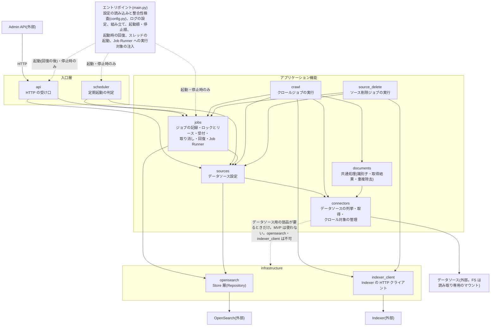
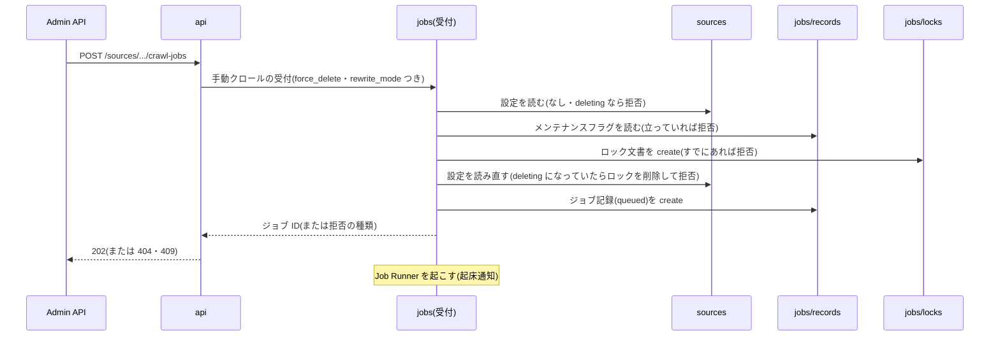
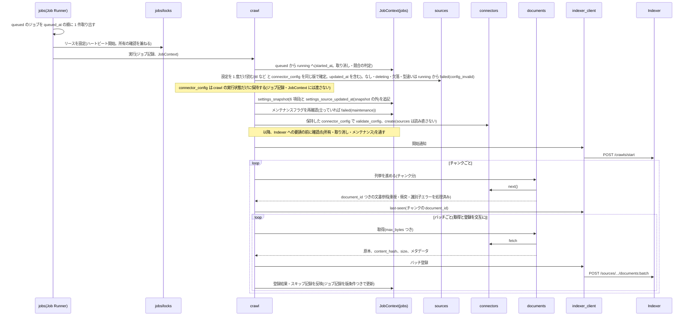
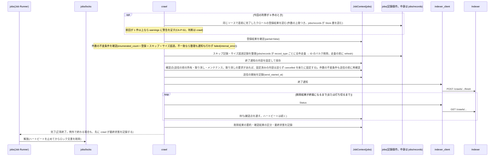
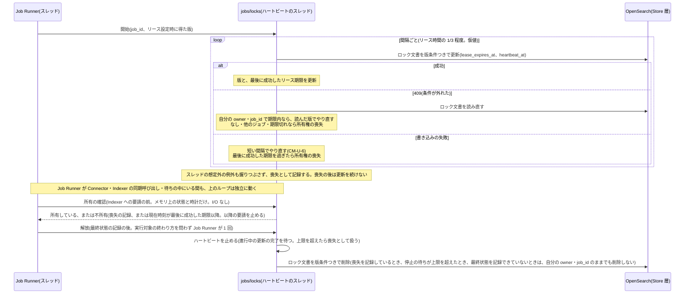
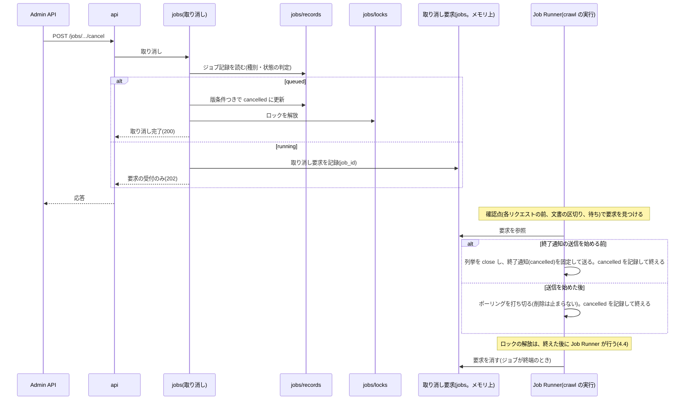
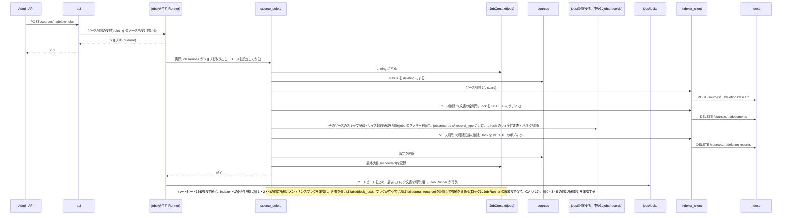
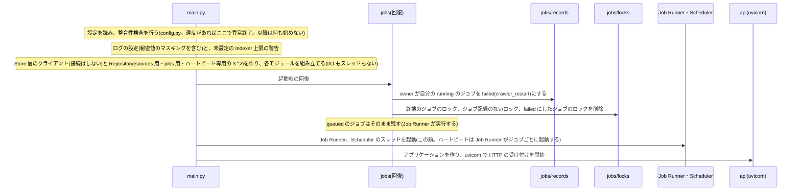
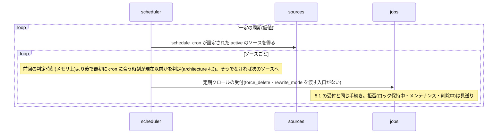

# Crawler モジュール構成設計書 v0.5

- 版: v0.5
- 更新日: 2026-11-16
- 前版: `crawler-module-structure-v0.4.md`
- 位置づけ: Crawler のコード上のモジュール分割と、モジュール間の依存・呼び出しの流れ。「何を、どのモジュールが担うか」を一目で分かるようにする。ジョブ・ロック・リース・リトライ・スキップ・連携・API 契約・Connector 仕様の仕様は他の Crawler 設計書が正本で、本書は仕様を変えず、再掲もしない。
- 本書は「案」「推測」「未決」を確定扱いにしない。**モジュールの分割、ディレクトリ名、並行モデル(スレッドの割り当て)は、ユーザー承認済みの案**(2026-11-16。v0.5 の改訂の 1。変更にはユーザー判断が要る)。ただし、承認済みの案に対応する architecture・interface の未決のうち、decisions の ID 列(decisions v0.3 の4章の表と CM-U-4・CA-U-3)にないもの — 並行モデルの CA-U-10・CI-U-9、`document_id` の二重実装対策の CA-U-9 — は、承認の時点では新たには解消しておらず、未決のまま残った(CA-U-9 は追補(2026-11-16)のユーザー回答で解消した。残る論点は 7.3 の冒頭)。ID は `CM-P-n` のまま付け替えず、`CM-K-n`(確定)の定義(ユーザー回答・既承認文書の引用)は変えていない。`CM-K` は、`connectors` を `infrastructure` の外の独立したモジュールにすることと、必要があれば `infrastructure` を使うこと(CM-K-10。ユーザーの指示)、Crawler にヘルスチェック用の API を置くこと(CM-K-11。ユーザーの回答。`GET /healthz` というパス・メソッドなどの詳細は案)、他文書・CLAUDE.md で確定済みの事項の引用に限る(7.2)。実装タスクで決めた内容(CM-P-28〜37。7.3)は、承認の対象外で、ユーザーの確定ではない。数値は「仮値・設定可能・未決」とし、本書では決めない(値は architecture 11章と各 Connector 文書。実装の既定値は `apps/crawler/README.md` 4章)。
  - **追補(2026-11-16。出典: ユーザーの回答。作業記録 0025)**: 未決の対話でのユーザーの回答を反映した(「案どおり承認」「ユーザー回答 2026-11-16」と書く。確定(`-K-`)への付け替えではない。版は上げず、その場で更新した)。(1) **定期起動の周期が cron 式に置き換わった**(`schedule_interval_seconds` を廃止し `schedule_cron` に。architecture CA-U-8 の解消・CA-P-12)ことに伴い、`scheduler`(4.2、5.8)と、`sources`・`api` の検証(4.1、4.3)を直した。ユーザー回答の範囲は、cron 式、標準の 5 項目(秒なし)、タイムゾーンは環境変数 1 つ、cron 式の解釈にライブラリを使う、Crawler が止まっていた間に過ぎた時刻は起動しない。`scheduler` が前回の判定時刻をメモリ上に持ち、`jobs` から直近の受付時刻を読まないこと、環境変数名、検証の絞り込み(別名の拒否など)は提案(新規 CM-P-38。ユーザー未確認)。実装で決めた内容(ユーザー回答ではない): cron 式の検証と次の時刻の計算を `sources/schedule_cron.py` に集約し(cronsim。`cronsim>=2.7,<2.8`)、`scheduler` と `sources` の検証関数が共有する。`jobs/records/latest_crawl.py` と `JobHistory.find_latest_crawl_queued_at` は削除した(`scheduler` が使わなくなったため)。(2) **解消**: CM-U-3(`document_id` のテストベクタは Crawler 側だけ。実 Indexer との一致は別タスクの結合テストで確認する。`apps/indexer` は変更しない)、CM-U-9(Indexer の上限が未設定のときは警告して、その項目の検査を省略する。環境変数名は `LORELEY_CRAWLER_INDEXER_<Indexer の設定名>` のまま。compose で両者に同じ値を渡す定義は、infra の別タスク)。(3) 新規 ID: CM-P-38(提案。ユーザー未確認)。なお未決: CM-U-1・6・8(CM-U-6 は数値の実測後)。
- v0.5 の改訂(ユーザー指示 2026-11-16「未確認事項について、設計書は承認する。2設計書の改版に反映する。それ以外は別タスク」(「2設計書の改版」は、STATUS.md の判断待ち 2『設計書の改版』の意。「それ以外」は判断待ち 3〜5(infra 前提作業の起票・コミット・Integration Test)。ユーザー指示 2026-11-16『それ以外は別タスク』に従い、この改版では扱わない)。出典は作業記録 `agent_tasks/20261113_implement_crawler/0023-approve-and-revise-design.md`(以下「0023」)。実装の経緯は同タスクの作業記録 0005〜0022): 次の 2 点を行った。
  1. **承認の反映**: Crawler 設計書の現行版(architecture・crawler-api・module-structure・decisions と、connector 配下の interface・file-system・web)がユーザーに承認された(2026-11-16)。これまで「案」(`CM-P-n`)だったものは**ユーザー承認済みの案**として扱う。decisions の「ユーザー判断待ち」10件と、本書に関わる CM-U-4(停止時の扱い)・CA-U-3(メンテナンスフラグの書き込み手段)・CA-U-17(ソース削除の順 1・2・4 でのメンテナンスフラグの確認)は、設計書の案どおり承認された(実装もその案どおり)。承認は数値(仮値)の確定ではない。承認では解消しない未決(CM-U-1・3・8、CM-U-6 の実測、CM-U-9)は、未決のまま残した(7.4)。
  2. **実装で決めた内容の反映**: 実装タスク `20261113_implement_crawler`(`apps/crawler/`)で決めた内容と、実際のディレクトリ・ファイル、依存ルールの機械検査(`apps/crawler/tests/architecture/`)の実際を反映した。**実装で決めた内容は、ユーザーの確定でも承認でもない**(「実装で決めた内容」と明記した)。設計の方針(分割・依存の向き・並行モデル)は変えていない。改版依頼の記述と実装が食い違った箇所は、実装を正として本文に「実装」と明記した(4.2 の `TickWaiter` の置き場、5.3 の `StatusPoller` の公開範囲)。2.2 のハートビートのスレッドは、v0.4 の「1 スレッド」に反しないが、ジョブごとに作る点を明記した。
  - 変更した節: 冒頭、1章(表)、2.1(図のラベル・補足)、2.2(ハートビート、解放の例外、停止要求)、3章(ディレクトリ構成を実際に合わせ、ファイル一覧・設定・整合性検査・テスト構成を追加)、4.1〜4.11(各モジュールの実際の入口・分割・追加した決定)、5.2〜5.4・5.6・5.7(補足と、5.7 の起動・停止)、6章(R3・R4・R6・R7・R11 と領域別のアクセス範囲)、7.1(確認)、7.2(承認の扱い)、7.3(CM-P-28〜37 の追加と、既存の案の補足)、7.4(CM-U-2・4 ほか)、7.6(他文書への反映状況)、7.7(決めないこと)、関連文書の参照(architecture v0.4、crawler-api v0.4、decisions v0.4、interface v0.3、FS v0.3)。
  - 新規 ID: CM-P-28〜37(7.3。実装で決めた内容)。承認(案どおり承認、ID は付け替えない): CM-U-4。実装時に決める事項として実装で決めた: CM-U-2(CM-P-29)。他の CM-U(1・3・6・8・9)は未決のまま(CM-U-9 は実装が仮置き(a)で動いている旨を注記。7.4)(承認の時点の記述。追補(2026-11-16)で CM-U-3・9 は解消)。CM-K の追加・変更はない。
- v0.4 の改訂(ユーザー回答 2026-11-13。出典は `agent_tasks/20261113_implement_crawler/0003-plan-approval-and-healthz-update.md`(以下「0003」)の §1): 完了条件 9「起動確認」の方法についての質問に対し、ユーザーが「`/healthz` を追加する」と回答した(2026-11-13)。ヘルスチェックの要否(CM-U-5、crawler-api の CAPI-U-9)の解消はこれによる。**Crawler にヘルスチェック用の API を置く**ことを確定した(CM-U-5 の解消。CM-K-11。crawler-api の CAPI-U-9 も同時に解消。CAPI-K-9)。確定は「置く」ことだけ。`GET /healthz` というパス・メソッド、応答の形、動作、crawler-api の契約外の API とする位置づけは、CM-U-5 にあった案(`api` が担当機能を呼ばずに受付開始後に 200 を返す。Indexer と同趣旨)のまま案(CM-P-27)。起動順(整合性検査 -> OpenSearch への接続 -> 起動時の回復 -> スレッドの起動 -> HTTP の受け付け。CM-P-17)は変えず、ヘルスチェック用の API は受け付けの開始後にだけ応答する(案。回復の完了前は接続できない)。Dockerfile の `HEALTHCHECK` と compose のヘルスチェックの設定は実装・infra 側で、本書は値を決めない。
  - 変更した節: 1章(`api` の入力)、4.1(やること・やらないこと・API の担当)、5.7(回復中は応答しないこと)、7.1(確認した事実)、7.2(CM-K-11)、7.3(CM-P-27)、7.4(CM-U-5 を解消)、7.6(crawler-api 5.4 の委任への回答)、7.7(決めないこと)、関連文書の参照(architecture v0.3、crawler-api v0.3、decisions v0.3)。他の仕様・モジュール分割・依存ルールは変えていない。
  - 新規 ID: CM-K-11、CM-P-27。解消: CM-U-5。他の未決・案(CM-U-1〜4・6・8・9、CM-P-1〜26)は変更していない。
- v0.3 の改訂(ユーザーの指示。作業記録 0013): **`connectors` を `infrastructure` の配下から出し、独立したモジュールにした**(アプリケーション機能の層。ディレクトリは `connectors/`)。理由は、Connector がデータソースへの単純な接続だけでなく、クロール対象の管理など複雑な処理を持つため。Connector がデータソースにアクセスするために必要があれば、`infrastructure` を使う構成とする。確定は CM-K-10(ユーザーの指示。置き場と、必要があれば `infrastructure` を使うことだけ)で、具体の依存ルール・内部構成は案のまま。
  - 変更した節: 1章(表・説明)、2.1(図・凡例)、3章(ディレクトリ構成)、4.10、6章(R2〜R5)、7.2(CM-K-10 を追加)、7.3(CM-P-1・CM-P-7)、7.4(CM-U-8)、7.6(対応表の 1 行)。他の節の仕様は変えていない。
  - 依存の変更: アプリケーション機能どうしの依存が 6 本から 9 本になった(`sources`・`crawl`・`documents` → `connectors`。R3)。`infrastructure` は `opensearch`・`indexer_client` の 2 モジュールになった(R5)。`connectors` は `opensearch`・`indexer_client`・他のアプリケーション機能に依存しない(R5。interface 1.4)。
  - 追記(軽微な指摘への対応。作業記録 0014): R2 の表現を「データソースへのアクセスは `connectors` だけが行う」から、責務の分担(探索・取得の制御は `connectors`、外部 API との通信や認証などの低レベルな I/O は必要に応じて `infrastructure` に委ねる)に直した。`infrastructure` のクライアントの渡し方を CM-P-26(案)として追加した(Composition Root の `main.py` が Client Factory を作って `ConnectorType` に渡す。`create(config)` は変えない。CM-P-9 の `FsOps` の注入と同じ考え方)。
  - 新規 ID: CM-K-10、CM-P-26。更新: CM-P-1・CM-P-7、CM-U-8。他の Crawler 設計書(architecture・interface・FS・Web・crawler-api)は、`connectors` の置き場を書いておらず、変更不要(7.6)。decisions は参照先を v0.3 にした版(decisions-v0.2)を作る。
- v0.2 の改訂: `crawler-architecture-v0.2.md`(外部レビューへの対応。同書冒頭に要約がある)への追従。仕様は architecture が正本で、本書はどのモジュールが担うかだけを直した。
  - 実行開始(手順 6)の順序を architecture に合わせた(Job Runner がリース設定 → `crawl` が `queued` -> `running`(取り消し・競合の判定)→ `loreley-sources` を 1 度だけ読む → `settings_snapshot` と `settings_source_updated_at` を追記。設定の読み取りの失敗は `running` からの `config_invalid`)。`connector_config` は `crawl` の実行状態だけに持つ(`jobs`・`JobContext`・ジョブ記録には持たせない)。診断用の読んだ版は、`settings_snapshot` の外の最上位項目 `settings_source_updated_at`(4.4、4.5、5.2。CM-P-22。architecture CA-P-51)。0 件列挙の警告のための、直前の完了したクロールの登録結果の読み取りは `jobs` の記録操作(4.4、4.5、5.3。CM-P-23。CA-P-52)。
  - `opensearch`(Repository)に、全件走査(PIT + `search_after`)、ID のバルク削除、条件指定の削除を追加し、走査・条件指定の削除は開始前に refresh する(4.8。CM-P-24。CA-P-53・54)。メモリ上のフェイクにも同じ契約が要る(3章、CM-P-18)。
  - 起動時の整合性検査を `config.py` に置き、失敗なら `main.py` が起動を中止する(3章、5.7。CM-P-25。CA-P-55)。入力は「Indexer の設定名に対応する値を compose で Crawler にも渡す」形で、`last-seen` の分割の上限を加えた。実際の環境変数名と未設定の扱いは CM-U-9。
  - 索引・マッピングは既存の `opensearch-init` が作成・管理する(確定。CM-K-9。CA-K-21)。Crawler の `opensearch` は作らない(4.8)。CM-U-7 は解消。
  - 新規 ID: CM-K-9、CM-P-22〜25、CM-U-9。解消: CM-U-7。更新: CM-P-10・17・18、CM-U-1・6。参照している architecture の章番号・ID は v0.2 でも実在する(7.1 の確認)。他文書への依頼は 7.6。

区分の凡例(Indexer 設計書に合わせる):

| 区分 | 意味 |
| --- | --- |
| 確定 | ユーザーが確定した事項(出典を書く) |
| 案 | ユーザー承認済みの案(2026-11-16。承認済み。変更にはユーザー判断が要る)。`CM-K`(確定)ではない。ID は `CM-P-n` のまま。v0.4 以前の記述の「案」「ユーザー未確定」は、この承認で承認済みの案になった |
| 実装で決めた内容 | 実装タスク `20261113_implement_crawler` で実装担当が決めた事項(本文に「実装で決めた内容」と明記。CM-P-28〜37)。ユーザーの確定でも承認でもない。ユーザー指示 2026-11-16 で本書に反映した |
| 提案(ユーザー未確認) | 追補(2026-11-16)で追加した `CM-P-38`(architecture の `CA-P-77`、crawler-api の `CAPI-P-30` も同じ)。ユーザーの回答を受けて、メインが整理した細部と、実装で決めた細部。ユーザーは確認していない。承認済みの案でも、確定でもない |
| 未決 | 決めていない |
| 推測 | 根拠が弱い想定。推測と注記した事項(実機未確認を含む) |
| 導出 | 他の仕様から導いた事項(明示された記述がなく、本書で導いた事項) |

ID 体系: 本書の確定・案・未決は `CM-K-n` / `CM-P-n` / `CM-U-n`。既存設計との不整合は `I-n`(本書の予約範囲は I-50〜。本書で新たに立てる I-n はない。I-50(FS 9.2 の「ロック解放かコンテナの再起動で解消」の誤り)と I-51(architecture 7.5 の「共通処理が保持するメモリ上の集合」と interface 2章の定義のずれ)は、他文書の修正で解消したため欠番とし、I-52 以降も使わない。7.5)。`CA-*` は architecture、`CI-*` は interface、`CAPI-*` は crawler-api、`CFS-*` は FS、`CW-*` は Web の ID。

関連文書:

| 文書 | 内容 | 本書との関係 |
| --- | --- | --- |
| `crawler/crawler-architecture-v0.4.md`(以下 architecture) | ジョブ、ロック・リース、リトライ・スキップ、Indexer との連携、データモデル。13.7 に本書への申し送り | 仕様の正本。本書はどのモジュールが担うかを示す |
| `crawler/connector/connector-interface-v0.3.md`(以下 interface) | Connector の抽象、識別子規則、エラー分類。11.6 に本書への申し送り | 同上 |
| `crawler/crawler-api-v0.4.md`(以下 crawler-api) | Admin API -> Crawler の契約 | 同上 |
| `crawler/connector/connector-file-system-v0.3.md`(以下 FS)、`connector-web-v0.3.md`(以下 Web) | Connector 固有の設計。FS 9.2 にテスト用の注入点の申し送り | 同上 |
| `crawler/crawler-design-decisions-v0.4.md`(以下 decisions) | 実装着手のための短い決定事項の文書(採用方針、ユーザー確定事項、実装着手を妨げる未決、実装者が決めてよい事項) | 本書と各設計書の要約。理由・詳細は本書と各設計書が正で、食い違えば decisions を直す(承認済みの案) |
| `apps/crawler/`(`src/loreley_crawler/`、`tests/architecture/`、`README.md`) | Crawler の実装(実装タスク `20261113_implement_crawler`。未コミット) | 3章・4章のディレクトリ・ファイルは、この実装に合わせた(v0.5)。挙動・環境変数・既定値は `README.md` が正。本書と食い違えば、まず実装を確認し、設計の変更はユーザー判断にする |
| `indexer/indexer-module-structure-v0.4.md` | Indexer の構成設計 | 形式・層構成・依存ルールの考え方を踏襲した(参考) |
| `apps/indexer/`(`pyproject.toml`、`main.py`、`tests/architecture/`、`tests/fakes/`) | Indexer の実装 | ディレクトリ・設定・テストの作り方の参考。コードは変更しない |
| `indexer/indexer-api-v0.10.md` | Crawler -> Indexer の契約 | `indexer_client` の呼び出し先。再掲しない |

---

## 1. 概要

Crawler は、データソースを列挙・取得して Indexer に登録させ、ジョブ・ロック・リースを管理し、削除結果を確認する(architecture 2章)。Admin API からの操作(起動・取り消し・ロック解放・設定の登録/更新・ソース削除)は HTTP で受ける(crawler-api)。実装言語は Python(CM-K-1)。実行は単一プロセスで、HTTP ハンドラ・Job Runner・ハートビート・Scheduler の 4 つの実行単位をスレッドで動かし、Connector と Indexer の呼び出しは同期で行う(2.2。承認済みの案。CM-P-13)。

コードは Indexer に倣って 3 層(入口層 / アプリケーション機能 / infrastructure)に分け、層の外に全層から参照できる `common` を置く(承認済みの案。CM-P-1)。ただし `connectors` は `infrastructure` に置かず、アプリケーション機能の層の独立したモジュールとする(確定。CM-K-10)。データソースへの単純な接続にとどまらず、クロール対象の管理などの複雑な処理を持つため。`connectors` は、データソースへのアクセスに必要があれば `infrastructure` を使う(確定。CM-K-10)。MVP の FileSystem は使わない(承認済みの案。4.10)。

| モジュール | ディレクトリ | 役割 | 主な入力 | 主な出力 |
| --- | --- | --- | --- | --- |
| `api` | `api/` | Admin API からの HTTP を受け、形式を検証して担当機能へ渡す | HTTP リクエスト(crawler-api の 6 API と、契約外のヘルスチェック用の API(案: `GET /healthz`)) | HTTP 応答 |
| `scheduler` | `scheduler/` | 定期起動の時刻を判定し、`jobs` の受付を呼ぶ | 現在時刻、データソース設定(`schedule_cron`)。直近のクロールジョブは読まない(2026-11-16。CM-P-38) | 受付の呼び出し |
| `sources` | `sources/` | `loreley-sources` のデータソース設定の登録・更新・読み取り・削除と、その業務上の検証を行う(読み取りは `SourceReader`、書き込みは `SourceStore`。CM-P-28) | 設定の登録・更新・読み取り・削除の要請 | 設定、検証結果 |
| `jobs` | `jobs/` | ジョブの記録、ロック・リース(ハートビート)、受付、取り消し、ロック解放、起動時の回復、Job Runner を担う(ジョブ管理)。実行対象向けの記録操作のファサード(`DocumentRecords`・`JobHistory`)を入口に置く(CM-P-30) | 起動・取り消し・解放の要請、`queued` のジョブ | ジョブ記録、ロック文書、実行に渡す `JobContext` |
| `crawl` | `crawl/` | クロールジョブを実行する(列挙・`last-seen`・取得・バッチ登録・終了通知・ポーリング、リトライ・スキップの判断、登録結果の集計) | `running` にするジョブと `JobContext` | ジョブ記録の更新(`jobs` 経由)、Indexer への要請 |
| `source_delete` | `source_delete/` | ソース削除ジョブを実行する(architecture 8.1 の手順) | 同上 | ジョブ記録の更新、Indexer への要請、設定・記録の削除 |
| `documents` | `documents/` | Connector の呼び出し結果を Crawler の規則に合わせる共通処理(識別子規則、`document_id`、`content_hash`、重複除去、衝突検出)。Indexer の `documents` とは別物 | Connector の列挙・取得の結果 | 規則適用後の文書参照・原本 |
| `connectors` | `connectors/` | データソースの列挙・取得と、クロール対象の管理など Connector 固有の処理(interface の Connector。MVP は FileSystem)、`connector_type` から実装を引くレジストリ。独立したモジュールで、必要があれば `infrastructure` を使う(CM-K-10) | `connector_config`、文書参照、取得の上限 | 文書参照、原本とメタデータ、`ConnectorError` |
| `opensearch` | `infrastructure/opensearch/` | Store 層(`loreley-sources`・`loreley-jobs`)の Repository を OpenSearch で実装する | 取得・作成・条件付き置き換え/削除・一覧・全件走査・ID の一括削除の指示(条件指定の削除は置かない。4.8、CM-P-36) | 記録(版つき)、または結果の区分 |
| `indexer_client` | `infrastructure/indexer_client/` | Indexer の HTTP API を呼び、応答を呼び出し側が扱える形にする | 開始通知・`last-seen`・バッチ登録・終了通知・Status・ソース削除 1〜3 の要請 | 型付きの結果、または失敗の区分 |
| `common` | `common/` | 全層から参照できる共通部品(時計、日時形式、リトライの汎用機構、表示用の文字列整形、ログ、エラー型)。他のモジュールに依存しない葉(CM-P-20) | 各モジュールからの利用 | 型・関数 |

ディレクトリは `src/loreley_crawler/`(3章)からの相対。行は層の順(入口層、アプリケーション機能、infrastructure)で、層の外の `common` は最後。`connectors` はアプリケーション機能の層にある。依存先は 4章、依存のルールは 6章にある。

読み方:

- **分割と呼び出し関係は 7.3 の `CM-P` の承認済みの案(2026-11-16)が基本。`CM-K` は、他文書・CLAUDE.md で確定済みの事項の引用と、`connectors` の置き場の CM-K-10、ヘルスチェック用の API を置く CM-K-11 だけ。実装で決めた内容(CM-P-28〜37)は承認の対象外で、ユーザーの確定ではない。並行モデル(CM-P-13・14)と `document_id` の二重実装対策(CM-P-6)は承認済みの案だが、対応する CA-U-10・CI-U-9・CA-U-9 は未決のまま(7.3 の冒頭)。**
- 仕様の正本は architecture(ジョブ・ロック・リトライ・連携)、interface(識別子規則・エラー分類・Connector の抽象)、crawler-api(API 契約)、FS・Web(Connector 固有)。本書は仕様を変えない。
- 申し送り(architecture 13.7、interface 11.6、FS 9.2、Indexer クライアントの要件)への回答は 7.6 に対応表がある。

---

## 2. 構成図

### 2.1 モジュールと依存

責務と依存の向きだけを示す。処理の順序は 5章のシーケンス図にある。承認済みの案と実装で決めた内容の一覧は 7.3。



凡例:

| 記号 | 意味 |
| --- | --- |
| 矢印 `A --> B` | A が B を呼ぶ(呼ぶ側 → 呼ばれる側)。データの流れではない |
| 点線 | 用途が限られる呼び出し(ラベルのとおり)。`conn` から `L3`(infrastructure)への点線は、データソースへのアクセス用に新設する部品が要るときだけ使ってよいことを示す(MVP の FileSystem は使わない。承認済みの案。R2)。`opensearch`・`indexer_client` は使えない(R5) |
| 3 つの枠 | 層。層をまたぐ呼び出しは上から下へだけ。同じ層(アプリケーション機能)の中の呼び出しは図にある 9 本だけ(R3) |

`jobs` は `crawl`・`source_delete` を呼ばない。Job Runner が実行する対象は `main.py` が起動時に渡す(CM-P-4)。`crawl --> conn` は Connector の生成(レジストリ)と型の参照のためで、列挙・取得の呼び出しは `documents` が包む。`connectors` は他のアプリケーション機能を呼ばない(葉)。`common`(全層から参照できる葉。R10)は、矢印が多くなるため図に描かない。OpenSearch 内の索引ごとのアクセス範囲は 6章の表にある。

実装(`apps/crawler/`)の import の辺は、この図と一致する(7.1)。図に描かない補足(実装で決めた内容。CM-P-28・30・33):

- `crawl`・`source_delete`・`scheduler`・`api` は `jobs` の入口だけを import し、`jobs/records/`・`jobs/locks/` は import しない。`crawl`・`source_delete` は R3 により `infrastructure.opensearch` を import できないので、`jobs` の入口に、`Repository` を内部に束ねた記録操作のファサード(`DocumentRecords`・`JobHistory`)を置いた(4.4)。
- `jobs`・`crawl`・`scheduler` が `sources` から使うのは、読み取りだけの `SourceReader`。書き込みの `SourceStore` を使うのは `api` と `source_delete`(と、組み立てる `main.py`)だけ(4.3、R7)。
- `api` が使う `ConnectorRegistry`・`ConnectorError` は `sources` の入口が再公開したもので、`api` は `connectors` を直接 import しない(R4)。
- `main.py` は Composition Root として、各モジュールの入口に加え、`jobs/records/`・`jobs/locks/`(`JobRecordStore`・`LockStore`・`Heartbeat`・`is_maintenance_enabled`)と `infrastructure` の 2 モジュールを直接 import する。

### 2.2 実行の単位(スレッド)

単一プロセスで、次の 4 つの実行単位が動く(承認済みの案。CM-P-13)。Indexer の実行モデル(同期クライアントと `threading` のワーカー、単一プロセス。`indexer-module-structure-v0.4.md` 1章)に揃えた。

| 実行の単位 | 数 | 担当モジュール | 行うこと | 行わないこと |
| --- | --- | --- | --- | --- |
| HTTP ハンドラ | uvicorn の 1 プロセス。同期ハンドラで、複数のスレッドで並行しうる | `api` → `jobs`・`sources` | 受付、取り消し、ロック解放、設定の登録・更新(Store 層の読み書き) | Connector の列挙・取得、Indexer の呼び出し |
| Job Runner | 1 スレッド | `jobs`(Runner)→ `crawl`・`source_delete` | `queued` のジョブを 1 件ずつ実行する。Connector の呼び出し、Indexer への同期呼び出し、`running` 以降のジョブ記録の書き込み、ポーリング、リトライの待ちのすべて | |
| ハートビート | 1 スレッド(実装: Job Runner がジョブごとに `Heartbeat` を作り、そのジョブの実行の間だけスレッドを持つ。直列実行なので同時には 1 つ) | `jobs/locks` | 実行中のジョブのロック文書のリース更新(architecture 5.3)。ジョブ記録は書かない | |
| Scheduler | 1 スレッド | `scheduler` | 定期起動の判定と、`jobs` の受付の呼び出し | |

Job Runner・ハートビート・Scheduler のスレッドは daemon スレッドで(実装で決めた内容。CM-P-35)、停止は `main.py` が `request_stop()` と `join(タイムアウトつき)` で行う(5.7)。

- **ハートビートはジョブ実行と独立に動く**。Job Runner のスレッドが、Connector の取得・Indexer の同期 HTTP・リトライの待ち・ポーリングの中で止まっていても、ハートビートは別スレッドで Store 層を更新し続ける(architecture 5.3 の要件。CA-U-10、CI-U-9 への回答案。両 ID は未決のまま。7.3)。所有の確認と解放の規則は、次の項に集約する(CM-P-14)。
- **所有の確認と解放の規則**(本書での正。他の節は参照する。architecture 5.3・5.5・5.7)
  - **所有の確認**: Job Runner が Indexer への要請の前に、ハートビートが持つメモリ上の状態と時計だけで確認する(I/O なし)。「所有していない」とするのは、(a) 喪失が記録されている、または (b) 現在時刻が最後に成功した更新のリース期限以降、のどちらかのとき(ハートビートが止まってもリース切れで以降の要請を止められ、architecture 5.7 を満たす)。(b) は確認の結果を返すだけで、喪失を記録しない。期限を過ぎたことを観測しただけでは喪失を永続化せず、その後に更新が成功すれば所有に戻る(実装で決めた内容。CM-P-31。architecture 5.3・5.7)。喪失を記録するのは、ハートビート(更新の失敗・ロック文書の消失・他のジョブのロック・スレッドの想定外の例外。例外は握りつぶさない)と、`lock_not_owned` を受けた実行対象(`JobContext` 経由)。喪失の後は、ハートビートは更新を続けない。
  - **解放**: 実行したジョブのロックの解放は、Job Runner が、実行対象の終わり方(正常・例外)を問わず 1 回行う。最終状態の記録の後に、ハートビートを止め(進行中の更新の完了を待つ。待ちの上限は専用クライアントのタイムアウトの 2 倍以上の仮値。CM-U-6)、読んだ版を条件にロック文書を削除する(条件が外れたら読み直す)。
  - **喪失を記録しているときは、ロック文書が自分の `owner`・`job_id` のままでも削除しない**(保守側に倒す。回復や管理者の解放に委ねる)。停止の待ちの上限を超えたときも、喪失として扱い、ロック文書は削除せずに終了処理を続ける(以後の更新は無効にする)。
  - **最終状態を記録できていない(ジョブが終端と分かっていない)ときも、ロック文書は削除しない**(実装で決めた内容。CM-P-31)。「実行対象の終わり方を問わず 1 回」の例外で、`running` のジョブのロックを消して、新しい受付を通さないようにするため。ハートビートは必ず止める。リース切れの後は、管理者の解放が `failed`(`lock_released`)にする。
  - 受付の巻き戻し、`queued` の取り消し、管理者の解放、起動時の回復によるロック文書の削除は、それぞれ `jobs` の該当処理が行う(Job Runner の解放ではない)。
- **ブロッキングの扱い**: ブロッキングする `os.read` の待ち中も別のスレッドが進むことを、macOS・CPython 3.13.4 で確認した(7.1。Linux コンテナ・NFS/SMB は未確認で、推測)。このため、ハードマウントの共有の停止などで Job Runner が戻らない呼び出しの中にいても、ハートビートは続いてリースは切れない。このとき管理者のロック解放は `lock_in_use` で拒否されるので、脱出手段は Crawler の再起動による回復だけ(architecture 4.7・5.8、crawler-api 4.3。MVP は、呼び出しの停止を検知するウォッチドッグを設けない。案。FS 9.2 の「ロック解放でも解消できる」旨の記述は、この点に合わせて修正済み。7.6)。
- **asyncio・別プロセスのハートビートを採らない理由**(案): interface 3.2 の `fetch`・`next()` と FS の `os.*`、Indexer 呼び出しは同期の呼び出しで、非同期にすると、結局これらをスレッドに逃がすことになる。ハートビートだけを別プロセスにすると、Job Runner の I/O なしの所有確認に要る所有状態(最後に成功したリース期限・喪失の有無)をプロセス間で共有する必要が出る(取り消し要求の共有も複雑になる。CA-P-44)。スレッドの限界として、Job Runner が GIL を保持し続ける長い処理(GIL を解放しない拡張モジュールの呼び出しなど)の間は、ハートビートも進まなくなりうる(推測。MVP は、そのような処理を想定しない)。
- **スレッド間で共有する状態**は次の 6 つに限る(CM-P-13)。(1) 取り消し要求(`jobs`。CM-P-15)。(2) ハートビートの所有状態(`jobs/locks`。CM-P-14)。(1)(2) は 1 か所に置き、排他で守る。(3) Store 層のクライアント(Job Runner・HTTP ハンドラ・Scheduler の各スレッドが共有するクライアントを複数スレッドから使えるかは未確認。ハートビートは専用のクライアントを持つ。CM-P-14、CM-U-1)。(4) 時計。(5) Job Runner の起床通知。(6) 停止要求。(5)(6) は同期の部品(イベント)。実装では、(5) は `main.py` が 1 つ作って受付と Job Runner に渡し(`RunnerWakeup`。`wait` は通知で戻ると `True` を返す)、(6) は Job Runner・Scheduler がそれぞれ持つイベントを、`main.py` が `request_stop()` で立てる(実装で決めた内容。CM-P-35)。`JobContext`(CM-P-16)は Job Runner のスレッドだけが使う。
- Job Runner は、受付が `queued` を保存したときの起床通知(プロセス内の通知)と、一定間隔の走査(取りこぼし対策。間隔は仮値。CM-U-6)で動く。

---

## 3. ディレクトリ構成

```text
apps/crawler/
├── Dockerfile
├── README.md                   # 起動・設定(環境変数と既定値)・運用・持ち越しの正
├── pyproject.toml, uv.lock
├── tests/                      # src の構成に合わせる。architecture/(依存ルール・書き込み範囲の検査)・fakes/ を持つ(CM-P-18)
└── src/
    └── loreley_crawler/        # Python パッケージ層
        ├── main.py             # エントリポイント(Composition Root)
        ├── config.py           # 環境変数の読み込みと整合性検査
        ├── common/             # 全層から参照できる共通部品。葉(CM-P-20)
        ├── api/
        ├── scheduler/
        ├── sources/
        ├── jobs/               # 直下に、受付・取り消し・ロック解放・回復・Job Runner・JobContext・記録操作のファサードを置く
        │   ├── records/        # loreley-jobs の記録(ジョブ・スキップ・サイズ超過・メンテナンスフラグ)
        │   └── locks/          # ロック文書とハートビート
        ├── crawl/
        ├── source_delete/
        ├── documents/          # 共通処理(Indexer の documents とは別物)
        ├── connectors/         # アプリケーション機能の層の独立したモジュール(CM-K-10)。必要があれば infrastructure を使う
        │   ├── registry.py     # connector_type から実装を引くレジストリ
        │   ├── interface/      # 型・エラー・ConnectorType(Python への落とし込みは 4.10)
        │   └── filesystem/     # FS(MVP)
        └── infrastructure/
            ├── opensearch/
            └── indexer_client/
```

実際のファイル(`apps/crawler/src/loreley_crawler/` で確認。実装で決めた内容。CM-P-28〜37。各ファイルの責務は 4章):

| モジュール | ファイル |
| --- | --- |
| `common/` | `clock.py`(時計の抽象と `SystemClock`)、`timestamps.py`(日時の書式化と解釈)、`retry.py`(リトライの汎用機構)、`conflict.py`(版条件つき書き込みが競合したときの読み直しの回数)、`display_text.py`(表示用の文字列整形)、`errors.py`(共有のエラー型)、`log_masking.py`・`log_setup.py`(ログのマスキングと出力設定) |
| `api/` | `app.py`(アプリケーションの組み立て)、`routes.py`(6 つの API と `/healthz`)、`request_parsing.py`(形式の検証)、`request_body.py`(本文の読み込みと大きさの上限 10 MiB。CAPI-P-29)、`responses.py`(結果型から応答への写像)、`errors.py`(共通のエラー形式)、`middleware.py`(アクセスログと想定外の例外の吸収)、`dependencies.py`(`ApiDependencies`) |
| `scheduler/` | `scheduler.py`、`settings.py` |
| `sources/` | `records.py`(記録の形式と読み戻し)、`results.py`(結果の区分)、`source_store.py`(`SourceReader`・`SourceStore`)、`validation.py`(値の規則の検証関数)、`schedule_cron.py`(cron 式の検証と、次に合う時刻の計算。cronsim。`scheduler` と `validation.py` が共有する。CM-P-38) |
| `jobs/` 直下 | `admission.py`(受付)、`cancellation.py`(取り消し)、`cancel_requests.py`(取り消し要求のレジストリ)、`lock_release.py`(管理者のロック解放)、`lock_cleanup.py`(版条件つきのロック文書の削除)、`recovery.py`(起動時の回復)、`runner.py`(Job Runner)、`context.py`(`JobContext`)、`interruptions.py`(確認点が知らせる中断の例外)、`job_updates.py`(版条件つきのジョブ記録の更新)、`existing_job.py`(`lock_held` の既存ジョブの情報)、`wakeup.py`(起床通知)、`records_facade.py`(`DocumentRecords`・`JobHistory`)、`settings.py`、`log_text.py` |
| `jobs/records/` | `job_record.py`(ジョブ記録の形式。`FailureReason` を含む)、`job_store.py`、`job_ids.py`、`document_records.py`(スキップ・サイズ超過記録)、`purge.py`(整理・一括削除)、`previous_crawl.py`(直前に完了したクロール)、`maintenance_flag.py` |
| `jobs/locks/` | `lock_document.py`(ロック文書の形式)、`lock_store.py`(ロック文書の読み書き)、`heartbeat.py`(ハートビートと `TickWaiter`) |
| `crawl/` | `executor.py`(`CrawlExecutor`)、`run.py`(`CrawlRun`)、`start.py`(実行開始)、`snapshot.py`(設定スナップショット)、`batch_registration.py`、`fetch_stage.py`、`outcomes.py`(文書ごとの結果の記録と計数)、`skip_counter.py`、`tally.py`(登録結果の集計と ID 集合)、`finish_notice.py`、`status_polling.py`、`warning_log.py`、`indexer_calls.py`(Indexer 呼び出しのリトライ・確認点・失敗の対応づけ)、`failure.py`、`constants.py`、`dependencies.py`、`settings.py` |
| `source_delete/` | `executor.py`(`SourceDeleteExecutor`)、`indexer_calls.py`、`failure.py`、`dependencies.py` |
| `documents/` | `enumeration.py`(列挙の包み)、`fetching.py`(取得の包み)、`document_id.py`、`identifiers.py`(`external_id` の規則)、`errors.py`、`settings.py` |
| `connectors/` | `registry.py`、`interface/`(`connector.py`・`errors.py`・`models.py`)、`filesystem/`(`connector.py`・`config.py`・`settings.py`・`enumeration.py`・`fetch.py`・`patterns.py`・`paths.py`・`errors.py`・`fs_ops.py`) |
| `infrastructure/opensearch/` | `repository.py`(インターフェース)、`opensearch_repository.py`(実装)、`results.py`(結果の区分)、`queries.py`・`query_builder.py`(検索条件と並べ替え)、`scan.py`(全件走査)、`bulk_delete.py`、`classification.py`(例外・応答の分類)、`client_calls.py`、`connection.py`、`settings.py` |
| `infrastructure/indexer_client/` | `client.py`(インターフェース)、`http_client.py`(urllib3 の実装)、`models.py`(入力の型)、`payloads.py`(リクエストの組み立て)、`parsing.py`(応答の解釈)、`results.py`(型付きの結果)、`config.py` |

- パッケージ層・`main.py`・`config.py` は Python 前提の承認済みの案(CM-P-17)。分け方は Indexer の構成(`api`・アプリケーション機能・`infrastructure`・`common`)に倣う(CM-P-1)。Indexer と違い、データソースへのアクセスは `infrastructure` に置かず、`connectors` として独立させる(CM-K-10)。技術スタックも Indexer に揃えた(Python 3.12、FastAPI・uvicorn、pydantic・pydantic-settings、opensearch-py。実装の `pyproject.toml` で確認)。HTTP クライアントのライブラリは、実装で urllib3 に決めた(CM-P-29。CM-U-2)。
- Web Connector 用のディレクトリは、MVP では作らない(追加時の構成は CM-U-8)。
- モジュール内部のファイル名は、上の表が実装の実際で、実装が正本。ファイルの追加・改名で、本書の改版は要らない(モジュール境界・入口・依存の変更は要る)。`crawl` の内部は、責務ごとのファイルに分けた(実装で決めた内容)。
- `api/` は Admin API からの HTTP ハンドラの置き場(Indexer と同じ名前。`apps/api` とは別)。
- `main.py` は、設定の読み込み(整合性検査を含む。下記の `config.py`)、モジュールの組み立て、起動順・停止順、起動時の回復の呼び出し、スレッドの起動、Job Runner への実行対象(`crawl`・`source_delete`)の注入を担う(CM-P-4、CM-P-17、CM-P-25)。
- `config.py` は設定の読み込みを担う(承認済みの案。Indexer の M-15 と同じ作り)。各モジュールが自前の設定 dataclass(`*/settings.py`・`infrastructure/*/config.py` など)を持ち、`config.py` がそれらに値を詰める。モジュールは `config.py` に依存せず、値は `main.py` が渡す。`config.py` が import するのは、設定型を持つモジュールの入口だけ(内部には触れない。`tests/architecture/` が検査する)。環境変数の接頭辞は `LORELEY_CRAWLER_`(Indexer は `LORELEY_INDEXER_`)。設定する項目は、OpenSearch の接続先、Indexer の URL、`loreley-sources`・`loreley-jobs` の索引名(後者は、Indexer の `LORELEY_INDEXER_JOBS_INDEX_NAME`・`opensearch-init` の `JOBS_INDEX_NAME` と同じ値にする。architecture 10章。CA-U-14)、`owner`(CA-P-3)、architecture 11章の仮値、FS 文書の仮値、整合性検査に使う、Indexer の上限に対応する値(下記)、定期起動の cron 式を解釈するタイムゾーン(環境変数 `LORELEY_CRAWLER_TIMEZONE`。全ソース共通はユーザー回答。名前・IANA 名・未設定は UTC・不正な名前は設定エラーは提案。`SchedulerSettings.timezone` として `main.py` が渡す。CM-P-38)。数値は本書では決めない。
  - **環境変数名と必須項目**(実装で決めた内容。CM-P-34): 環境変数名は、設定のフィールド名の大文字に `LORELEY_CRAWLER_` を付けた名前。必須は `OWNER`・`OPENSEARCH_URL`・`INDEXER_URL` の 3 つで、未設定なら起動に失敗する(`OWNER` は 256 バイト以内・制御文字なし)。設定エラーのメッセージは、環境変数名・項目名・固定文・数値だけで、値(秘密を含む)を載せない。一覧と既定値は `apps/crawler/README.md` 4章が正。
- **起動時の整合性検査は `config.py` に置く**(承認済みの案。CM-P-25。architecture 10章・CA-P-55)。置き場の理由: (a) 検査は、各モジュールの設定 dataclass に詰める前後の値(Crawler の仮値)と、Indexer の上限という、設定の読み込みで得る値どうしの比較で、業務の判断ではない。(b) `config.py` はすでに全モジュールの設定値を集める唯一の場所で、各モジュールは `config.py` に依存しない(R1 の向きを変えない)。(c) `common` は業務の判断を持たない葉(4.11)で、Crawler の仮値の意味を知る検査は置けない。(d) Indexer も設定の整合を設定クラスの検証で起動時に行っている(`apps/indexer/src/loreley_indexer/config.py` の `model_validator`。7.1)。
  - **入力**(architecture 10章・11章): Crawler 自身の仮値を、11章の項目名で — `max_raw_bytes`、バッチの文書数、バッチの原本のバイト数、`last-seen` の分割の上限(1 回の要請の `document_ids` の最大件数。チャンクの件数とは別の項目で、チャンクの件数 500 は Indexer の上限に縛られない)、終了通知の ID 一覧の警告閾値 — 、Indexer の上限(Indexer の設定名 `MAX_RAW_BYTES`・`MAX_BATCH_DOCUMENTS`・`MAX_BATCH_BYTES`・`MAX_REQUEST_BODY_BYTES`・`MAX_LAST_SEEN_IDS`・`SKIP_OVERSIZE_ID_LIMIT`。`LORELEY_INDEXER_` を除いた名前)に対応する値と比べる。後者は、compose で Indexer と同じ値を Crawler にも渡す(Indexer の実際の環境変数名は `LORELEY_INDEXER_` つきで、`apps/indexer/src/loreley_indexer/config.py` の `env_prefix` で確認した。7.1)。Crawler が読む実際の環境変数名は、ユーザー回答 2026-11-16 で現状どおりとした(CM-U-9 を解消。compose で同じ値を渡す定義は、infra の別タスク)。**名前**: Indexer の設定名(`LORELEY_INDEXER_` を除いた名前)の前に `INDEXER_` を付けた名前、つまり `LORELEY_CRAWLER_INDEXER_<名前>` で読む(Crawler 自身の `LORELEY_CRAWLER_MAX_RAW_BYTES`(原本 1 件の上限)と取り違えないため。実装で決めた内容。CM-P-34)。
  - **検査の内容**は architecture 10章のとおり(本書は再掲しない)。比較の関数は、入力の値を受けて違反の一覧(項目名・Crawler の値・Indexer の上限)を返す純粋な関数にし、環境変数に依存しない形でテストできるようにする(承認済みの案。実装もその形)。実装は、architecture 10章の検査に次を加えた(実装で決めた内容。CM-P-34): (1) ハートビートの停止の待ち ≥ ハートビート専用クライアントのタイムアウトの 2 倍(ちょうど 2 倍は可)、(2) ハートビートの大小関係(再試行間隔 < 更新間隔 < リース)、(3) `loreley-sources` と `loreley-jobs` の索引名が異なること(記録 ID の衝突を防ぐため)。
  - **失敗時の動作**: 違反が 1 件でもあれば、`config.py` が設定エラー(`ConfigError`)を送出し、`main.py` は捕捉せずにプロセスを異常終了させる(終了コード非 0)。ログに項目名・Crawler の値・Indexer の上限を出す(数値と固定の名前だけ。値の秘密は出さない)。OpenSearch への接続・起動時の回復・スレッドの起動・HTTP の受け付けは、いずれも始めない(architecture 10章の起動順の先頭。CM-P-17)。上限の値が未設定のときの扱いは、下記。
  - **未設定のときの限界**: 既定の `deploy/compose/compose.yaml` は、Indexer に上限の変数を渡しておらず、Indexer はコードの既定値を使っている(7.1)。Crawler 側も未設定だと、検査が素通りしうる。未設定のときは、警告を出して、その項目の検査を省略する(ユーザー回答 2026-11-16。CM-U-9 を解消。Indexer の既定値との突き合わせ・起動の失敗は採らない。起動は続く。警告は項目名だけを出す)。本番では 6 項目を Indexer の実際の値に合わせて渡す(`apps/crawler/README.md` 4章)。
- `tests/` は `src` の構成に合わせ(案)、メモリ上の Repository・Indexer の偽物・固定時計・偽の Connector・偽の `FsOps`(CM-P-9)を `tests/fakes/` に置く。メモリ上の Repository は、`opensearch` の Repository と同じ操作(全件走査・ID の一括削除・条件指定の削除を含む。4.8、CM-P-24)と同じ結果の区分を実装する。ただしメモリ上では OpenSearch の 10,000 件の上限・PIT・refresh の遅れは起きないので、これらは実 OpenSearch の統合テストで確認する(architecture 12章 #37。CM-P-18)。`document_id` のテストベクタ(CM-P-6)のデータファイルと、依存ルールの検査(CM-P-18)も置く。

---

## 4. モジュール詳細

各モジュールを同じ形式で示す。節番号は architecture・interface・crawler-api・FS の節。括弧のタグ(CM-P-n)は 7.3 の案。どのモジュールも `common`(4.11)を使える(R10)ため、依存先には書かない。

### 4.1 `api`(CM-P-1)

- **役割**: Admin API からの HTTP を受け、形式を検証して担当機能へ渡す
- **やること**
  - crawler-api 1章の 6 つの API を受け付ける(担当は下表)
  - ヘルスチェック用の API(Crawler に置くことは確定。CM-K-11)を受け付け、担当機能(`jobs`・`sources`)のどれも呼ばずに 200 を返す(`GET /healthz` というパス・メソッド、応答の形、契約外とする位置づけは承認済みの案。CM-P-27)
  - リクエストの形式を検証し、違反の `reason`(`required`・`type`・`format`・`read_only`・`unknown_field`・`unsupported`。crawler-api 3.3)を決める: JSON の厳密な型(型変換をしない)、必須の項目、未知の項目、読み取り専用の項目、`job_id` の形式(crawler-api 3.2)。**値の規則そのもの**(`source_id` の形式、`ttl`・`min_delete_count` が整数、`ratio_threshold` が有限の数値、`schedule_cron` が 5 項目の cron 式の文字列または null(`sources/schedule_cron.py`。CM-P-38)、`connector_type` が登録済み)は `sources` が持ち、`api` はその検証関数を呼んで結果を `reason` に対応づける(crawler-api 4.4.1)
  - 業務上の結果(拒否の種類など)を、エラーコードと HTTP ステータスの応答にする(crawler-api 3.3)
  - **設定の更新(`PUT`)では、`sources` の更新を呼ぶ前に、保存済みの設定を 1 回読み(`SourceStore` の `fetch`。Store 層の異常は `ApiDependencies` のリトライで束ねる)、保存済みの `connector_type` で `connector_config` の `validate_config` を呼ぶ**(`connector_type` は登録後に変わらず、更新のリクエストには含まれないため。設定がない・`connector_type` が読めないときは検証せず、404・409・500 の判断は `sources` の更新の結果に任せる。実装で決めた内容。CM-P-33)
  - アクセスログと、想定外の例外の吸収を、共通の処理(`middleware.py`)で行う。ログに出すのは、メソッド・ルートのテンプレート・ステータス・所要時間だけ(R11。詳細は crawler-api)
  - HTTP の受け付けは、起動時の回復が終わった後に始める(起動順は `main.py`。architecture 10、CA-P-40)。ヘルスチェック用の API も同じで、受け付けの開始前は応答しない(接続できない)。実装は、`api` に「受付の可否」の状態を持たせず、`main.py` が回復の後にアプリケーションを作って uvicorn に渡すことで実現した(5.7。実装で決めた内容。CM-P-35)
- **やらないこと**: 受付の判断(ロック・メンテナンスフラグ・設定の状態)、ジョブ記録の書き込み、設定の保存、Connector の列挙・取得、Indexer の呼び出し。ヘルスチェック用の API(`GET /healthz`)でも、ジョブ・設定・OpenSearch・Indexer の状態を調べない(CM-P-27)
- **依存先**: `jobs`、`sources`。`ConnectorRegistry`・`ConnectorError`・`ErrorCategory`(検証関数の引数と送出する例外の型)は、`sources` の入口が再公開したものを使う。`api` は `connectors` を直接 import しない(R4。実装で決めた内容。CM-P-33)
- **公開する入口**: Admin API から HTTP リクエストを受け、下表の担当機能に渡し、その結果を応答として返す。入口は `create_app(ApiDependencies)`(`ApiDependencies` は、受付・取り消し・ロック解放・`SourceStore`・`ConnectorRegistry`・リトライの部品の束。`main.py` が組み立てて渡す)
- **元の節**: crawler-api 1・3・4章、architecture 4.3・4.7

API の担当(CM-P-1):

| API | 担当 |
| --- | --- |
| クロール起動(`POST /sources/{source_id}/crawl-jobs`) | `jobs`(手動の受付) |
| ソース削除ジョブ起動(`POST /sources/{source_id}/delete-jobs`) | `jobs`(受付。`status=deleting` のソースも受け付ける) |
| 取り消し(`POST /jobs/{job_id}/cancel`) | `jobs`(取り消し) |
| ロック解放(`DELETE /sources/{source_id}/lock`) | `jobs`(解放) |
| 設定の登録(`POST /sources`) | `sources` |
| 設定の更新(`PUT /sources/{source_id}`) | `sources`(`api` が、検証のために保存済みの設定を 1 回読む。上記) |
| ヘルスチェック用の API(`GET /healthz`。契約外とする位置づけとともに承認済みの案。CM-K-11、CM-P-27) | なし(担当機能を呼ばない) |

パスは crawler-api の案をそのまま使う。設定の登録・更新で呼ぶ `ConnectorType.validate_config` は I/O をしないので、HTTP ハンドラのスレッドから呼んでよい(`sources` が、`connectors` のレジストリが返す保護済みの `ConnectorType` を通して呼ぶ。4.10、R9)。

### 4.2 `scheduler`(CM-P-5)

- **役割**: 定期起動の時刻を判定し、`jobs` の受付を呼ぶ
- **やること**
  - 一定の周期(仮値。CM-U-6)で起きる
  - `schedule_cron` が設定されている `active` のデータソースを `sources` から得る
  - 前回の判定時刻(`scheduler` がメモリ上に持つ。永続化しない。生成時と `start()`(起動時の回復の後)に現在時刻で初期化する)より後で最初に cron に合う時刻が現在以前なら、そのソースの定期の受付を `jobs` に呼ぶ(1 回だけ。tick の間に複数の時刻が過ぎても 1 回)。全ソースの判定のあとで、前回の判定時刻を現在に進める(ソース一覧の読み取りに失敗した tick は進めない。個別ソースの受付で例外が出た tick は進める。architecture CA-P-77 (b))。cron 式の計算は、`config.py` が読み `main.py` が渡すタイムゾーン(全ソース共通。architecture 4.3・10章)で行う。時計が戻った tick は、前回の判定時刻を現在にそろえて起動しない。Crawler が止まっていた間に過ぎた時刻は起動しない(ユーザー回答 2026-11-16)。ジョブ記録の `queued_at` や、設定の登録・更新時刻は使わない(`jobs` から直近の受付時刻を読まない)。判定の実装は提案(CM-P-38。architecture CA-P-77。ユーザー未確認)
  - 起動すると決めたら、`jobs` の定期の受付を呼ぶ。この入口は `force_delete`・`rewrite_mode` を受け取らない(常に `false`。CA-P-13)
  - 受付の拒否(ロック保持中・メンテナンス中・削除中)は、その回を見送るだけで、待ち行列を作らず取り返さない
  - 周期の待ちは、停止要求で中断できる待ち(`TickWaiter`。既定の実装は `EventTickWaiter`)で行う。`TickWaiter` の型と `EventTickWaiter` はハートビートと共通の部品で、`jobs/locks/heartbeat.py` に定義され、`jobs` の入口が公開している。`Scheduler` はそのインスタンスを自分で持つ(ハートビートと共有しない)。改版依頼(作業記録 0016 §6)は「`scheduler` は独自の待ち(`TickWaiter`)を持つ」としていたが、実装は型を `jobs` の入口から借りている(`scheduler` → `jobs` の依存は R3・R4 の範囲内。実装を正とした。CM-P-30)
- **やらないこと**: 受付の判断そのもの、ジョブ記録の書き込み、ジョブの実行
- **依存先**: `jobs`(受付・`TickWaiter`。`JobHistory` は使わない。CM-P-38)、`sources`(読み取りだけの `SourceReader` と、cron 式の計算 `next_fire_time`。CM-P-38)
- **公開する入口**: Scheduler のスレッドの開始と停止(`start`・`request_stop`・`join`)。判定の 1 周(`run_once`)はスレッドなしでも呼べ、テストは決定的に確かめられる
- **元の節**: architecture 4.3、CA-P-12・CA-P-13・CA-P-77

### 4.3 `sources`(CM-P-3)

- **役割**: `loreley-sources` のデータソース設定を扱う。記録の形式(architecture 3.2)と書き込みの規則を持つ。`loreley-sources` に書く唯一のモジュール
- **やること**
  - 設定の登録: 存在しない場合だけ成功する作成。同じ内容の再送は成功、内容が異なる、または `status=deleting` なら競合の結果を返す(crawler-api 4.4.2)
  - 設定の更新: 変更できる項目の全置換。読んだ版を条件にし、`status` は現在の値を保つ。内容が同じなら書き込まない(crawler-api 4.4.3)
  - 設定の読み取りと一覧(`jobs` の受付、`scheduler`、`crawl` が使う)。1 回の読み取りは、`ttl`・`ratio_threshold`・`min_delete_count`・`connector_config`・`updated_at` など、読んだ時点のレコード全体を 1 つの値として返す。`crawl` は、実行開始でこの値を 1 度だけ得て使い、項目ごとに読み直さない(CM-P-22。architecture 3.2・4.5。CA-P-51)
  - ソース削除ジョブのための `status=deleting` への更新と、設定の削除(architecture 8.1 の順 0・5)
  - 値の規則の検証(検証関数として公開し、`api` が呼んで `reason` に対応づける): `source_id`(CA-K-13。文字種は承認済みの案で CAPI-P-15。実装は `sources/validation.py` の 1 か所に局所化)、`ttl`・`min_delete_count` が整数、`ratio_threshold` が有限の数値(範囲は見ない)、`schedule_cron` が 5 項目の cron 式の文字列または null(解釈は `sources/schedule_cron.py`。CM-P-38)、`connector_type` が `connectors` のレジストリに登録されていること(crawler-api 4.4.1)
  - `connector_config` を、レジストリが返す保護済みの `ConnectorType` の `validate_config` で確認する(I/O なし。想定外の例外は `connectors` 側で `connector_internal_error` に変換済み。4.10)
  - **読み取りと書き込みの分離**(実装で決めた内容。CM-P-28): `SourceReader`(読み取りと一覧)と、それを継ぐ `SourceStore`(登録・更新・`deleting` への更新・削除)に分ける。`jobs` の受付・`scheduler`・`crawl` は `SourceReader` だけを受け取り、`SourceStore` を使うのは `api` と `source_delete` だけ(`main.py` が組み立てる)。書き込みの入口を型で絞り、R7 の機械検査(6章)で `SourceStore` の import 元を限る。`SourceStore` の書き込みはすべて `create` か読んだ版を条件にした置き換え・削除で、版条件なしの書き込みはしない
  - **リトライの分担**(実装で決めた内容。CM-P-28): 登録・更新は HTTP ハンドラから直接呼ばれ、呼び出し側にリトライの場がないので、`SourceStore` が Store 層の全体の異常(`StoreUnavailableError`)を、操作全体(読み・比較・書き)を単位にリトライする。内容の比較で成否を決めるので、応答が失われた書き込みの再実行は、すでに成功していた場合も成功になる(登録は 200、更新は変更なし)。読み取り・`mark_deleting`・`delete` は 1 回の試行で、リトライは呼び出し側(`JobContext` のリトライ・`api` のリトライ)が行う。競合(版が合わない)は読み直して判定し直し、解けなければ `StoreUnavailableError`(503)
  - 形式不正な保存済みの記録は `MalformedSourceRecord` で表す。更新で保存済みの `connector_type` を `api` が使えるよう、読める場合は `connector_type` を持たせる(4.1。CM-P-33)
- **やらないこと**: しきい値の範囲の検証(Admin API。CA-K-16)、接続確認(`validate_config` は I/O をしない)、JSON の形式の検証と `reason` の決定(→ `api`)、ジョブ・ロックの扱い(→ `jobs`)、`loreley-sources` 以外の索引への書き込み
- **依存先**: `opensearch`、`connectors`(レジストリと `validate_config` だけ)。入口(`__init__`)は、`ConnectorRegistry`・`ConnectorError`・`ErrorCategory` を再公開する(`api` が `connectors` を import できない R4 のため。CM-P-33)
- **公開する入口**: 設定の登録・更新・読み取り・一覧・`deleting` への更新・削除(読み取りは `SourceReader`、書き込みは `SourceStore`)。検証の結果は、呼び出し側が応答にできる区分で返す
- **元の節**: architecture 3.2・4.5・8.1・8.3、crawler-api 4.4

### 4.4 `jobs`(ジョブ管理。CM-P-2)

- **役割**: ジョブの記録、ロックとリース、受付、取り消し、ロック解放、起動時の回復、Job Runner を担う。`loreley-jobs` に書く唯一のモジュール。ジョブの実行の中身(列挙・登録・削除)は持たない

内部は、`loreley-jobs` の記録の種類ごとに 2 つのサブディレクトリに分け、受付などの手続きは直下に置く(CM-P-2)。

| 置き場 | 役割 |
| --- | --- |
| `records/` | ジョブ・スキップ・原本サイズ超過・メンテナンスフラグの記録の形式(architecture 3.3)と読み書き。ジョブ記録の更新はすべて読んだ版を条件にする(CA-P-43)。メンテナンスフラグは fail-closed で読む(CA-P-34)。ジョブ ID の生成(CA-P-1)。記録の整理・一括削除・直前に完了したクロールの取得(下の「公開する入口」。CM-P-23・CM-P-24) |
| `locks/` | ロック文書(architecture 5.1)の作成・リースの設定・読み取り・版条件つきの削除と、ハートビート(専用スレッド。CM-P-14) |
| 直下 | 受付・取り消し・ロック解放・起動時の回復・Job Runner・`JobContext`。実行対象向けの記録操作のファサード(`records_facade.py`。下の「公開する入口」。CM-P-30) |

実際のファイルは 3章の表。記録の型(`JobRecord`・`JobStatus`・`JobType`・`JobTrigger`・`FailureReason`)は `records/` にあり、入口が再公開する(実装で決めた内容。CM-P-30)。

- **やること**
  - 受付: 手動クロール・定期クロール・ソース削除の 3 つの入口が、同じ手続き(architecture 4.3 の手順 1〜5)を共有する。`api` と `scheduler` が同じ受付処理(`JobAdmission` の 1 つのインスタンス)を呼ぶ(CM-P-5)。クロールとソース削除の違い(`deleting` のソースを受け付けるか)と、`force_delete`・`rewrite_mode` を受け取るのが手動クロールの入口だけであることは、入口の引数で表す。受付が `queued` を保存したら、Job Runner を起こす。メンテナンスフラグの読み取りは、`main.py` が `jobs/records` の読み取り関数を束ねて受付と Job Runner に渡す(実装で決めた内容。CM-P-30)
  - 取り消し: `queued` は版条件つきで `cancelled` にしてロックを解放する。`running` は、取り消し要求をメモリ上のレジストリに記録する(CM-P-15)。実装は、要求を記録した後にジョブを読み直し、すでに終端なら要求を消す(終端の後に誰も消さない要求を残さないため。応答が 202 でなく 409 `job_already_finished` になりうる。実装で決めた内容。CM-P-31。architecture 4.7・crawler-api 4.2)。判定の順序は crawler-api 4.2、状態別の扱いは architecture 4.7
  - ロック解放(管理者): architecture 5.4 の対象のロックだけを解放し、`running` のジョブがあれば `failed`(`lock_released`)にする。受付の途中のロックを解放しない判定(`acquired_at`)を含む。実装の順序は、ロック文書の版条件つき削除が先、ジョブの `failed`(`lock_released`)が後(リースが再開していれば版が進んで削除に失敗し、判定し直して `lock_in_use` にする。実装で決めた内容。CM-P-31。architecture 5.4)
  - 起動時の回復: architecture 5.8 の手順 1〜4。実装は、`owner` が自分以外のジョブのロックには触れず警告し、判断できないもの(ロックが指すジョブ記録の `status` が形式不正など)は削除せずに警告して続行する(回復全体を止めない。実装で決めた内容。CM-P-31。architecture 5.8)
  - Job Runner: `queued` のジョブを `queued_at` の順に 1 件ずつ取り出し、リースを設定してハートビートを始め(architecture 4.5 の手順 6 の最初の段。所有の確認を兼ねる)、`job_type` に対応する実行対象を呼ぶ。実行対象は `main.py` から受け取り、`crawl`・`source_delete` を import しない(CM-P-4)。手順 6 のそれ以降(`running` への遷移、`loreley-sources` を 1 度だけ読む処理、スナップショットの追記、`connector_config` の保持)は、実行対象の `crawl` が、`JobContext` を通して行う(Job Runner は設定を読まず、`connector_config` も持たない。CM-P-22。下の `JobContext` と 4.5)。ただし、`queued` -> `running` の条件付き更新で取り消しに負けたときの停止(ロックの解放)は、Job Runner が行う(5.2)。実装で決めた内容(CM-P-31):
    - リース設定の時点でロックがない・他のジョブのものなら、実行せず、そのジョブを `queued` から `failed`(`lock_lost`)にする(所有なしに Indexer を呼ばないため)
    - ジョブを終端にできたときだけ次の走査を続け、Store 層の異常などで終端にできなかったときは走査間隔だけ待つ(`run_next` が真偽を返す)。先頭の `queued` が形式不正でも、Runner は止まらずに警告して待つ(ただし後続のジョブは実行されない。該当の記録を手で直す必要がある。`apps/crawler/README.md` 6章)
    - 起床通知を受けて戻るか、走査間隔(5 秒の仮値)で動く
  - **実行したジョブのロックの解放は Job Runner だけが行う**(CM-P-16): 実行対象は最終状態の記録までを担い、正常に終わっても例外で終わっても、ハートビートの停止とロック文書の削除は Job Runner が必ず 1 回行う。ただし、最終状態を記録できていないときと、喪失を記録しているときは、ロック文書を削除しない(2.2。CM-P-31)。受付の巻き戻し・`queued` の取り消し・管理者の解放・起動時の回復によるロック操作は、それぞれ `jobs` の該当処理が行う(区別。2.2)。解放の手順、喪失を記録しているときはロック文書を削除しない規則、停止の待ちの上限は 2.2(architecture 5.5・5.7)。`source_delete` の順 6 のロック文書の削除(K29 の順序で最後)も、この解放に当たる(最終状態の記録の直後。喪失を記録していれば削除しない)
  - **最後の手段**: 実行対象が、最終状態を記録しないまま例外を送出した(または記録せずに戻った)ときだけ、Job Runner が `failed` を記録してから解放する。理由は、`StoreUnavailableError` なら `store_unavailable`、それ以外(`StoreUnexpectedResponseError` を含む)なら `internal_error`。ログには例外の種類だけを出す(R11)。実行対象が `running` にする前に例外で終わった場合も同じで、`queued` から `failed` を書く(実装で決めた内容。CM-P-31。architecture 4.2 の遷移表、4.8)。想定外の例外の捕捉と終了通知(`failed`)の試みは、まず実行対象が行う(`crawl`。4.5)。最終状態は 1 度だけ記録し、終端の後の最後の手段は上書きしない(`JobContext.finish` が False を返す)
  - ハートビートの停止の待ち: 上限(仮値。CM-U-6。実装の既定は 30 秒。専用クライアントのタイムアウトの 2 倍以上)を超えたら喪失として扱い、ロック文書は削除せずに終了処理を続ける(2.2)
  - `JobContext`(CM-P-16): 実行対象(`crawl`・`source_delete`)に渡す、ジョブ単位の部品。次を提供する
    - 最後に書いた版を条件にしたジョブ記録の更新。条件が外れたら読み直し、`failed`(`lock_released`)などに変わっていれば所有権の喪失として知らせる(architecture 5.3)
    - 確認点: 所有の確認(規則は 2.2。I/O なし)、取り消し要求の確認、メンテナンスフラグの確認(`source_delete` では 8.1 の順 1・2・4 の送信の前にだけ確認する。承認済みの案。architecture 4.6・4.7・5.7・7.9・8.1、CA-U-17。順 0・3・5 は所有だけを確認し、フラグを読まない。4.6)。取り消し・所有権の喪失・メンテナンスは、それぞれの例外で知らせる。どの呼び出しの前でどれを確認するかは、実行対象が決める
    - 待ち: 確認点を通しながら中断できる待ち(リトライのバックオフ、ポーリングの間隔)。既定ではメンテナンスフラグを確認しない(Store 層を読むため。ポーリングの待ちで毎回読まない)
    - **公開する操作**(実装で決めた内容。CM-P-30): 確認点の指定は `Check`(`OWNERSHIP`・`CANCELLATION`・`MAINTENANCE` の組み合わせ)。`check(checks)`・`retrier(checks)`・`wait(seconds, checks)`・`record_lock_not_owned()`(Indexer の `lock_not_owned` を所有権の喪失として記録する)・`start_running()`(`started_at` の文字列を返す。条件付き更新に負けたときは `JobNotStartable`。実行対象は捕捉せず、Job Runner が扱う)・`record_settings(...)`(6 項目を厳密に検査し、1 度だけ書ける)・`update(changes)`(`status`・`connector_config` は書けない)・`finish(status, failure_reason, failure_detail, changes) -> bool`。`finish` は、`failed` なら `failure_reason` が必須で、`failure_detail` は保存前に表示用に整形する(512 文字)。すでに終端と分かっているとき、または他者が状態を変えていたときは、上書きせずに `False` を返す(後者は喪失として記録し、ロック文書を削除させない)
    - リトライ: `common` の汎用機構(CM-P-12)を、設定のリトライ値と確認点で束ねたもの。判断(何をリトライするか)は呼び出し側が渡す。`JobContext` は Job Runner のスレッドでしか使えないため、HTTP ハンドラ側の Store 層の書き込み(受付・取り消し・ロック解放・設定の登録/更新)のリトライは、呼び出し側(`jobs` の受付など・`sources`)が `common` の汎用機構を直接使う
    - 最終状態の記録(終了処理の前半。ロックの解放は Job Runner)
    - `connector_config` は持たない。`JobContext` が書く設定関連のジョブ記録は、`settings_snapshot`(CA-K-5 の確定の 6 項目だけ。丸ごと Indexer に送るので 7 番目を入れない)と、その外の最上位項目 `settings_source_updated_at`(読んだ設定の `updated_at`。診断用。案。architecture 3.3.1)の追記だけで、`connector_config` を書く項目も、保持する場所もない(`jobs` は Connector の設定の中身を知らない。実行中の保持先は `crawl` の実行状態。CM-P-22)。`queued` -> `running`(`started_at`)と、この追記は、別々の条件付き更新(それぞれ最後に書いた版を条件にする)で、`JobContext` がそのための操作を提供する
- **やらないこと**: 列挙・取得・Indexer への登録・削除の手順(→ `crawl`・`source_delete`)、リトライ・スキップの判断、登録結果の集計(→ `crawl`)、Indexer の呼び出し、`loreley-sources` の書き込み(読み取りだけ)、しきい値の検証
- **依存先**: `sources`(読み取りだけの `SourceReader`)、`opensearch`(`jobs/records`・`jobs/locks` と、ファサードが `Repository` を受け取るため)。内部は、直下 → `records/`・`locks/` で、`records/` と `locks/` は互いに依存しない(R6)。`records/`・`locks/` は `jobs` の入口と `sources` も import しない
- **公開する入口**
  - 受付(手動クロール・定期クロール・ソース削除)を受け、ジョブ ID または拒否の種類(`lock_held` のときは既存ジョブの情報)を返す
  - 取り消し、ロック解放を受け、結果を返す(結果は型付きのバリアント。`api` が応答に写像する)
  - 記録の読み書き(スキップ記録・サイズ超過記録の更新・整理・一括削除、直前に完了したクロールジョブの取得、メンテナンスフラグの読み取り)。`crawl`・`source_delete` が使う(`scheduler` は、cron 式への置き換え(2026-11-16)で、`loreley-jobs` を読まなくなった。CM-P-38)。**入口には、`Repository` を内部に束ねたファサード `DocumentRecords`(スキップ記録・サイズ超過記録の書き込み、整理、ソース単位の一括削除)と `JobHistory`(直前に完了したクロールの取得 `find_previous_completed_crawl`)を置き、`crawl`・`source_delete` はこれを通して `jobs/records` の操作を呼ぶ**(`crawl`・`source_delete` は R3 により `infrastructure.opensearch` を import できないため。`main.py` が `loreley-jobs` 用の Repository で組み立てて注入する。どの操作も、Store 層の全体の異常は呼び出し側が渡すリトライ(`JobContext` から取る確認点つきのもの)で尽くしてから送出し、`StoreUnexpectedResponseError` はリトライせず伝播する。実装で決めた内容。CM-P-30)。次の 2 点は v0.2 で追加した
    - 記録の整理と一括削除は、`opensearch` の全件走査(`record_type` の `skip`・`oversize` ごとに 1 回ずつ)と ID のバルク削除の上に作る(10,000 件を超えても取りこぼさない。architecture 6.4・3.1。CM-P-24)。そのソースの `skip`・`oversize` 記録の削除(`source_delete` の順 3)も、`jobs/records` の操作として公開する(実装は、`record_type` ごとの全件走査 + バルク削除。条件指定の削除は置かない。architecture 8.1。CA-P-54。CM-P-36)。全件走査の `sort` の一意性は呼び出し側の責任で、必ず一意な `document_id` で終える(ページ境界をまたぐ同値は検出できないため。実装は `jobs/records/purge.py` の `SCAN_SORT`)。`pit_expired` は操作単位のリトライでは直らないので、`with scan(...)` ブロック全体をやり直す単位にする
    - 0 件列挙の警告(architecture 7.7。CA-P-52)のための、同じソースで直前に列挙を完了した `crawl` ジョブの登録結果の取得(`registration.partial=false` の最新のもの。自分のジョブを除く。新しい順に、件数の上限つきで読む。上限は architecture 11章の仮値)。`loreley-jobs` を読めるのは `jobs/records` だけ(R7)なので、`crawl` は `jobs` のこの操作を呼ぶ。`registration` は索引しないため、`_source` を読んで判定する。警告を作るかどうかの判断と `warnings` への記録は `crawl`(CM-P-23)
  - 起動時の回復の実行(`StartupRecovery`)、Job Runner(`JobRunner`)の開始・停止(`start`・`request_stop`・`join`)。ハートビート(`Heartbeat`)は Job Runner がジョブごとに作る(`main.py` が渡すファクトリ。2.2)
  - 実行対象が実装するインターフェース(`JobExecutor`)と、`JobContext`・確認点(`Check`)・中断の例外(`CancellationRequested`・`OwnershipLost`・`MaintenanceDetected`・`JobNotStartable`)
  - `main.py` が共有する部品: 取り消し要求のレジストリ(`CancelRequestRegistry`)、起床通知(`RunnerWakeup`)、設定(`JobsSettings`・`HeartbeatSettings`)、周期の待ち(`TickWaiter`・`EventTickWaiter`。`scheduler` も使う)
- **元の節**: architecture 3.1・3.3、4.2〜4.8、5章、6.4、7.7、8.1、crawler-api 4.1〜4.3・4.6

### 4.5 `crawl`

- **役割**: クロールジョブを実行する(architecture 4.5 の手順 6〜13)。Job Runner が呼ぶ実行対象
- **やること**
  - 実行開始(architecture 4.5 の手順 6〜8。CM-P-22)。Job Runner がリースを設定した後、`crawl` が次の順に行う
    1. `queued` -> `running` にし、`started_at` を書く(`JobContext` 経由の条件付き更新。`crawl_started_at` はこの時刻で `started_at` と同じ値。取り消し・競合の判定はここ。取り消しに負けたときは、Job Runner がロックを解放して止める)
    2. `sources` から設定を **1 度だけ**読む(4.3)。`ttl`・`ratio_threshold`・`min_delete_count` と `connector_config` を、この 1 回の結果で確定する。設定レコードがない、`status=deleting`、値が欠けている・型が合わないときは、開始通知を送らずに、`running` から `config_invalid` で `failed`
    3. `settings_snapshot`(6 項目。`crawl_started_at` は手順 1 の時刻)と `settings_source_updated_at`(読んだ設定の `updated_at`。`settings_snapshot` の外の最上位項目)を、条件付き更新で追記する(`JobContext` 経由)。`connector_config` はジョブ記録に書かない。この追記の前に Crawler が止まっても、再起動時の回復で `failed`(`crawler_restart`)になり、開始通知は送られていないので害はない(architecture 3.2)
    4. メンテナンスフラグを再確認する(手順 7)
    5. 手順 2 で保持した `connector_config` で `validate_config`・`create` を行う(`sources` は読み直さない。レジストリが返す保護済みの `ConnectorType` を使う。想定外の例外は `connectors` 側で `connector_internal_error` に変換済み。4.10)。失敗したら開始通知を送らずに `failed`
    - `connector_config` の置き場は、`crawl` の実行状態(このジョブの実行が持つ、実行中だけのメモリ上の状態。ID 集合や登録結果の集計と同じ置き場)。ジョブ記録・`JobContext`・ログには出さない(中身は不透明で、認証情報の参照名を含みうるため。R11)。Crawler が再起動すると `running` のジョブは `failed` になり、再実行は新しいジョブとして読み直す(保存して復元する必要はない。architecture 3.2)
  - 開始通知。再送では保存済みの同一値を送る(architecture 7.4)
  - チャンク処理: `documents` が包んだ列挙からチャンクを作り、チャンクごとに `last-seen` → 取得 → バッチ登録を、取得と登録を交互に進めて行う。バッチの閉じ条件、失敗した文書だけの再送(architecture 4.6、7.3)
  - 失敗の扱いの適用: リトライ(`JobContext` 経由)、スキップ、原本サイズ超過、ジョブ `failed`、連続スキップの計数(取得段階・登録段階。architecture 6.2・6.3・7.8)。スキップ記録・原本サイズ超過記録の書き込みと整理(`jobs` の記録操作を呼ぶ。整理は全件走査と ID のバルク削除で行い、どの記録を消すかは `crawl` が判断する。architecture 6.4。CM-P-24)
  - 登録結果の集計(再送時は最初の結果を保持)と、`partial` の遷移・ジョブ記録への反映(architecture 7.7)
  - 0 件列挙の警告(architecture 7.7。CA-P-52): 列挙が 0 件で `Completed` になったとき、登録結果を `partial=false` で確定する前に、`jobs` の記録操作(4.4)で直前に完了したクロールの `registration.enumerated_count` を読み、1 件以上なら `warnings` に固定文のコードと前回の件数・`job_id` を足す。観測だけで、ジョブの status・終了通知・削除の挙動は変えない(CM-P-23)
  - 識別子エラー(`invalid_external_id`)の文書の計上(`invalid_id_count`)と、`partially_succeeded` への反映(architecture 7.7、CA-P-25)
  - `warnings` の記録: 識別子エラーの例(件数・長さに上限。architecture 7.7)、終了通知の ID 一覧の件数が警告閾値を超えそうなとき(CA-P-41)、受理の根拠が得られない終端状態(CA-P-29)、ポーリングを打ち切ったとき(architecture 7.6)
  - `failure_detail` の組み立て(分類名と、Connector の説明文または衝突した `external_id` と `document_id`。保存前に `common` の整形を通す。architecture 3.3.1、CA-P-45・CA-P-48)
  - 件数照合のための ID 集合(`skipped_document_ids`・`oversize_document_ids`)を、このクロールの実行状態として持つ。`enumerated_count` と、スキップ記録の整理(architecture 6.4。今回列挙された文書か)に必要な、列挙済みの件数と「ID が列挙済みか」の照会は、`documents` の列挙の包みに問い合わせる(architecture 7.5。CM-P-21)
  - バッチ応答の `document_id` を、`documents` が算出した値と照合する(architecture 7.11。CA-P-27)
  - 終了通知の組み立て・固定・送信(`send_started_at` の記録を含む)、`failed`・`cancelled` の通知(architecture 7.5)
  - 削除結果のポーリング、確認結果の区分、削除結果の要約の記録(architecture 7.6)
  - 確認点で知らされた取り消し・所有権の喪失・メンテナンスへの対応(列挙の `close()`、`outcome=cancelled`・`failed` の通知、ポーリングの打ち切りなど。architecture 4.7・5.7・7.9)
  - 最終状態の決定と理由コードの記録(Store 層への書き込みがリトライを尽くしても失敗したときの `store_unavailable` を含む。architecture 4.8、CA-P-50)。記録までが `crawl` の担当で、ロックの解放は Job Runner(4.4)
  - 実装で決めた内容(CM-P-32。仕様の正本は architecture。ここでは `crawl` が何を担うかだけ):
    - 件数の不変条件(`enumerated_count` = 登録 + スキップ + サイズ超過)の確認は、登録結果の確定の直後・記録の整理の前に置き、終了通知の送信前にも再確認する(二重防御)。不一致なら、整理も `enumeration_completed` も行わず、`failed`(`internal_error`)にして `failed` の通知を送る(architecture 7.5・6.4)
    - 記録の整理の判定は種別ごと: `skip` 記録は今回スキップした文書のものだけ、`oversize` 記録は今回サイズ超過だった文書のものだけ残し、それ以外(今回登録できた・別の種別になった・列挙されなかった文書)の記録は消す(architecture 6.4)
    - 終了通知は `FinishNotice`(`content` と `send_started_at`)。`enumeration_completed` の送信前に、所有・取り消し・メンテナンスを確認する(喪失・メンテナンス中は `failed` の通知を送る)。`failed`・`cancelled` の通知は `send_started_at` を記録しない(architecture 7.5・5.7)
    - 他者が終端にしたジョブ(`lock_released` など)には、通知も最終状態の記録も行わない(`JobContext.finish` が `False`。architecture 4.8)
  - 想定外の例外: `crawl` が自分で捕捉し、開始通知が成功した後で、`enumeration_completed` の初回送信を始める前(`send_started_at` の記録前)に限り、終了通知 `failed` を試みる(CA-P-28)。送信開始後は `failed` を送らない(受理の有無が不明で、別内容は Indexer が 409 `finish_content_mismatch` で拒否し、`failure_reason` を上書きしかねないため。architecture 4.7・4.8、CA-K-9)。そのうえで `failed`(`internal_error`)を記録して再送出する。Job Runner の最後の手段(4.4)は、それでも最終状態が記録されないまま例外が抜けた場合だけ
  - 終了時に、`EnumerationStream.close()` と `Connector.close()` を呼ぶ(正常・異常・取り消しのいずれでも)
- **やらないこと**: ジョブ・ロックの記録操作の実装(→ `jobs`)、Indexer との HTTP 通信そのもの(→ `indexer_client`)、`external_id`・`document_id` の規則(→ `documents`)、データソースの読み取り(→ `connectors`)、削除の判断(Indexer)
- **依存先**: `jobs`(入口の `JobContext`・ファサード `DocumentRecords`・`JobHistory`。`jobs/records/`・`jobs/locks/` は直接 import しない)、`sources`(読み取りだけの `SourceReader`)、`documents`、`indexer_client`、`connectors`(レジストリと型)
- **公開する入口**: 「ジョブ記録と `JobContext` を受けてクロールを実行する」(Job Runner が呼ぶ実行対象)。実装(CM-P-32): `CrawlExecutor(CrawlDependencies)` の `__call__(record, context)` が、実行開始から最終状態の記録までを行う(テスト用に、終了通知の手前まで実行する `run_until_finish_notice` もある)。`CrawlDependencies` は、`SourceReader`・`ConnectorRegistry`・`IndexerClient`・`DocumentRecords`・`JobHistory`・`Clock`・`CrawlSettings`・`DocumentsSettings` の束で、`main.py` が組み立てる。入口が公開する状態・結果の型は、`CrawlRun`(1 つのクロールの実行状態。列挙の包み・集計・ID 集合・警告・識別子エラーの例を持つ)・`PreparedCrawl`・`RegistrationTally`・`SettingsSnapshot`・`CrawlFailure`(理由コードと説明)・`FinishNotice`・`PollingResult`・`DeletionConfirmation`・`ConsecutiveSkipCounter`・`CrawlSettings`。削除結果のポーリングは `status_polling.py` の `StatusPoller` が行う(クラスは入口からは公開していない。内部の部品)
- **元の節**: architecture 3.2、4.5〜4.8、6章、7章

### 4.6 `source_delete`

- **役割**: ソース削除ジョブを実行する(architecture 8.1 の手順)。Job Runner が呼ぶ実行対象
- **やること**
  - 実行開始: `running` にし、`sources` を `status=deleting` にする(順 0)
  - 順 1・2・4: `indexer_client` のソース削除 1・2・3 を、`lock` つきで呼ぶ。各呼び出しの前に確認点(所有・メンテナンスフラグ)を通し、所有権を失ったら後続を止めて `failed`(`lock_lost`)に、フラグが立っていれば後続を止めて `failed`(`maintenance`)にする(ロックは終了処理まで保持し、再実行で復旧する。architecture 7.9・8.1・8.2、CA-U-17。承認済みの案)。順 1 の 409 `lock_not_owned` も順 2・4 と同様に扱う(architecture 7.8)
  - 順 3: そのソースのスキップ記録・原本サイズ超過記録を、`jobs` のファサード(`DocumentRecords`)で削除する(実装は `record_type`(`skip`・`oversize`)ごとの全件走査 + バルク削除。条件指定の削除は置かない。いずれも実行前に refresh し、10,000 件を超えても取りこぼさない。4.4、4.8。CM-P-24、CM-P-36。リトライを尽くしても失敗したら `failed`(`store_unavailable`。architecture 8.1・4.8))
  - 順 5: `sources` の設定を削除する(同上)。設定が `status=deleting` でないときは削除せず、`failed`(`internal_error`)にする(`SourceStore.delete` が `status=deleting` のときだけ削除するため。実装で決めた内容。CM-P-31。architecture 8.1・8.3)
  - **確認点の範囲**(実装で決めた内容の結論。CM-P-31。architecture 8.1・7.9): メンテナンスフラグは、順 1・2・4 の各試行の前に読む。順 0・3・5 の各試行の前は所有だけを確認し、フラグを読まない(順 0 の `deleting` への更新と、順 3・5 は Crawler 自身の記録の更新・削除で、フラグの目的の対象(検索インデックスへの書き込み)ではないため)。このため、ジョブの実行中にフラグを読むのは、リトライも待ちもなければ合計 3 回(順 1・2・4 に 1 回ずつ。待ちの間は約 1 秒ごとに確認点を通るので、その間も読む)。順 2 の最中にフラグが立っても順 3 は実行され、順 4 の前で `failed`(`maintenance`)になる(再実行で冪等に完了する)。順 4 の最中に立っても順 5 は実行される。取り消しは確認しない
  - 開始時に設定がなくても、冪等な順 1〜4 は実行し、ジョブは成功する(順 5 は削除済みとして成功。architecture 8.3)
  - 順 6: 最終状態(`succeeded`)を記録する。続くロック文書の削除(最後。K29)は Job Runner が行う(4.4)。失敗・所有権の喪失のときの最終状態の記録も `source_delete` が行う
  - 再実行: 順 3・5 は、すでに削除済みなら成功として扱う(architecture 8.3)。ロックは最後まで保持し、ハートビートも続く(CM-K-7)
- **やらないこと**: ジョブ・ロックの記録操作の実装(→ `jobs`)、Indexer の HTTP 通信そのもの(→ `indexer_client`)、取り消し(`source_delete` は取り消せない。crawler-api 4.2)
- **依存先**: `jobs`(入口の `JobContext`・ファサード `DocumentRecords`。`jobs/records/` は直接 import しない)、`sources`(書き込みの `SourceStore`。ソース削除の順 0・5 のため)、`indexer_client`
- **公開する入口**: 「ジョブ記録と `JobContext` を受けてソース削除を実行する」(Job Runner が呼ぶ実行対象)。実装: `SourceDeleteExecutor(SourceDeleteDependencies)` の `__call__(record, context)` が、順 0 から順 6 の最終状態の記録までを行う。`SourceDeleteDependencies` は `SourceStore`・`IndexerClient`・`DocumentRecords` の束で、`main.py` が組み立てる。所有を失った・メンテナンス中・Indexer の拒否・想定外の応答では、後続の削除を行わずに `failed` にする(`SourceDeleteFailure`)
- **元の節**: architecture 8章、CA-K-11

### 4.7 `documents`(共通処理。CM-P-6)

- **役割**: Connector の呼び出し結果を Crawler 本体の規則に合わせる(interface 2章の「共通処理」の中心)。識別子、取得結果、列挙の重複除去と衝突検出。全 Connector で 1 つの実装を使う。論理上の共通処理は、`documents` と `connectors` のレジストリの保護ラッパの両方に実装される(`validate_config`・`create` の例外の変換は、R3 のため保護ラッパが同じ変換関数で行う。4.10)。Indexer の `documents`(文書の登録)とは無関係
- **やること**
  - `external_id` の規則適用(孤立サロゲートの ID 用エスケープ → NFC → `\` の置換 → 検証)と、規則に合わない文書の `invalid_external_id`(interface 5.1)
  - `document_id` の算出(interface 5.2)。単独の関数として置き、`crawl` が `last-seen`・終了通知の ID 一覧・バッチ応答の照合に使う
  - 列挙の包み: `next()` の結果に `document_id` を付け、重複を除き、衝突を検出する。列挙した ID の集合(`document_id` と、元の `external_id` の SHA-256)をこの包みが持ち、件数の上限(`max_enumerated_documents`)を超えたら専用の失敗を返す(architecture 7.7、CA-P-26。interface CI-U-10 への回答)。列挙済みの件数と、ID が列挙済みかの照会に答える(`crawl` が `enumerated_count` とスキップ記録の整理に使う)。**実装(実装で決めた内容。CM-P-32)**: `next()` が返すのは 3 種 — `EnumeratedDocument`(`document_id`・最終形の `external_id`・`ref`)、`InvalidExternalId`(`invalid_external_id` の文書。`document_id` を算出できず、`warnings` の例に使う表示用の値を持つ)、`Completed`。上限超過は専用の例外 `EnumerationTooLargeError`。失敗(列挙の `ConnectorError`・`external_id_collision`・`EnumerationTooLargeError`)は列挙の終端で、その後の `next()` は同じ例外を再送出する。`Completed` を受けた後は Connector を呼ばず `Completed` を返す
  - 取得の包み: `fetch` に `max_bytes` を渡し、`size_hint` が上限を超えるときは読まずに `oversize` にする(architecture 6.5)。原本から `content_hash`・`size` を算出する(interface 5.4)。`title`・`path`・`url`・`mime_type` の孤立サロゲートを表示用に置換する(interface 4章)。Connector の戻り値の検査と後処理(上記の算出・置換を含む)も、`connector_internal_error`(document)への変換の範囲に含める(Connector の不正な戻り値で、生の例外が `crawl` まで抜けないようにするため。実装で決めた内容。CM-P-32)
  - 列挙(`next()`)・取得(`fetch`)で、Connector から `ConnectorError` 以外の例外が出たときの `connector_internal_error` への変換。変換の関数は `connectors/interface/` が持ち、`documents` はそれを呼ぶ(`validate_config`・`create` の変換は `connectors` のレジストリが同じ関数で行う。interface 3.2。4.10)
  - 保存・表示する文字列(`failure_detail`・`warnings`)の整形は `common` の部品を使う(CA-P-48)
- **`document_id` の二重実装対策**(CM-P-6): Indexer との共有ライブラリは作らない(別アプリ・別 `pyproject` で、小さな 2 つの関数のために共有パッケージを増やさないため)。ずれは、実行時の照合(architecture 7.11。CA-P-27)と、テストベクタで検出する。テストベクタは interface 5.2 の全行(共通処理を通さず算出関数へ直接入力する行を含む。interface 10章 #1)を、出典つきの 1 つのデータファイルとして `apps/crawler/tests/` に置く(CI-U-1、CA-U-9 への案。Indexer 側には置かず、実 Indexer との一致は別タスクの結合テストで確認する。ユーザー回答 2026-11-16。CM-U-3 を解消)
- **やらないこと**: Connector の実装、リトライ・スキップの判断(→ `crawl`)、Indexer との通信、ジョブ・ロックの扱い。自身は I/O をしない(Connector の呼び出しを除く)
- **依存先**: `connectors`(`interface/` の型と、例外の変換関数だけ)
- **公開する入口**: 列挙の包み(`DocumentEnumeration`。列挙済みの件数・ID の照会を含む)、取得の包み(`DocumentFetcher`・`PreparedDocument`)、`document_id` の算出関数(`compute_document_id`)、`external_id` の規則の関数、`DocumentsSettings`
- **元の節**: interface 2〜7章、architecture 4.6・6.5・7.7・7.11

### 4.8 `opensearch`(`infrastructure/opensearch`。CM-P-10、CM-P-24、CM-P-36)

- **役割**: Store 層の Repository(architecture 3.1)を OpenSearch で実装し、結果を呼び出し側が扱える区分に直す
- **やること**
  - Repository インターフェース(抽象クラス)と OpenSearch の実装を持つ。操作は architecture 3.1 の案のとおり: ID による取得(版つき)、存在しない場合だけ成功する作成(`create`)、読んだ版を条件にした置き換え、読んだ版を条件にした削除、単純な条件での一覧(並べ替え・件数上限)、ID の一括削除。Indexer の Store 層にない `create` と版条件つきの削除は、ここで用意する(7.1)
  - **v0.2 で追加する操作**(CM-P-24。architecture 3.1・8.1。CA-P-53・54。OpenSearch の通常の検索は既定で先頭 10,000 件までしか返さないため、一覧では取りこぼす記録を扱う)
    - **全件走査**(実装は、並べ替えのタイブレークを呼び出し側の責任とし、`sort` に一意な `document_id` を終わりに置く。ページ境界をまたぐ同値が返った場合は `StoreUnexpectedResponseError("non_unique_sort")`。PIT が期限切れになった場合は `StoreUnavailableError("pit_expired")` で、操作単位のリトライでは直らないため、`with scan(...)` ブロック全体を単位にやり直す。実装で決めた内容。CM-P-36): 条件に合う記録を、point in time(PIT)と `search_after` で最後まで読む。呼び出し側にはページ単位の反復として見せる(全件を一度に返さない)。並べ替えは一意なタイブレークを含める。第一候補は、`source_id` と `record_type` で絞った上の `document_id`(keyword)。`skip`・`oversize` 記録の ID は `skip-{source_id}-{document_id}`・`oversize-{source_id}-{document_id}` なので、`document_id` が一意なのは 1 ソース・1 種類の中だけ(同じソースで `skip` と `oversize` が同じ `document_id` で共存すると、同順位になって `search_after` が破綻する)。そのため、**全件走査は `record_type` ごとに 1 回ずつ**行う(呼び出し側が、`source_id` と `record_type` の条件で別々に走査する。architecture 3.1)。PIT 使用時の `_shard_doc` は、OpenSearch 3.9.0 の実機で使えた場合の代替(実機確認は CA-U-18。実装時に決める)。ページサイズ・PIT の保持時間は architecture 11章の仮値(1 回の要請のタイムアウトも別の仮値。CM-U-6)。最後まで読み終えたときも、途中で失敗・中断したときも PIT を閉じる(反復の終了処理で行う)。`opensearch` が持つ責務は、走査の仕組みと PIT の管理まで。どの記録を消すかの判断は呼び出し側
    - **ID のバルク削除**: ID の一覧を、1 回の件数の上限(仮値)ごとに分けて削除する。存在しない ID は成功とみなす。一部の ID だけ失敗したときは、失敗した ID の一覧を結果の区分として返す(リトライは呼び出し側が失敗した ID だけに対して `common` の汎用機構で行い、尽きたら Store 層への書き込みの失敗として扱う)
    - **条件指定の削除**(承認済みの案(条件つき: 8.1 の順 3 が全件走査 + バルク削除で足りるなら置かない。実装は置かない)。`delete_by_query` に相当): 項目の一致を条件に、一覧せずに削除する(用途は、`source_id` と `record_type` による、ソース削除の順 3)。結果は削除した件数、または異常。1 回の要請が長くなりうるので、タイムアウトは通常の読み書きと別に設定でき、ハートビート専用のクライアントでは行わない(architecture 11章。CM-U-6)。architecture 3.1・8.1 のとおり、8.1 の順 3 が全件走査 + バルク削除で足りるなら、この操作は Repository に置かない。**実装は「置かない」を選んだ**(順 3 を `record_type` ごとの全件走査 + バルク削除で行い、結果は同じで契約が単純になるため。実装で決めた内容。CM-P-36)
    - **refresh**: 全件走査(と、置く場合の条件指定の削除)は、開始の前に対象の索引を refresh する(書いた直後の記録が検索に見えないことによる、整理の見落とし・ソース削除での記録の取り残しを防ぐ)。契約に含め、呼び出し側が個別に呼ぶ操作にはしない(呼び忘れを防ぐため。導出・案)。実装は、一覧(`list_records`)も検索の前に refresh する(直前の書き込みを含む最新の状態で返すため。実装で決めた内容。CM-P-36)
  - 結果の区分(実装で決めた内容。CM-P-36): 記録ごとの結果は型で返す — 作成は `Written` か `AlreadyExists`、版条件つきの置き換えは `Written`・`Conflict`・`NotFound`、版条件つきの削除は `Deleted`・`Conflict`・`NotFound`、ID の一括削除は失敗した ID の一覧(`BulkDeleteResult`)、取得は記録または `None`。**記録がない場合の版条件つき書き込みも `Conflict`**(実 OpenSearch 3.9.0 で確認。作業記録 0006・0007。fake も同じ)で、`NotFound`(404)と区別できない。呼び出し側はどちらも「条件が外れた」として読み直す。**OpenSearch 全体の異常は結果の区分ではなく、例外 `StoreUnavailableError`(理由名つき。接続できない・タイムアウト・`search_incomplete`・`pit_expired`・`refresh_incomplete` など)として伝播させる**。リトライできない想定外の応答(クエリやマッピングの誤り、`non_unique_sort`、シリアライズの失敗など)は `StoreUnexpectedResponseError`(種別名つき)で、Crawler の不具合として最後の手段 `failed`(`internal_error`)に落ちる(リトライしない)。理由名・種別名に本文は含まない(R11)。一部のシャードの失敗・タイムアウトで欠けた一覧・走査は、成功にせず `search_incomplete`
  - リトライ後の `AlreadyExists`・`Conflict`: タイムアウト・接続断の後にリトライして返る `AlreadyExists`・`Conflict` は、初回が成功していた可能性がある。呼び出し側は読み直して自分が書いた内容か確認し、そうなら成功とする(ロックの取得・ハートビート・ジョブ記録の更新・スキップ記録。architecture 5.3・3.3.3)
  - 索引ごとに Repository のインスタンスを作る(`loreley-sources` 用と `loreley-jobs` 用の 2 つ。索引名は設定。R7)。加えて、ハートビート専用の `loreley-jobs` 用のクライアントとインスタンスを作る(別のタイムアウトを持てる。Indexer の `delete_by_query` 専用クライアントに倣う。CM-P-14)。クライアントの作成と終了、タイムアウトの設定
- **やらないこと**: 記録の形式と業務上の判断(→ `sources`・`jobs`)、409 のときの読み直しとリトライ(→ 呼び出し側。`common` の汎用機構)、`loreley-deletions`・検索インデックスへのアクセス(CM-K-3)。**索引とマッピングの作成**(Crawler は作らない。既存の `opensearch-init`(`infra/opensearch/schema/`)が `loreley-sources` の追加と `loreley-jobs` の拡張を行い、作成・管理する。確定。CM-K-9。architecture 3.1。CA-K-21。`opensearch` は、索引が作られている前提で読み書きする。前提作業は 7.2 の CM-K-9 の注)、全件走査・バルク削除の対象の選択(どの記録を消すか。→ `jobs/records`・`crawl`)
- **依存先**: OpenSearch(外部)
- **公開する入口**: Repository インターフェース(実装: `fetch`・`create`・`replace_if_unchanged`・`delete_if_unchanged`・`list_records`・`scan`・`delete_ids` の 7 操作。条件指定の削除は置かない)と OpenSearch の実装 `OpenSearchRepository`(1 インスタンスが 1 索引)、クライアントの生成(Store 層用とハートビート専用)、結果の型、検索条件と並べ替え(`RecordFilter`・`SortKey`)、設定。`scan` は `with` で使い、ページ単位で読む(`pit_expired` のときは `with` ブロック全体をやり直す)。テスト用のメモリ上の実装(`InMemoryRepository`)は `tests/fakes/` に置く。メモリ上の実装は同じインターフェースと結果の区分を実装し、バルク削除の部分失敗を注入できるようにする。10,000 件の上限・PIT・refresh の遅れはメモリ上では再現しないため、**10,001 件以上の記録を扱う統合テスト**(実 OpenSearch。architecture 12章 #37。整理・ソース削除の順 3・PIT の解放・部分失敗)は、フェイクでは代えられない(CM-P-18、CM-P-24)
- **元の節**: architecture 3.1・3.3・6.4・8.1・12章 #37・13.1

### 4.9 `indexer_client`(`infrastructure/indexer_client`。CM-P-11)

- **役割**: Indexer の HTTP API(indexer-api v0.10)を呼び、応答を呼び出し側が扱える形にする。同期呼び出しで、呼んだスレッドの中で完結する
- **やること**
  - 1 つの API につき 1 つの操作: 開始通知、`last-seen`、バッチ登録、終了通知、Status、ソース削除 1・2・3
  - リクエストの組み立て: JSON を厳密な型で作り(型を変換しない、`NaN` を送らない。CM-K-6)、`raw_content` を標準の base64(パディングあり・改行なし)にする。`source_id` をパスにパーセントエンコードする(architecture 7.10)
  - `DELETE` に JSON ボディ(`lock`)を載せる。ソース削除 2・3 が使う(CM-K-5。ボディを落とさないことは契約テストで確認する。architecture 12章 #17)
  - API ごとのタイムアウト(architecture 11章の仮値)を設定する
  - 応答を型付きの結果にする: 成功(バッチ登録は文書ごとの結果を含む)、`IndexerUnavailable`(500・503・接続エラー・タイムアウト)、`IndexerRejected`(400・409・404・405・その他。HTTP ステータスとエラーコードを持つ)。**実装は、契約外の 2xx(応答の形・件数・対応の不一致、200/202 以外の 2xx)を `IndexerRejected("malformed_response")` にする**(リトライせず、呼び出し側が `failed` にする。設計書の区分にない区分を安全側に追加。実装で決めた内容。CM-P-36)
  - ログに本文・秘密情報を出さない(R11)
- **やらないこと**: リトライとバックオフ(→ `JobContext` が束ねる `common` の汎用機構。CM-P-12)、確認点(所有・取り消し・メンテナンス)、エラー別のジョブの扱い(`failure_reason` への対応づけは `crawl`・`source_delete`。architecture 7.8)、ID の算出・検証、スレッドの管理
- **依存先**: Indexer(外部)
- **公開する入口**: 上の操作。`lock`(`owner`・`job_id`)は値(`LockInfo`)として受け取る。実装: インターフェース `IndexerClient` と、urllib3 による実装 `HttpIndexerClient`、入力の型、型付きの結果、設定(`IndexerClientConfig`・API ごとのタイムアウト `ApiTimeouts`)。HTTP クライアントのライブラリは、`DELETE` にボディを載せられる・API ごとのタイムアウトを設定できる・スレッドから使える、の条件を満たす urllib3 に決めた(opensearch-py が既に依存しているため追加の依存が増えない。ボディを落とさないことはローカルの HTTP スタブで確認。実装で決めた内容。CM-P-29)。テスト用の偽物(`FakeIndexerClient`)は `tests/fakes/` にある
- **元の節**: architecture 7.1〜7.4・7.8・7.10・11章、indexer-api 3・4章

同期 HTTP の待ち中もリースの更新が止まらないための条件(CM-P-11、CM-P-13): `indexer_client` は Job Runner のスレッドの中で呼ばれ、ハートビートは別のスレッドで Store 層を更新するため、待ち中も止まらない。`indexer_client` は、他のスレッド(ハートビート)と共有する排他や接続を持たない。

### 4.10 `connectors`(`connectors/`。アプリケーション機能の層。CM-K-10、CM-P-7、CM-P-8)

- **役割**: データソースの列挙・取得を行う(interface の Connector)。データソースへの単純な接続にとどまらず、クロール対象の管理など、データソースごとの複雑な処理を持つ(そのため `infrastructure` の配下に置かず、独立したモジュールとする。CM-K-10)。Indexer・ジョブ・ロックを知らない(interface 1.4)。「クロール対象の管理」の具体は案・未決(CM-U-8)。MVP の FS では、包含・除外パターンの適用と走査(FS 2〜9章)がこれに当たる想定。設定の登録・検証(`sources`)と、規則の適用・重複除去・衝突検出(`documents`)は `connectors` に含めない

内部は次の 3 つ(MVP の分。Web Connector 用の置き場は MVP では作らない。追加時の構成は CM-U-8)。

| 置き場 | 役割 |
| --- | --- |
| 直下 | レジストリ: `connector_type` の値(MVP は `file_system`)から、保護済みの `ConnectorType` を引く。`sources`(`validate_config`)と `crawl`(`create`)が使う |
| `interface/` | interface 3.2 の疑似シグネチャを Python の型にしたもの(下記)と、分類名・属性、想定外の例外を `connector_internal_error` に変換する関数。他に依存しない。Connector の実装と、`documents`・`crawl`・`sources` が参照する |
| `filesystem/` | FS の実装(FS 2〜9章)。OS 呼び出しを `FsOps` 経由にする(CM-P-9)。ファイルシステムのエンコーディングの確認も `FsOps` 経由で `create` に置く(FS CFS-P-22 の選択。FS 文書が正本) |

- **やること**
  - `interface/`: `ConnectorType`(`validate_config`・`create`)、`Connector`(`enumerate`・`fetch`・`close`)、`EnumerationStream`(`next`・`close`)、`DocumentRef`・`FetchedDocument`・`DocumentMetadata`、`ConnectorError`(`category`・`scope`・`retry`・`message`)、例外の変換関数(列挙・`create`・`validate_config` は source、取得は document。interface 6.2)。実装は、変換を `converting_unexpected_errors(scope)`(コンテキストマネージャ)で行い、**元の例外を連鎖に残さない(`from None`)**: `OSError` のファイル名の repr(未加工のパス)や値の repr が、`logger.exception` などでログに出ないようにするため(R11)。必要な情報(型名・errno 名・エスケープ済みのパス)は説明文が持つ。トレードオフとして、元の例外の発生箇所(ファイル・行)は失われる(実装で決めた内容。CM-P-37。interface 3.2・6.1)
  - レジストリ(直下): 引いた `ConnectorType` を保護ラッパで包んで返す。`validate_config`・`create` で `ConnectorError` 以外の例外が出たら、`interface/` の変換関数で `connector_internal_error` にする。これにより、`sources`・`crawl` は `documents` に依存せずに interface 3.2 の変換を受けられる(interface 3.2 は変換の主体を「共通処理」とするが、論理上の共通処理は `documents` とこの保護ラッパの両方に実装される。`sources` から `documents` への依存を禁じる R3 のため、この 2 操作の変換だけをここに置く。列挙・取得の変換は `documents`。CM-P-7)
  - `filesystem/`: FS 文書のとおりに列挙・取得し、errno を分類名に対応づける
  - Python への落とし込み(案。CM-P-8): 抽象は抽象クラス(Indexer の Repository と同じ作り)。`DocumentRef`・`FetchedDocument`・`DocumentMetadata` は変更できないデータクラスで、`locator` は不透明な値、`size_hint` は整数または `None`。`next()` は `DocumentRef` か `Completed` の目印を返し、列挙の `Failed` は `ConnectorError` の送出で表す。Python の反復の終わり(`StopIteration`)を完了に使わないのは、終端なしで途切れた列挙を完了と区別するため(interface 3.3 の 1)
  - 外部のクライアントの受け取り(案。CM-P-26): `infrastructure` のクライアントが要る Connector は、`ConnectorType` の生成時にクライアントまたは Client Factory(`connector_config` からクライアントを作る関数)を受け取り(例: `ConfluenceConnectorType(client_factory)`)、`create(config)` の中で使う。`FileSystemConnectorType` が `FsOps` を受け取る(CM-P-9)のと同じ考え方で、`ConnectorType.create(config)` のインターフェースは変えない。テストは偽のクライアント・Factory を渡す。MVP の FS は `FsOps` だけで、この仕組みは使わない
- **やらないこと**: `external_id` への規則の適用・`document_id`・`content_hash`・`size`(→ `documents`)、リトライ(Connector は内部でリトライしない。CI-P-5)、スキップの判断、Indexer・Store 層へのアクセス
- **依存先**: データソース(外部)。データソースへのアクセスに必要があれば、`infrastructure` を使う(データソースへのアクセスを支える部品に限る。MVP の FS は、OS 呼び出しを `connectors/filesystem/` の内部の `FsOps`(CM-P-9)にまとめていて足りるため、使わない。Web で HTTP クライアントなどが要るときに、`infrastructure` に部品を置くか `web/` の内部に持つかを Web の設計で決める。CM-U-8)。`infrastructure` のクライアントは、`connectors` が自分で生成せず、`ConnectorType` の生成時に外から渡される(Composition Root の `main.py` が Client Factory を作って渡す。CM-P-26)。`opensearch`・`indexer_client` は使わない(Connector は Indexer・Store 層を知らない。interface 1.4)。アプリケーション機能の他のモジュール(`sources`・`jobs`・`crawl`・`source_delete`・`documents`)にも依存しない。内部は、直下(レジストリ)→ `filesystem/` → `interface/` の一方向で、`interface/` は他に依存しない(R5)
- **公開する入口**: 上のレジストリと型。Connector のインスタンス(列挙・取得・`close`)の呼び出しは Job Runner のスレッドだけが行う(R9)ので、同じ Connector への並行呼び出し(`close()` を含む)は起きない(interface CI-U-9 への回答)。`close()` を呼ぶのは `crawl`(4.5)
- **元の節**: interface 3・4・6・7・8章、FS 全体

### 4.11 `common`(`common/`。CM-P-20)

- **役割**: 全層から参照できる共通部品を置く。他のモジュールに依存しない葉。業務の判断は持たない
- **やること**
  - 時計を抽象化する(テストで固定時計に替える。Indexer の `common` と同じ作り)
  - 日時を、UTC・ミリ秒精度の形式で書く(architecture 2.5。CA-P-38)
  - リトライの汎用機構: 最大試行回数・バックオフ(初回・倍率・上限・ジッタ)に従って操作を繰り返し、待ちを中断できる。何をリトライするかの判断と、待ちの中断(確認点)は呼び出し側が渡す。乱数の元は差し替えられる(CM-P-12)
  - 保存・表示する文字列の整形: 文字数の切り詰め、制御文字のエスケープ、孤立サロゲートの置換(CA-P-48。FS 7.3・9.4)。`documents` と `filesystem/` が使う
  - ログのマスキングと出力設定(Indexer の `common` と同趣旨)
  - 複数のモジュールが共有するエラー型(実装: 基底 `CrawlerError`、Store 層全体の異常 `StoreUnavailableError`(理由名つき)、Store 層の想定外の応答 `StoreUnexpectedResponseError`(種別名つき)。Indexer の異常は例外でなく `indexer_client` の型付きの結果で返すので置かない。理由名・種別名は固定の短い文字列で、本文・識別子を入れない。R11。CM-P-36)
  - 版条件つき書き込みが競合したときの、読み直して判定し直す回数(`conflict.py`。`jobs` のロック・ジョブ記録・解放が同じ値を使う。仮値。実装で決めた内容。CM-P-31)
- **やらないこと**: 他のモジュールへの依存、業務の判断、外部システムへのアクセス
- **依存先**: なし
- **公開する入口**: 上の型・関数。呼び出し側は、層を問わず直接使える
- **元の節**: architecture 2.5・6.1・11章、FS 7.3・9.4

---

## 5. 主要シナリオ別の呼び出しの流れ

読み方:

- 矢印は呼び出し。`->>` は応答を待つ呼び出し。
- Admin API からの呼び出しと応答は `api` を経由する。図に `api` を描かないシナリオでは省略している。
- `records`・`locks` は `jobs` の内部(`jobs/records`・`jobs/locks`)。Store 層(`opensearch`)への読み書きは、図が長くなるため省略する(省略しない箇所は図に明記)。
- Connector の呼び出しは `documents` が包んで行う。各シナリオが依拠する案は、見出し直下に CM-P で示す。
- 手順の中身(順序・条件・リトライ・失敗の扱い)は architecture が正本で、図は「どのモジュールが呼ぶか」だけを示す。

### 5.1 クロールの受付

依拠する案: CM-P-2、CM-P-5



- 手順は architecture 4.3 の受付の手順 1〜5。ソース削除の受付(`POST .../delete-jobs`)は、設定の `status=deleting` を拒否しない点だけが違う(architecture 8.1 の順 0)。
- 同じ受付を、`scheduler` の定期起動も呼ぶ(5.8)。受付は HTTP ハンドラのスレッド(または Scheduler のスレッド)で完結し、Connector も Indexer も呼ばない。
- 同時に 2 つの受付が来ても、ロック文書の `create` で 1 つだけ成功する(architecture 5.2)。

### 5.2 クロールの実行(開始からチャンク処理まで)

依拠する案: CM-P-4、CM-P-6、CM-P-11、CM-P-12、CM-P-16、CM-P-22(実装で決めた内容: CM-P-30、CM-P-31、CM-P-32)



- チャンク・バッチ・リトライ・スキップの規則は architecture 4.6・6章・7.3。リトライは `ctx` が確認点つきで束ねる(CM-P-12)。
- 順序は architecture 4.5 の手順 6 のとおり: リース設定(Job Runner)→ `queued` -> `running`(`crawl`)→ 設定を 1 度だけ読む → スナップショットの追記。設定の読み取りは 1 回だけで(手順 8 で読み直さない。CA-P-51)、手順 6 の読み取りより後に設定が更新されても、このジョブには反映されない。`connector_config` を保持するのは `crawl` で、`jobs` は持たない(CM-P-22)。
- 実行開始の条件付き更新(`queued` -> `running`)が取り消しと競合したときは、先に勝った側が有効で、負けたときは Job Runner がロックを解放して止める(architecture 4.5 の手順 6・4.7)。この更新が最初なので、設定の読み取りの失敗(`config_invalid`)は常に `running` からの `failed` で、状態遷移は増えない。
- リース設定の時点で、ロックがない・他のジョブのものだった `queued` は、実行せず(Indexer を呼ばず)、Job Runner が `queued` から `failed`(`lock_lost`)にする(実装で決めた内容。CM-P-31。architecture 4.2 の遷移表)。
- 図の `crawl` は `sources` の読み取り(`SourceReader`)と、`jobs` の入口のファサード(`DocumentRecords`・`JobHistory`)を呼ぶ(CM-P-28・30)。`crawl` は `jobs/records/` を直接呼ばない。

### 5.3 クロールの実行(終了通知から完了まで)

依拠する案: CM-P-11、CM-P-14、CM-P-16、CM-P-23、CM-P-24



- 終了通知の受理の確認、確認結果の区分、打ち切りの規則は architecture 7.5・7.6。送信の開始の前後の取り消しの扱いは architecture 4.7・CA-P-42。
- 0 件列挙の警告は、登録結果の確定(`partial=false`)の前に判定する。`loreley-jobs` を読むのは `jobs/records` だけで、`crawl` は `jobs` の記録操作を呼ぶ(R7。CM-P-23)。
- 整理は、10,000 件を超える記録でも取りこぼさないよう全件走査を使う。タイブレークが一意になる 1 ソース・1 種類の単位で走査するため、`skip` と `oversize` を別々に走査する(architecture 6.4・3.1。CM-P-24)。どの記録を消すかは種別ごとの判定(4.5。実装で決めた内容。CM-P-32)。
- 件数の不変条件の確認位置(登録結果の確定の直後、整理の前。送信の前にも再確認)は、壊れた集計をもとに記録を消さないための実装の決定(実装で決めた内容。CM-P-32。architecture 7.5・6.4)。
- 削除結果のポーリングは `crawl` の内部部品(`StatusPoller`)が行う。上限時間は最初の要請からの経過で測り、最初の要請の前にも所有・取り消しを確認する(architecture 7.6)。
- ロックの解放は、実行対象が正常に終わっても例外で終わっても Job Runner が必ず 1 回行う。最終状態の記録までが実行対象の担当で、最終状態を記録しないまま例外が抜けたときだけ、Job Runner が `failed` を記録してから解放する(理由は `store_unavailable` か `internal_error`。4.4)。その `failed` を記録できなかったときは、ロック文書を削除しない(2.2。実装で決めた内容。CM-P-31)。

### 5.4 リースの更新(ハートビート)

依拠する案: CM-P-13、CM-P-14



- 更新・喪失・解放の規則は architecture 5.3・5.5・5.7、所有確認と解放の具体は 2.2。ここで示すのは、更新を行うのが専用スレッド(専用の Store 層のクライアント)で、Job Runner は I/O なしで所有状態を見るだけ、という分担。
- 管理者のロック解放(`jobs` の解放処理。HTTP ハンドラのスレッド)が先にロック文書を削除すると、ハートビートの更新は条件が外れ、読み直しで「なし」と分かって所有権の喪失になる(architecture 5.7)。
- 所有の確認が「不所有」を返すのは、現在時刻が最後に成功した期限以降のときも含むが、その確認自体は喪失を記録しない。次の更新が成功すれば所有に戻る(実装で決めた内容。CM-P-31。architecture 5.3・5.7)。
- 実装では、ハートビートはジョブごとに Job Runner が作り(`main.py` が渡すファクトリ)、そのジョブの実行の間だけスレッドを持つ(2.2)。停止の待ちの上限は、実装の既定で 30 秒(専用クライアントのタイムアウト 10 秒の 2 倍以上を整合性検査で要求)、更新の間隔 100 秒・失敗時の再試行間隔 10 秒・リース 300 秒(いずれも仮値・設定可能。CM-U-6)。

### 5.5 取り消し

依拠する案: CM-P-15、CM-P-16



- 状態別の扱いは architecture 4.7、判定の順序と応答は crawler-api 4.2。`source_delete` は取り消せない。
- 取り消し要求は Crawler プロセスのメモリ上にあり、API 側(HTTP ハンドラのスレッド)が書き、Job Runner のスレッドが読む。このため API と Job Runner は同じプロセスで動く(CM-P-15)。再起動で要求は消えるが、`running` は回復で `failed` になる(architecture 4.7)。
- 確認点に達しない(中断できない呼び出しの途中など)ときの脱出は、再起動による回復だけ(architecture 4.7)。

### 5.6 ソース削除ジョブ

依拠する案: CM-P-4、CM-P-11、CM-P-16、CM-P-24



- 手順の順序と、所有権を失ったときの停止・再実行は architecture 8章。ここでは担当だけを示す(Indexer の 3 つの呼び出しは `indexer_client`、Crawler 側の記録・設定の削除は `jobs`・`sources`)。
- ソース削除 1 の応答待ちが長くても、ハートビートは別スレッドで更新を続ける(architecture 8.2。CM-P-13)。
- メンテナンスフラグの確認の範囲(順 1・2・4 の前だけ。順 3・5 の前は読まない)と、その結論は 4.6(実装で決めた内容。CM-P-31)。

### 5.7 起動・停止・再起動時の回復

依拠する案: CM-P-14、CM-P-17、CM-P-25、CM-P-27、CM-U-4(承認済みの案。停止)。実装で決めた内容: CM-P-34、CM-P-35



- 起動順(実装の実際。architecture 10章に、ログの設定と未設定の警告を加えた。実装で決めた内容。CM-P-35): 設定の読み込みと整合性検査 → ログの設定 → 未設定の Indexer 上限の警告 → Store 層のクライアントと Repository → 組み立て → 起動時の回復 → Job Runner → Scheduler → アプリケーションの作成と uvicorn の開始。
- 回復の規則は architecture 5.8。Indexer の起動は待たない(接続エラーはリトライの対象。architecture 10)。
- 整合性検査(Indexer の上限と Crawler の仮値の突き合わせ)は起動順の先頭で、失敗したときは、OpenSearch への接続・回復・各スレッド・HTTP の受け付けのどれも始めずに終了する(3章。CM-P-25。architecture 10章。CA-P-55)。
- 回復が終わるまで受付を始めないため、Admin API からは接続エラーに見える(crawler-api 3.1)。Indexer と同じ作りで、uvicorn がアプリケーションを受け取るまで接続を受け付けない。**実装は、アプリケーション(`create_app`)を回復の後に作る**ことでこれを実現し、`api` に受付可否の状態を持たせていない。ヘルスチェック用の API(CM-K-11。`GET /healthz`)も同じで、回復の完了前と整合性検査の失敗時(プロセスが終了する)は応答しない。compose のヘルスチェックを置くときは、回復に要する時間を見込んだ猶予が要る(導出。値は決めない。infra 側の前提作業。実装の `HEALTHCHECK` の値は `apps/crawler/README.md`)。
- 起動途中の失敗(実装で決めた内容。CM-P-35): 設定エラー・整合性検査の違反・OpenSearch に接続できない・回復の失敗は、HTTP を開く前に異常終了する(スレッドもアプリケーションも作られない)。Job Runner・Scheduler の開始か `create_app` で失敗したときは、開始したスレッドを止めて(停止処理)から異常終了する。「starting the HTTP server」のログは開始の合図で、bind の成功を意味しない(bind の成否は uvicorn が知る)。

停止(承認済みの案。CM-U-4。実装の実際は、実装で決めた内容。CM-P-35):

- 停止は起動の逆順(CM-P-17)。SIGTERM・SIGINT で uvicorn が受け付けを止め(graceful shutdown。処理中のリクエストの完了を待つ。最大 10 秒)、続けて `main.py` が Scheduler → Job Runner の順に `request_stop()` を呼び、それぞれ `join`(最大 5 秒)する。上限までに止まらなければ警告を出し、daemon スレッドなので放置してプロセスを終える。
- **実行中のジョブの完了は待たず、最終状態の記録・ロックの解放といった終了処理もしない**。ジョブは `running` のまま、ロック文書も残り、次回の起動時の回復が `failed`(`crawler_restart`)にしてロックを削除する(承認済みの案。CM-U-4)。**OpenSearch・Indexer の接続は閉じない**(閉じると、実行中のジョブが途中で失敗の記録を試み、「終了処理をしない」方針とずれる。プロセスの終了に任せる)。
- シグナルの扱い: uvicorn は graceful shutdown の後、元のシグナルハンドラを戻して同じシグナルを再送出する。元のハンドラが SIGTERM の既定(終了)だと、`uvicorn.run` から戻る前にプロセスが終わり、停止処理が走らない。そこで `main.py` は、`uvicorn.run` の前後だけ、再送出を無害に受けるハンドラ(何もしない)に差し替え、`uvicorn.run` から戻った後(`finally`)に停止処理を行う。終了コードは 0。起動中(回復など)のシグナルは既定のまま(プロセスがそのまま終わる。回復は冪等で、次回の回復が `failed` にする)。
- **停止の時間予算**: uvicorn の graceful(最大 10 秒)+ Scheduler の `join`(最大 5 秒。Scheduler のリトライの待ち最大約 3 秒を含む)+ Job Runner の `join`(最大 5 秒)で、最悪約 20 秒。Docker の既定の停止猶予(10 秒)を超えうる。処理中の同期ハンドラ(Store 層のリトライで最大約 90 秒)があると、終了はさらに遅れる。10 秒と 5 秒は環境変数でなく `main.py` の固定値(仮値)。compose の `stop_grace_period`(`docker run` なら `--stop-timeout`)は 30 秒以上にする必要があるが、compose は infra 側の前提作業で、本書は値を決めない(`apps/crawler/README.md` 6章)。猶予を超えて SIGKILL されても、ジョブは次回の回復で `failed`(`crawler_restart`)になるので、安全性は変わらない。

### 5.8 定期起動

依拠する案: CM-P-5、CM-P-38(提案。architecture CA-P-77)



- 起動の規則(Crawler が止まっていた間に過ぎた時刻は起動しない、ロックがあるときは見送って取り返さない、など。メモリ上の前回の判定時刻を使い、ジョブ記録は読まない)は architecture 4.3(CA-P-77。提案)。実行は Job Runner が `queued` を取り出して行う(5.2)。

---

## 6. 依存ルール

層のルール(R1〜R5)、`jobs` の内部のルール(R6)、書き込みの範囲(R7)、確認点と並行のルール(R8・R9)、共通部品(R10)、ログ(R11)に分ける。すべて導出で、区分の「案」は承認済みの案(2026-11-16)を指す(変更にはユーザー判断が要る)。R1〜R6・R10 は import の検査(`connectors` が import してはならないモジュールの検査を含む)で、R7 は書き込み呼び出しの場所と Repository の生成の部分検査で自動化している(Indexer の `apps/indexer/tests/architecture/` に倣う。CM-P-18)。実装は、`apps/crawler/tests/architecture/dependency_rules.py`(許可表と AST による import の検査器)・`test_dependency_rules.py`・`test_write_rules.py` で検査している(実装で確認した内容。CM-P-37)。許可表にない import、分類できないファイル、モジュール間の循環、外部システム用ライブラリ(`opensearchpy`・`urllib3`)の所有者以外からの import は違反になり、許可表の内容そのもの(全辺)も固定している。限界として、動的な import(`importlib`・`__import__`・文字列から組み立てた名前)は検出できない。R8・R9・R11 は import の検査の対象外で、各機能のテストで確認する。

| # | ルール | 根拠 | 区分 |
| --- | --- | --- | --- |
| R1 | 呼び出しは上の層から下の層へだけ。順序は入口層(`api`・`scheduler`)→ アプリケーション機能 → `infrastructure`。循環させない。同じ層の呼び出しは R3 による。`common` は層の外で、R10 による | 本書。Indexer の R1 に倣う | 導出(案) |
| R2 | 外部システムへのアクセスの担当: OpenSearch は `infrastructure/opensearch`、Indexer は `infrastructure/indexer_client` だけが行う。データソースの探索・取得を制御する責務は、独立したモジュール `connectors` が持つ(クロール対象の管理など複雑な処理を持つため。CM-K-10)。外部 API との通信や認証などの低レベルな I/O は、必要に応じて `infrastructure` に委ねる(例: 将来 Confluence 用のクライアントを `infrastructure` に置いた場合、実際の通信はそのクライアントが行い、何を探索・取得するかの制御は `connectors` が持つ。MVP の FS は OS 呼び出しを `FsOps` に委ね、`infrastructure` は使わない) | architecture 2.2・3.1、interface 1.4、CM-K-10 | 担当の分け方は確定(CM-K-10)。具体の書き方は導出(案) |
| R3 | アプリケーション機能どうしの依存は次の 9 本だけ: `jobs` → `sources`(受付での設定の読み取り)、`crawl` → `jobs`・`sources`・`documents`・`connectors`(レジストリと型)、`source_delete` → `jobs`・`sources`、`sources` → `connectors`(レジストリと `validate_config`)、`documents` → `connectors`(`interface/` の型と変換関数だけ)。`jobs` は `crawl`・`source_delete` を import しない(実行対象は `main.py` が注入する。循環を避ける)。`documents` は `connectors` 以外の機能に依存しない。`connectors` は他のアプリケーション機能に依存しない(葉。R5)。**実装で決めた内容(CM-P-28・30)**: `jobs` → `sources` は読み取りだけの `SourceReader`。`crawl`・`source_delete` が `infrastructure.opensearch` を import できない一方、`jobs/records` の操作は `Repository` を取るので、`jobs` の入口に `Repository` を束ねたファサード(`DocumentRecords`・`JobHistory`)を置き、`crawl`・`source_delete` はこれを通して記録を操作する(`scheduler` は `loreley-jobs` を読まず、`jobs` の入口の受付と `TickWaiter` だけを使う。`crawl`・`source_delete`・`scheduler`・`api` は `jobs/records/`・`jobs/locks/` を直接 import しない) | 本書(CM-P-4) | 導出(案) |
| R4 | `api` は業務判断をしない。形式の検証と受け渡しだけを行う。`scheduler` は起動時刻の判定と受付の呼び出しだけを行う。どちらも `crawl`・`source_delete`・`connectors`・`infrastructure` を import しない。**実装で決めた内容(CM-P-33)**: `api` が使う `ConnectorRegistry`・`ConnectorError`・`ErrorCategory` は `sources` の入口の再公開で、`api` は `connectors` を直接 import しない | crawler-api 3章、architecture 4.3 | 導出(案) |
| R5 | `infrastructure` の 2 モジュール(`opensearch`・`indexer_client`)は互いに依存しない。`connectors` は、`opensearch`・`indexer_client` と、アプリケーション機能の他のモジュールを import しない(データソースへのアクセスに要る `infrastructure` の部品だけを使える。R2)。`connectors` の内部は、直下(レジストリ)→ `filesystem/` → `interface/` の一方向で、`interface/` は他に依存しない(循環を避ける) | interface 1.4(Connector は Indexer・ジョブ・ロックを知らない) | 導出(案) |
| R6 | `jobs` の内部は、直下 → `records/`・`locks/`。`records/` と `locks/` は互いに依存しない。`records/`・`locks/` は `jobs` の入口と `sources` も import しない(実装の検査で確認。`main.py` は Composition Root として `records/`・`locks/` を直接 import してよい) | 本書(CM-P-2) | 導出(案) |
| R7 | Crawler が書く索引は `loreley-sources` と `loreley-jobs` だけ。`main.py` が作る Repository のインスタンスは、`loreley-sources` 用・`loreley-jobs` 用の 2 つと、ハートビート専用の `loreley-jobs` 用 1 つ(CM-P-14)だけで、`loreley-deletions` や検索インデックスを指す Repository は作らない。`loreley-sources` の書き込みは `sources` だけ、`loreley-jobs` の書き込みは `jobs`(`records/`・`locks/`)だけが行う。ジョブ記録・ロック文書の更新は読んだ版を条件にする。Crawler は索引・マッピングを作らない(作成は `opensearch-init`。CM-K-9)。アクセスの範囲は下表。**実装の機械検査(実装で決めた内容。CM-P-37)**: (1) OpenSearch クライアントの書き込み呼び出し(`index`・`create`・`delete`・`bulk` と、更新・`delete_by_query`・`reindex`・索引とマッピングの変更)は `infrastructure/opensearch/` の中だけ。`opensearch` の中の書き込みはすべて条件つき(`create` か版)で、`bulk` は ID のバルク削除(`bulk_delete.py`)だけが使う。(2) Repository の書き込み操作(`create`・`replace_if_unchanged`・`delete_if_unchanged`・`delete_ids`)の呼び出しは `sources/`・`jobs/records/`・`jobs/locks/` だけ。版条件つきの書き込みの版の引数は定数にせず、読んだ値を渡す。Repository に版条件なしの書き込み操作を足すと失敗する。(3) `SourceStore`(`loreley-sources` に書く)を import してよいのは `sources`・`api`・`source_delete`・`main.py` だけ。(4) `OpenSearchRepository(...)` の生成と、クライアントの生成は `main.py` と `opensearch` の中だけで、`main.py` が作る Repository はちょうど 3 つ(Store 層のクライアントに `sources` 用・`jobs` 用、ハートビート専用のクライアントに `jobs` 用)。(5) `loreley-documents`・`loreley-deletions` の索引名の文字列を持たない。**限界**: 受け口の名前に `client`・`repository` を含まない変数への代入し直し、動的な呼び出し、低水準の呼び出し(`transport.perform_request` など)、別名での Repository の生成は検出できない。版が「読んだ値」かどうかの意味は検出できず、Repository の契約テストで確かめる | architecture 2.2・2.3・5.3 | 書き込み役は確定(CA-K-2・CA-K-19。メンテナンスフラグの書き込み手段を除く。CA-U-3。CM-K-3)。割り当ては導出(案) |
| R8 | Indexer への書き込みの要請(`last-seen`、バッチ登録、ソース削除 1〜3)の前には、`JobContext` の確認点(所有・取り消し・メンテナンスのうち、architecture 4.6・5.7・7.9 が定めるもの)を通す。リトライの試行のたびにも通す。`indexer_client` は確認しない | architecture 4.6・5.7・7.9 | 導出(案) |
| R9 | Connector インスタンス(列挙・取得・`close`)の呼び出しと Indexer への同期呼び出しは、Job Runner のスレッドだけが行う。HTTP ハンドラのスレッドが呼べるのは、Store 層の読み書きと、I/O のない `validate_config` だけ。ハートビートのスレッドが書くのはロック文書だけで、ジョブ記録は書かない。実行したジョブのロックの解放は Job Runner だけが行う(受付の巻き戻し、`queued` の取り消し、管理者の解放、起動時の回復は、それぞれ `jobs` の該当処理が行う)。スレッド間で共有する状態は 2.2 の 6 つに限る | architecture 5.3、interface 3.1 | 導出(案) |
| R10 | `common` は全層から参照できる。`common` は他のモジュールに依存しない(葉)。置くのは、複数のモジュールが共有する部品に限る(4.11) | CM-P-20。Indexer の R10 に倣う | 導出(案) |
| R11 | ログに、文書の本文・認証情報・Indexer への要請の本文を出さない。識別子・パス・説明文を出すときは、切り詰めと制御文字のエスケープを通す。**実装で決めた内容(CM-P-37)**: (1) 想定外の例外を変換するときは元の例外を連鎖に残さない(`from None`)。`OSError` のファイル名や値の repr が `logger.exception` でログに出ないようにするため。必要な情報(型名・errno 名・エスケープ済みのパス)は説明文が持つ。(2) 失敗のログは、例外のクラス名・固定の理由名・発生箇所(ファイル・行・関数名)だけを出す。Store 層の理由名・種別名にも本文は含まない。(3) アクセスログは、メソッド・ルートのテンプレート・ステータス・所要時間だけで、`/healthz` を含む。(4) 秘密値(OpenSearch のパスワード)は、メッセージに混ざっても伏せる。`opensearch`・`opensearchpy`・`urllib3` のロガーは ERROR 以上に固定する。(5) ログの水準: `/healthz` のアクセスログと、Scheduler の見送り(ロック保持中・メンテナンス中・削除中)は DEBUG | FS 9.4、CA-P-48 | 導出(案) |

領域別のアクセス範囲(R7 の具体):

| 対象 | 書く | 読む |
| --- | --- | --- |
| `loreley-sources` | `sources`(`SourceStore`。CM-P-28) | `sources`(`api`・`scheduler`・`jobs`・`crawl` は `sources` 経由。`jobs`・`scheduler`・`crawl` は読み取りだけの `SourceReader`) |
| `loreley-jobs`(ジョブ・スキップ・サイズ超過) | `jobs/records`(記録の整理・バルク削除を含む。条件指定の削除は置かない。CM-P-24、CM-P-36) | `jobs/records`(`crawl`・`source_delete` は `jobs` の入口のファサード経由。0 件列挙の警告のための直前のジョブの読み取りも `jobs` 経由。`scheduler` は `loreley-jobs` を読まない。CM-P-23、CM-P-30、CM-P-38) |
| `loreley-jobs`(ロック文書) | `jobs/locks`(受付・Job Runner・ハートビート・解放・回復) | `jobs/locks` |
| `loreley-jobs`(メンテナンスフラグ) | 書かない(運用者の手動手順。承認済みの案。CA-U-3) | `jobs/records` |
| `loreley-deletions`・検索インデックス | 書かない(Indexer のみ。CA-K-2) | 読まない(Status API 経由。architecture 1.4) |

---

## 7. 確認状況

### 7.1 確認した事実(2026-11-13。v0.5 で 2026-11-16 の確認を追加)

- Indexer の構成(`apps/indexer/src/loreley_indexer/`): `api`・`crawl_runs`(`lifecycle/`・`deletion/`)・`documents`(`extraction/`・`summarization/`)・`infrastructure`(`opensearch`・`llm`)・`common`・`main.py`・`config.py`。依存は fastapi・uvicorn・pydantic・pydantic-settings・opensearch-py など、Python は `>=3.12,<3.13`(`pyproject.toml`)。設定は pydantic-settings で、環境変数の接頭辞は `LORELEY_INDEXER_`(`config.py`)。依存ルールは `tests/architecture/dependency_rules.py` が AST で import を検査し、テスト用の偽物は `tests/fakes/`(メモリ上の Store、時計など)にある。
- Indexer は単一プロセス(uvicorn。`--workers`・`--reload` を使わない。README 2章)で、起動処理は `main.py` の lifespan、ワーカーは `threading`(`indexer-module-structure-v0.4.md` 1章)。
- Indexer の Store 層(`infrastructure/opensearch/store.py`)は、取得・一覧・無条件の保存・版条件つきの置き換え・無条件の削除で、`create` と版条件つきの削除はない(architecture 13.1 と同じ)。
- Indexer の `document_id` 算出は `documents/document_id.py`(NFC と `\` の置換)。結合テスト(`tests/integration/indexer/support.py`)にも、Indexer のコードを import しない独立の算出がある(誤りを同じ誤りで見逃さないため)。
- スレッドの挙動: macOS・CPython 3.13.4 で、あるスレッドが `os.read` で待っている間も、別のスレッドが進むことを確認した(作業用の一時領域で実行。リポジトリには残していない)。実装の対象は Python 3.12(CM-P-19)で、3.12 での確認はしていない(推測。同じ CPython の仕組み)。
- 他の Crawler 設計書(architecture 13.7、interface 11.6、FS 9.2、crawler-api 5.4)の、module-structure への申し送りを確認した(7.6)。
- v0.2 で追加で確認(2026-11-13): Indexer の設定の環境変数は接頭辞 `LORELEY_INDEXER_` つきで、Indexer の上限の項目(`max_raw_bytes`・`max_batch_documents`・`max_batch_bytes`・`max_request_body_bytes`・`max_last_seen_ids`・`skip_oversize_id_limit`、`jobs_index_name`)が `apps/indexer/src/loreley_indexer/config.py` の設定クラス(`env_prefix="LORELEY_INDEXER_"`)にあり、設定どうしの整合(原本の上限 ≤ バッチの上限、バッチの上限の 4/3 倍 ≤ リクエストボディの上限)は同じ設定クラスの `model_validator` で起動時に検査している。`deploy/compose/compose.yaml` は Indexer に `LORELEY_INDEXER_*` を渡しているが、上限の変数(`MAX_*`)は渡しておらず(grep で確認)、Indexer はコードの既定値を使う。`infra/opensearch/init-indices.sh` の `create_index_if_absent` は、索引がすでにあれば何もしない(既存の索引は更新されない)。`infra/opensearch/schema/` には `jobs.json`・`deletions.json`・`search-index.json` があり、`loreley-sources` の定義はない(architecture 3.1 の記述と一致)。Indexer の `tests/fakes/` にメモリ上の Store(`in_memory_store.py`)がある。本書が参照する architecture の章番号と `CA-*` の ID は、v0.2 にすべて実在することを機械的に照合した。意味の変更は、4.5・6.4・7.7・8.1・10章・11章・13.7 を読んで確認した(それ以外の章は照合のみ)。実装・実機の確認(PIT・refresh の挙動など)は行っていない(architecture CA-U-18)。

- v0.4 で追加で確認(2026-11-13): Indexer は契約外の `GET /healthz` を持ち(`indexer/indexer-api-v0.10.md` 1章)、`apps/indexer/Dockerfile` の `HEALTHCHECK`(`--start-period=120s`)がその `/healthz` を使っている。起動時の整理が終わるまでは uvicorn が接続を受け付けず、外からは接続拒否に見える(同 1章)。CM-P-27 の案はこれに合わせた。(v0.4 の時点では `apps/crawler/` はなかった。)

- v0.5 で追加で確認(2026-11-16。実装 `apps/crawler/` を読んだ。pytest などは実行していない。テストの結果は作業記録 0021 の記録による):
  - `apps/crawler/src/loreley_crawler/` のディレクトリ・ファイルの構成を列挙して確認した(3章の表)。`pyproject.toml` の依存は fastapi・opensearch-py・pydantic・pydantic-settings・urllib3・uvicorn、Python は `>=3.12,<3.13`。
  - import の依存を、`tests/architecture/dependency_rules.py` の検査器(AST)を実装の全 `.py` に適用して辺を抽出し、2.1 の図・R3 と照合した。アプリケーション機能どうしの辺は 9 本で一致する。`api`・`scheduler`・`crawl`・`source_delete` は `jobs` の入口だけを import する。`main.py` は `jobs/records/`・`jobs/locks/` も import する。`config.py` は設定型を持つモジュールの入口だけを import する。
  - `tests/architecture/test_write_rules.py` の docstring と定数から、R7 の機械検査の範囲と限界を確認した(6章)。
  - `main.py` の docstring と実装から、起動順・停止順・シグナルの扱い・固定値(graceful 10 秒・`join` 5 秒)を確認した(5.7)。`jobs/context.py`・`jobs/runner.py`・`jobs/locks/heartbeat.py`・`infrastructure/opensearch/repository.py`・`documents/`・`scheduler/scheduler.py` の docstring と主要な定義から、4章の記述を確認した。
  - `apps/crawler/README.md` の 4〜6 章(環境変数・起動順・停止・運用)を読み、3章・5.7 と矛盾しないことを確認した。
  - 実 OpenSearch・実 Indexer・実機の FileSystem・実 compose での動作は、確認されていない(README 8章。Integration Test は別タスク)。

確認していないこと: opensearch-py のクライアントを複数スレッドから使えるか(CM-U-1。実装は共有する構成で、単体テストでは検証していない)。同期 HTTP クライアントのライブラリが実 Indexer に対して `DELETE` のボディを送れるか(CM-U-2。実装はローカルの HTTP スタブで、ボディが届くことを確認した)。Linux コンテナ・NFS/SMB で、ブロッキングする I/O の待ち中も別のスレッドが進むか(推測。FS 9.2 も推測としている)。FastAPI の同期ハンドラの並行数の上限。実装・実測を伴う性能の見積もり。

### 7.2 確定(CM-K)

確定にしたのは、他の Crawler 設計書・CLAUDE.md で確定済みの事項の引用と、ユーザーが指示した `connectors` の置き場(CM-K-10)、ユーザーが回答したヘルスチェック用の API を置くこと(CM-K-11)だけ。それ以外のモジュール分割を `CM-K` にしたものはない。v0.5 の承認(2026-11-16)で、`CM-P` は承認済みの案になったが、`CM-K` には付け替えていない(`CM-K` の定義は、ユーザー回答・既承認文書の引用のまま)。実装で決めた内容(CM-P-28〜37)も `CM-K` ではない。

| ID | 内容 | 出典 |
| --- | --- | --- |
| CM-K-1 | Crawler の実装言語は Python | CLAUDE.md、architecture 1.2 |
| CM-K-2 | Crawler と Indexer は別コンテナで、メッセージブローカーを介さず HTTP で直接通信する | architecture CA-K-1 |
| CM-K-3 | `loreley-jobs` に書くのは Crawler だけ(Admin API は読み取りのみ)。`loreley-deletions` と検索インデックスは Indexer だけが書き、Crawler は書かない。`loreley-sources` の登録・更新・削除は Crawler が受ける(Admin API は Crawler の口を呼ぶ)。ただし、メンテナンスフラグの書き込み手段は確定でなく案(CA-U-3。v0.5 で承認済みの案になった。運用者の手動手順で、Crawler は読み取りのみ。`CM-K` ではない) | architecture CA-K-2(`loreley-jobs`・`loreley-deletions`・検索インデックス)、CA-K-19(ユーザー回答 Q1。`loreley-sources`) |
| CM-K-4 | Store 層は Repository インターフェース経由で読み書きする(将来バックエンドを差し替えられる) | CLAUDE.md(アーキテクチャ) |
| CM-K-5 | Crawler の HTTP クライアントは、`DELETE` に JSON ボディ(`lock`)を載せられる | architecture CA-K-12 |
| CM-K-6 | Indexer に送る JSON の型は strict(整数・数値・真偽値を文字列などに変換しない)。ID・`content_hash` の制約を満たす値だけを送る | architecture CA-K-5・CA-K-13、interface CI-K-3〜CI-K-5 |
| CM-K-7 | ソース削除ジョブは、ロックを最後まで保持し、応答待ちの間もリースの更新を続ける | architecture CA-K-11(要件(1)) |
| CM-K-8 | MVP は単一ホスト・単一 Crawler・直列実行 | CLAUDE.md、architecture 1.2 |
| CM-K-9 | 索引・マッピングの作成・管理は、既存の `opensearch-init`(`infra/opensearch/schema/`)が担う(`loreley-sources` を追加し、`loreley-jobs` を拡張する。Indexer が読む 4 項目の型は維持)。Crawler の `opensearch` は作らない。マッピングの個々の定義(CA-P-49)は案のまま。確定は作成・管理の担当まで。**前提作業(案。確定の範囲外。architecture 3.1)**: 既存の `opensearch-init`(`infra/opensearch/init-indices.sh`)は `create_index_if_absent` で、索引がすでにあれば何もしない(既存の索引は更新されない。確認済み)ので、スキーマを拡張しても既存の環境の `loreley-jobs` には入らない。前提作業に、既存の索引への項目追加(put mapping。`dynamic: false` なので項目の追加で足りる想定。未確認。CA-U-18)か、開発・検証用の既存ボリュームの作り直しのどちらかを含める。選択は実装タスクで決める。あわせて、`init-indices.sh` は索引ごとに `create_index_if_absent` を列挙しているので、`loreley-sources` の追加には、`schema/` の定義に加えて、スクリプトへの `loreley-sources` の作成の呼び出しと索引名の環境変数の追加が要る(案。確定の範囲は超えない) | architecture CA-K-21(ユーザー回答 2026-11-13。作業記録 0010) |
| CM-K-10 | `connectors` は `infrastructure` の配下に置かず、独立したモジュールとする(アプリケーション機能の層)。データソースへの単純な接続のほか、クロール対象の管理など複雑な処理を持つため。Connector がデータソースにアクセスするために必要があれば、`infrastructure` を使う構成とする。確定は、独立したモジュールにすること、必要があれば `connectors` が `infrastructure` を使うこと(`infrastructure` が `connectors` に依存する向きではない)まで。`opensearch`・`indexer_client` を使わないこと(interface 1.4 と R5 からの導出)、`connectors` が使える `infrastructure` の部品の範囲、他モジュールからの依存の本数(R3)、内部の構成(CM-P-7)、「クロール対象の管理」の具体(4.10)は案 | ユーザーの指示(2026-11-13。作業記録 0013) |
| CM-K-11 | Crawler にヘルスチェック用の API を置く。確定は「置く」ことだけ。`GET /healthz` というパス・メソッド、応答の形、動作、契約外とする位置づけ、起動順との関係などの詳細は承認済みの案(CM-P-27。v0.5)(CM-U-5 から移行) | ユーザー回答(2026-11-13。0003 §1)。完了条件 9「起動確認」の方法についての質問に、ユーザーが「`/healthz` を追加する」と回答した。ヘルスチェックの要否(CM-U-5、CAPI-U-9)の解消はこれによる |

### 7.3 案(CM-P)

CM-P-1〜27 は、v0.5 でユーザーに承認された案(2026-11-16。承認済みの案)。CM-P-28〜37 は、実装タスク `20261113_implement_crawler` で実装担当が決めた内容で、ユーザーの確定でも承認でもない(ユーザー指示 2026-11-16 で本書に反映した)。CM-P-38 は、追補(2026-11-16)の提案(ユーザー未確認。承認済みの案でも確定でもない)。仮値は、実装の既定値が `apps/crawler/README.md` 4章にあるが、承認は仮値の確定ではない。

承認済みの案に対応する未決で、新たには解消していないもの(ID 列にないため。残る論点を併記する): (a) CA-U-10・CI-U-9(並行モデル)— 並行モデル(CM-P-13・14)は承認済みの案。残る論点はスレッド安全性・ブロッキング I/O 中のハートビートの実機確認(CM-U-1、CFS-U-4)と、Web の `next()` の最大ブロック時間(CM-U-8)。(b) CA-U-9(`document_id` の二重実装対策。回答案は CM-P-6)— CM-P-6 の部分(算出関数は `documents` に置く・共有ライブラリは作らない・実行時の照合とテストベクタで検出)は承認済みの案で、ユーザー回答 2026-11-16 で、残る論点も解消した(テストベクタは Crawler 側だけ。Indexer 側のテストには置かない。実 Indexer との一致は、別タスクの結合テストで確認する。CM-U-3 を解消)。

| ID | 内容 | 章 |
| --- | --- | --- |
| CM-P-1 | 全体の分割: 入口層(`api`・`scheduler`)/ アプリケーション機能(`sources`・`jobs`・`crawl`・`source_delete`・`documents`・`connectors`。`connectors` を独立させることは確定。CM-K-10)/ `infrastructure`(`opensearch`・`indexer_client`)と、層の外の `common`。パッケージは `apps/crawler/src/loreley_crawler/`。Indexer の構成に倣う。API の担当割り当て | 1、2.1、3、4.1 |
| CM-P-2 | ジョブ管理を `jobs` の 1 モジュールにまとめ、内部を `records/`(`loreley-jobs` の記録)・`locks/`(ロック文書とハートビート)・直下(受付・取り消し・ロック解放・回復・Job Runner・`JobContext`)に分ける | 3、4.4 |
| CM-P-3 | `loreley-sources` の担当を `sources` として独立させる(`jobs` の受付・`scheduler`・`crawl`・`source_delete`・`api` が共有するため)。設定の業務上の検証(`validate_config` の呼び出しを含む)を持つ | 4.3 |
| CM-P-4 | ジョブ種別ごとの実行を `crawl`・`source_delete` に分け、Job Runner(`jobs`)は実行対象を `main.py` から受け取る(`jobs` は両者を import しない) | 2.1、4.4〜4.6 |
| CM-P-5 | 受付処理の共通化: `jobs` の受付(手動クロール・定期クロール・ソース削除の 3 入口)を `api` と `scheduler` が呼ぶ。`force_delete`・`rewrite_mode` は手動クロールの入口だけが受け取る(architecture CA-P-43、CA-P-13 への回答) | 4.2、4.4、5.1、5.8 |
| CM-P-6 | (承認済みの案。対応する CA-U-9・CM-U-3 は、ユーザー回答 2026-11-16 で解消)共通処理を `documents` に置く(識別子規則、`document_id`、`content_hash`・`size`、重複除去、衝突検出、ID 集合の保持、列挙・取得の例外の変換)。`document_id` の算出は `documents` の単独の関数とし、Indexer との共有ライブラリは作らない。ずれは、実行時の照合(CA-P-27)とテストベクタ(Crawler の `tests/` に 1 つのデータファイル)で検出する(詳細は 4.7。CI-U-1、CA-U-9 への案) | 4.7、7.6 |
| CM-P-7 | `connectors` をアプリケーション機能の層の独立したモジュールとして置く(CM-K-10。v0.2 は `infrastructure` の下に置く案だった。データソースの列挙・取得はクロール対象の管理などの処理を持つため)。`connectors` はデータソースへのアクセスに必要があれば `infrastructure` を使い、`opensearch`・`indexer_client` と他のアプリケーション機能には依存しない(R5)。`sources`・`crawl`・`documents` が `connectors` に依存する(R3)。内部は、直下(`connector_type` から `ConnectorType` を引くレジストリ)→ `filesystem/` → `interface/`(型・エラー・例外の変換関数。他に依存しない)。`ConnectorType` は `interface/` に置く。レジストリが返す `ConnectorType` は保護ラッパで、`validate_config`・`create` の想定外の例外を `connector_internal_error` に変換する(論理上の共通処理は `documents` と保護ラッパの両方に実装される。`sources`・`crawl` が `documents` に依存せずに済む。列挙・取得の変換は `documents`)。Web 用の置き場は MVP では作らない(CM-U-8) | 4.10 |
| CM-P-8 | interface 3.2 の Python への落とし込み: 抽象クラス、変更できないデータクラス、`next()` は `DocumentRef` か `Completed` の目印を返す(`StopIteration` を完了に使わない)、`ConnectorError` は例外 | 4.10 |
| CM-P-9 | FS の OS 呼び出し(FS 9.1 の疑似コードが使う呼び出し全般。`scandir`・`stat`・`open`・`read`・`fstat`・`realpath`・`close`、`DirEntry` 相当を含む。細部は実装時)を、`FsOps` として 1 つの差し替え可能な部品にまとめ、`FileSystemConnectorType` の生成時に渡す(既定は `os` の関数)。テストは、時点を制御する偽の `FsOps` を渡す(FS 9.2・10章の #13・#15・#17 への回答) | 3、4.10 |
| CM-P-10 | `opensearch`: Repository インターフェース(取得・`create`・版条件つきの置き換え・版条件つきの削除・一覧・一括削除。v0.2 で追加した全件走査・条件指定の削除は CM-P-24。architecture 3.1)と OpenSearch の実装。記録の形式を持たない。インスタンスは索引ごとに 2 つ(`loreley-sources`・`loreley-jobs`)に、ハートビート専用の 1 つ(CM-P-14)を加える。索引・マッピングは作らない(`opensearch-init` が作成・管理する。確定。CM-K-9)。マッピングの案は architecture 3.1(CA-P-49。作成担当は確定(CA-K-21)、個々の定義は案)を参照する。メモリ上の実装は `tests/fakes/` | 4.8 |
| CM-P-11 | `indexer_client`: 1 API 1 操作の同期クライアント。厳密な JSON、base64、`source_id` のパーセントエンコード、`DELETE` のボディ、API ごとのタイムアウト。リトライ・確認点・エラー別のジョブの扱いは持たない。他のスレッドと共有する排他や接続を持たない | 4.9 |
| CM-P-12 | リトライ: 試行回数・バックオフ・ジッタ・中断できる待ちの汎用機構を `common` に置き、`JobContext` が設定のリトライ値と確認点で束ねる。Indexer の呼び出し、Connector の `fetch`・`create`、Job Runner 側の Store 層の書き込みに使う。HTTP ハンドラ側の Store 層の書き込み(受付・取り消し・解放・設定)は `JobContext` を使えないため、呼び出し側が `common` の汎用機構を直接使う。何をリトライするかは呼び出し側が渡す(architecture 6.1・6.2、interface CI-P-5) | 4.4、4.11 |
| CM-P-13 | (承認済みの案。対応する CA-U-10・CI-U-9 は未決のまま。残る論点はスレッド安全性・ブロッキング I/O 中のハートビートの実機確認(CM-U-1、CFS-U-4)と、Web の `next()` の最大ブロック時間(CM-U-8))並行モデル: 単一プロセスで、HTTP ハンドラ(同期)・Job Runner・ハートビート・Scheduler の 4 つの実行単位をスレッドで動かす。Connector インスタンスと Indexer の呼び出しは同期で、Job Runner のスレッドだけが行う(HTTP ハンドラが呼ぶ `validate_config` は I/O なし)。スレッド間の共有状態は 2.2 の 6 つに限る。Job Runner は起床通知と一定間隔の走査で動く。呼び出しの停止を検知するウォッチドッグは設けない(脱出は再起動)。asyncio・別プロセスのハートビートは採らない(CA-U-10、CI-U-9 への案) | 2.2、5.4 |
| CM-P-14 | (承認済みの案。CA-U-10 の残る論点は CM-P-13 と同じ: CM-U-1、CFS-U-4、CM-U-8)ハートビート: `jobs/locks` が専用スレッドと専用の Store 層のクライアント(Indexer の `delete_by_query` 専用クライアントに倣う。別のタイムアウトを持てる)で、実行中のジョブのロック文書のリースを更新する。所有状態(最後の版・最後に成功したリース期限・喪失の有無)をメモリ上に持つ。所有確認の規則(I/O なし)と解放の手順(Job Runner が 1 回。喪失を記録しているときはロック文書を削除しない)は 2.2 に集約する(architecture 5.3・5.5・5.7) | 2.2、4.4、5.4 |
| CM-P-15 | 取り消し要求: `jobs` のメモリ上のレジストリ(`job_id` をキーにしたフラグ)。`main.py` が 1 つ作って、API 側と Job Runner に渡す。API と Job Runner が同一プロセスで動くことを前提にし、`uvicorn` のワーカーは 1 に固定する(architecture CA-P-44 への回答) | 2.2、4.4、5.5 |
| CM-P-16 | (承認済みの案。並行モデルの CA-U-10 は未決のまま。CM-P-13 参照)`JobContext`: 実行対象に渡すジョブ単位の部品(版条件つきのジョブ記録の更新、確認点、中断できる待ち、リトライ、最終状態の記録)。ロックの解放は含まず、Job Runner が行う。Job Runner のスレッドだけが使う。取り消し・所有権の喪失・メンテナンスは例外で知らせる | 4.4 |
| CM-P-17 | `main.py` と `config.py`: 各モジュールが自前の設定 dataclass を持ち、`config.py` が詰め、`main.py` が渡す。起動順は、設定(整合性検査を含む。CM-P-25) → Store 層のクライアントと Repository → 各機能の組み立て(取り消し要求・ハートビート・Connector のレジストリ・実行対象の注入)→ 起動時の回復 → ハートビート・Job Runner・Scheduler のスレッド → HTTP の受け付け(architecture 10 の起動順に合わせる。CA-P-40)。停止は逆順で、実行中のジョブの完了を待たない(CM-U-4。承認済みの案)。実装の起動順(ログの設定・未設定の警告を含む)と停止の実装は CM-P-35 | 3、5.7 |
| CM-P-18 | `tests/` は `src` の構成に合わせる。`tests/fakes/` にメモリ上の Repository・Indexer の偽物・固定時計・偽の Connector・偽の `FsOps` を置く。メモリ上の Repository は、全件走査・ID の一括削除(部分失敗を注入できる)・条件指定の削除を含め、`opensearch` と同じ契約(CM-P-24)を実装する。10,000 件の上限・PIT・refresh の遅れは再現せず、10,001 件以上の記録を扱う統合テスト(実 OpenSearch。architecture 12章 #37)で確認する。依存ルール R1〜R6・R10 の import の検査と、R7 の部分検査を `tests/architecture/` に置く(Indexer に倣う) | 3、4.8、6 |
| CM-P-19 | 技術スタックを Indexer に揃える: Python 3.12、FastAPI・uvicorn、pydantic・pydantic-settings、opensearch-py(同期)。HTTP クライアントのライブラリは実装時に選ぶ(CM-U-2。実装は urllib3 に決めた。CM-P-29)。実装の対象は 3.12 で、7.1 のスレッドの確認は 3.13.4 で行った(差は 7.1) | 3 |
| CM-P-20 | `common` に置くもの: 時計、日時形式、リトライの汎用機構、表示用の文字列整形、ログのマスキングと出力設定、共有のエラー型。他のモジュールに依存しない葉。層の外 | 4.11 |
| CM-P-21 | ID 集合の置き場: 列挙した文書の `document_id` の集合(重複除去・衝突検出用)は `documents` の列挙の包みが持つ。`skipped_document_ids`・`oversize_document_ids` の元になる集合は、`crawl` の実行状態として持つ(architecture 7.5 は後者も「共通処理が保持する」と書いていたが、interface 2章の共通処理の定義に含まれない。architecture 側の表現は修正済み。7.6) | 4.5、4.7 |
| CM-P-22 | 設定の 1 回の読み取りと `connector_config` の置き場(architecture CA-P-51 への回答): 実行開始(手順 6)の順序は、Job Runner がリースを設定 → `crawl` が `JobContext` 経由で `queued` -> `running`(`started_at`。取り消し・競合の判定) → `crawl` が `sources` から設定を 1 度だけ読み(1 回の結果として、`ttl` など・`connector_config`・`updated_at` を返す)、`ttl` など と `connector_config` を同じ版で確定 → `settings_snapshot`(CA-K-5 の確定の 6 項目だけ)と、その外の最上位項目 `settings_source_updated_at` を条件付き更新で追記。設定がない・`status=deleting`・値の欠落・型違いは、`running` からの `config_invalid` で `failed`(開始通知の前)。`connector_config` は `crawl` の実行状態(ID 集合・登録結果の集計と同じ、実行中だけのメモリ上の置き場)だけに持ち、`jobs`・`JobContext`・ジョブ記録・ログには持たせない。手順 7 でメンテナンスフラグを再確認し、手順 8 は保持した値で `validate_config`・`create` を行い、`sources` を読み直さない。理由: 読むのは設定を使う `crawl` で、`crawl` → `sources` はすでに R3 にある。`jobs` に持たせると、`source_delete` を含む全ジョブ共通の部品が Connector の設定を知ることになる。受付のための `jobs` → `sources`(読み取り)の用途も増やさない。検討して採らなかった案: Job Runner が手順 6 で読んで `JobContext` に載せる案(上の理由) | 2.1、4.3〜4.5、5.2 |
| CM-P-23 | 0 件列挙の警告のための読み取り(architecture CA-P-52 への回答): 同じソースで直前に完了したクロールジョブの登録結果の取得を、`jobs` の記録操作として公開する(`jobs/records` が、新しい順・件数の上限つきで `_source` を読み、`registration.partial=false` の最新のものを返す。自分のジョブを除く)。`crawl` が、0 件で `Completed` のとき、登録結果の確定前に呼び、警告を作って `warnings` に足す。`loreley-jobs` を読む窓口を `jobs/records` に保つ(R7)。警告の判断・コードの名称は architecture 7.7 | 4.4、4.5、5.3、6 |
| CM-P-24 | Repository の追加操作(architecture CA-P-53・54 への回答): `opensearch` に、(1) 全件走査(PIT + `search_after`、一意なタイブレーク(第一候補は `source_id` と `record_type` で絞った上の `document_id`(keyword。一意なのは 1 ソース・1 種類の中だけなので、走査は `record_type` ごとに 1 回ずつ行う)、`_shard_doc` は実機(3.9.0)で使えた場合の代替)、ページ単位の反復、終了・失敗・中断のいずれでも PIT を閉じる)、(2) ID のバルク削除(件数の上限ごとに分割、存在しない ID は成功、部分失敗は失敗した ID の一覧で返す。リトライは呼び出し側)、(3) 条件指定の削除(案。8.1 の順 3 が全件走査 + バルク削除で足りるなら置かない。architecture 3.1 と同じ。実装は置かない。CM-P-36)を置き、(1)・(3) は開始前に対象の索引を refresh する(契約に含める。個別の操作にしない)。使い手は `jobs/records`(記録の整理・ソース削除の順 3)で、どの記録を消すかの判断は `crawl`・`source_delete`。メモリ上のフェイクにも同じ契約を持たせ、10,001 件以上は実 OpenSearch の統合テストで確認する(CM-P-18)。実機の確認事項は architecture CA-U-18 | 3、4.4、4.8、5.3、5.6 |
| CM-P-25 | 起動時の整合性検査(architecture CA-P-55 への回答): `config.py` に置く。入力は、Crawler の仮値(architecture 11章の項目名。`last-seen` の分割の上限を含む。チャンクの件数は対象外)と、Indexer の設定名(`LORELEY_INDEXER_` を除いた名前)に対応する上限の値(compose で Crawler にも渡す。Crawler が読む実際の名前は `LORELEY_CRAWLER_INDEXER_<名前>`。CM-U-9 を解消)。比較は環境変数に依存しない純粋な関数(違反の一覧を返す)で、違反があれば `config.py` が設定エラーを送出し、`main.py` は捕捉せずに異常終了する(ログに項目名・Crawler の値・Indexer の上限)。起動順の先頭で、OpenSearch への接続・起動時の回復・スレッド・HTTP の受け付けは始めない。各モジュールは `config.py` に依存しない(R1 の向きを変えない)。`common` には置かない(業務の判断を持たない葉。4.11)。検査の内容は architecture 10章。既定の compose は Indexer に上限の変数を渡さないため、Crawler 側が未設定だと検査が素通りしうる。未設定のときは警告して、その項目の検査を省略する(CM-U-9 を解消) | 3、5.7 |
| CM-P-26 | `infrastructure` のクライアントの注入(案): `infrastructure` のクライアント(例: 将来の Confluence 用の `AtlassianClient`)は、Connector が自分で生成せず、`ConnectorType` の生成時にクライアントまたは Client Factory として渡す。Client Factory は `connector_config` からクライアントを作る関数で、接続先・認証が設定ごとに違う場合に使う。生成・組み立ては Composition Root の `main.py` が行い、`connectors` のレジストリに登録する `ConnectorType` へ渡す。`ConnectorType.create(config)` のインターフェースは変えない(interface 3.2)。CM-P-9 の `FsOps` の注入と同じ考え方で、テストは偽のクライアント・Factory を渡せる。`infrastructure` が `connectors` に依存しない向きは変わらない(R1・R2)。MVP の FS は `FsOps` だけを使い、この仕組みの適用対象はない。Web Connector を追加するときに具体化する(CM-U-8)。ユーザーの指摘(2026-11-13)を反映した案 | 3、4.10 |
| CM-P-27 | ヘルスチェック用の API の仕様(CM-K-11 の詳細。すべて承認済みの案。CM-U-5 にあった案を出発点にした): パス・メソッドは `GET /healthz`。crawler-api の契約外の運用上の API(CAPI-P-19)。`api` に、担当機能(`jobs`・`sources`)のどれも呼ばないハンドラを 1 つ置き、受け付けの開始後に 200 を返す(OpenSearch・Indexer も呼ばない。本文は Indexer に倣い `{"status": "ok"}` を出発点とし、内部情報は返さない。crawler-api 4.7)。`api` の依存先(`jobs`・`sources`)は変えない。起動順(CM-P-17)は変えず、受け付けは最後なので、回復の完了前・整合性検査の失敗時は応答しない。200 は「受け付けが始まった」ことだけを示し、起動後の OpenSearch・Indexer への到達性や、Job Runner・ハートビートの生存は示さない(導出)。Dockerfile の `HEALTHCHECK` は `apps/indexer/Dockerfile` に倣い、回復の完了まで応答しないため `--start-period` を十分に取る(導出。値は実装時)。compose のヘルスチェックの設定は infra 側の前提作業で、本書は値を決めない | 4.1、5.7 |
| CM-P-28 | **(実装で決めた内容。作業記録 0010 §7)** `sources` を、読み取りと一覧の `SourceReader`(`jobs` の受付・`scheduler`・`crawl` が使う)と、それを継ぐ書き込みの `SourceStore`(登録・更新・`deleting` への更新・削除。`api`・`source_delete` が使う)に分ける。`SourceStore` を import してよいのは `sources`・`api`・`source_delete`・`main.py` だけ(機械検査。R7)。登録・更新は HTTP ハンドラ側にリトライの場がないため、`SourceStore` が操作全体(読み・比較・書き)を単位にリトライする(応答喪失後の再実行は、内容の比較で成功にする)。読み取り・`mark_deleting`・`delete` は 1 回の試行で、リトライは呼び出し側。書き込みは `create` か読んだ版を条件にした置き換え・削除だけ | 1、2.1、4.3、6 |
| CM-P-29 | **(実装で決めた内容。作業記録 0006)** HTTP クライアントのライブラリ(CM-U-2)は urllib3。理由: `DELETE` にボディを載せられる・API ごとのタイムアウトを設定できる・スレッドから使える、の条件を満たし、opensearch-py が既に依存していて追加の依存が増えない。`urllib3` を import してよいのは `indexer_client` だけ、`opensearchpy` を import してよいのは `opensearch` だけ(機械検査。R2)。ボディを落とさないことは、ローカルの HTTP スタブで確認した | 3、4.9、6 |
| CM-P-30 | **(実装で決めた内容。作業記録 0011 §8・0013 §9・0016 §6)** `jobs` の入口の公開物。(1) `Repository` を内部に束ねた記録操作のファサード `DocumentRecords`(スキップ記録・サイズ超過記録の書き込み・整理・ソース単位の一括削除)と `JobHistory`(直前に完了したクロールの取得 `find_previous_completed_crawl`。直近の受付時刻 `find_latest_crawl_queued_at` は、`scheduler` が使わなくなり削除した。CM-P-38)。`crawl`・`source_delete` は R3 により `infrastructure.opensearch` を import できないため。(2) `JobContext`・`Check`・中断の例外(`CancellationRequested`・`OwnershipLost`・`MaintenanceDetected`・`JobNotStartable`)、記録の型(`JobRecord`・`JobStatus`・`JobType`・`JobTrigger`・`FailureReason`。`jobs/records` に置き、入口が再公開)、`JobExecutor`、受付・取り消し・ロック解放の型付きの結果。(3) 周期の待ちの `TickWaiter`・`EventTickWaiter`(`jobs/locks/heartbeat.py` に定義。`scheduler` も使う)。(4) `main.py` が束ねて渡すもの: メンテナンスフラグの読み取り関数、`CancelRequestRegistry`、`RunnerWakeup`。`crawl`・`source_delete`・`scheduler`・`api` は `jobs` の入口だけを import し、`jobs/records/`・`jobs/locks/` は import しない | 2.1、4.2、4.4、4.5、4.6、6 |
| CM-P-31 | **(実装で決めた内容。作業記録 0011・0012・0016・0019)** `jobs` と実行対象の実装の決定。(1) Job Runner は、最終状態を記録できていない・喪失を記録している・停止の待ちを超えたときは、ロック文書を削除しない(ハートビートは必ず止める)。(2) `queued` -> `failed` を 2 か所で許す(リース設定時にロックがない・他のジョブのものなら `lock_lost`。実行対象が `running` にする前に例外で終わった場合の最後の手段)。(3) 最後の手段の理由は `StoreUnavailableError` なら `store_unavailable`、それ以外なら `internal_error`。(4) 管理者のロック解放の順序は、ロック文書の版条件つき削除が先、ジョブの `failed`(`lock_released`)が後。(5) `running` への取り消しは、要求の記録後にジョブを読み直し、終端なら要求を消して `JobAlreadyFinished`。(6) `run_next` はジョブを終端にできたときだけ真を返し、先頭の形式不正な `queued` で Runner は止まらない。(7) 起動時の回復は、自分以外の `owner` のジョブのロック・判断できないもの(ロックが指すジョブ記録の `status` が形式不正など)を削除・変更せず、警告して続行する。(8) `JobContext.finish` は最終状態を 1 度だけ記録し、`failed` は理由が必須、`failure_detail` は 512 文字に整形し、`record_settings` は 6 項目を厳密に検査して 1 度だけ書く。(9) ソース削除のメンテナンスフラグの確認は順 1・2・4 の前だけ(順 0・3・5 は所有だけ。実行中の読み取りは、リトライも待ちもなければ合計 3 回。待ちの間は約 1 秒ごとに確認点を通るので、その間も読む)、順 5 は `status=deleting` でない設定を拒否して `failed`(`internal_error`)。(10) ハートビートの所有確認は、期限超過を観測しただけでは喪失を記録せず、その後の更新の成功で所有に戻る。(11) 版条件つき書き込みの競合時に読み直す回数は `common/conflict.py` の仮値(3 回) | 2.2、4.4、4.6、5.2、5.4 |
| CM-P-32 | **(実装で決めた内容。作業記録 0008・0009・0013〜0015)** `documents`・`crawl` の実装の決定。(1) 列挙の包みの結果は `EnumeratedDocument`・`InvalidExternalId`・`Completed` の 3 種と、例外 `EnumerationTooLargeError`。`Completed` を受けた後は Connector を呼ばず、失敗の後は同じ例外を再送出する。(2) 取得の包みは、Connector の戻り値の検査と後処理も `connector_internal_error`(document)への変換の範囲に含める。(3) `crawl` の公開型は `CrawlExecutor`(`CrawlDependencies` で組み立て)・`CrawlRun`・`FinishNotice` など。`CrawlDependencies` は `SourceReader`・`ConnectorRegistry`・`IndexerClient`・`DocumentRecords`・`JobHistory`・`Clock`・`CrawlSettings`・`DocumentsSettings`。(4) 件数の不変条件は、登録結果の確定の直後・整理の前と、終了通知の送信前に確認する。(5) 記録の整理の判定は種別ごと。(6) 終了通知は `FinishNotice`(`content` と `send_started_at`)で、`enumeration_completed` の送信前に所有・取り消し・メンテナンスを確認する。(7) 他者が終端にしたジョブには通知も記録も行わない | 4.5、4.7、5.3 |
| CM-P-33 | **(実装で決めた内容。作業記録 0017)** `api` の入口は `create_app(ApiDependencies)`。`api` が使う `ConnectorRegistry`・`ConnectorError`・`ErrorCategory` は `sources` の入口の再公開で、`api` は `connectors` を import しない(R4)。設定の更新(`PUT`)では、`api` が保存済みの設定を 1 回読み、保存済みの `connector_type` で `validate_config` を呼ぶ(設定がない・`connector_type` が読めないときは検証せず、404・409・500 は `sources` の結果に任せる)。`MalformedSourceRecord` は、読める場合は `connector_type` を持つ | 4.1、4.3、6 |
| CM-P-34 | **(実装で決めた内容。作業記録 0005・0017)** 設定。環境変数名は、設定のフィールド名の大文字に `LORELEY_CRAWLER_` を付けた名前。必須は `OWNER`・`OPENSEARCH_URL`・`INDEXER_URL`。設定エラー(`ConfigError`)は、環境変数名・項目名・固定文・数値だけを出し、値(秘密を含む)を載せない。Indexer の上限は `LORELEY_CRAWLER_INDEXER_<Indexer の設定名>`(ユーザー回答 2026-11-16 で承認。CM-U-9 を解消。未設定は警告して、その項目の検査を省略)。整合性検査に、ハートビートの停止の待ち ≥ 専用クライアントのタイムアウトの 2 倍、再試行間隔 < 更新間隔 < リース、`loreley-sources` と `loreley-jobs` の索引名が異なること、を加えた | 3、5.7 |
| CM-P-35 | **(実装で決めた内容。作業記録 0018・0019)** 起動・停止の実装。起動順は、設定・整合性検査 → ログの設定 → 未設定の Indexer 上限の警告 → クライアントと Repository → 組み立て → 回復 → Job Runner → Scheduler → アプリケーションの作成と uvicorn。アプリケーションを回復の後に作ることで、回復の完了前は接続を受け付けない。起動途中の失敗では、開始したスレッドを止めてから異常終了する。停止(承認済みの案 CM-U-4 の実装): uvicorn の graceful shutdown(10 秒)→ Scheduler → Job Runner の `request_stop` と `join`(各 5 秒)。実行中のジョブは待たず、終了処理も、接続を閉じることもしない。Job Runner・Scheduler・ハートビートは daemon スレッド。`uvicorn.run` の前後だけ、再送出される SIGTERM・SIGINT を無害に受けるハンドラを入れ、`uvicorn.run` から戻った後に停止処理を行う(終了コード 0)。停止の時間は最悪約 20 秒で、compose の `stop_grace_period` は 30 秒以上が必要(infra 側の前提作業) | 2.2、5.7 |
| CM-P-36 | **(実装で決めた内容。作業記録 0006・0007・0022 §3)** Store 層の契約。Repository の操作は `fetch`・`create`・`replace_if_unchanged`・`delete_if_unchanged`・`list_records`・`scan`・`delete_ids` の 7 つ。条件指定の削除と、版条件なしの書き込みは置かない。全体の異常は結果の区分でなく例外 `StoreUnavailableError`(理由名つき)で伝播させ、想定外の応答は `StoreUnexpectedResponseError`(種別名つき。`failed`(`internal_error`))。記録がない場合の版条件つき書き込みも `Conflict`(実 OpenSearch 3.9.0 で確認)。`list_records` と `scan` は開始前に refresh する。`scan` の `sort` の一意性は呼び出し側の責任で、`pit_expired` は `with scan(...)` 全体をやり直す。リトライ後の `AlreadyExists`・`Conflict` は、読み直して自分の書き込みなら成功とする。Indexer の契約外の 2xx は `IndexerRejected("malformed_response")`(リトライせず `failed`) | 4.4、4.8、4.9、4.11 |
| CM-P-37 | **(実装で決めた内容。作業記録 0005・0007・0010・0018)** 機械検査とログ。依存ルールは `tests/architecture/` が AST で検査する(許可表・全辺の固定・循環・外部ライブラリの所有者・R7 の書き込み範囲と Repository の生成数。限界は 6章の R7 に書いた)。ログは、想定外の例外の変換で元の例外を連鎖に残さず(`from None`)、失敗の記録は例外の種類・固定の理由名・発生箇所だけにする(R11)。`tests/` は `src` の構成に合わせ、外部システムはメモリ上の fake(`tests/fakes/`: `InMemoryRepository`、OpenSearch の通信層のエミュレータ、`FakeIndexerClient`、偽の Connector、偽の `FsOps`、固定時計、応答喪失の注入、ローカルの HTTP スタブ)に差し替える | 3、6 |
| CM-P-38 | (**提案。ユーザー未確認**。architecture CA-P-77 の実装側の分担。ユーザー回答 2026-11-16(cron 式、標準の 5 項目、タイムゾーンは環境変数 1 つ、解釈にライブラリを使う、止まっていた分は起動しない)を受けて、メインが整理した細部と、実装で決めた細部。承認済みの案でも確定でもない)(a) cron 式の検証と「ある時刻より後で最初に合う時刻」の算出は、`sources/schedule_cron.py` に集約し(実装で決めた内容)、`sources` の検証関数(`schedule_cron` の形式)と `scheduler` が共有する。ライブラリは cronsim(`cronsim>=2.7,<2.8`)。cronsim が許す 6 項目・`@` の別名・前後の空白は、自前で絞る(architecture CA-P-77 (c))。(b) `scheduler` は前回の判定時刻をメモリ上に持ち(永続化しない。生成時と `start()` で初期化)、`jobs` から直近の受付時刻を読まない(`JobHistory` を使わない。`find_latest_crawl_queued_at` と `jobs/records/latest_crawl.py` は削除した)。一覧の失敗・受付の例外・時計が戻ったときの進め方は architecture CA-P-77 (b)。(c) タイムゾーンは環境変数 `LORELEY_CRAWLER_TIMEZONE` を `config.py` が読み(`UTC` は OS の tzdata を使わず、ほかの名前は OS の tzdata。不正な名前は設定エラー)、`SchedulerSettings.timezone` として `main.py` が `scheduler` に渡す | 3、4.2、4.3 |

### 7.4 未決(CM-U)

| ID | 内容 | 決める場所 |
| --- | --- | --- |
| CM-U-1 | opensearch-py のクライアントを、Job Runner・HTTP ハンドラ・Scheduler の複数スレッドから使えるか(スレッド安全性の確認)。ハートビートは専用のクライアントを持つ案(CM-P-14)で、専用クライアントの要否の最終決定はこの確認の結果による。OpenSearch 実機での `create`・`if_seq_no` の挙動、v0.2 で加わった全件走査・条件指定の削除・バルク削除の挙動の確認(CA-U-18)とあわせて、実装時に実機で行う。v0.5 の時点で未決のまま(承認の対象ではない)。実装は Store 層のクライアントを Job Runner・HTTP ハンドラ・Scheduler で共有し、ハートビートだけ専用のクライアントを持つ構成で、単体テストでは実機の挙動を検証していない(`apps/crawler/README.md` 8章。Integration Test に持ち越し) | 実装時の確認 |
| CM-U-2 | **実装で決めた(v0.5。承認ではなく、「実装時に決める」としていた事項を実装担当が決めた)**: 同期 HTTP クライアントのライブラリは urllib3(CM-P-29)。条件: `DELETE` にボディを載せられる、API ごとのタイムアウトを設定できる、スレッドから使える。ボディを落とさないことはローカルの HTTP スタブで確認した。実 Indexer に対する確認は Integration Test に持ち越し | (実装で決定済み。CM-P-29) |
| CM-U-3 | **解消(ユーザー回答 2026-11-16)**。`document_id` のテストベクタは Crawler 側だけに置く(Indexer 側のテストには置かず、`apps/indexer` は変更しない)。実 Indexer との `document_id` の一致は、別タスクの結合テスト(Integration Test。`tests/integration/` の Crawler 版)で、バッチ応答の `document_id` と Crawler の算出値の一致を確認する。旧: Indexer 側のテストにもベクタを置くか、実 Indexer での照合を結合テストにするか(CI-U-1・CA-U-9 の残り) | (解消済み) |
| CM-U-4 | **承認済み(v0.5。ユーザー指示 2026-11-16。案どおり承認。ID は付け替えない)**: 停止(SIGTERM)時の扱い。案は、実行中のジョブの完了を待たず、終了処理もしない(次回の起動時の回復で `failed`(`crawler_restart`)になる。architecture 9章)。代替(停止要求を出して `failed` を記録してから終える)は採らない。実装もこの案どおり(5.7、CM-P-35)。コンテナの停止猶予(`stop_grace_period`)は、compose が infra 側の前提作業なので、本書は値を決めない(実装の停止の時間予算は 5.7。30 秒以上が目安) | (承認済み。案どおり) |
| CM-U-5 | 解消(ユーザー回答 2026-11-13。0003 §1。CM-K-11。crawler-api の CAPI-U-9 も解消。CAPI-K-9)。Crawler にヘルスチェック用の API を置く。`GET /healthz` というパス・メソッド、応答の形、動作は案(CM-P-27)。compose のヘルスチェックの設定は infra 側の前提作業で、本書は決めない。v0.3 までの「置く場合は、`api` が担当機能を呼ばずに受付開始後に 200 を返す案」は CM-P-27 に移した(番号は残す) | (解消済み) |
| CM-U-6 | architecture 11章に値が空欄の行として載せた仮値(本書が必要とするもの): Scheduler の判定周期、Job Runner の走査間隔(起床通知の取りこぼし対策)、ハートビートの更新が失敗したときの再試行間隔、Store 層のクライアントのタイムアウト(ハートビート専用のものは、再試行間隔とリース時間に収まる短さにする)、ハートビートの停止の待ちの上限(専用クライアントのタイムアウトの 2 倍以上。4.4)、v0.2 で加わった、条件指定の削除・全件走査の 1 回の要請のタイムアウト(architecture 11章。長くなりうるので、ハートビート専用のクライアントとは別のタイムアウトにする。4.8)。すべて仮値・設定可能・未決(CA-U-1 と同じく実測後)。なお、全件走査のページサイズ・PIT の保持時間・バルク削除 1 回の件数・`last-seen` の分割の上限は、architecture 11章に値の案がある。実装は仮の値を既定値として採用している(Scheduler の判定周期 30 秒、Job Runner の走査間隔 5 秒、ハートビート: リース 300 秒・更新 100 秒・失敗時の再試行 10 秒・停止の待ち 30 秒、Store 層のタイムアウト 30 秒・ハートビート専用 10 秒、停止時の `join` 5 秒・uvicorn の graceful 10 秒など。`apps/crawler/README.md` 4章が正)。承認は仮値の確定ではなく、実測後に決める点は変わらない | 実装後の実測 |
| CM-U-7 | 解消(CA-K-21 で確定。CM-K-9。architecture の CA-U-11・I-6 も解消)。索引・マッピングの作成は、既存の `opensearch-init` が担う。Crawler の `opensearch` は作らない(4.8)。v0.1 の「Crawler が担う場合は `infrastructure/opensearch` に置き、`main.py` が起動時に呼ぶ案」は不要になった。マッピングの個々の定義(CA-P-49)は案のままで、`opensearch-init` の実装時に決める(番号は残す) | (解消済み) |
| CM-U-8 | Web Connector を追加するときの構成。`next()` の最大ブロック時間と `close()` の並行呼び出し(CI-U-9、CW-U-16)、列挙中の一時失敗の扱い(I-40。`connectors`・`documents`・`crawl` の分担が変わりうる)、`web/` の置き場所と認証情報の参照名の解決(CI-U-7)、「クロール対象の管理」の具体(Connector ごとに何を `connectors` が持ち、何を `sources`・`documents` に残すか。MVP の FS は包含・除外パターンの適用と走査の想定)、HTTP クライアントなど、データソースへのアクセスを支える部品(注入の方法は CM-P-26)を `infrastructure` に置くか `web/` の内部に持つか(CM-K-10。FS は `FsOps` を `connectors/filesystem/` の内部に持ち、`infrastructure` を使わない) | Web の詳細設計時 |
| CM-U-9 | **解消(ユーザー回答 2026-11-16)**。Indexer の上限が Crawler に未設定のときは、警告を出して、その項目の検査を省略する(実装の仮置き (a) を承認。Indexer の既定値との突き合わせ・起動の失敗は採らない)。環境変数名は `LORELEY_CRAWLER_INDEXER_<Indexer の設定名>`(現状どおり)。compose で両者に同じ値を渡す定義は、infra の別タスク(architecture CA-U-14 の運用部分として残る)。旧: 起動時の整合性検査(CM-P-25)の入力(Crawler が読む環境変数名、未設定のときの扱いの選択肢 (a)(b)(c)) | (解消済み) |

### 7.5 既存設計との不整合(I-n)

本書で新たに立てる既存設計との不整合はない。本書の作成中に見つけた Crawler 設計書どうしの食い違い 2 件は、他文書の側を修正して解消したため、I-n として残さない。I-50: FS 9.2 の「ロック解放かコンテナの再起動で解消する」の誤り(リース期限内の `running` は解放できない)。I-51: architecture 7.5 の「共通処理が保持するメモリ上の集合」と、interface 2章の共通処理の定義のずれ。いずれも 7.6 に記録した。I-50・I-51 は欠番とし、再利用しない。I-52 以降も使わない。

### 7.6 申し送りへの回答と他文書への修正要望

architecture 13.7(module-structure 向け):

| 申し送り | 本書での回答 |
| --- | --- |
| ハートビートの並行モデル(CA-U-10) | 回答案(承認済みの案。CA-U-10 自体は未決のまま。7.3): 専用スレッドと専用の Store 層のクライアント。Job Runner は I/O なしで所有状態と時計を見る。ロックの解放は Job Runner が 1 回行う(CM-P-13・CM-P-14・CM-P-16。2.2、4.4、5.4) |
| 共通処理・Indexer クライアント・Repository(`create`・条件付き削除)の配置 | 共通処理は `documents`(CM-P-6。4.7)、Indexer クライアントは `infrastructure/indexer_client`(CM-P-11。4.9)、Repository は `infrastructure/opensearch` で `create`・版条件つきの削除をここで用意する(CM-P-10。4.8) |
| 受付処理の共通化(CA-P-43) | `jobs` の受付を `api` と `scheduler` が呼ぶ(CM-P-5。4.4、5.1、5.8) |
| API と Job Runner が同一プロセスであること(取り消しフラグ。CA-P-44) | 取り消し要求を `jobs` のメモリ上のレジストリに置き、`main.py` が共有する。uvicorn のワーカーは 1(CM-P-15。2.2、5.5) |
| `document_id` の二重実装対策(CA-U-9) | CM-P-6(承認済みの案)。CA-U-9・CM-U-3 は、ユーザー回答 2026-11-16 で解消(下の interface 11.6 の CI-U-1 と同じ) |

architecture 13.7「v0.2 での依頼」(module-structure 向け 4 項目。v0.2 で回答):

| 依頼 | 本書での回答 |
| --- | --- |
| (1) `jobs`: 手順 6 の設定の読み取り(`running` への遷移の後に 1 度だけ読み、`settings_snapshot` を追記。失敗は `running` からの `config_invalid`)と `connector_config` を実行コンテキストだけに持つこと(CA-P-51)。0 件列挙の警告(CA-P-52)の判定のための、過去のジョブの読み取り | 読むのも持つのも `crawl`(その実行状態)。`jobs`・`JobContext`・ジョブ記録は `connector_config` を持たず、`JobContext` は `settings_snapshot`(6 項目)と、その外の `settings_source_updated_at` を追記するだけ(CM-P-22。4.3〜4.5、5.2)。過去のジョブの読み取りは `jobs/records` の記録操作として公開し、`crawl` が警告を判断する(CM-P-23。4.4、4.5、5.3) |
| (2) `opensearch`(Repository): 全件走査(PIT + `search_after`)、ID のバルク削除、条件指定の削除、走査前の refresh(CA-P-53・54) | Repository に追加し、refresh は全件走査・条件指定の削除の契約に含める。フェイクにも同じ契約。10,001 件以上は実 OpenSearch の統合テスト(CM-P-24、CM-P-18。4.8、5.3、5.6) |
| (3) `main.py`・設定: 起動時の整合性検査(Indexer の上限の環境変数。CA-P-55) | `config.py` に置き、失敗なら `main.py` が異常終了する。起動順の先頭(CM-P-25、CM-P-17。3章、5.7)。未設定は警告して検査を省略(CM-U-9 を解消) |
| (4) CM-U-7 を解消(CA-K-21)にし、「索引とマッピングの作成は現時点では作らない」の記述を、`opensearch-init` が担うことに改める | CM-U-7 を解消、CM-K-9 を追加。4.8・CM-P-10・R7 を直した。v0.1 の CM-P-10 の重複した文は 1 つにした |

interface 11.6(module-structure 向け):

| 申し送り | 本書での回答 |
| --- | --- |
| CI-U-1 `document_id` の二重実装対策 | 算出関数は `documents` に置く。共有ライブラリは作らない。テストベクタは interface 5.2 の全行を Crawler の `tests/` に 1 つのデータファイルで置く。実行時の照合は architecture の案(CA-P-27)。Indexer 側には置かず、実 Indexer での照合は別タスクの結合テストで行う(ユーザー回答 2026-11-16。CM-U-3 を解消。CM-P-6) |
| CI-U-9 Connector 呼び出しとリース更新の並行モデル | Connector インスタンスの呼び出しは Job Runner のスレッドだけ。ハートビートは別のスレッド。`close()` の並行呼び出しは起きない(CM-P-13。4.10)。Web の `next()` の最大ブロック時間は CM-U-8 |
| `ConnectorType` と共通処理の配置 | `ConnectorType` は `connectors/interface/`、レジストリは `connectors` の直下、共通処理は `documents`(CM-P-6・CM-P-7・CM-P-8。4.7、4.10) |
| CI-U-10 共通処理の ID 集合 | 列挙の包み(`documents`)が `document_id` と元の `external_id` の SHA-256 を持ち、件数の上限を超えたら専用の失敗を返す。上限の値は architecture 11章の仮値(4.7、CM-P-21) |

FS 9.2・Indexer クライアント:

| 申し送り | 本書での回答 |
| --- | --- |
| FS: `os.read`・`os.scandir` の差し替え(注入点) | `FsOps` を `FileSystemConnectorType` の生成時に渡す。既定は `os` の関数、テストは偽の `FsOps`(CM-P-9) |
| Indexer クライアント: 同期 HTTP の待ち中もリース更新が止まらない設計 | クライアントは Job Runner のスレッドで呼び、ハートビートは別のスレッドで(専用の Store 層のクライアントで)更新する。クライアントはハートビートと共有する排他・接続を持たない(CM-P-11・CM-P-13。4.9) |
| Indexer クライアント: `DELETE` の JSON ボディ(`lock`) | 汎用の要求の組み立てで `DELETE` にボディを載せる。契約テストで確認する(CM-K-5、CM-P-11。4.9、CM-U-2) |
| Indexer クライアント: リトライ・バックオフ | クライアントは持たない。`common` の汎用機構を `JobContext` が確認点つきで束ねて使う(CM-P-12。4.4、4.9) |

crawler-api 5.4 が本書に委ねた事項: CAPI-U-9(ヘルスチェック)は CM-U-5。v0.4 でユーザーが「置く」ことを回答し(2026-11-13)、CM-U-5・CAPI-U-9 とも解消した(CM-K-11、CAPI-K-9)。

他文書への修正要望(本書では直さない):

| 宛先 | 要点 | 緊急度 |
| --- | --- | --- |
| FS 9.2(入出力の停止) | 「運用者がロック解放かコンテナの再起動で解消する」から「ロック解放」を除き、「リース期限内はロック解放できないため、Crawler の再起動による回復だけ」に直す(architecture 4.7、crawler-api 4.3 と整合) | 反映済み(メインが修正) |
| architecture 7.5 | 「共通処理が保持するメモリ上の集合」を、`skipped_document_ids`・`oversize_document_ids` の元は「`crawl` の実行状態として保持する集合」と読める表現にする(interface 2章の共通処理の定義との整合) | 反映済み(メインが修正) |
| architecture 11章 | Scheduler の判定周期、Job Runner の走査間隔、ハートビート失敗時の再試行間隔、Store 層クライアントのタイムアウト、ハートビート停止の待ち上限の仮値の行を足す(または CM-U-6 を参照する) | 反映済み |
| architecture 13.8 | 横断一覧に `CM-U-1`〜`CM-U-8` を追記する(I-50・I-51 は欠番で載せない) | 反映済み |
| crawler-api 5.4 | CAPI-U-9 の回答として CM-U-5 への参照を足す | 反映済み |
| interface 3.2 | 例外変換の実装配置の注記(論理上の共通処理は `documents` と `connectors` レジストリの保護ラッパの両方に実装される。`validate_config`・`create` の変換は保護ラッパ。4.10) | ライターが同時に追記 |
| architecture 10章・11章(v0.2 での新規) | 検査の入力の環境変数を接頭辞なしの名前で書いていた件(Indexer の実際の名前は `LORELEY_INDEXER_` つき。7.1)。architecture 10章が「Indexer の設定名(`LORELEY_INDEXER_` を除いた名前)に対応する値を compose で Crawler にも渡す。Crawler が読む実際の名前は CM-U-9」に直した | v0.2 で反映済み |
| architecture 13.8(v0.2 での新規) | 横断一覧に `CM-U-9`(整合性検査の入力。名前と未設定の扱い)を追記する。CM-U-7 の行を「module-structure に反映済み(CM-K-9)」に直す | v0.2 で反映済み(architecture 13.8 の CM-U-7・CM-U-9 の行で確認) |

v0.5 で、実装で決めた内容のうち、仕様が他文書の正本であるもの(本書は担当モジュールだけを書き、仕様を再掲していない。反映は各文書の新版が行う。依頼元は改版依頼の集約。0023):

| 宛先 | 要点(本書の関連箇所) |
| --- | --- |
| architecture(v0.4) | Store 層の理由名・種別名、応答喪失後のリトライの扱い、スキップ記録の更新項目、ロック文書の読めない日時の扱い、`queued` -> `failed` の遷移、`job_id` の衝突、ロック解放の順序、取り消し要求の読み直し、ソース削除の確認点の範囲、件数の不変条件の確認位置、整理の種別ごとの判定、終了通知・警告の形式、仮値の採用値(4.4・4.5・4.6・5.3・5.7) |
| crawler-api(v0.4) | 形式不正な既存の設定の扱い、更新(`PUT`)での保存済み設定の読み取り(4.1)、エラー応答の `details`、アクセスログ(R11)、リクエスト本文の上限 10 MiB(仮値。CAPI-P-29)、int64 の範囲外は検証しない(CAPI-P-28 (b)。CAPI-U-11 を解消) |
| FS(v0.3)・interface(v0.3) | glob 照合の実装方式、`from None` による例外の変換(4.10、R11)、エンコーディングの確認の置き場所(4.10) |

### 7.7 この文書が決めないこと

| 事項 | 所在 |
| --- | --- |
| 複数プロセス・複数 Crawler・キュー化(MVP 対象外)。本書は、実行対象の注入と Repository インターフェースにより、将来の差し替えを妨げない形にとどめ、そのための仕組みは足さない | CLAUDE.md(アーキテクチャ)、architecture 1.2 |
| Web Connector の構成(CM-U-8) | Web 文書、CI-U-11 |
| 数値(仮値)の正式値 | architecture 11章、CA-U-1、CFS-U-6 |
| コンテナ・compose・Dockerfile の具体(`HEALTHCHECK` の値、compose のヘルスチェックと `stop_grace_period` の設定を含む。案は CM-P-27、停止は CM-U-4・CM-P-35) | 実装の `Dockerfile`・`README.md`(`HEALTHCHECK` の採用値など)。compose は infra 側の前提作業(ユーザー指示 2026-11-16『それ以外は別タスク』に従い、この改版では扱わない)。architecture 10章はコンテナの方針とヘルスチェックの案まで |
| Admin API 側の設計 | CA-U-12。CAPI-U-1 のうち「設定の削除」の解釈は解消(CA-K-22)。Admin API 設計の不在と Admin API 側の 409 の扱いは未決のまま(crawler-api v0.4 5.4) |
| 各モジュール内部のファイル名 | 実装が正本(3章の表は v0.5 時点の実際。ファイルの追加・改名で本書の改版は要らない) |
| Crawler の HTTP API のリクエスト本文の大きさの上限 | 10 MiB(仮値。ユーザー指示 2026-11-16。crawler-api 3.2・CAPI-P-29)。変えるときは設計書の改版が先 |
| `opensearch-init` が作る索引・マッピングの中身(個々の項目の定義、`dynamic` の設定)と、既存の環境への反映方法(put mapping か既存ボリュームの作り直しか)、`init-indices.sh` への `loreley-sources` の作成の追加(案。CM-K-9 の確定範囲は超えない) | architecture 3.1(CA-P-49)。infra の前提作業は、ユーザー指示 2026-11-16『それ以外は別タスク』に従い、この改版では扱わない |
| Indexer に上限を返す API を追加する案(整合性検査の代替) | architecture CA-U-14(採らず、記録のみ) |
