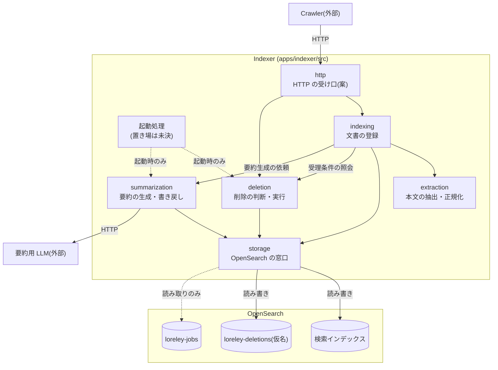
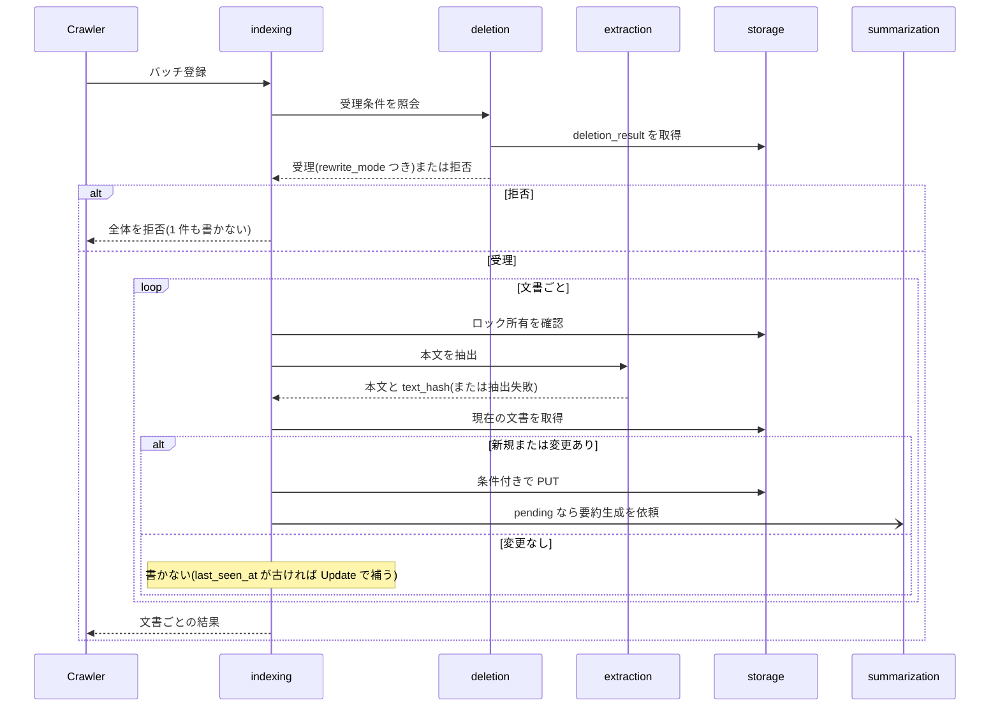
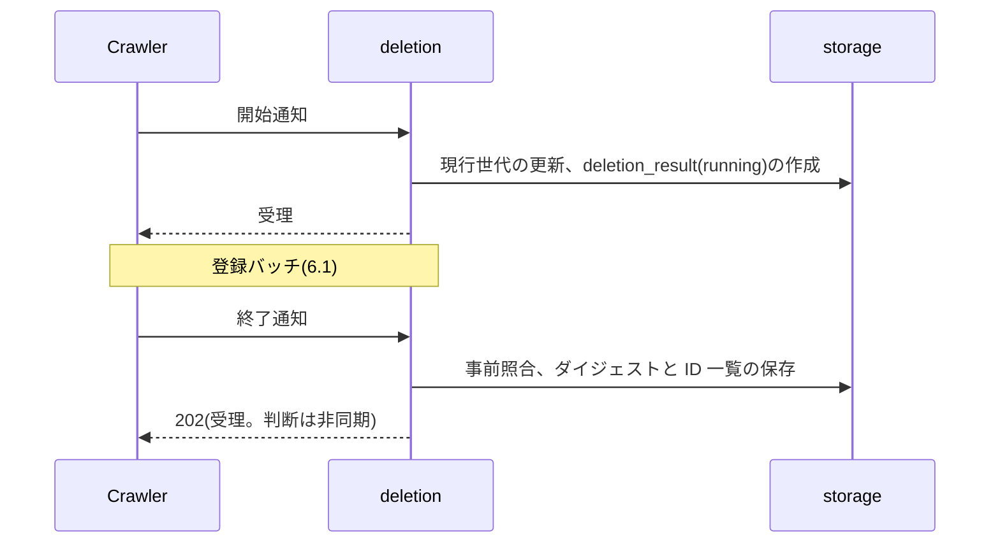
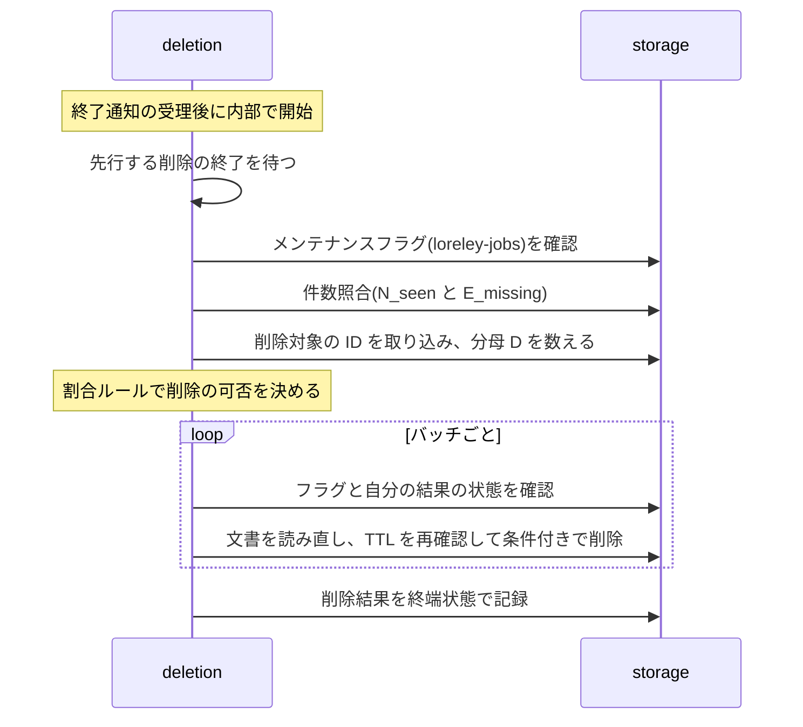
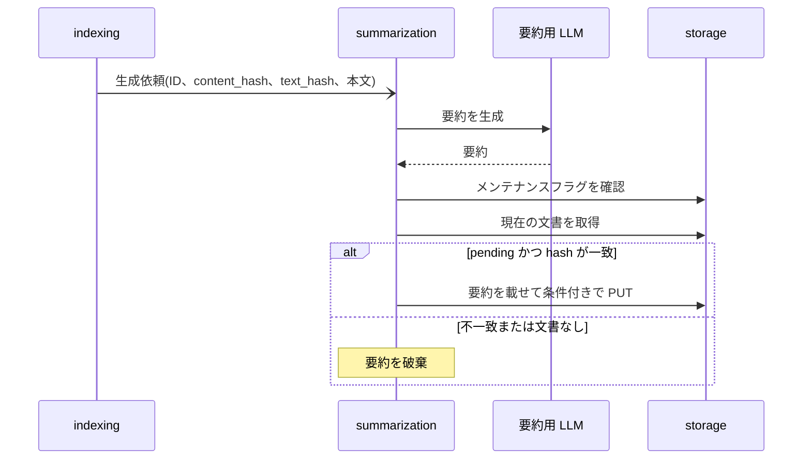
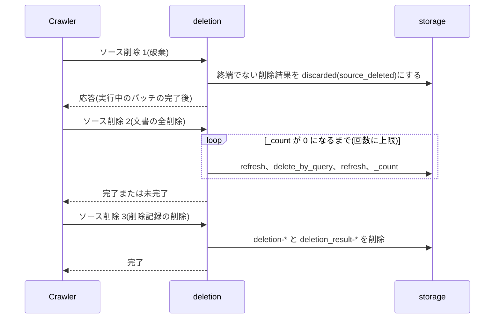
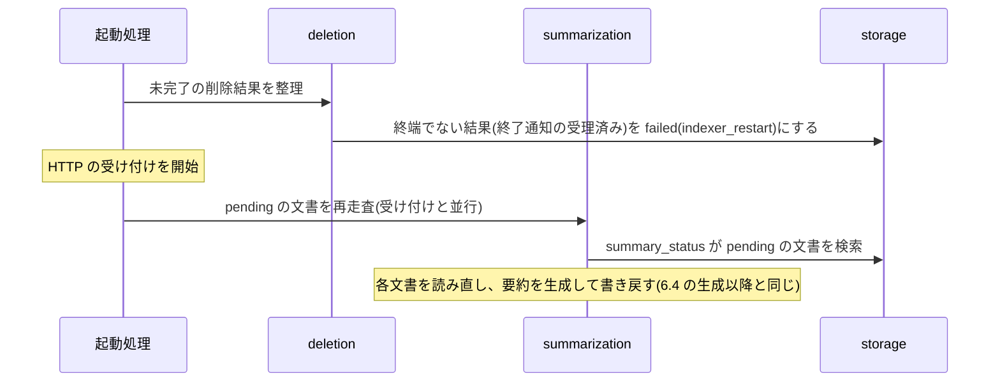

# Indexer モジュール構成設計書 v0.1

- 版: v0.1
- 更新日: 2026-11-10
- 位置づけ: Indexer のコード上のモジュール分割と、モジュール間の依存・呼び出しの流れをまとめた設計書。「何を、どのモジュールが担うか」を一目で分かるようにする。
- 仕様(責務、処理、状態値、API)は `indexer-architecture-v0.9.md`(以下 arch)と `indexer-api-v0.9.md`(以下 api。Indexer の API 書で、`apps/api` とは別)が正本。本書は仕様を変えず、詳細は該当節を参照させる。
- 区分(確定・案・未決・導出など)の語彙は arch 冒頭の凡例に合わせる。

---

## 1. 概要

**分割と呼び出し関係は、8章の M-1〜M-12 の案(ユーザー未確定。確定ではない)。**

Indexer は、Crawler から HTTP で文書を受けて検索インデックスに登録し、期限切れの文書を削除し、要約を非同期に生成する。検索インデックスと `loreley-deletions`(仮名)への書き込みは Indexer だけが行う(`loreley-jobs` は Crawler の領域)。

コードは 5 つのモジュールと、HTTP の受け口(案)で構成する。

| モジュール | 役割 |
| --- | --- |
| `http`(案) | Crawler からの HTTP を受け、担当モジュールへ渡す |
| `extraction` | 原本から本文を取り出して正規化する |
| `indexing` | 文書を検索インデックスへ登録する |
| `deletion` | 削除の判断・実行を行い、削除結果を記録する(arch の Deletion Manager) |
| `summarization` | 要約を非同期に生成し、文書へ書き戻す(既定では無効) |
| `storage` | OpenSearch へのアクセスを引き受ける |

---

## 2. 構成図

分割と呼び出し関係は M-1〜M-12 の案(確定ではない)。



凡例:

| 記号 | 意味 |
| --- | --- |
| 矢印 `A --> B` | A が B を呼ぶ(呼ぶ側 → 呼ばれる側)。データの流れではない |
| 点線 | 用途が限られる呼び出し(ラベルのとおり) |
| `http`、起動処理 | 案(4章、M-2、M-10、M-13) |
| `loreley-jobs` | Crawler が書く領域。Indexer は読み取りのみ(ロック文書とメンテナンスフラグ。arch 2.3) |

---

## 3. モジュール一覧

依存先と元の設計書の節は、5章のモジュール詳細にある。

| モジュール | ディレクトリ | 役割 | 主な入力 | 主な出力 |
| --- | --- | --- | --- | --- |
| `http`(案) | `src/http/` | Crawler からの HTTP を受け、担当モジュールへ渡す | HTTP リクエスト | HTTP 応答 |
| `extraction` | `src/extraction/` | 原本から本文を取り出して正規化する | 原本、形式 | 本文と `text_hash`、または抽出失敗 |
| `indexing` | `src/indexing/` | 文書を検索インデックスへ登録する | バッチ登録、`last_seen_at` 部分更新の要請 | 文書ごとの結果 |
| `deletion` | `src/deletion/` | 削除の判断・実行を行い、削除結果を記録する | 開始通知、終了通知、ソース削除の要請 | 受理結果、削除結果 |
| `summarization` | `src/summarization/` | 要約を非同期に生成し、文書へ書き戻す | 要約生成の依頼 | なし(文書を更新する) |
| `storage` | `src/storage/` | OpenSearch へのアクセスを引き受ける | 取得・書き込み・削除・検索の指示 | 文書、または結果の区分 |

---

## 4. ディレクトリ構成

```text
apps/indexer/
├── Dockerfile
├── tests/
└── src/
    ├── http/            # 案
    ├── extraction/
    ├── indexing/
    ├── deletion/
    ├── summarization/
    └── storage/
```

`http/` は、実装タスクの構成案(extraction / indexing / deletion / summarization / storage)にない。HTTP ハンドラの置き場として足す案である(M-2)。`apps/api`(Search API・Admin API)と紛らわしくならないよう、`api/` ではなく `http/` とする。起動処理(モジュールの組み立てと起動時の呼び出し)の置き場は未決(M-13)。

---

## 5. モジュール詳細

各モジュールを同じ形式で示す。節番号は arch / api の節。括弧のタグ(M-n)は8章の案。

### 5.1 `http`(案。M-2)

- **役割**: Crawler からの HTTP を受け、担当モジュールへ渡す
- **やること**
  - api 1章の 8 API を受け付ける
  - リクエストの形式を検証する(不正なら 400)
  - 結果を共通のエラー形式を含む HTTP 応答にする(api 3.4)
- **やらないこと**
  - 受理条件の判定、書き込みの判断(→ `indexing`、`deletion`)
  - OpenSearch へのアクセス(→ `storage`)
- **依存先**: `indexing`、`deletion`
- **公開する入口**
  - Crawler から HTTP リクエストを受け、下表の担当モジュールに渡し、その結果を応答として返す
- **元の節**: api 1章、3.4

API の担当モジュール(M-3):

| API | 担当 |
| --- | --- |
| バッチ登録(`POST /sources/{source_id}/documents:batch`) | `indexing` |
| `last_seen_at` 部分更新(`POST /sources/{source_id}/last-seen`) | `indexing` |
| 開始通知(`POST /crawls/start`) | `deletion` |
| 終了通知(`POST /crawls/{crawl_id}/finish`) | `deletion` |
| Status API(`GET /crawls/{crawl_id}`) | `deletion` |
| ソース削除 1(破棄。`POST /sources/{source_id}/deletions:discard`) | `deletion` |
| ソース削除 2(文書の全削除。`DELETE /sources/{source_id}/documents`) | `deletion` |
| ソース削除 3(削除記録の削除。`DELETE /sources/{source_id}/deletion-records`) | `deletion` |

エンドポイント形は api の案をそのまま使う。

### 5.2 `extraction`

- **役割**: 原本から本文を取り出して正規化する。OpenSearch も他モジュールも知らない部品
- **やること**
  - 形式別に抽出する(txt・Markdown・HTML・PDF)
  - 文字コードを判定する(UTF-8、Shift_JIS/CP932)
  - 本文を正規化する
  - サイズ上限で切り詰め、`truncated` を判定する(M-7)
  - 切り詰め後の本文から `text_hash` を計算する(M-7)
  - 抽出の失敗を結果として返す
- **やらないこと**
  - 検索インデックスの読み書き
  - 変更の有無の判定(→ `indexing`)
  - `content_hash` の計算(Crawler が渡す。照合の有無は arch U-26 で未決)
- **依存先**: なし(抽出ライブラリを除く。arch U-10)
- **公開する入口**
  - 原本と形式を受け取り、「本文・`text_hash`・`truncated`」または「抽出失敗」を返す
- **元の節**: arch 4.2、15.2、1.3(`text_hash`)

### 5.3 `indexing`

- **役割**: 文書を検索インデックスへ登録する。書き込みの種別(全文書き込み、`last_seen_at` の部分更新)を選ぶ
- **やること**
  - `document_id` を算出する
  - 受理条件を `deletion` に照会する(M-5)
  - 文書ごとに、先にロック所有を確認する(M-6)
  - 抽出 → 現在の文書の取得 → 新規・更新・変更なしの判定 → 書き込み、の順に処理する
  - 変更のない文書は書かない。`last_seen_at` が古いときだけ Update(max 比較)で補う
  - 再書き込みモード(`rewrite_mode`)を反映する
  - 409 のときは文書を読み直して再判定する(M-9)
  - PUT 成功後に `summary_status=pending` なら、要約生成を依頼する(M-11)
  - `last_seen_at` の部分更新(Update。max 比較)を行う
- **やらないこと**
  - 本文の抽出処理(→ `extraction`)
  - 削除の判断(→ `deletion`)
  - 要約の生成と書き戻し(→ `summarization`)
  - OpenSearch への直接アクセス(→ `storage`)
  - リトライとスキップの判断、結果の集計(Crawler)
- **依存先**: `extraction`、`storage`、`deletion`(受理条件の照会だけ)、`summarization`(生成依頼だけ)
- **公開する入口**
  - バッチ登録の要請を受け、文書ごとの結果(`change` の区分、または失敗種別)を返す。受理条件を満たさなければ、1 件も書かずに拒否の種類を返す
  - `last_seen_at` 部分更新の要請を受け、文書ごとの結果(`updated` / `unchanged` / `not_found` / 失敗)を返す
- **元の節**: arch 4.3、4.4、5章、6章、8章、9.5(受理条件)。api 4.2、4.3

### 5.4 `deletion`

- **役割**: 削除の判断・実行を行い、削除結果を記録する。`loreley-deletions`(仮名)の唯一の書き手
- **やること**
  - 開始通知を受理する(現行世代の更新、`deletion_result` の作成と設定の複写、終了通知が届かなかった旧い結果の `superseded` 化)
  - 終了通知を受理する(`source_id` の事前照合、再送の判定、スキップ文書 ID 一覧とサイズ超過文書 ID 一覧の保存)
  - 同じソースの削除を直列に処理する
  - 削除を判定する(先行する削除の待機、メンテナンスフラグ、件数照合、対象の決定、割合ルール)
  - 削除を実行する(バッチごとに、TTL を再確認して条件付きで削除)
  - Status API に削除結果を返す
  - 登録の受理条件の照会に答える(M-5)
  - ソース削除 1〜3 を受け持つ。arch 9.14 の手順 1・2・4 に当たる(M-4)
  - 起動時に、未完了の削除結果を `failed`(`indexer_restart`)にする(M-10)
- **やらないこと**
  - 文書の登録(→ `indexing`)
  - ジョブ・ロック・リース・スキップ記録・確認結果の区分(Crawler)
  - しきい値の範囲検証(Admin API)
  - スキップ記録とロック文書の削除(Crawler)
  - OpenSearch への直接アクセス(→ `storage`)
- **依存先**: `storage`
- **公開する入口**
  - 開始通知を受け、受理または拒否を返す
  - 終了通知を受け、受理(202)または拒否(409 など)を返す。判定と実行は受理後に内部で非同期に進める
  - Status API の要請を受け、削除結果を返す
  - 登録の受理条件の照会を受け、受理(`rewrite_mode` を添える)または拒否の種類を返す
  - ソース削除 1〜3 を受け、完了または未完了を返す
  - 起動時の整理を実行する
- **元の節**: arch 9章、8章(削除前の確認)、11章、12章。api 4.1、4.4〜4.8。`loreley-deletions-v0.9.md`

### 5.5 `summarization`

- **役割**: 要約を非同期に生成し、文書へ書き戻す。既定では無効で、LLM を明示的に設定したときだけ動く
- **やること**
  - 生成依頼を受け、内部の非同期処理で要約を生成する(並列数の仮の既定値は 1)
  - LLM を呼び出す(M-9)
  - 書き込み前にメンテナンスフラグを確認する
  - 書き戻す。文書が `pending` で、`content_hash` と `text_hash` が生成元と一致するときだけ PUT する。不一致・文書なしは破棄し、409 は読み直す
  - `summary_status=pending` の文書を再走査する(起動後、書き戻し失敗後)
- **やらないこと**
  - 文書を `pending` にする書き込み(→ `indexing`)
  - ジョブ記録(要約は `loreley-jobs` の対象外)
  - `failed` への遷移と再実行の手段の詳細(arch U-9 で未決)
  - Embedding(MVP 対象外)
- **依存先**: `storage`、要約用 LLM(外部。設定したときだけ使う)
- **公開する入口**
  - 生成依頼(文書の ID、生成元の `content_hash`・`text_hash`・本文)を受ける。結果は待たせず、完了後に文書を更新する
  - 起動時に再走査を実行する
- **元の節**: arch 7章、5章(要約の書き戻し)、12章

### 5.6 `storage`

- **役割**: OpenSearch へのアクセスを引き受け、結果を呼び出し側が扱える区分に直す
- **やること**
  - 検索インデックス: ID での取得(`_seq_no`/`_primary_term` つき)、新規作成、条件付き書き込み、`last_seen_at` の Update(max 比較)、条件付き削除、条件指定での検索(`search_after`)、件数、refresh、`delete_by_query`
  - `loreley-deletions`: ID での取得・保存・削除、条件指定での列挙、条件付き更新(Repository インターフェース)
  - `loreley-jobs`: ロック文書とメンテナンスフラグの読み取り
  - 結果を、成功・競合(409)・文書なし・文書固有の拒否・OpenSearch 全体の異常に区分して返す
- **やらないこと**
  - 業務上の判断(変更の有無、割合ルール、要約の書き戻し条件)
  - 409 のときの読み直しの繰り返し(→ 呼び出し側。R10)
  - `loreley-jobs` と `loreley-sources` への書き込み、`loreley-sources` の読み取り
- **依存先**: OpenSearch(外部)
- **公開する入口**
  - 「取得」「条件付き書き込み」「条件付き削除」「検索・件数」などの指示を受け、文書(と版)または結果の区分を返す
- **元の節**: arch 2.3、3.5、5章、6章

検索インデックスは Repository インターフェースの対象外のまま(arch 3.5)にし、`storage` の中で「検索インデックス」と「Store 層(`loreley-deletions` ほか)」の 2 つの窓口に分ける(M-8)。

---

## 6. 主要シナリオ別の呼び出しの流れ

読み方:

- 矢印は呼び出し。`->>` は応答を待つ呼び出し、`-)` は待たない呼び出し。
- Crawler からの呼び出しと応答は `http` を経由する。図では `http` を省略する。
- 各シナリオが依拠する案は、見出し直下に M-ID で示す。

### 6.1 文書の登録バッチ

依拠する案: M-3、M-5、M-6、M-7、M-9、M-11



- 409 のときは取得からやり直す(arch 4.3)。
- 要約は待たない。登録の応答は要約より先に返る(arch 7.2)。要約の起動契機は arch が推測としている(G-12)。
- `last_seen_at` の部分更新も、同じ受理条件の照会と文書ごとのロック確認を通り、`storage` の Update(max 比較)で書く。

### 6.2 開始通知から終了通知まで(受付)

依拠する案: M-3、M-5



- 開始通知は、旧い削除が進行中でも待たせずに受理する(arch 9.5)。新しい開始通知は、受理済みの旧い削除を止めない。
- 終了通知の受理は、書き込みの直列処理の中で行う(arch 9.9)。
- 202 のあと、Crawler は Status API をポーリングする(6.3 の判定・実行と並行)。

### 6.3 削除の判定・実行(非同期)

依拠する案: M-3



- 判定の順序は arch 9.7、割合ルールは 9.3、削除の実行は 9.8。
- 件数照合が合わない、割合を超える、メンテナンス中などの場合は、削除せず理由つきで終端状態にする(arch 9.10)。
- Status API(`GET /crawls/{crawl_id}`)の要請は、`deletion` が `storage` から `deletion_result` を取得して返す。判定・実行とは独立に、いつでも答える。

### 6.4 要約の非同期生成

依拠する案: M-9、M-11



- PUT が 409 のときは、文書を読み直して再判定する。読み直しの上限を超えたら `pending` のまま残し、再走査に委ねる(arch 7.4)。
- 要約が無効な構成では、この流れは動かない(arch 7.1)。

### 6.5 ソース削除の要請

依拠する案: M-3、M-4



- スキップ記録・ロック文書・データソース設定の削除は Crawler が行う(arch 9.14)。
- ソース削除 1〜3 は、何度でも再実行できる(arch 9.14)。

### 6.6 起動時の整理・再開(arch 12章)

依拠する案: M-10、M-13



- 待機中・判定中・実行中の削除は、再開せず `failed` にする。削除は次のクロールに委ねる(arch 9.8)。
- 整理の対象の細部は未決(arch U-20)。
- 順序は案(M-10)。削除結果の整理を先に終えてから HTTP の受け付けを始める。要約の再走査は受け付けと並行してよい。

---

## 7. 依存ルール

区分は arch の語彙に合わせる。「導出(案)」は arch から本書が導いたもので、ユーザー未確定。

| # | ルール | 根拠 | 区分 |
| --- | --- | --- | --- |
| R1 | OpenSearch へのアクセスは `storage` に限る。他のモジュールは OpenSearch のクライアントを直接使わない | arch 2.2、2.3、3.5 | 導出(案) |
| R2 | `loreley-deletions` に書くのは `deletion` だけ。他のモジュールは、`deletion` を通さずに変更しない | arch 2.2、2.3 | 書き込み役は確定(K2)。モジュールへの割り当ては導出(案) |
| R3 | `loreley-jobs` は読み取りのみ。`loreley-sources` は読まない | arch 2.3、8章、11章 | ロック文書の読み取りは確定(K13)。メンテナンスフラグの読み取りは案(P10)・未決(U-12)。`loreley-sources` を読まないことは記述あり(arch 2.3。区分表記なし) |
| R4 | 呼び出しは上位から下位へだけ行う。順序は `http`・起動処理 → `indexing` → `deletion`・`summarization`・`extraction` → `storage`。下位から上位を呼ばない。循環させない | 本書 | 導出(案) |
| R5 | `deletion`・`summarization`・`extraction` は互いを呼ばない。組み合わせは `indexing` が行う | 本書 | 導出(案) |
| R6 | `indexing` から `deletion` への呼び出しは、受理条件の照会(読み取り)だけ | arch 9.5 | 導出(案)。受理条件そのものは確定(K23) |
| R7 | `indexing` から `summarization` への呼び出しは、生成依頼(待たない)だけ。登録の応答は要約を待たない | arch 7.2 | 非同期の生成は記述あり(arch 7.2。区分表記なし)。起動契機は推測(G-12)。呼び出しの形は導出(案) |
| R8 | `http` は業務判断をしない。形式の検証と受け渡しだけを行う | 本書 | 導出(案) |
| R9 | 検索インデックスへの書き込みは条件付き(`if_seq_no`/`if_primary_term`、`op_type=create`、`last_seen_at` は max 比較)にする。文書ごとのアプリ内ロックは設けない。**例外**: ソース削除 2 の `delete_by_query`(`conflicts=proceed`)は条件付きにしない。競合した文書はその回は飛ばし、完了後の `_count` の確認と再実行で収束させる | arch 5章、6章、8章末尾、9.14 | 書き込み方式は確定(K19、K27)。`delete_by_query` は確定(K20、K28、K48)。アプリ内ロックを設けないことは記述あり(arch 8章。区分表記なし) |
| R10 | 409 のときの読み直しは呼び出し側(`indexing`・`summarization`・`deletion`)が行う。`storage` は繰り返さない。読み直しの上限は共通の設定値にする | arch 4.4、6章 | 導出(案)。上限の値は未決(U-31(4)) |
| R11 | 外部 LLM を呼ぶのは `summarization` だけ。明示的に設定したときだけ呼ぶ | arch 2.4、7.1 | 記述あり(arch 2.4、7.1。区分表記なし) |
| R12 | ログに本文と秘密情報を出さない(全モジュール共通) | arch 2.4 | 記述あり(arch 2.4。区分表記なし) |

モジュール別のアクセス範囲(R1〜R3 の具体):

| 対象 | `indexing` | `deletion` | `summarization` | `extraction` |
| --- | --- | --- | --- | --- |
| 検索インデックスの書き込み | 全文書き込み、`last_seen_at` の Update | 条件付き削除、`delete_by_query` | 要約の書き戻し(PUT) | なし |
| 検索インデックスの読み取り | あり | あり | あり | なし |
| `loreley-deletions` | 直接は触らない(`deletion` に照会) | 読み書き | なし | なし |
| `loreley-jobs` | ロック文書の読み取り | メンテナンスフラグの読み取り | メンテナンスフラグの読み取り | なし |

---

## 8. 確認状況

本書でモジュール分割として新たに決めた事項。すべてユーザー未確定で、確定扱いにしない。

| ID | 内容 | 区分 | 関連する arch / api の ID・節 |
| --- | --- | --- | --- |
| M-1 | モジュールは `extraction` / `indexing` / `deletion` / `summarization` / `storage` の 5 つを基本とする。実装タスクの構成案をそのまま使い、分け方は変えない | 案 | 実装タスクの要件(`20261110_implement_indexer`) |
| M-2 | HTTP ハンドラの置き場として `src/http/` を足す。モジュール数の 5 には数えない入口層。`apps/api` と紛らわしいので `api/` にしない | 案 | api 1章 |
| M-3 | API の担当: バッチ登録と `last_seen_at` 部分更新は `indexing`。開始通知・終了通知・Status API・ソース削除 1〜3 は `deletion` | 導出(案) | arch 9章(K1)、api 1章 |
| M-4 | ソース削除 1〜3(arch 9.14 の手順 1・2・4)は `deletion` に置く。`delete_by_query` の再実行も `deletion` が行う | 導出(案) | arch 9.14、K20、K28、K48 |
| M-5 | 登録の受理条件(`deletion_result` の存在・一致・状態)の判定は `deletion` が持ち、`indexing` が照会する。`deletion_result` の読み方を 1 か所にするため | 導出(案) | arch 9.5、K23、K33 |
| M-6 | 書き込み前のロック所有確認は `indexing` が行い、`storage` 経由で `loreley-jobs` のロック文書を読む。ソース削除 2・3 の要請にもロック所有確認を課す場合の担当は未決(arch U-4、api API-U-14) | 導出(案)。ソース削除 2・3 の担当は未決 | arch 8章、P13、K13、U-4。api 3.2 |
| M-7 | `extraction` が、サイズ上限での切り詰め・`truncated` の判定・`text_hash` の計算まで担う。上限の値は決めない | 導出(案) | arch 15.2、1.3、K22、U-8 |
| M-8 | `storage` は、検索インデックス(Repository の対象外)と Store 層(Repository)の両方を包み、内部で 2 つの窓口に分ける | 導出(案) | arch 3.5、U-11 |
| M-9 | `summarization` の LLM 呼び出しは、独立モジュールにせず `summarization` の内部に置く(MVP に抽象化を足さない)。409 の読み直しは呼び出し側が行う(R10) | 案 | arch 7.1、6章、U-9、U-31(4) |
| M-10 | 起動時の整理・再開は、起動処理が呼ぶ。`deletion` の整理を HTTP の受け付け開始前に終え、`summarization` の再走査は受け付けと並行してよい。受け付け後に整理すると、新しい終了通知を誤って `failed` にしうるため | 導出(案) | arch 12章、9.8、7.4、P15、U-20 |
| M-11 | `indexing` → `summarization` は一方向・非同期の生成依頼だけ。起動契機は arch が推測としている | 案 | arch 7.2、G-12 |
| M-12 | 依存ルールのうち、7章で導出(案)としたもの: R1、R4〜R8、R10(R2 のモジュールへの割り当て、R7 の呼び出しの形を含む) | 導出(案) | arch 2.2、2.3、3.5、6章、7.2、8章 |
| M-13 | 起動処理(モジュールの組み立てと起動時の呼び出し順)と、共通の部品(設定の読み込み、ログ、エラー型など)の置き場は決めない。実装時に必要になった範囲で決める。モジュールには数えない | 未決 | arch 15.7(仮値の設定管理)、12章 |

この文書が決めないこと(元の設計書の未決を引き継ぐ):

| 事項 | ID |
| --- | --- |
| API の契約の細部(エンドポイント形、エラー名、部分結果の返し方) | arch U-4、api の API-U-n |
| ソース削除 2・3 の要請へのロック所有確認の担当 | arch U-4、api API-U-14 |
| 抽出ライブラリ、文字コード判定の方法 | arch U-10 |
| 要約の失敗時の再試行、`failed` への遷移、後日の有効化 | arch U-9、K54 |
| メンテナンスフラグの確認のタイミング | arch U-12 |
| 待機中の削除を進める契機 | arch U-14 |
| Repository インターフェースの詳細 | arch U-11 |
| 件数・回数・サイズの数値(バッチ件数、読み直しの上限など) | arch K39、U-2、U-3、U-31 |
