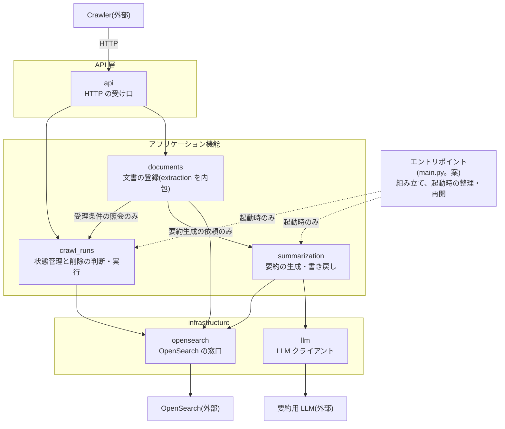
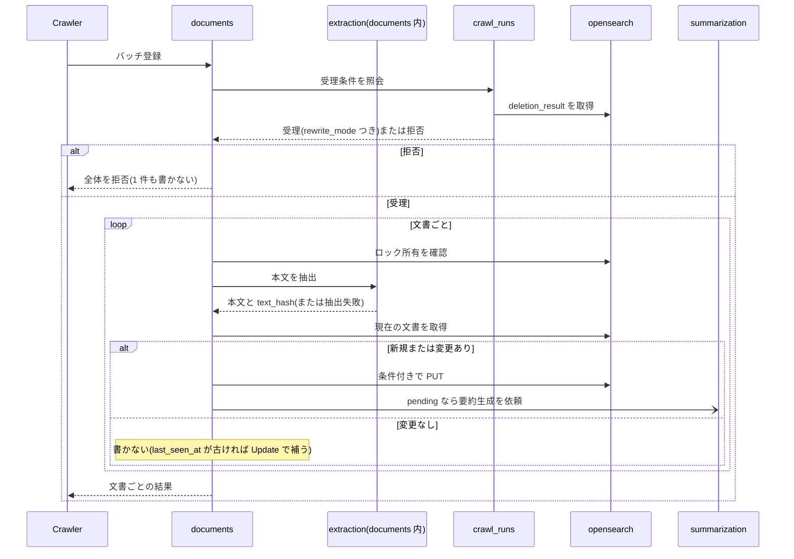
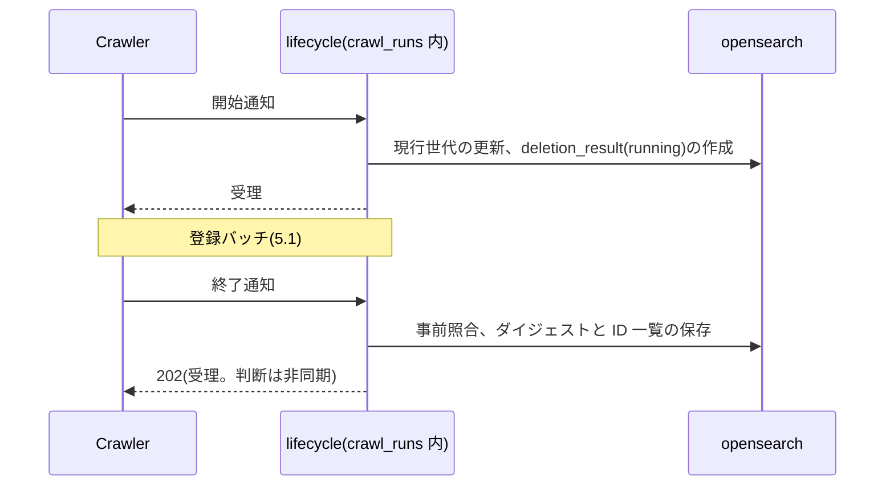
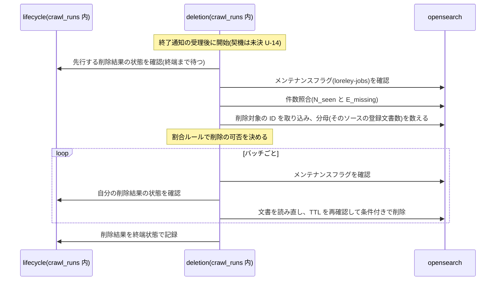
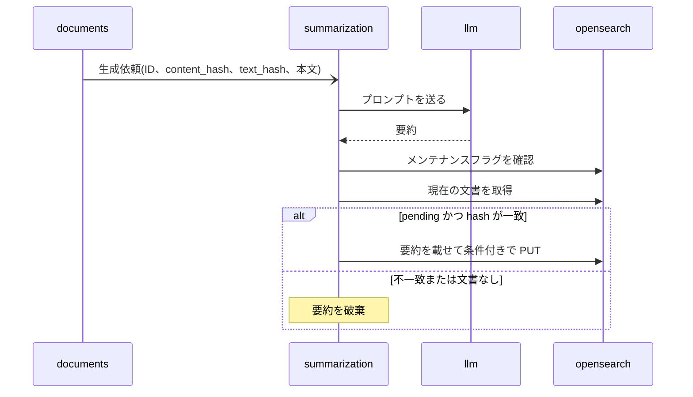
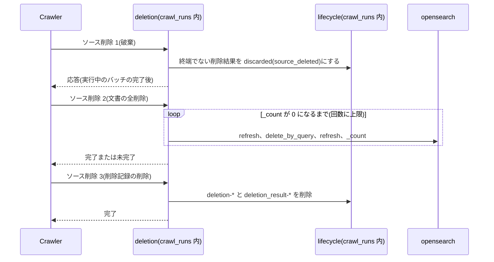
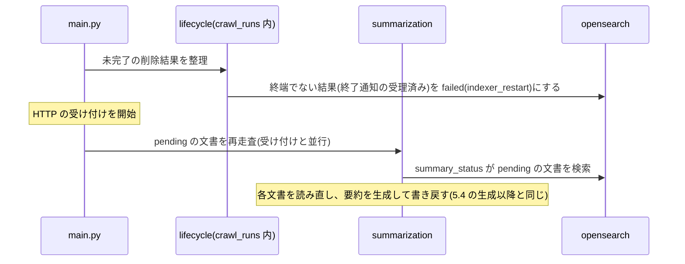

# Indexer モジュール構成設計書 v0.2

- 版: v0.2(2026-11-10)
- 位置づけ: Indexer のコード上のモジュール分割と、モジュール間の依存・呼び出しの流れ。「何を、どのモジュールが担うか」を一目で分かるようにする。

---

## 1. 概要

Indexer は、Crawler から HTTP で文書を受けて検索インデックスに登録し、期限切れの文書を削除し、要約を非同期に生成する。検索インデックスと `loreley-deletions`(仮名)への書き込みは Indexer だけが行う(`loreley-jobs` は Crawler の領域)。実装言語は Python(arch 2.4)。

コードは 3 層(API 層 / アプリケーション機能 / infrastructure)に分ける。`crawl_runs` は arch 9章の Deletion Manager に当たる。

| モジュール | ディレクトリ | 役割 | 主な入力 | 主な出力 |
| --- | --- | --- | --- | --- |
| `api` | `api/` | Crawler からの HTTP を受け、形式を検証して担当機能へ渡す | HTTP リクエスト | HTTP 応答 |
| `crawl_runs` | `crawl_runs/` | クロール実行の状態を管理し、削除の判断・実行を行う | 開始通知、終了通知、Status API、ソース削除の要請、受理条件の照会 | 受理結果、削除結果 |
| `documents` | `documents/` | 文書を検索インデックスへ登録する(本文の抽出を含む) | バッチ登録、`last_seen_at` 部分更新の要請 | 文書ごとの結果 |
| `summarization` | `summarization/` | 要約を非同期に生成し、文書へ書き戻す(既定では無効) | 要約生成の依頼 | なし(文書を更新する) |
| `opensearch` | `infrastructure/opensearch/` | OpenSearch へのアクセスを引き受ける | 取得・書き込み・削除・検索の指示 | 文書、または結果の区分 |
| `llm` | `infrastructure/llm/` | 要約用 LLM へのリクエストを送り、応答を返す | プロンプト | 生成結果、または失敗 |

ディレクトリは `src/loreley_indexer/`(3章)からの相対。行は層の順(API 層、アプリケーション機能、infrastructure)。依存先と元の節は 4章にある。

読み方:

- **分割と呼び出し関係は、7章の M-1〜M-15 の案(M-16 の未決を除く。ユーザー未確定。確定ではない)。**
- 仕様(責務、処理、状態値、API)の正本は `indexer-architecture-v0.9.md`(arch)と `indexer-api-v0.9.md`(api。Indexer の API 書で、`apps/api` とは別)。本書は仕様を変えない。
- 区分は arch 冒頭の凡例(確定・案・未決・推測・導出)に合わせる。ただし「記述あり」(arch に区分表記がない記述)と「導出(案)」は本書の補助表記。

---

## 2. 構成図

責務と依存の向きだけを示す。処理の順序は 5章のシーケンス図にある。案の一覧は 7章。



凡例:

| 記号 | 意味 |
| --- | --- |
| 矢印 `A --> B` | A が B を呼ぶ(呼ぶ側 → 呼ばれる側)。データの流れではない |
| 点線 | 用途が限られる呼び出し(ラベルのとおり) |
| 3 つの枠 | 層。層をまたぐ呼び出しは上から下へだけ。同じ層(アプリケーション機能)の中の呼び出しは、図にある 2 本だけ(R3) |

OpenSearch 内の領域別のアクセス範囲は 6章の表にある。

---

## 3. ディレクトリ構成

```text
apps/indexer/
├── Dockerfile
├── tests/
└── src/
    └── loreley_indexer/        # Python パッケージ層(案)
        ├── main.py             # エントリポイント(案)
        ├── config.py           # 設定の読み込み(案)
        ├── api/
        ├── crawl_runs/
        │   ├── lifecycle/      # 状態管理(案)
        │   └── deletion/       # 削除の判定・実行(案)
        ├── documents/
        │   └── extraction/     # 本文の抽出・正規化
        ├── summarization/
        └── infrastructure/
            ├── opensearch/
            └── llm/
```

- パッケージ層・`main.py`・`config.py` は Python 前提の案(M-15)。実装タスクの構成案(extraction / indexing / deletion / summarization / storage)とは異なる、本書の案(M-1)。
- モジュール(ディレクトリ)の内部のファイル名は書かない。実装時に決める。
- `api/` は HTTP ハンドラの置き場(M-2)。`apps/api`(Search API・Admin API)とは別のアプリのディレクトリ。
- `main.py` は、モジュールの組み立てと、起動時の整理・再開の呼び出しを担う(M-11)。
- `config.py` は設定の読み込みを担う。モジュールは `config.py` に依存せず、値は `main.py` が渡す(案)。設定する項目と値、保存の仕方は arch で未決(K39、U-2、U-3、U-31)。

---

## 4. モジュール詳細

各モジュールを同じ形式で示す。節番号は arch / api の節。括弧のタグ(M-n)は 7章の案。

### 4.1 `api`(M-2)

- **役割**: Crawler からの HTTP を受け、形式を検証して担当機能へ渡す
- **やること**
  - api 1章の 8 API を受け付ける
  - リクエストの形式を検証する(不正なら 400)
  - 結果を共通のエラー形式を含む HTTP 応答にする(api 3.4)
- **やらないこと**: 受理条件の判定、書き込みの判断(→ `documents`、`crawl_runs`)。OpenSearch へのアクセス(→ `opensearch`)
- **依存先**: `crawl_runs`、`documents`
- **公開する入口**: Crawler から HTTP リクエストを受け、下表の担当機能に渡し、その結果を応答として返す
- **元の節**: api 1章、3.4

API の担当(M-4):

| API | 担当 |
| --- | --- |
| バッチ登録(`POST /sources/{source_id}/documents:batch`) | `documents` |
| `last_seen_at` 部分更新(`POST /sources/{source_id}/last-seen`) | `documents` |
| 開始通知(`POST /crawls/start`) | `crawl_runs` |
| 終了通知(`POST /crawls/{crawl_id}/finish`) | `crawl_runs` |
| Status API(`GET /crawls/{crawl_id}`) | `crawl_runs` |
| ソース削除 1(破棄。`POST /sources/{source_id}/deletions:discard`) | `crawl_runs` |
| ソース削除 2(文書の全削除。`DELETE /sources/{source_id}/documents`) | `crawl_runs` |
| ソース削除 3(削除記録の削除。`DELETE /sources/{source_id}/deletion-records`) | `crawl_runs` |

エンドポイント形は api の案をそのまま使う。

### 4.2 `crawl_runs`(arch の Deletion Manager。M-3)

- **役割**: クロール実行の状態を管理し、削除の判断・実行を行う。Crawler のジョブ管理(`loreley-jobs`)ではなく、Indexer 側の削除結果(`deletion_result`)の管理。`loreley-deletions`(仮名)の唯一の書き手

内部は 2 つのサブディレクトリに分ける(M-13)。

| サブディレクトリ | 役割 |
| --- | --- |
| `lifecycle/` | クロール実行の状態を管理する。開始・終了通知、世代、受理条件、Status API、`loreley-deletions` の読み書きの窓口 |
| `deletion/` | 削除を判定し、実行する。ソース削除も受け持つ。記録は `lifecycle/` を通す |

- **やること**
  - `lifecycle/`: 開始通知を受理する(現行世代の更新、`deletion_result` の作成と設定の複写、終了通知が届かなかった旧い結果の `superseded` 化)
  - `lifecycle/`: 終了通知を受理する(`source_id` の事前照合、再送の判定、スキップ文書 ID 一覧とサイズ超過文書 ID 一覧の保存)
  - `lifecycle/`: 開始通知と終了通知の受理を、同じソース単位で直列に処理する
  - `lifecycle/`: Status API に削除結果を返す
  - `lifecycle/`: 登録の受理条件の照会に答える(M-6)
  - `lifecycle/`: 起動時に、未完了の削除結果を `failed`(`indexer_restart`)にする(M-11)
  - `deletion/`: 同じソースの削除を直列に処理する(先行する削除の終了を待つ)
  - `deletion/`: 削除を判定する(メンテナンスフラグ、件数照合、対象の決定、割合ルール)
  - `deletion/`: 削除を実行し(バッチごとに、TTL を再確認して条件付きで削除)、結果を終端状態で記録する(`lifecycle/` 経由)
  - `deletion/`: ソース削除 1〜3 を受け持つ。arch 9.14 の手順 1・2・4 に当たる(M-5)
- **やらないこと**: 文書の登録(→ `documents`)。ジョブ・ロック・リース・スキップ記録・確認結果の区分(Crawler)。しきい値の範囲検証(Admin API)。スキップ記録とロック文書の削除(Crawler)。OpenSearch への直接アクセス(→ `opensearch`)
- **依存先**: `opensearch`。内部は `deletion/` → `lifecycle/` の一方向(M-13)
- **公開する入口**
  - 開始通知を受け、受理または拒否を返す
  - 終了通知を受け、受理(202)または拒否(409 など)を返す。受理後の判定・実行は内部で非同期に進める
  - Status API の要請を受け、削除結果を返す
  - 登録の受理条件の照会を受け、受理(`rewrite_mode` を添える)または拒否の種類を返す
  - ソース削除 1〜3 を受け、完了または未完了を返す
  - 起動時の整理を実行する
- **元の節**: arch 9章、8章(削除前の確認)、11章、12章。api 4.1、4.4〜4.8。`loreley-deletions-v0.9.md`

未決の注記:

- ソース単位の排他は `crawl_runs` が持つ。実現方法は未決(arch 9.9、9.14)。
- `deletion/` の処理の開始契機は arch U-14 で未決。契機がイベント駆動(`lifecycle/` が通知)なら、`deletion/` → `lifecycle/` の一方向の規則を見直す。走査型(`deletion/` が `loreley-deletions` の状態を読む。arch 9.9 項3)なら一方向のまま成り立つ。

### 4.3 `documents`(M-8)

- **役割**: 文書を検索インデックスへ登録する(本文の抽出を含む)。書き込みの種別(全文書き込み、`last_seen_at` の部分更新)を選ぶ
- **やること**
  - `document_id` を算出する
  - 受理条件を `crawl_runs` に照会する(M-6)
  - 文書ごとに、先にロック所有を確認する(M-7)
  - 抽出 → 現在の文書の取得 → 新規・更新・変更なしの判定 → 書き込み、の順に処理する
  - 変更のない文書は書かない。`last_seen_at` が古いときだけ Update(max 比較)で補う
  - 再書き込みモード(`rewrite_mode`)を反映する
  - 409 のときは文書を読み直して再判定する(R8)
  - PUT 成功後に `summary_status=pending` なら、要約生成を依頼する(M-12)
  - `last_seen_at` の部分更新(Update。max 比較)を行う
  - `extraction/`: 形式別(txt・Markdown・HTML・PDF)に本文を抽出し、文字コードを判定する(UTF-8、Shift_JIS/CP932)
  - `extraction/`: 本文を正規化し、サイズ上限で切り詰めて `truncated` を判定し、`text_hash` を計算する
  - `extraction/`: 抽出の失敗を結果として返す
- **やらないこと**: 削除の判断(→ `crawl_runs`)。要約の生成と書き戻し(→ `summarization`)。OpenSearch への直接アクセス(→ `opensearch`)。`content_hash` の計算(Crawler が渡す。照合の有無は arch U-26 で未決)。リトライとスキップの判断、結果の集計(Crawler)
- **依存先**: `opensearch`、`crawl_runs`(受理条件の照会だけ)、`summarization`(生成依頼だけ)。`extraction/` は `documents` の内部で、他へ依存しない(抽出ライブラリを除く。arch U-10)
- **公開する入口**
  - バッチ登録の要請を受け、文書ごとの結果(`change` の区分、または失敗種別)を返す。受理条件を満たさなければ、1 件も書かずに拒否の種類を返す
  - `last_seen_at` 部分更新の要請を受け、文書ごとの結果(`updated` / `unchanged` / `not_found` / 失敗)を返す
  - `extraction/`(内部向け): 原本と形式を受け取り、「本文・`text_hash`・`truncated`」または「抽出失敗」を返す
- **元の節**: arch 4.2、4.3、4.4、5章、6章、8章、9.5(受理条件)、15.2、1.3(`text_hash`)。api 4.2、4.3

### 4.4 `summarization`

- **役割**: 要約を非同期に生成し、文書へ書き戻す。既定では無効で、LLM を明示的に設定したときだけ動く
- **やること**
  - 生成依頼を受け、内部の非同期処理で要約を生成する(並列数の仮の既定値は 1)
  - プロンプトを組み立て、使うモデルを選ぶ(モデルの選定は arch U-9 で未決)。LLM の呼び出しは `llm` に依頼する(M-10)
  - 書き込み前にメンテナンスフラグを確認する
  - 書き戻す。文書が `pending` で、`content_hash` と `text_hash` が生成元と一致するときだけ PUT する。不一致・文書なしは破棄し、409 は読み直す
  - `summary_status=pending` の文書を再走査する(起動後、書き戻し失敗後)
- **やらないこと**: 文書を `pending` にする書き込み(→ `documents`)。LLM との通信そのもの(→ `llm`)。ジョブ記録(要約は `loreley-jobs` の対象外)。`failed` への遷移と再実行の手段の詳細(arch U-9 で未決)。Embedding(MVP 対象外)
- **依存先**: `opensearch`、`llm`
- **公開する入口**
  - 生成依頼(文書の ID、生成元の `content_hash`・`text_hash`・本文)を受ける。結果は待たせず、完了後に文書を更新する
  - 起動時に再走査を実行する
- **元の節**: arch 7章、5章(要約の書き戻し)、12章

### 4.5 `opensearch`(`infrastructure/opensearch`。M-9)

- **役割**: OpenSearch へのアクセスを引き受け、結果を呼び出し側が扱える区分に直す
- **やること**
  - 検索インデックスの窓口: ID での取得(`_seq_no`/`_primary_term` つき)、新規作成、条件付き書き込み、`last_seen_at` の Update(max 比較)、条件付き削除、条件指定での検索(`search_after`)、件数、refresh、`delete_by_query`
  - Store 層の窓口(`loreley-deletions`): ID での取得・保存・削除、条件指定での列挙、条件付き更新(Repository インターフェース)
  - `loreley-jobs`: ロック文書とメンテナンスフラグの読み取り
  - 結果を、成功・競合(409)・文書なし・文書固有の拒否・OpenSearch 全体の異常に区分して返す
- **やらないこと**: 業務上の判断(変更の有無、割合ルール、要約の書き戻し条件)。409 のときの読み直しの繰り返し(→ 呼び出し側。R8)。`loreley-jobs` と `loreley-sources` への書き込み、`loreley-sources` の読み取り
- **依存先**: OpenSearch(外部)
- **公開する入口**: 「取得」「条件付き書き込み」「条件付き削除」「検索・件数」などの指示を受け、文書(と版)または結果の区分を返す
- **元の節**: arch 2.3、3.5、5章、6章

検索インデックスは Repository インターフェースの対象外のまま(arch 3.5)にし、内部で「検索インデックス」と「Store 層」の 2 つの窓口に分ける。

### 4.6 `llm`(`infrastructure/llm`。M-10)

- **役割**: 要約用 LLM へのリクエストを送り、応答を返す。LLM クライアントだけを持つ
- **やること**: 接続の設定を読む(LLM を明示的に設定したときだけ使う)。プロンプトを送り、生成結果を受け取る。接続の失敗・タイムアウトを結果として返す
- **やらないこと**: プロンプトの組み立て、モデルの選定、再走査、再試行の判断(→ `summarization`)。検索インデックスの読み書き
- **依存先**: 要約用 LLM(外部)
- **公開する入口**: プロンプトを受け取り、生成結果または失敗を返す
- **元の節**: arch 7.1、2.4

---

## 5. 主要シナリオ別の呼び出しの流れ

読み方:

- 矢印は呼び出し。`->>` は応答を待つ呼び出し、`-)` は待たない呼び出し。
- Crawler からの呼び出しと応答は `api` を経由する。図では `api` を省略する。
- `opensearch` は `infrastructure/opensearch`、`llm` は `infrastructure/llm`。
- 各シナリオが依拠する案は、見出し直下に M-ID で示す。

### 5.1 文書の登録バッチ

依拠する案: M-4、M-6、M-7、M-8、M-12



- 409 のときは取得からやり直す(arch 4.3)。
- 要約は待たない。登録の応答は要約より先に返る(arch 7.2)。要約の起動契機は arch が推測としている(G-12)。
- `last_seen_at` の部分更新も、同じ受理条件の照会と文書ごとのロック確認を通り、Update(max 比較)で書く。

### 5.2 開始通知から終了通知まで(受付)

依拠する案: M-4、M-13



- 開始通知は、旧い削除が進行中でも待たせずに受理する(arch 9.5)。新しい開始通知は、受理済みの旧い削除を止めない。
- 開始通知と終了通知の受理は、同じソース単位で直列に処理する(arch 9.9)。
- 202 のあと、Crawler は Status API をポーリングする(5.3 の判定・実行と並行)。

### 5.3 削除の判定・実行(非同期)

依拠する案: M-13



- 判定の順序は arch 9.7、割合ルールは 9.3、削除の実行は 9.8。
- 件数照合が合わない、割合を超える、メンテナンス中などの場合は、削除せず理由つきで終端状態にする(arch 9.10)。
- Status API(`GET /crawls/{crawl_id}`)の要請は、`lifecycle/` が `deletion_result` を取得して返す。判定・実行とは独立に、いつでも答える。

### 5.4 要約の非同期生成

依拠する案: M-10、M-12



- PUT が 409 のときは、文書を読み直して再判定する。読み直しの上限を超えたら `pending` のまま残し、再走査に委ねる(arch 7.4)。
- 要約が無効な構成では、この流れは動かない(arch 7.1)。

### 5.5 ソース削除の要請

依拠する案: M-4、M-5



- スキップ記録・ロック文書・データソース設定の削除は Crawler が行う(arch 9.14)。
- ソース削除 1〜3 は、何度でも再実行できる(arch 9.14)。

### 5.6 起動時の整理・再開(arch 12章)

依拠する案: M-11



- 待機中・判定中・実行中の削除は、再開せず `failed` にする。削除は次のクロールに委ねる(arch 9.8)。
- 整理の対象の細部は未決(arch U-20)。
- 順序は案(M-11)。削除結果の整理を先に終えてから HTTP の受け付けを始める。要約の再走査は受け付けと並行してよい。

---

## 6. 依存ルール

3 層のルール(R1〜R5)と、OpenSearch の領域別のルールおよび共通のルール(R6〜R9)に分ける。

| # | ルール | 根拠 | 区分 |
| --- | --- | --- | --- |
| R1 | 呼び出しは上の層から下の層へだけ。順序は `api` → アプリケーション機能 → `infrastructure`。循環させない。機能どうしの呼び出しは R3 による | 本書 | 導出(案) |
| R2 | 外部システム(OpenSearch、要約用 LLM)へのアクセスは `infrastructure` に限る | arch 2.2、2.3、3.5、7.1 | 導出(案) |
| R3 | 機能どうしの依存は次の 2 つだけ。(a)`documents` → `crawl_runs`: 受理条件の照会(読み取り)だけ。`crawl_runs` を分けても、この依存は解消しない。(b)`documents` → `summarization`: 要約生成の依頼(待たない)だけ | arch 9.5、7.2 | 導出(案)。受理条件は確定(K23)。要約の起動契機は推測(G-12) |
| R4 | `api` は業務判断をしない。形式の検証と受け渡しだけを行う | 本書 | 導出(案) |
| R5 | `crawl_runs` の内部は `deletion/` → `lifecycle/` の一方向。`loreley-deletions` の読み書きは `lifecycle/` を通す | arch 9.9 | 導出(案)。`deletion/` の開始契機の決定(arch U-14)で変わりうる |
| R6 | OpenSearch 内の領域ごとのアクセスは下表のとおり。`loreley-deletions` に書くのは `crawl_runs` だけ。`loreley-jobs` は読み取りのみ。`loreley-sources` は読まない | arch 2.2、2.3、8章、11章 | 書き込み役は確定(K2)で、割り当ては導出(案)。ロック文書の読み取りは確定(K13)。メンテナンスフラグの読み取りは案(P10)・未決(U-12)。他は記述あり |
| R7 | 検索インデックスへの書き込みは条件付き(`if_seq_no`/`if_primary_term`、`op_type=create`、`last_seen_at` は max 比較)にする。文書ごとのアプリ内ロックは設けない。**例外**: ソース削除 2 の `delete_by_query`(`conflicts=proceed`)は条件付きにしない。競合した文書はその回は飛ばし、完了後の `_count` の確認と再実行で収束させる | arch 5章、6章、8章末尾、9.14 | 確定(K19、K27)。`delete_by_query` は確定(K20、K28、K48)。アプリ内ロックなしは記述あり |
| R8 | 409 のときの読み直しは呼び出し側の機能(`documents`・`summarization`・`crawl_runs`)が行う。`infrastructure` は繰り返さない。上限は共通の設定値にする | arch 4.4、6章 | 導出(案)。上限の値は未決(U-31(4)) |
| R9 | 全体共通: 外部 LLM は、明示的に設定したときだけ呼ぶ。ログに本文と秘密情報を出さない | arch 2.4、7.1 | 記述あり |

領域別のアクセス範囲(R6、R7 の具体):

| 対象 | `documents` | `crawl_runs` | `summarization` |
| --- | --- | --- | --- |
| 検索インデックスの書き込み | 全文書き込み、`last_seen_at` の Update | 条件付き削除、`delete_by_query` | 要約の書き戻し(PUT) |
| 検索インデックスの読み取り | あり | あり | あり |
| `loreley-deletions` | 直接は触らない(`crawl_runs` に照会) | 読み書き(`lifecycle/` が窓口) | なし |
| `loreley-jobs` | ロック文書の読み取り | メンテナンスフラグの読み取り | メンテナンスフラグの読み取り |

---

## 7. 確認状況

本書でモジュール分割として新たに決めた事項。M-16 は未決で、他はすべて案。ユーザー未確定で、確定扱いにしない。

| ID | 内容 | 区分 | 関連する arch / api の ID・節 |
| --- | --- | --- | --- |
| M-1 | 3 層(API 層 / アプリケーション機能 / infrastructure)で、`api` / `crawl_runs` / `documents` / `summarization` / `infrastructure`(`opensearch`、`llm`)に分ける。実装タスクの構成案に替わる案 | 案 | 実装タスクの要件(`20261110_implement_indexer`) |
| M-2 | HTTP ハンドラの置き場は `api/`。`api` は API 層という役割が名前で分かる。パッケージ層がなければ `http/` は Python 標準の `http` と衝突しうるが、パッケージ層(M-15)があるので衝突しない。`apps/api` とは別のアプリのディレクトリで、実害が小さいと見る | 案 | api 1章 |
| M-3 | 実装タスクの `deletion` を `crawl_runs` に改名する。開始・終了通知の受理や Status API など削除以外の責務を含む実態に合わせる | 案 | arch 9章、K1 |
| M-4 | API の担当: バッチ登録と `last_seen_at` 部分更新は `documents`。開始通知・終了通知・Status API・ソース削除 1〜3 は `crawl_runs` | 導出(案) | arch 9章(K1)、api 1章 |
| M-5 | ソース削除 1〜3(arch 9.14 の手順 1・2・4)は `crawl_runs/deletion/` に置く。`delete_by_query` の再実行も行う | 導出(案) | arch 9.14、K20、K28、K48 |
| M-6 | 登録の受理条件の判定は `crawl_runs/lifecycle/` が持ち、`documents` が照会する(読み取りのみ)。`deletion_result` の読み方を 1 か所にするため。`crawl_runs` を分けても、`documents` → `crawl_runs` の依存は解消しない | 導出(案) | arch 9.5、K23、K33 |
| M-7 | 書き込み前のロック所有確認は `documents` が行い、`opensearch` 経由で `loreley-jobs` のロック文書を読む。ソース削除 2・3 の要請にもロック所有確認を課す場合の担当は未決 | 導出(案)。ソース削除 2・3 の担当は未決 | arch 8章、P13、K13、U-4。api 3.2、API-U-14 |
| M-8 | `extraction/` は独立モジュールにせず、`documents` の内部ディレクトリにする(呼び出し元が登録処理だけのため)。サイズ上限での切り詰め・`truncated` の判定・`text_hash` の計算まで担う。上限の値は決めない | 導出(案) | arch 15.2、1.3、K22、U-8 |
| M-9 | `opensearch` は、検索インデックス(Repository の対象外)と Store 層(Repository)の両方を包み、内部で 2 つの窓口に分ける | 導出(案) | arch 3.5、U-11 |
| M-10 | LLM クライアントだけを `infrastructure/llm` に置く。プロンプトの組み立て、モデルの選定、再走査、再試行の判断は `summarization` に残す。LLM の呼び出しは `summarization` からだけ | 案 | arch 7.1、U-9 |
| M-11 | `main.py` がモジュールの組み立てと、起動時の整理・再開の呼び出しを担う。`lifecycle/` の整理を HTTP の受け付け開始前に終え、`summarization` の再走査は受け付けと並行してよい。受け付け後に整理すると、新しい終了通知を誤って `failed` にしうるため | 導出(案) | arch 12章、9.8、7.4、P15、U-20 |
| M-12 | `documents` → `summarization` は一方向・非同期の生成依頼だけ | 案 | arch 7.2、G-12 |
| M-13 | `crawl_runs` の内部を `lifecycle/`(状態管理)と `deletion/`(判定・実行)に分け、`deletion/` → `lifecycle/` の一方向にする。`loreley-deletions` の読み書きは `lifecycle/` を通す。`deletion/` の開始契機は未決で、イベント駆動なら一方向の規則を見直し、走査型なら成り立つ | 導出(案)。開始契機は未決 | arch 9.9、U-14 |
| M-14 | 依存ルールのうち導出(案)としたもの: R1〜R5、R8、R6 のモジュールへの割り当て | 導出(案) | arch 2.2、2.3、3.5、6章、7.2、8章 |
| M-15 | Python 前提の構成: パッケージ層 `src/loreley_indexer/`、エントリポイント `main.py`、設定の読み込み `config.py`。モジュールは `config.py` に依存せず、値は `main.py` が渡す。内部のファイル名は決めない。実装言語が Python であることは arch 2.4 の記述(区分表記なし)。U-10 で未決なのは、抽出ライブラリと文字コード判定の選定 | 案 | arch 2.4、15.7、K39、U-10 |
| M-16 | 共通の部品(ログ、エラー型など)の置き場は決めない。実装時に必要になった範囲で決める。モジュールには数えない | 未決 | arch 15.7 |

この文書が決めないこと(元の設計書の未決を引き継ぐ):

| 事項 | ID |
| --- | --- |
| API の契約の細部(エンドポイント形、エラー名、部分結果の返し方) | arch U-4、api の API-U-n |
| ソース削除 2・3 の要請へのロック所有確認の担当 | arch U-4、api API-U-14 |
| 抽出ライブラリ、文字コード判定の方法(実装言語は Python で、これは未決ではない) | arch U-10 |
| 要約の失敗時の再試行、`failed` への遷移、後日の有効化、モデルの選定 | arch U-9、K54 |
| メンテナンスフラグの確認のタイミング | arch U-12 |
| 待機中の削除を進める契機 | arch U-14 |
| Repository インターフェースの詳細 | arch U-11 |
| 設定する項目・値・保存の仕方、件数・回数・サイズの数値(バッチ件数、読み直しの上限など) | arch K39、U-2、U-3、U-31 |

---

## v0.1 からの変更点

モジュール分割だけを変えた。仕様・数値・状態値・API 名は arch / api v0.9 のまま。

| v0.1 | v0.2 |
| --- | --- |
| `http`(案) | `api`(役割が名前で分かる。パッケージ層があるので標準 `http` とは衝突しない。M-2) |
| `deletion` | `crawl_runs`(内部に `lifecycle/` と `deletion/`。`crawl_runs/deletion/` は v0.1 の `deletion` の一部で、状態管理の部分は `lifecycle/` に分けた) |
| `indexing` | `documents` |
| `extraction`(独立モジュール) | `documents/extraction/`(内部ディレクトリ) |
| `summarization` | `summarization`(LLM クライアントを `infrastructure/llm` へ移す) |
| `storage` | `infrastructure/opensearch` |
| 起動処理(置き場は未決) | `main.py`(案) |
| (なし) | パッケージ層 `src/loreley_indexer/`、`config.py`(案。M-15) |
