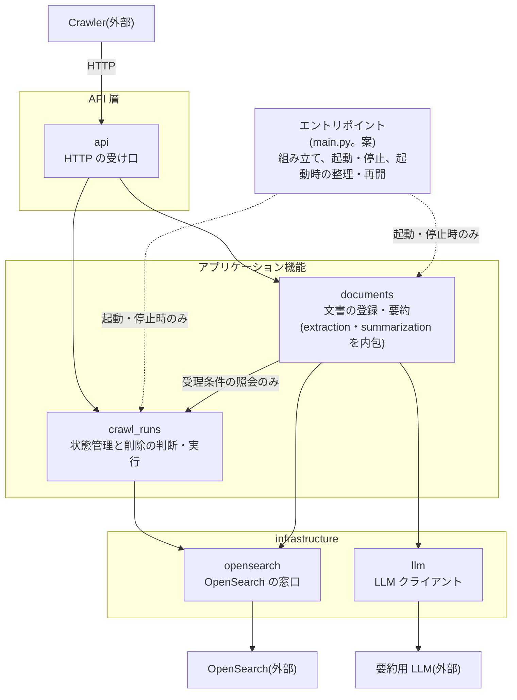
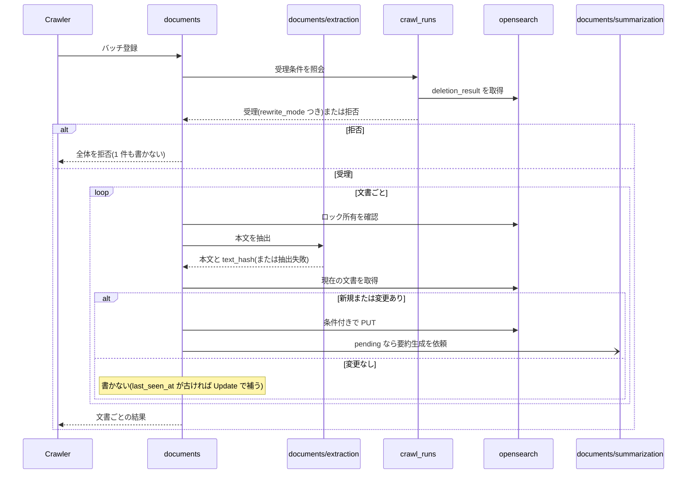
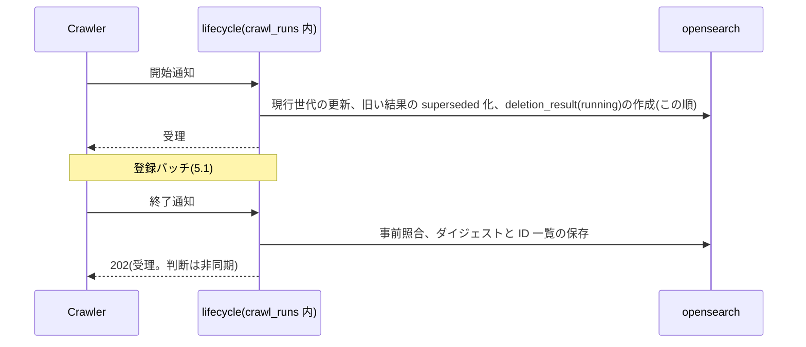
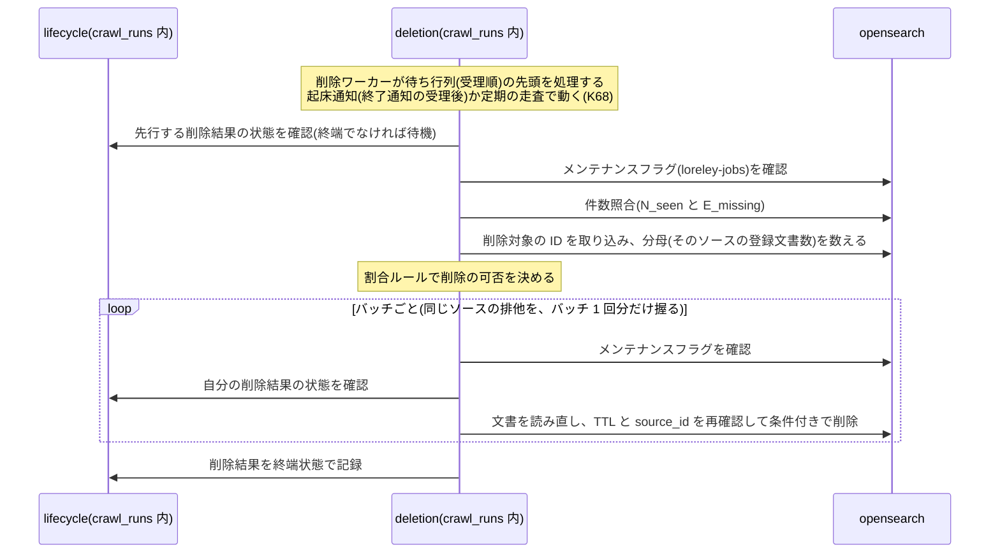
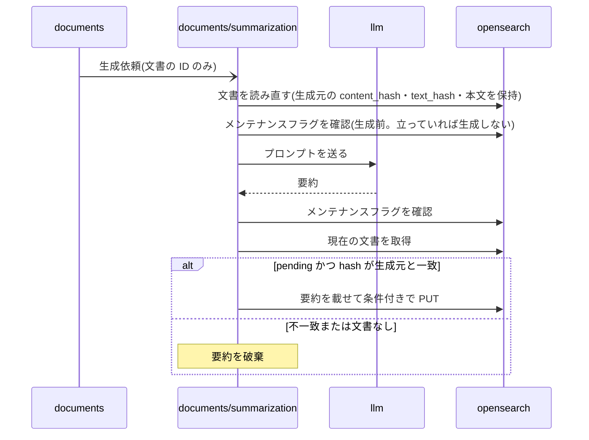
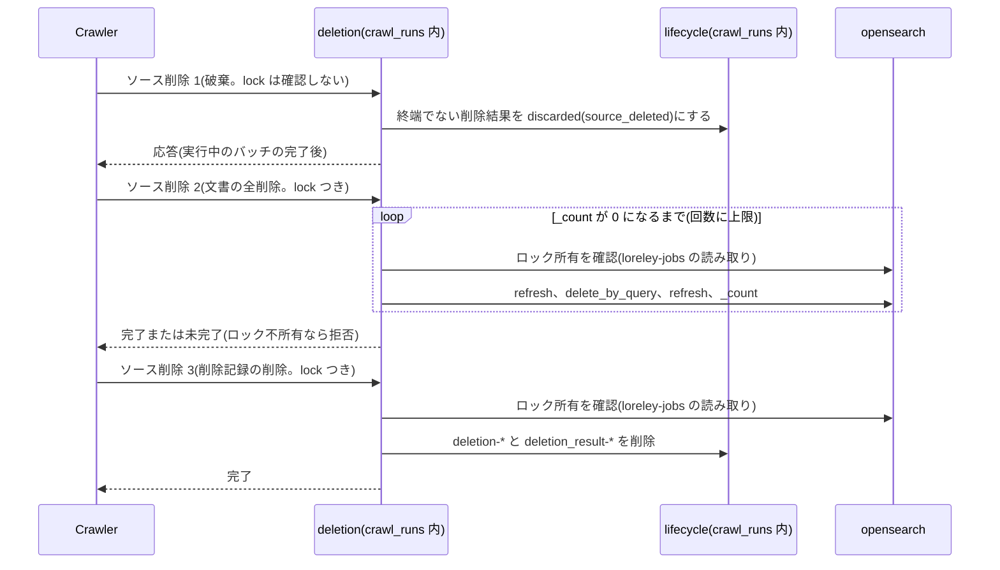
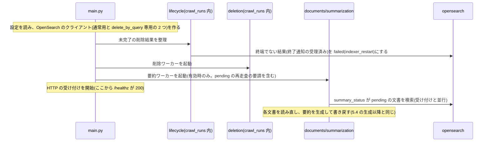

# Indexer モジュール構成設計書 v0.4

- 版: v0.4(2026-11-12)
- 前版: `indexer-module-structure-v0.3.md`
- 位置づけ: Indexer のコード上のモジュール分割と、モジュール間の依存・呼び出しの流れ。「何を、どのモジュールが担うか」を一目で分かるようにする。

---

## 1. 概要

Indexer は、Crawler から HTTP で文書を受けて検索インデックスに登録し、期限切れの文書を削除し、要約を非同期に生成する。検索インデックスと `loreley-deletions`(仮名)への書き込みは Indexer だけが行う(`loreley-jobs` は Crawler の領域)。実装言語は Python(arch 2.4)。実行は単一プロセスで、OpenSearch のクライアントと HTTP のハンドラは同期、削除と要約のワーカーは `threading` のスレッドで動かす(K67。ユーザー承認 2026-11-11(0002 §3 #9))。

コードは 3 層(API 層 / アプリケーション機能 / infrastructure)に分け、層の外に、全層から参照できる共通部品 `common` を置く(M-16)。`crawl_runs` は arch 9章の Deletion Manager に当たる。

| モジュール | ディレクトリ | 役割 | 主な入力 | 主な出力 |
| --- | --- | --- | --- | --- |
| `api` | `api/` | Crawler からの HTTP を受け、形式を検証して担当機能へ渡す | HTTP リクエスト | HTTP 応答 |
| `crawl_runs` | `crawl_runs/` | クロール実行の状態を管理し、削除の判断・実行を行う | 開始通知、終了通知、Status API、ソース削除の要請、受理条件の照会 | 受理結果、削除結果 |
| `documents` | `documents/` | 文書を検索インデックスへ登録し、要約を生成して書き戻す(本文の抽出・要約を含む) | バッチ登録、`last_seen_at` 部分更新の要請、起動時の再走査 | 文書ごとの結果 |
| `opensearch` | `infrastructure/opensearch/` | OpenSearch へのアクセスを引き受ける | 取得・書き込み・削除・検索の指示 | 文書、または結果の区分 |
| `llm` | `infrastructure/llm/` | 要約用 LLM へのリクエストを送り、応答を返す | プロンプト | 生成結果、または失敗 |
| `common` | `common/` | 全層から参照できる共通部品(エラー型、日時、ロック所有の判定、ソース単位ロック、ログのマスキングと出力設定、時計)。他のモジュールに依存しない葉(M-16) | 各モジュールからの利用 | 型・関数 |

ディレクトリは `src/loreley_indexer/`(3章)からの相対。行は層の順(API 層、アプリケーション機能、infrastructure)で、層の外の `common` は最後。依存先と元の節は 4章にある。

読み方:

- **分割と呼び出し関係は、7章の M-1〜M-15 と M-18 の案が基本。ユーザーが承認した部分(M-7・M-9・M-12・M-13・M-16 の一部、M-17)だけが確定で、区分欄に承認日と記録を書く。個別の承認がない案は案のまま(「実装済み」「実装で採用中」の注記だけを付ける。実装は 2026-11-11〜12)。**
- 仕様(責務、処理、状態値、API)の正本は `indexer-architecture-v0.10.md`(arch)と `indexer-api-v0.10.md`(api。Indexer の API 書で、`apps/api` とは別)。本書は仕様を変えない。
- 区分は arch 冒頭の凡例(確定・案・未決・推測・導出)に合わせる。ただし「記述あり」(arch に区分表記がない記述)と「導出(案)」は本書の補助表記。

---

## 2. 構成図

責務と依存の向きだけを示す。処理の順序は 5章のシーケンス図にある。案の一覧は 7章。



凡例:

| 記号 | 意味 |
| --- | --- |
| 矢印 `A --> B` | A が B を呼ぶ(呼ぶ側 → 呼ばれる側)。データの流れではない |
| 点線 | 用途が限られる呼び出し(ラベルのとおり) |
| 3 つの枠 | 層。層をまたぐ呼び出しは上から下へだけ。同じ層(アプリケーション機能)の中の呼び出しは、図にある 1 本だけ(R3) |

OpenSearch 内の領域別のアクセス範囲は 6章の表にある。`common`(全層から参照できる葉。M-16、R10)は、矢印が多くなるため図に描かない。

---

## 3. ディレクトリ構成

```text
apps/indexer/
├── Dockerfile
├── tests/
└── src/
    └── loreley_indexer/        # Python パッケージ層(案)
        ├── main.py             # エントリポイント(案)
        ├── config.py           # 設定の読み込み(案)
        ├── common/             # 全層から参照できる共通部品。葉(M-16)
        ├── api/
        ├── crawl_runs/
        │   ├── lifecycle/      # 状態管理(案)
        │   └── deletion/       # 削除の判定・実行(案)
        ├── documents/          # 直下に、登録・更新の処理を置く(案。例: indexing.py)
        │   ├── extraction/     # 本文の抽出・正規化
        │   └── summarization/  # 要約の生成・書き戻し・再走査(案)
        └── infrastructure/
            ├── opensearch/
            └── llm/
```

- パッケージ層・`main.py`・`config.py` は Python 前提の案(M-15)。実装タスクの構成案(extraction / indexing / deletion / summarization / storage)とは異なる、本書の案(M-1)。
- モジュール(ディレクトリ)の内部のファイル名は書かない。実装時に決める。ただし `documents` の登録・更新の処理(Indexer の中心の機能)は、`extraction/` と `summarization/` の下ではなく `documents/` の直下に置く(M-8)。
- `api/` は HTTP ハンドラの置き場(M-2)。`apps/api`(Search API・Admin API)とは別のアプリのディレクトリ。
- `main.py` は、モジュールの組み立てと、起動・停止、起動時の整理・再開の呼び出しを担う(M-12、M-18)。
- `common/` は、エラー型、日時の正規化、ロック所有の判定、ソース単位ロック、ログのマスキングと出力設定、時計を置く。他のモジュールに依存せず、全層から参照できる(M-16、R10)。
- `config.py` は設定の読み込みを担う(案。M-15)。各モジュールが自前の設定 dataclass を持ち、`config.py` がそれらに値を詰める。モジュールは `config.py` に依存せず、値は `main.py` が渡す。`config.py` は各モジュールの設定 dataclass を import する(`config.py` → モジュールの一方向。M-15)。設定する項目は arch 15.7 にあり、数値は仮値(K39。実装の既定値は `apps/indexer/README.md`)。保存の仕方は arch で未決(U-2、U-3、U-31)。

---

## 4. モジュール詳細

各モジュールを同じ形式で示す。節番号は arch / api の節。括弧のタグ(M-n)は 7章の案。どのモジュールも `common`(4.6)を使える(R10)ため、依存先には書かない。

### 4.1 `api`(M-2)

- **役割**: Crawler からの HTTP を受け、形式を検証して担当機能へ渡す
- **やること**
  - api 1章の 8 API を受け付ける。契約外のヘルスチェック(`GET /healthz`)も持つ
  - リクエストの形式を検証する(不正なら 400)
  - 結果を共通のエラー形式を含む HTTP 応答にする(api 3.4)
  - 起動時の整理が終わる(M-12)までは、`/healthz` を含む全パスに 503(`unavailable`。再試行可)を返す(K67)。実装上は `ready` ガードによる防御だが、実際には uvicorn がアプリケーションの起動完了まで接続を受け付けないため、外からは接続拒否に見える。Crawler は 503 と接続エラーの両方をリトライする(Crawler 領域。案。5.6、api 3.4)
- **やらないこと**: 受理条件の判定、書き込みの判断(→ `documents`、`crawl_runs`)。OpenSearch へのアクセス(→ `opensearch`)
- **依存先**: `crawl_runs`、`documents`
- **公開する入口**: Crawler から HTTP リクエストを受け、下表の担当機能に渡し、その結果を応答として返す
- **元の節**: api 1章、3.4

API の担当(M-4):

| API | 担当 |
| --- | --- |
| バッチ登録(`POST /sources/{source_id}/documents:batch`) | `documents` |
| `last_seen_at` 部分更新(`POST /sources/{source_id}/last-seen`) | `documents` |
| 開始通知(`POST /crawls/start`) | `crawl_runs` |
| 終了通知(`POST /crawls/{crawl_id}/finish`) | `crawl_runs` |
| Status API(`GET /crawls/{crawl_id}`) | `crawl_runs` |
| ソース削除 1(破棄。`POST /sources/{source_id}/deletions:discard`) | `crawl_runs` |
| ソース削除 2(文書の全削除。`DELETE /sources/{source_id}/documents`) | `crawl_runs` |
| ソース削除 3(削除記録の削除。`DELETE /sources/{source_id}/deletion-records`) | `crawl_runs` |
| ヘルスチェック(契約外。`GET /healthz`) | `api`(担当機能を呼ばない) |

エンドポイント形は api の案をそのまま使う。ソース削除 1〜3 の `lock` は JSON のボディで受け取り、`crawl_runs` に渡す(K60)。

### 4.2 `crawl_runs`(arch の Deletion Manager。M-3)

- **役割**: クロール実行の状態を管理し、削除の判断・実行を行う。Crawler のジョブ管理(`loreley-jobs`)ではなく、Indexer 側の削除結果(`deletion_result`)の管理。`loreley-deletions`(仮名)の唯一の書き手

内部は 2 つのサブディレクトリに分ける(M-13)。

| サブディレクトリ | 役割 |
| --- | --- |
| `lifecycle/` | クロール実行の状態を管理する。開始・終了通知、世代、受理条件、Status API、`loreley-deletions` の読み書きの窓口 |
| `deletion/` | 削除を判定し、実行する。ソース削除(文書の全削除を含む)も受け持つ。削除結果の状態の更新は `lifecycle/` だけが行い、`deletion/` は `lifecycle/` に依頼する |

- **やること**
  - `lifecycle/`: 開始通知を受理する(書き込みの順は、現行世代の更新 → 終了通知が届かなかった旧い結果の `superseded` 化 → `deletion_result` の作成と設定の複写。結果の作成を最後にする。K57)
  - `lifecycle/`: 終了通知を受理する(`source_id` の事前照合、再送の判定、スキップ文書 ID 一覧とサイズ超過文書 ID 一覧の保存)
  - `lifecycle/`: 開始通知と終了通知の受理を、同じソース単位で直列に処理する(ソース単位ロックは `common/` の部品。`documents` の登録・`last-seen` のロックとは別のインスタンスで、互いを待たせない。M-17)
  - `lifecycle/`: Status API に削除結果を返す
  - `lifecycle/`: 登録の受理条件の照会に答える(M-6)
  - `lifecycle/`: 起動時に、終了通知を受理済みで終端状態でない削除結果(待機中・判定中・実行中)を `failed`(`indexer_restart`)にする。終了通知が届いていない `running` には触れない(M-12。K68)
  - `deletion/`: 削除ワーカーが、終了通知を受理済みで終端状態でない削除結果を `(finish_received_at, crawl_id)` の順に並べた待ち行列の先頭だけを処理する。全ソースを通して 1 件ずつ(並行度 1)。起床通知か定期の走査で動く(走査型。M-13、K68)
  - `deletion/`: 同じソースの削除バッチとソース削除 1・2 を、削除専用のソース単位の排他で直列に処理する(ソース削除を優先する。3 は排他を使わない。M-17)
  - `deletion/`: 削除を判定する(メンテナンスフラグ、件数照合、対象の決定、割合ルール)
  - `deletion/`: 削除を実行し(バッチごとに、TTL を再確認して条件付きで削除)、結果を終端状態で記録する(`lifecycle/` 経由)
  - `deletion/`: ソース削除 1〜3 を受け持つ。arch 9.14 の手順 1・2・4 に当たる(M-5)。2・3 は `lock` の所有を確認し、確認できなければ、それ以降は何も書かずに拒否する(2 は再実行のたびに確認する)。1 は `lock` を受け取るが確認しない(M-7。K60)
- **やらないこと**: 文書の登録(→ `documents`)。ジョブ・ロック・リース・スキップ記録・確認結果の区分(Crawler)。しきい値の範囲検証(Admin API)。スキップ記録とロック文書の削除(Crawler)。OpenSearch への直接アクセス(→ `opensearch`)
- **依存先**: `opensearch`。内部は `deletion/` → `lifecycle/` の一方向(M-13)
- **公開する入口**
  - 開始通知を受け、受理または拒否を返す
  - 終了通知を受け、受理(202)または拒否(409 など)を返す。受理後の判定・実行は内部で非同期に進める
  - Status API の要請を受け、削除結果を返す
  - 登録の受理条件の照会を受け、受理(`rewrite_mode` を添える)または拒否の種類を返す
  - ソース削除 1〜3 を `lock` つきで受け、完了、未完了、またはロック不所有による拒否を返す
  - 起動時の整理を実行する
  - 削除ワーカーを起動・停止する。起動は起動時の整理の後(M-18)。終了通知の受理後に削除ワーカーを起こす通知は、`main.py` が両者に同じ通知を渡してつなぎ、`lifecycle/` は `deletion/` を知らない(M-13)
- **元の節**: arch 9章、8章(削除前の確認)、11章、12章。api 4.1、4.4〜4.8。`loreley-deletions-v0.10.md`

ソース単位の排他(arch 9.9、9.14。K61、K67):

- ソース単位の排他は 3 種類あり、互いに別のロックで、互いを待たせない。(a) 開始・終了通知の受理(`crawl_runs/lifecycle/`)、(b) `documents` の登録と `last-seen`、(c) 削除バッチとソース削除 1・2(`crawl_runs/deletion/`。ソース削除を優先。3 は排他を使わない)。(a)(b)は `common/` のソース単位ロック(M-16)を別々のインスタンスで使う。通知を削除バッチの完了待ちにしないこと(arch 9.5)と、登録の排他を `crawl_runs` 側に置くと `documents` → `crawl_runs` の依存が受理条件の照会以外に広がること(R3)が理由。
- `deletion/` の処理の開始契機は走査型+起床通知に決まった(arch U-14 の契機・順序・並行度は解消。K68)。`deletion/` が `loreley-deletions` の状態を `lifecycle/` 経由で読む(arch 9.9 項3)ので、`deletion/` → `lifecycle/` の一方向のまま成り立つ。

### 4.3 `documents`(M-8、M-9)

- **役割**: 文書を検索インデックスへ登録し、要約を生成して書き戻す(本文の抽出・要約を含む)。書き込みの種別(全文書き込み、`last_seen_at` の部分更新)を選ぶ

内部は 3 つに分ける。登録の処理(`documents/` 直下)が、`extraction/` と `summarization/` を呼ぶ。`extraction/` と `summarization/` は互いを呼ばない。

- **やること**
  - 登録の処理: `document_id` を算出する
  - 登録の処理: 受理条件を `crawl_runs` に照会する(M-6)
  - 登録の処理: 文書ごとに、先にロック所有を確認する(M-7)
  - 登録の処理: 抽出 → 現在の文書の取得 → 新規・更新・変更なしの判定 → 書き込み、の順に処理する
  - 登録の処理: 変更のない文書は書かない。`last_seen_at` が古いときだけ Update(max 比較)で補う
  - 登録の処理: 再書き込みモード(`rewrite_mode`)を反映する
  - 登録の処理: 409 のときは文書を読み直して再判定する(R8)
  - 登録の処理: `last_seen_at` の部分更新(Update。max 比較)を行う
  - 登録の処理: PUT 成功後に `summary_status=pending` なら(要約が有効なときだけ `pending` になる)、`summarization/` に生成を依頼する。渡すのは文書の ID だけで、本文やハッシュは渡さない(K64)。結果は待たない(登録の応答は要約より先に返る。M-9)
  - `extraction/`: 形式別(txt・Markdown・HTML・PDF)に本文を抽出し、文字コードを判定する(UTF-8、Shift_JIS/CP932)
  - `extraction/`: 本文を正規化し、サイズ上限で切り詰めて `truncated` を判定し、`text_hash` を計算する
  - `extraction/`: 抽出の失敗を結果として返す
  - `summarization/`: 生成依頼(文書の ID)を有界のキューに受け、`threading` のワーカーで要約を生成する(並列数は設定で決める。既定値は `apps/indexer/README.md` を正とする)。待機中の同じ ID の依頼は 1 件にまとめ、キューが満杯なら依頼を断って `pending` のまま再走査に委ねる(キューのメモリに上限を置くため。K39、K64)。既定では無効で、LLM を明示的に設定したときだけ動く。ただし LLM の具体的なプロバイダは未実装で、要約を有効にすると現状は起動に失敗する(M-11、arch U-9)
  - `summarization/`: ワーカーは、生成を始めるときに文書を読み直し、そのときの `content_hash`・`text_hash`・本文を生成元として保持する(arch 7.4。K64)
  - `summarization/`: 生成を始める前にも、メンテナンスフラグを確認する。立っていれば生成しない(生成して捨てることを繰り返さないための安全側の追加。実装で採用中の案で、承認の個別記録はない。0008 A1。K63 の確定は、下の書き込み前の確認)
  - `summarization/`: プロンプトを組み立て(本文は先頭の一定文字数だけを入れる。K64)、使うモデルを選ぶ(モデルの選定は arch U-9 で未決)。LLM の呼び出しは `llm` に依頼する(M-11)
  - `summarization/`: 書き込み前にメンテナンスフラグを確認し(不正な値は「立っている」とみなす。K63)、文書が `pending` で `content_hash` と `text_hash` が生成元と一致するときだけ PUT で書き戻す。不一致・文書なしは破棄し、409 は読み直す(R8)
  - `summarization/`: `summary_status=pending` の文書を再走査する。起動時に即時に 1 回行い、以後は、再走査の契機(キューが満杯で依頼を断った、生成・書き戻しが `pending` のまま終わった、メンテナンスで止まった、走査自体が失敗した。arch 7.4)があったときだけ、書き戻しの成功がない限り間隔を伸ばしながら続ける(成功すると元に戻す)。生成・書き戻しが直らなくても `failed` にはせず、`pending` のまま残す(K64)
- **やらないこと**: 削除の判断(→ `crawl_runs`)。OpenSearch への直接アクセス(→ `opensearch`)。LLM との通信そのもの(→ `llm`)。`content_hash` の計算(Crawler が渡す。Indexer は照合も再計算もしない。K66)。リトライとスキップの判断、結果の集計(Crawler)。要約のジョブ記録(要約は `loreley-jobs` の対象外)。`failed` への遷移と、再実行・有効化後の既存文書の一括生成の手段(arch U-9 の残り。未実装で、`rewrite_mode` のクロールで代える。K64)。Embedding(MVP 対象外)
- **依存先**: `opensearch`、`crawl_runs`(受理条件の照会だけ)、`llm`。`extraction/` は他へ依存しない(抽出ライブラリを除く。K71)。`summarization/` は `opensearch` と `llm` を使う
- **公開する入口**
  - バッチ登録の要請を受け、文書ごとの結果(`change` の区分、または失敗種別)を返す。受理条件を満たさなければ、1 件も書かずに拒否の種類を返す
  - `last_seen_at` 部分更新の要請を受け、文書ごとの結果(`updated` / `unchanged` / `not_found` / 失敗)を返す
  - 要約ワーカーを起動・停止し(有効時のみ)、起動時に `pending` の文書の再走査を要請する(`summarization/` の入口を、`documents` の公開する入口として `main.py` に見せる。M-12、M-18)。再走査は受け付けと並行して進む
  - 内部向け: `extraction/` は原本と形式を受け取り、「本文・`text_hash`・`truncated`」または「抽出失敗」を返す。`summarization/` は生成依頼(文書の ID だけ。生成元の `content_hash`・`text_hash`・本文は、ワーカーが生成の開始時に文書を読み直して保持する)を受け、結果は待たせず、完了後に文書を更新する
- **元の節**: arch 4.2、4.3、4.4、5章、6章、7章、8章、9.5(受理条件)、12章、15.2、1.3(`text_hash`)。api 4.2、4.3

### 4.4 `opensearch`(`infrastructure/opensearch`。M-10)

- **役割**: OpenSearch へのアクセスを引き受け、結果を呼び出し側が扱える区分に直す
- **やること**
  - 検索インデックスの窓口: ID での取得(`_seq_no`/`_primary_term` つき)、新規作成、条件付き書き込み、`last_seen_at` の Update(max 比較)、条件付き削除、条件指定での検索(`search_after`)、件数、refresh、`delete_by_query`。削除の再確認用に、本文を読まずに `source_id`・`last_seen_at` と版だけを返す取得も持つ。`delete_by_query` は専用のクライアントで行い、タイムアウトなどでも自動では再送しない(K61)
  - Store 層の窓口(`loreley-deletions`): ID での取得・保存・削除、条件指定での列挙、条件付き更新(Repository インターフェース)
  - `loreley-jobs`: ロック文書とメンテナンスフラグの読み取り(読み取り専用。ロック文書とフラグの形式は案。M-7、R6)
  - 結果を、成功・競合(409)・文書なし・文書固有の拒否・OpenSearch 全体の異常に区分して返す
- **やらないこと**: 業務上の判断(変更の有無、割合ルール、要約の書き戻し条件)。409 のときの読み直しの繰り返し(→ 呼び出し側。R8)。`loreley-jobs` と `loreley-sources` への書き込み、`loreley-sources` の読み取り
- **依存先**: OpenSearch(外部)
- **公開する入口**: 「取得」「条件付き書き込み」「条件付き削除」「検索・件数」などの指示を受け、文書(と版)または結果の区分を返す
- **元の節**: arch 2.3、3.5、5章、6章

検索インデックスは Repository インターフェースの対象外のまま(arch 3.5)にし、内部で「検索インデックス」と「Store 層」の 2 つの窓口に分ける。

### 4.5 `llm`(`infrastructure/llm`。M-11)

- **役割**: 要約用 LLM へのリクエストを送り、応答を返す。LLM クライアントだけを持つ
- **やること**: 接続の設定を読む(LLM を明示的に設定したときだけ使う)。プロンプトを送り、生成結果を受け取る。接続の失敗・タイムアウトを結果として返す。ただし現状の実装は、インターフェースと、何も生成しない無効な既定実装だけで、具体的なプロバイダは未実装(M-11)
- **やらないこと**: プロンプトの組み立て、モデルの選定、再走査、再試行の判断(→ `documents/summarization/`)。検索インデックスの読み書き
- **依存先**: 要約用 LLM(外部)
- **公開する入口**: プロンプトを受け取り、生成結果または失敗を返す
- **元の節**: arch 7.1、2.4

### 4.6 `common`(`common/`。M-16)

- **役割**: 全層から参照できる共通部品を置く。他のモジュールに依存しない葉。業務の判断は持たない
- **やること**
  - エラー型を定義する(下位システムの異常、契約で HTTP エラーにするリクエスト全体の拒否など。メッセージに本文・秘密情報を入れない)
  - 日時を、UTC・ミリ秒精度の形式に正規化する(arch 3.3、api 3.6)
  - ロック所有を判定する(`owner` と `job_id` の一致とリース期限。`documents` の登録と、`crawl_runs/deletion/` のソース削除 2・3 が同じ判定を使う。M-7)
  - ソース単位ロックの部品を提供する(M-17)
  - ログのマスキングと出力設定を行う(秘密値を伏せる。ライブラリ由来のログの水準を制限する。R9)
  - 時計を抽象化する(テストで固定時計に替えるため。個別の承認なし。案(実装で採用中))
- **やらないこと**: 他のモジュールへの依存。業務の判断。外部システムへのアクセス(R2)
- **依存先**: なし
- **公開する入口**: 上記の型・関数。呼び出し側は、層を問わず直接使える
- **元の節**: arch 15.7、8章、9.9。M-16(確定の範囲は M-16 の区分欄のとおり。エラー型・日時・ロック判定・ログのマスキングは 0002 §3 #20、ログの出力設定は 0021 §2。ソース単位ロックの移動は案(実装で採用中)。0020 §6-2(0021 で全て承認))

---

## 5. 主要シナリオ別の呼び出しの流れ

読み方:

- 矢印は呼び出し。`->>` は応答を待つ呼び出し、`-)` は待たない呼び出し。
- Crawler からの呼び出しと応答は `api` を経由する。図では `api` を省略する。
- `opensearch` は `infrastructure/opensearch`、`llm` は `infrastructure/llm`。`extraction`、`summarization` は `documents` の内部。
- 各シナリオが依拠する案は、見出し直下に M-ID で示す。

### 5.1 文書の登録バッチ

依拠する案: M-4、M-6、M-7、M-8、M-9



- 409 のときは取得からやり直す(arch 4.3)。
- 要約は待たない。登録の応答は要約より先に返る(arch 7.2)。要約の起動契機は arch が推測としている(G-12)。
- `last_seen_at` の部分更新も、同じ受理条件の照会と文書ごとのロック確認を通り、Update(max 比較)で書く。

### 5.2 開始通知から終了通知まで(受付)

依拠する案: M-4、M-13



- 開始通知は、旧い削除が進行中でも待たせずに受理する(arch 9.5)。新しい開始通知は、受理済みの旧い削除を止めない。
- 開始通知の書き込みは、世代の更新 → 旧い結果の `superseded` 化 → `deletion_result` の作成の順で、結果の作成を最後にする(K57)。途中で失敗した後の再送が、「結果がある=受理済み」と見て整理を飛ばさないため(0010 判断4)。
- 開始通知と終了通知の受理は、同じソース単位で直列に処理する(arch 9.9)。
- 202 のあと、Crawler は Status API をポーリングする(5.3 の判定・実行と並行)。

### 5.3 削除の判定・実行(非同期)

依拠する案: M-13、M-17



- 判定の順序は arch 9.7、割合ルールは 9.3、削除の実行は 9.8。
- 件数照合が合わない、割合を超える、メンテナンス中などの場合は、削除せず理由つきで終端状態にする(arch 9.10)。
- 判定・実行の全体異常(文書ごとの削除エラーを除く。OpenSearch の障害など)は、`status` を変えず `running` のまま、走査ごとに判定(件数・T・D の取り直し)からやり直す(`deleted_count` は引き継ぐ。連続して失敗している間は走査の間隔を伸ばす)。`failed` にはしない(arch 9.9、K62)。
- Status API(`GET /crawls/{crawl_id}`)の要請は、`lifecycle/` が `deletion_result` を取得して返す。判定・実行とは独立に、いつでも答える。

### 5.4 要約の非同期生成

依拠する案: M-9、M-11



- 生成依頼は文書の ID だけを運ぶ。本文を載せるとキューのメモリが「キューの長さ × 本文の大きさ」になるため、ワーカーが生成の開始時に文書を読み直す。待機中の同じ ID は 1 件にまとめる。キューが満杯なら依頼を断り、`pending` のまま再走査に委ねる(K39、K64)。
- PUT が 409 のときは、文書を読み直して再判定する。読み直しの上限を超えたら `pending` のまま残し、再走査に委ねる(arch 7.4)。
- フラグの確認は 2 回ある。確定(K63)は書き込み前の確認(不正な値は立っているとみなす)。生成前の確認は実装で採用中の安全側の追加で、承認の個別記録はない(0008 A1)。
- 要約が無効な構成では、この流れは動かない(arch 7.1)。

### 5.5 ソース削除の要請

依拠する案: M-4、M-5、M-7、M-17



- スキップ記録・ロック文書・データソース設定の削除は Crawler が行う(arch 9.14)。
- ソース削除 1〜3 は、何度でも再実行できる(arch 9.14)。
- ソース削除 2・3 は `lock` の所有を確認できなければ、それ以降は何も書かずに拒否する。2 は再実行のたびに確認する(別のジョブがロックを取った後の再実行で、新しい登録を消さないため)。1 は確認しない(応答待ちでリースが切れうるため。再実行を妨げない)(K60、K61)。
- ソース削除 1・2 は、同じソースの削除バッチと排他にし、ソース削除を優先する。1 の応答の時点で、そのソースの削除バッチは動いていない(案。実装で採用中。arch P29。M-17)。

### 5.6 起動・停止、起動時の整理・再開(arch 12章)

依拠する案: M-9、M-12、M-18



- 起動の順は、設定 → OpenSearch クライアント → 起動時の整理 → 削除ワーカー → 要約ワーカー → HTTP の受け付け(M-18)。受け付けの開始前は、`/healthz` を含む全パスが 503(`unavailable`。再試行可)を返す(K67)。実際には uvicorn がアプリケーションの起動完了まで接続を受け付けないため、外からは接続拒否に見える(`ready` ガードは二重の防御)。Crawler は 503 と接続エラーの両方をリトライする(Crawler 領域。案)。要約が有効なのに LLM が未設定なら(現状は具体プロバイダがないため有効にすると必ず)、起動に失敗する。コンテナの停止猶予とヘルスチェックの待機時間は `apps/indexer/README.md` を正とする。
- 待機中・判定中・実行中の削除は、再開せず `failed` にする。削除は次のクロールに委ねる(arch 9.8)。整理の対象は、終了通知を受理済みで終端状態でない結果。終了通知が届いていない `running` には触れない(K68)。
- 削除ワーカーは整理の後に起動する。先に動かすと、再起動前に受理した削除を再開してしまうため。
- 停止(SIGTERM)は起動の逆順: 受け付けを止め、要約ワーカー、削除ワーカーの順に止め、OpenSearch の接続を閉じる。ワーカーは実行中の処理(削除は 1 バッチ、要約は 1 件)を終えてから止まり、それぞれ最大 10 秒待つ(コードの固定値。時間内に終わらなければ待つのをやめ、処理は打ち切られる)。途中だった削除結果は `running` のまま残り、次回の起動時の整理で `failed`(`indexer_restart`)になる(M-18)。
- 整理を HTTP の受け付けの前に終えることは M-12 のとおり(受け付け後だと、新しい終了通知を誤って `failed` にしうる)。ワーカーの起動と停止の順は案(M-18)。要約の再走査は受け付けと並行してよい。再走査の入口は `documents` が公開する入口として `main.py` に見せる。

---

## 6. 依存ルール

3 層のルール(R1〜R5)と、OpenSearch の領域別のルールおよび共通のルール(R6〜R9)、共通部品 `common` のルール(R10)に分ける。依存ルールは、実装のテスト(`apps/indexer/tests/architecture/`)が検査する。import の検査は R1〜R5、R9 の LLM の限定、R2 のライブラリの限定、R10。R6・R7 は `test_write_rules.py` による部分検査(インターフェースの面と、書き込み呼び出しの場所・条件)のみ。R8 は import の検査ではなく、各機能のテスト(409 の読み直し)で確認する。

| # | ルール | 根拠 | 区分 |
| --- | --- | --- | --- |
| R1 | 呼び出しは上の層から下の層へだけ。順序は `api` → アプリケーション機能 → `infrastructure`。循環させない。機能どうしの呼び出しは R3 による。共通部品 `common` は層の外で、R10 による | 本書 | 導出(案)。実装済み |
| R2 | 外部システム(OpenSearch、要約用 LLM)へのアクセスは `infrastructure` に限る | arch 2.2、2.3、3.5、7.1 | 導出(案) |
| R3 | 機能どうしの依存は `documents` → `crawl_runs` の 1 本だけ: 受理条件の照会(読み取り)だけ。`crawl_runs` を分けても、この依存は解消しない。`documents` の内部(登録の処理、`extraction/`、`summarization/`)の呼び出しは、層をまたぐ依存ではない。ロック所有の判定とソース単位ロックは `common` に置き、機能どうしの依存を増やさない(M-16) | arch 9.5 | 導出(案)。受理条件は確定(K23)。実装済み |
| R4 | `api` は業務判断をしない。形式の検証と受け渡しだけを行う | 本書 | 導出(案) |
| R5 | `crawl_runs` の内部は `deletion/` → `lifecycle/` の一方向。`loreley-deletions` の読み書きは `lifecycle/` を通す | arch 9.9 | 導出(案)。`deletion/` の開始契機は走査型+起床通知に決まり(K68。ユーザー承認 2026-11-11(0002 §3 #2))、一方向のまま成り立つ。実装済み |
| R6 | OpenSearch 内の領域ごとのアクセスは下表のとおり。`loreley-deletions` に書くのは `crawl_runs` だけ。`loreley-jobs` は読み取りのみ。`loreley-sources` は読まない | arch 2.2、2.3、8章、11章 | 書き込み役は確定(K2)で、割り当ては導出(案)。ロック文書の読み取りは確定(K13)。メンテナンスフラグの読み取りは、確認箇所(削除は判定前と各バッチ前、要約は書き込み前)と不正値の扱い(fail-closed)が確定(K63。ユーザー承認 2026-11-11(0002 §3 #11)、2026-11-12(0014))で、形式は案(arch U-24。実装で採用中)。要約の生成前の確認は実装で採用中の安全側の追加で、承認の個別記録はない(0008 A1)。他は記述あり。部分検査のみ |
| R7 | 検索インデックスへの書き込みは条件付き(`if_seq_no`/`if_primary_term`、`op_type=create`、`last_seen_at` は max 比較)にする。文書ごとのアプリ内ロックは設けない。**例外**: ソース削除 2 の `delete_by_query`(`conflicts=proceed`)は条件付きにしない。競合した文書はその回は飛ばし、完了後の `_count` の確認と再実行で収束させる | arch 5章、6章、8章末尾、9.14 | 確定(K19、K27)。`delete_by_query` は確定(K20、K28、K48)。アプリ内ロックなしは記述あり。部分検査のみ |
| R8 | 409 のときの読み直しは呼び出し側(`documents`(`summarization/` を含む)・`crawl_runs`)が行う。`infrastructure` は繰り返さない。上限は共通の設定値にする | arch 4.4、6章 | 導出(案)。上限の値は未決(U-31(4))。実装済み。各機能のテストで確認(依存ルールのテストの対象外) |
| R9 | 全体共通: 外部 LLM は、明示的に設定したときだけ呼ぶ。ログに本文と秘密情報を出さない。運用から見える契約は次のとおり: OpenSearch クライアント系とその下位の HTTP ライブラリのログは、ID や本文が出るため、エラー水準以上だけにする。想定外の例外(500)のログは、種別と発生箇所だけを出し、入力の値を出さない。アクセスログは、メソッド、ルートのテンプレート、ステータス、所要時間だけを出す(ID を含む実際のパスは出さない)。起動時の設定エラーは、項目名と検証の種別だけを出し、値を出さない | arch 2.4、7.1 | 記述あり。OpenSearch クライアント系ログの ERROR 固定、500 のログの診断情報、設定エラーの固定形式は確定(ユーザー承認 2026-11-12(0021 §2))。アクセスログの内容は案(実装で採用中。個別の承認なし。0015) |
| R10 | `common` は全層から参照できる。`common` は他のモジュールに依存しない(葉)。`common` に置くのは、複数のモジュールが共有する部品(エラー型、日時、ロック所有の判定、ソース単位ロック、ログのマスキングと出力設定、時計)に限る | M-16 | 確定の範囲は M-16 のとおり(ユーザー承認 2026-11-11(0002 §3 #20)、ログの出力設定は 2026-11-12(0021 §2))。ソース単位ロックの移動は案(実装で採用中)。0020 §6-2(0021 で全て承認)。時計は個別の承認なし。案(実装で採用中)。実装済み |

領域別のアクセス範囲(R6、R7 の具体):

| 対象 | `documents` | `crawl_runs` |
| --- | --- | --- |
| 検索インデックスの書き込み | 全文書き込み、`last_seen_at` の Update、要約の書き戻し(PUT) | 条件付き削除、`delete_by_query` |
| 検索インデックスの読み取り | あり | あり |
| `loreley-deletions` | 直接は触らない(`crawl_runs` に照会) | 読み書き(`lifecycle/` が窓口) |
| `loreley-jobs` | ロック文書の読み取り(登録の処理)、メンテナンスフラグの読み取り(`summarization/`) | ロック文書の読み取り(ソース削除 2・3)、メンテナンスフラグの読み取り(`deletion/`) |

---

## 7. 確認状況

本書でモジュール分割として新たに決めた事項。ユーザーが承認した部分は確定で、区分欄に承認日と記録(`agent_tasks/20261111_implement_indexer/` の作業記録番号)を書く。それ以外は案で、個別の承認がないため確定扱いにしない。実装(2026-11-11〜12)は案どおりに行い、実装した案には「実装済み」と付ける。個別の承認がないまま実装が採った案には「実装で採用中」と付ける(いずれも実装の事実の注記で、承認ではない)。0001 Q2「設計書の案は実装仕様として採用する」は作業方針であり、項目ごとの確定ではない。

| ID | 内容 | 区分 | 関連する arch / api の ID・節 |
| --- | --- | --- | --- |
| M-1 | 3 層(API 層 / アプリケーション機能 / infrastructure)で、`api` / `crawl_runs` / `documents`(`extraction/`・`summarization/` を内包)/ `infrastructure`(`opensearch`、`llm`)に分ける。層の外に共通部品 `common` を置く(M-16)。実装タスクの構成案に替わる案 | 案。実装済み | 実装タスクの要件(`20261111_implement_indexer`) |
| M-2 | HTTP ハンドラの置き場は `api/`。`api` は API 層という役割が名前で分かる。パッケージ層がなければ `http/` は Python 標準の `http` と衝突しうるが、パッケージ層(M-15)があるので衝突しない。`apps/api` とは別のアプリのディレクトリで、実害が小さいと見る | 案。実装済み | api 1章 |
| M-3 | 実装タスクの `deletion` を `crawl_runs` に改名する。開始・終了通知の受理や Status API など削除以外の責務を含む実態に合わせる | 案。実装済み | arch 9章、K1 |
| M-4 | API の担当: バッチ登録と `last_seen_at` 部分更新は `documents`。開始通知・終了通知・Status API・ソース削除 1〜3 は `crawl_runs`。契約外のヘルスチェック(`/healthz`)は `api` 自身 | 導出(案)。実装済み | arch 9章(K1)、api 1章 |
| M-5 | ソース削除 1〜3(arch 9.14 の手順 1・2・4)は `crawl_runs/deletion/` に置く。`delete_by_query` の再実行も行う | 導出(案)。実装済み | arch 9.14、K20、K28、K48 |
| M-6 | 登録の受理条件の判定は `crawl_runs/lifecycle/` が持ち、`documents` が照会する(読み取りのみ)。`deletion_result` の読み方を 1 か所にするため。`crawl_runs` を分けても、`documents` → `crawl_runs` の依存は解消しない | 導出(案)。実装済み | arch 9.5、K23、K33 |
| M-7 | 書き込み前のロック所有確認は `documents` が行い、`opensearch` 経由で `loreley-jobs` のロック文書を読む。ソース削除 2・3 の要請のロック所有確認は `crawl_runs/deletion/` が行い(2 は再実行のたびに確認)、1 は確認しない。所有の判定そのもの(`owner`・`job_id` の一致とリース期限)は `common/` に置き、両者が共有する | 導出(案)。ソース削除 2・3 の `lock` 確認と、1 は確認しないことは確定(K60。ユーザー承認 2026-11-11(0002 §3 #8)・2026-11-12(0021 §1))。担当モジュールは M-5 の案どおり実装済み。ロック文書の形式は案(arch U-4、U-34。実装で採用中) | arch 8章、P13(→ K67)、K13、K60、U-4。api 3.2、API-U-14 |
| M-8 | `extraction/` は独立モジュールにせず、`documents` の内部ディレクトリにする(呼び出し元が登録処理だけのため)。サイズ上限での切り詰め・`truncated` の判定・`text_hash` の計算まで担う。上限の値は決めない | 導出(案)。実装済み | arch 15.2、1.3、K22、U-8 |
| M-9 | `summarization/` を独立モジュールにせず、`documents` の内部ディレクトリ(`extraction/` と並ぶ)にする。要約は登録済み文書に書き戻す処理で、`documents` が起動の契機(登録の成功後)を持つため。一方、非同期に動き、起動時の再走査と LLM 通信がある点は独立性が高い。内部に入れても、実行タイミングは変わらない。要約が大きくなれば独立に戻せる。登録の処理 → `summarization/` は一方向・非同期の生成依頼だけ(待たない。渡すのは文書の ID だけ) | 案。実装済み。生成依頼を文書の ID だけにした点は確定(K64。ユーザー承認 2026-11-12(0021)) | arch 4.3、7.2、G-12、7章 |
| M-10 | `opensearch` は、検索インデックス(Repository の対象外)と Store 層(Repository)の両方を包み、内部で 2 つの窓口に分ける | 導出(案)。実装済み | arch 3.5、U-11 |
| M-11 | LLM クライアントだけを `infrastructure/llm` に置く。プロンプトの組み立て、モデルの選定、再走査、再試行の判断は `documents/summarization/` に残す。LLM の呼び出しは `documents/summarization/` からだけ | 案。インターフェースと無効な既定実装のみ実装済み(具体的なプロバイダは未実装。要約を有効にすると起動に失敗する。arch U-9) | arch 7.1、U-9 |
| M-12 | `main.py` がモジュールの組み立てと、起動・停止、起動時の整理・再開(`lifecycle/` の整理と、`documents` が公開する再走査の入口の呼び出し)を担う。`lifecycle/` の整理を HTTP の受け付け開始前に終え、再走査は受け付けと並行してよい。受け付け後に整理すると、新しい終了通知を誤って `failed` にしうるため。整理の対象は、終了通知を受理済みで終端状態でない削除結果。整理が終わるまで、`/healthz` を含む全パスは 503 を返す(`ready` ガードによる防御。実際には uvicorn がアプリケーションの起動完了まで接続を受け付けないため、外からは接続拒否に見える。Crawler は 503 と接続エラーの両方をリトライする(Crawler 領域。案)) | 導出(案)。整理の対象と、整理の完了後にだけ `/healthz` が応答すること、起動前の全パスが 503 であることは確定(K67、K68。ユーザー承認 2026-11-11(0002 §3 #3・#21)、0020 §6-1 #9・0021 §1)。その他は案のまま実装済み | arch 12章、9.8、7.4、P15(→ K64)、U-19(`/healthz` は解消。K67。起動順・停止順は案で M-18、内部通信のテスト設計は未決)、U-20(解消。K68) |
| M-13 | `crawl_runs` の内部を `lifecycle/`(状態管理)と `deletion/`(判定・実行)に分け、`deletion/` → `lifecycle/` の一方向にする。`loreley-deletions` の読み書きは `lifecycle/` を通す(削除結果の状態更新を `lifecycle/` と `deletion/` の両方が行う責務の重複を避ける)。`deletion/` の開始契機は走査型+起床通知(終了通知の受理後に削除ワーカーを起こす通知は `main.py` が両者に同じものを渡してつなぐ。`lifecycle/` は `deletion/` を知らない)。待ち行列の順序は `(finish_received_at, crawl_id)`、並行度は全ソースで 1 | 導出(案)。開始契機・順序・並行度は確定(K68。ユーザー承認 2026-11-11(0002 §3 #2))。内部の分割と一方向の規則は案のまま実装済み | arch 9.9、U-14(契機・順序・並行度は解消。K68)、K68 |
| M-14 | 依存ルールのうち導出(案)としたもの: R1〜R5、R8、R6 のモジュールへの割り当て。R10 は M-16 で確定 | 導出(案)。実装済み(R1〜R5 は import の検査テストあり。R6 は `test_write_rules.py` による部分検査。R8 は各機能のテストで確認) | arch 2.2、2.3、3.5、6章、7.2、8章 |
| M-15 | Python 前提の構成: パッケージ層 `src/loreley_indexer/`、エントリポイント `main.py`、設定の読み込み `config.py`。各モジュールが自前の設定 dataclass を持ち、`config.py` がそれらに値を詰める。モジュールは `config.py` に依存せず、値は `main.py` が渡す。`config.py` は各モジュールの設定 dataclass を import する。内部のファイル名は決めない。実装言語が Python であることは arch 2.4 の記述(区分表記なし)。抽出ライブラリと文字コード判定の選定(U-10)は K71 で解消 | 案。実装済み。各モジュールが自前の設定 dataclass を持ち、`config.py` がそれらを import する点は、項目としての個別承認はない(プラン 0002 §6 P1 に沿う。同プランは 2026-11-11 承認)。実装で採用中 | arch 2.4、15.7、K39、K71 |
| M-16 | 共通部品の置き場は `common/`: 依存先を持たない葉のモジュールで、全層から参照できる(R10)。エラー型、日時の正規化、ロック所有の判定、ソース単位ロック、ログのマスキングと出力設定、時計を置く。ロック所有の判定とソース単位ロックを置くのは、`documents` と `crawl_runs/deletion/` が同じ部品を使い、R3 を守りつつ重複を避けるため。M-1 の各モジュールとは別の、層の外のモジュール | 確定の範囲は次のとおり。`common/` を葉として置くことと、エラー型・日時の正規化・ロック所有の判定・ログのマスキングを置くことは、ユーザー承認 2026-11-11(0002 §3 #20)。ログの出力設定は、2026-11-12(0021 §2)。ソース単位ロックの `common/` への移動は案(実装で採用中。0020 §6-2(0021 で全て承認))。時計は個別の承認なし。案(実装で採用中)。実装済み | arch 15.7。K67(ソース単位ロック) |
| M-17 | ソース単位の直列化は 3 種類の別のロックにする。(a) 開始・終了通知の受理(`crawl_runs/lifecycle/`)、(b) `documents` の登録と `last-seen`(2 つで同じロックを共有)、(c) 削除バッチとソース削除 1・2(`crawl_runs/deletion/` の削除専用の排他。ソース削除を優先する。3 は排他を使わない)。(a)(b)は `common/` の部品を別々のインスタンスで使う。理由: 開始・終了通知を削除バッチの完了待ちにしないため(arch 9.5)、登録の排他を `crawl_runs` 側に置くと `documents` → `crawl_runs` の依存が受理条件の照会以外に広がる(R3)ため共通部品にする、待っているソース削除をバッチ側が後回しにしないため | 確定(ユーザー承認 (a)(b)は 2026-11-11(0002 §3 #19)、(c)は 2026-11-12(0021 §2。architecture K61))。ただし、ソース削除 1 の応答の時点でそのソースの削除バッチが動いていないことの意味(arch P29)は案(実装で採用中)。実装済み | arch 8章、9.9、9.14、P13・P4(→ K67・K68)、P29(案のまま。排他によるソース削除の優先は K61)、K61、K67 |
| M-18 | 起動・停止の順序: 設定 → OpenSearch クライアント(通常用と `delete_by_query` 専用)→ 起動時の整理 → 削除ワーカー → 要約ワーカー → HTTP の受け付け。停止は逆順で、ワーカーは実行中の処理を終えてから止まり、それぞれ最大 10 秒待つ。削除ワーカーを整理の後に起動するのは、先に動かすと再起動前に受理した削除を再開してしまうため。起動前は全パス 503(外からは接続拒否に見える)。停止の 10 秒はコードの固定値で、時間内に終わらなければ待つのをやめ、処理は打ち切られる(削除結果は `running` のまま残り、次回の整理で `failed`) | 案。実装で採用中(個別の承認なし。整理の完了前は全パス 503 であることは M-12 で確定) | arch 12章、9.8、2.4、U-19(起動順・停止順の部分は案)、K67(確定の範囲は `/healthz`・実行モデル・直列化・起動前 503)、K68 |

この文書が決めないこと(元の設計書の未決を引き継ぐ):

| 事項 | ID |
| --- | --- |
| API の契約のうち残るもの(arch U-4 の残り、api の API-U-1・12・16・17 など) | arch U-4、api の API-U-n |
| Crawler との突き合わせが要る事項(`document_id` の先頭 `/`、`content_hash` の形式、DELETE のボディ、ロック文書・メンテナンスフラグの形式、索引名、マッピング前提など。Indexer の実装では案を採用中) | arch U-34、U-4(Crawler 領域) |
| `failed` への遷移、有効化後の既存文書の一括生成、LLM の具体的なプロバイダとモデルの選定(再試行と再走査の方針は K64 で暫定) | arch U-9、K54 |
| メンテナンスフラグの書き込み手段と形式、停止中の応答、ジョブ開始時の確認、再開手順(削除の判定前・各バッチ前と要約の書き込み前の確認箇所と、不正値の扱いは K63 で確定) | arch U-12、U-24 |
| 内部通信のテストケースの設計(`/healthz` は K67 で解消。起動順・停止順は案で M-18) | arch U-19 |
| Repository インターフェースの詳細 | arch U-11 |
| 設定する項目・値・保存の仕方、件数・回数・サイズの数値(バッチ件数、読み直しの上限など) | arch K39、U-2、U-3、U-31 |

---

## v0.2 からの変更点

変更はモジュール分割だけ。仕様・数値・状態値・API 名は arch / api v0.9 のまま。

| v0.2 | v0.3 |
| --- | --- |
| `summarization`(独立モジュール) | `documents/summarization/`(`documents` の内部ディレクトリ。`extraction/` と並ぶ) |

- アプリケーション機能の層は `crawl_runs` と `documents` の 2 つになった。機能どうしの依存は `documents` → `crawl_runs` の 1 本だけ(R3 の(b)を削除)。
- 起動時の再走査は、`main.py` が `documents` の公開する入口を呼ぶ。
- M-ID: M-9 を新設(`summarization` の移動)。v0.2 の M-9〜M-11 は M-10〜M-12 に繰り下げ。v0.2 の M-12(`documents` → `summarization`)は M-9 に統合。M-1、M-10、M-11、M-12 の内容は新構成に合わせて修正。
- R-ID: 番号は変えない。R3 の(b)を削除。R8 の呼び出し側は `documents`(`summarization/` を含む)と `crawl_runs` の 2 つ。

---

## v0.3 からの変更点

変更は、実装(2026-11-11〜12)で確定した事項の反映。モジュール分割(M-1〜M-15)は変えていない。仕様・数値・状態値・API 名は arch / api v0.10(K57〜K71)に従う。区分は、ユーザーが承認した部分だけを確定にし、個別の承認がない案は案のまま「実装済み」と付けた(7章)。

| v0.3 | v0.4 |
| --- | --- |
| 共通部品の置き場は決めない(M-16 未決) | `common/`(依存先を持たない葉。全層から参照可)を置く(M-16。確定の範囲は M-16 の区分欄のとおり。ソース単位ロックの移動と時計は案)。1章の表、3章、4.6 に追加。R10 を新設 |
| 要約の生成依頼は文書の ID、生成元の `content_hash`・`text_hash`・本文(4.3、5.4) | 文書の ID だけ。ワーカーが生成の開始時に文書を読み直し、そのときのハッシュと本文を保持する。待機中の同じ ID は 1 件にまとめる(K39、K64) |
| `deletion/` の開始契機は未決(arch U-14)。整理の対象の細部も未決(U-20) | 走査型+起床通知。順序 `(finish_received_at, crawl_id)`、並行度 1(M-13、K68)。整理の対象は、終了通知を受理済みで終端状態でない結果(5.6、K68) |
| ソース削除 2・3 のロック所有確認の担当は未決(M-7) | 2・3 の `lock` 確認と、1 は確認しないことが確定(K60)。担当モジュールは M-5 の案(`crawl_runs/deletion/`)のまま実装済み(2 は再実行のたびに確認)。R6 の表に、`crawl_runs` のロック文書の読み取りを追加 |
| ソース単位の排他は `crawl_runs` が持ち、実現方法は未決(4.2) | 開始・終了通知、`documents` の登録と `last-seen`、削除バッチとソース削除の 3 種類の別のロック(M-17。K61、K67) |
| 起動時の整理・再開だけを示す(5.6) | 起動と停止の順序(案。M-18)、整理の完了前の 503 と `/healthz`(確定。K67)を追加。起動前の 503 は、実際には uvicorn が起動完了まで接続を受け付けないため外からは接続拒否に見えること(確定。K67)、Crawler は両方をリトライすること(Crawler 領域。案)を追記(4.1、5.6、M-12)。要約ワーカーと削除ワーカーの起動・停止を `main.py` が担う |
| 技術スタックの記載なし | 1章に、同期クライアント・`threading` のワーカー・単一プロセスを追記(K67) |
| 8 API(4.1) | 契約外の `/healthz` を追加。ソース削除 1〜3 の `lock` は JSON のボディ(K60) |
| `config.py` は設定の読み込み。モジュールは `config.py` に依存しない(3章) | 各モジュールが自前の設定 dataclass を持ち、`config.py` がそれらに値を詰める。`config.py` は各モジュールの設定 dataclass を import する(M-15) |
| R9: LLM とログの記述のみ | ログと設定エラーの運用から見える契約を追記。ERROR 固定・500 の診断情報・設定エラーの固定形式は確定(0021 §2)、アクセスログの内容は案(実装で採用中。個別の承認の記録はない。0015) |
| 開始通知の受理の順は記載なし(4.2、5.2) | 世代の更新 → 旧い結果の `superseded` 化 → `deletion_result` の作成。結果の作成を最後にする(K57) |
| 要約のメンテナンスフラグ確認は書き込み前だけ(4.3、5.4) | 書き込み前の確認は確定(K63)。生成前の確認を追加(実装で採用中の安全側の案。承認の個別記録なし。0008 A1)。5.4 の図にステップを追加 |

- 7章: M-7(`lock` 確認の部分)・M-9・M-12・M-13 の承認済みの部分と、M-16 の一部(0002 §3 #20 の本文の範囲と、ログの出力設定(2026-11-12。0021 §2)。ソース単位ロックの `common/` への移動と時計は案で、実装で採用中)を確定にした。M-17(ソース単位の直列化。(a)(b)は 0002 §3 #19、(c)は 0021 §2 で確定。ただし arch P29 の意味は案)、M-18(起動・停止の順序。案で実装で採用中)を新設。承認のない案(M-1〜M-6、M-8〜M-11、M-14、M-15。M-9 は生成依頼を ID だけにした点のみ確定)は区分を変えず「実装済み」を付記した(M-11 はインターフェースと無効な既定実装のみ。具体的なプロバイダは未実装)。M-15 は個別承認なし(実装で採用中)と明記した。M-7・M-12 の関連 ID に、K へ移った P13・P4・P15 の対応を括弧で添えた。
- 「この文書が決めないこと」の表から、解消した事項(ソース削除 2・3 のロック所有確認の担当、抽出ライブラリと文字コード判定、待機中の削除を進める契機)を除いた。API の契約のうち残るもの(arch U-4 の残り、api の API-U-1・12・16・17 など)の行は残した。Crawler との突き合わせが要る事項は arch U-34 に集約した。LLM の具体的なプロバイダの未実装と、内部通信のテスト設計(arch U-19 の残り)を追記した。
- 4.2・4.3・4.4 の記述を実装に合わせた(`summarization/` の再走査と `failed` に遷移しないこと、`content_hash` を照合しないこと、削除の再確認用の取得と `delete_by_query` 専用クライアント)。ソース単位の排他の(c)はソース削除 1・2 だけ(3 は排他を使わない)。M-17 の理由に、登録の排他を `crawl_runs` 側に置くと依存が広がること(R3)を明記した。
- 参照先を arch・api・`loreley-deletions` の v0.10 に改め、M-1 の参照先タスクを `20261111_implement_indexer` に訂正した(v0.3 は存在しない `20261110_implement_indexer` を指していた)。
- 5.3・5.5・5.6 を実装に合わせて補った(判定・実行の全体異常は `status` を変えず `running` のまま走査ごとに判定からやり直すこと、ソース削除 1 の応答時点の意味は案、停止の 10 秒はコードの固定値で打ち切られること)。
- 6章冒頭・R6〜R8・M-14 のテスト範囲を実装に合わせた(R6・R7 は `test_write_rules.py` による部分検査、R8 は各機能のテストで確認)。
- R-ID: R10 を新設。R1・R3・R5〜R9 の区分・記述を更新(番号は変えない)。
